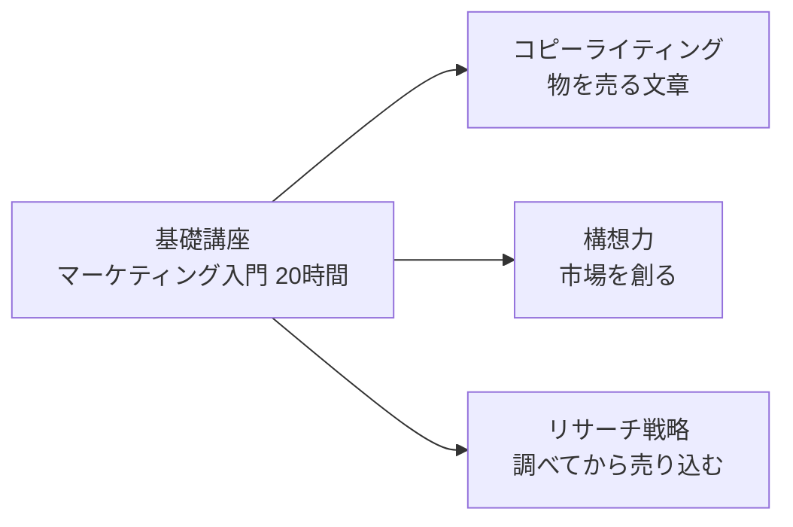

# マーケティング シリーズ構想（基礎講座＋3つの方向）

> 2026-10-31 ユーザー決定: マーケティングは方向性を分ける。①物を売るコピーライティング ②市場を創る構想力 ③リサーチからはじめて戦略的に売り込む。11月は**基礎講座**を作る。
> 基礎講座の章立ては [`marketing-course-curriculum.md`](marketing-course-curriculum.md)（8章・知識×経験の2軸・学生時代の場面・通し課題「青葉園」）。本書はシリーズ全体の設計。タスクは `.task-management/task.md` の T-30・T-48〜T-52。

---

## 1. シリーズの形

| コース | examId（仮） | 問い | 基礎講座のどこを深めるか | 時期 |
|---|---|---|---|---|
| 基礎講座 | `marketing` | マーケティングの言葉と考え方を一通り使えるか | — | 11月に本文、公開は審査結果の後 |
| ① 物を売るコピーライティング | `mk-copy` | この商品を、この相手に、文章で買ってもらえるか | 第3章（購買心理と文章の型）・第6章（チャネル） | 12月に設計・本文 |
| ② 市場を創る構想力 | `mk-concept` | まだない市場・使い方を、構想として描けるか | 第1章（顧客・価値）・第2章（STP）・第4章（4P） | 2027-01 |
| ③ リサーチからはじめて戦略的に売り込む | `mk-research` | 調べた事実から、誰に・何を・どう売るかを組み立てられるか | 第1章（リサーチ）・第2章・第7章（測って直す） | 2027-02 |

- どのコースも20時間（事前チェック0.5h＋章18h＋総復習1.5h）。章の型は基礎講座と同じく**実践→理論→振り返り**（まずやってみる → 名前をつける → 自分の答えを見直す）
- 基礎講座の各章の「この章のまとめ」に、深めるならどのコースかを1行で案内する。3つの方向のコースは、基礎講座を終えていることを前提にせず、事前チェックで基礎の章に戻れるようにする
- 筆者の失敗談（自分が欲しいものを紹介すれば売れると思っていた）は、基礎講座の第2章と、①コピーライティングの導入の両方に関係する。callout は筆者が書く

## 2. ① 物を売るコピーライティング（`mk-copy`）

**読者**: 商品説明・SNS投稿・LP・メールを書く担当になった人、個人で物を売っている人。**ゴール**: 1つの商品について、相手に合わせた文章を書き分け、反応で直せる。

| 章 | 内容（案） | 練習 |
|---|---|---|
| 1 | 売れる文章は「誰の、どの気持ち」から始まるか（ベネフィット、ターゲットの言葉、自分＝客の罠） | 同じ商品の説明を、3人の相手に向けて書き分ける |
| 2 | 購買心理のパターンを文章に入れる（社会的証明・希少性・返報性・権威・損失回避・アンカリング） | 心理を1つずつ足した文を比べる |
| 3 | 型で書く（AIDA・PASONA・QUEST・新PASONA）と、型が合わない場面 | 型ごとに告知文を書く |
| 4 | 見出し・キャッチコピー（ケープルズの見出しの型、数字、具体性） | 見出しを10本書いて3本に絞る |
| 5 | 媒体別の書き方（商品説明・SNS投稿・LP・メール・広告文の文字数と読まれ方） | 1つの訴求を5つの媒体に書き直す |
| 6 | 書いてはいけないこと（景品表示法の優良誤認・有利誤認、ステマ規制、薬機法の基本、不安の過剰な刺激） | 違反リスクのある文を直す |
| 7 | 反応で直す（A/Bテスト、クリック率・購入率、少ない数で判断しない） | 架空の結果から次の案を決める |
| 8 | 総合: 1つの商品のLPを1枚書き、AIにレビューさせて直す | LP＋直した前後の比較 |

- 一次情報: 消費者庁（景品表示法・ステマ規制）、厚生労働省（薬機法の広告規制）。法令は「2026年〇月時点」を付ける
- 検定との関係: 範囲の確認に使える資格を設計時に調べる（コピーライティング系の民間資格は乱立しているので、紹介は慎重に）

## 3. ② 市場を創る構想力（`mk-concept`）

**読者**: 新商品・新規事業の企画を任された人、今ある市場の取り合いから抜けたい人。**ゴール**: 「誰の、どの片付けたい用事を、どんな新しいやり方で解くか」を1枚の構想にでき、小さく試す計画を立てられる。

| 章 | 内容（案） | 練習 |
|---|---|---|
| 1 | 市場は「ある」ものか「創る」ものか（既存市場の取り合いと、使い方・場面の発明。カテゴリーをつくる） | 身近な商品が「新しい場面」を作った例を分解する |
| 2 | 片付けたい用事を見つける（ジョブ理論、無消費・不満、代わりに使われているもの） | 架空の行動記録から用事を3つ書き出す |
| 3 | 競争しない場所を描く（ブルー・オーシャンの戦略キャンバス、4つのアクション） | 戦略キャンバスを描き、減らす・取り除く要素を決める |
| 4 | 価値の約束を形にする（バリュー・プロポジション、ビジネスモデル・キャンバスの入門） | 構想を1枚のキャンバスにする |
| 5 | 広がり方を予測する（イノベーター理論・キャズム、最初の顧客を誰にするか） | 最初の100人を具体的に決める |
| 6 | 小さく試す（仮説・MVP・検証の指標、リーンスタートアップの入門） | 1週間でできる検証計画を作る |
| 7 | 構想を人に伝える（ストーリー、社内の企画書、反論への答え） | 構想を1分で説明する文を書く |
| 8 | 総合: 架空の会社の新しい市場の構想書を作り、AIを反対役にして詰める | 構想書＋反論と答えの一覧 |

- 理論の出典は書籍・論文（クリステンセン、キム＆モボルニュ、ムーア、オスターワルダー、リース）。本文は自作し、引用は短くする

## 4. ③ リサーチからはじめて戦略的に売り込む（`mk-research`）

**読者**: 「なんとなく」で施策を決めている担当者、上司に根拠を求められる人。**ゴール**: 調べる問いを立て、データとインタビューから戦略（誰に・何を・どう）を組み立て、測って直す計画まで1本につなげられる。

| 章 | 内容（案） | 練習 |
|---|---|---|
| 1 | 何を調べるかを決める（調査の目的・問い・仮説、調べなくてよいこと） | 曖昧な依頼を調査の問いに書き直す |
| 2 | 公開データを使う（官公庁統計・e-Stat・業界団体・検索データ、出典の書き方） | 公開データだけで市場規模を見積もる |
| 3 | アンケートを設計する（設問の偏り、サンプル、結果の読み方） | 偏った設問を直す |
| 4 | 人に聞く（インタビュー、N1、行動を聞く・意見を聞かない） | 架空のインタビュー記録から発見を3つ出す |
| 5 | 競合と自社を整理する（3C・SWOT を事実で埋める、ポジショニング） | 事実と推測を分けた3Cを書く |
| 6 | 戦略にする（STP、勝ち筋の選択、捨てるものを決める） | 1枚の戦略メモを書く |
| 7 | 売り込む計画にする（4P・チャネル・KPI ツリー、測り方を先に決める） | KPI ツリーと計測の計画を作る |
| 8 | 総合: 調査→戦略→実行計画を1本の提案書にまとめ、AIに根拠の弱い所を指摘させる | 提案書＋指摘と直しの記録 |

- 一次情報: e-Stat・各省庁の統計、GA4 デモアカウント。統計は取得日と表番号を書く
- 検定との関係: マーケティング・ビジネス実務検定（B級のリサーチ・戦略の範囲）、統計検定の入門、ウェブ解析士との関係を設計時に確かめる

## 5. 決まっていないこと

1. examId の付け方（`mk-copy` などの接頭辞でそろえるか）。`src/content/config.ts` の course enum に追加が要る
2. 3コースの通し課題を基礎講座の「青葉園」に続けるか、コースごとに変えるか（①は1つの商品で通せる。②は新規事業なので別の題材が合う可能性）
3. `/course/` の一覧でシリーズとしてまとめて見せるか（T-31 の文言の調整と一緒に決める）
4. 3つの方向の順番（今は ①→②→③。基礎講座の公開後の反応で入れ替えてよい）
