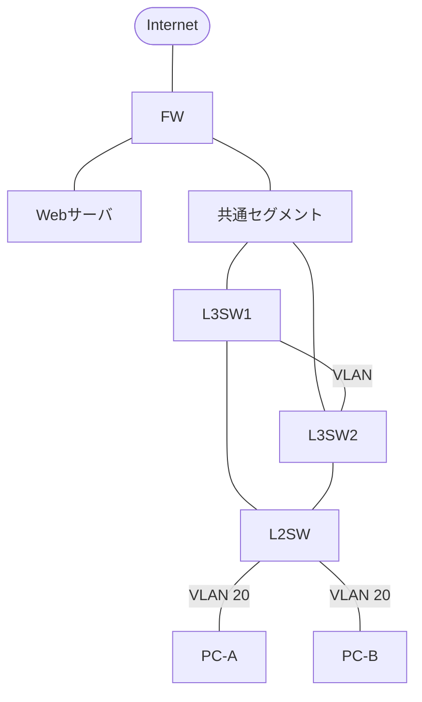

# AIの実行例：残りのプロンプト（強化12本）

対象: nw-mermaid-hack / ipa-2026-cbt-schedule-guide。各ブロックの下に、実行したAIと出力を貼る。画像（スクショ・手書き図の写真・生成された図）は同じフォルダに置き、ファイル名を書いておく。

> 反映（2026-11-02 CC）: ① → nw-mermaid-hack「手書きの図を、写真からMermaidに起こしてもらう」（参考図・手書きの写真を jpg にしてバンドルへ。Mermaid はサイトで描画するので mermaid-diagram.png は使っていない）。A-1免除 → ipa-2026-cbt-schedule-guide「別のモデルでもう一度実行した結果」（IPA の表と照合し全項目一致）。② ③、nw-mermaid-hack の「要件と照らし合わせる」プロンプト、ipa の追加プロンプトは未実行（マーカーのまま）

---

# nw-mermaid-hack ① 手書き図の写真 → Mermaid（記事の本題・最優先）

準備: NW試験の構成（VLAN・VRRP・L3スイッチ・FW など）を紙に手書きし、スマホで撮影。写真を添付して実行する。

```
添付の手書きのネットワーク図を読み取り、Mermaidの graph TD 形式で書いてください。

- 機器の接続関係を、図のとおりに再現する
- VLAN番号やVRRPの優先度など、メモに書いてある条件は、ラベルや注釈で残す
- 読み取れない部分や、接続が不明な部分は、推測せずに「不明」と書いて教えてください
```

## どのAIに実行させたか

出力内容

（できれば: 出力した Mermaid を表示した図のスクショ、手書き図の写真、読み取りの誤りがあればその箇所）

### ChatGPTで出力（図解の参考図）
```参考プロンプト
NW試験の構成でVLAN・VRRP・L3スイッチ・FW などの図解を手書きで練習したいので、例の図を出力してほしい。1枚でいい
```
これで生成された画像("C:\Users\sasis\Downloads\marmeid-sankouzu.png")をメモに手書きで書いて写真をとったもの("C:\Users\sasis\Downloads\tegaki-marmeid.HEIC")。
手書き画像をもとにChatGPTで出力テスト（GPT6.1Sol fast）。

これを画像にしたもの("C:\Users\sasis\Downloads\mermaid-diagram.png")。

---

# nw-mermaid-hack ② 文章の要件 → Mermaid（①ができない場合の代わり）

準備: 最後の行に、NW試験の過去問の要件の文（数行〜1段落）を貼る。出典（年度・期・問番号）をメモしておく。

```
以下のネットワーク要件を読み取り、Mermaidの graph TD 形式で構成図を作成してください。

各VLAN、L3スイッチ、FWの接続関係を明確にし、VRRPが適用されている箇所は注釈を入れてください。
要件に書かれていない接続は、足さないでください。

（問題文の要件定義）
```

## どのAIに実行させたか

出力内容

（使った過去問: 令和◯年度 ◯期 午後Ⅰ／Ⅱ 問◯）

---

# nw-mermaid-hack ③ 図ができたら、障害を想像させる（①か②の続きで、同じ会話に送る）

```
L3スイッチAが故障した場合、パケットはどう流れるか。図を更新して説明して
```

## どのAIに実行させたか

出力内容

---

# ipa-2026-cbt-schedule-guide 科目A-1（午前Ⅰ）免除の確認

受験歴は架空の例でよい（記事には「架空の受験歴で試した」と書く）。例を入れた版:

```
あなたはIPA情報処理技術者試験の制度に詳しいアドバイザーです。
私はネットワークスペシャリスト試験を受験予定です。
以下の受験歴で2026年度の科目A-1免除を受けられるか教えてください：
・応用情報技術者試験 令和6年度秋期 合格
・午前Ⅰ通過の実績はなし

また、免除を活用した場合の最適な学習スケジュールも提案してください。
```

## どのAIに実行させたか
ChatGPT GPT6.1 Sol fast

出力内容
```
**はい。令和6年度秋期の応用情報技術者試験に合格しているため、2026年度のネットワークスペシャリスト試験で科目A-1免除を申請できます。午前Ⅰ通過の実績は必要ありません。**

IPAは、2026年度前期の免除対象に「令和6年度秋期のAP合格者」を明記しています。応用情報合格と午前Ⅰ通過は、それぞれ独立した免除条件です。[IPA：2026年度の免除対象者](https://www.ipa.go.jp/shiken/2026/ap_koudo_sc_kikan.html)

| 確認項目 | あなたの場合 |
|---|---|
| 免除の根拠 | 令和6年度秋期の応用情報合格 |
| 午前Ⅰ通過実績 | 不要 |
| 免除期間 | 令和8年度後期試験まで |
| 申請に必要な番号 | 応用情報の**合格証書番号** |
| 免除される科目 | 科目A-1のみ |

免除は自動適用ではなく、**受験申込時に適正に申請する必要があります**。IPAのFAQにも、令和6年度秋期の合格による免除は令和8年度後期までと明記されています。[IPA：免除制度FAQ](https://www.ipa.go.jp/shiken/faq.html)

**学習計画は、現在の日付と受験手続の状況で分かれます。**

本日2026年11月2日時点では、2026年度前期NWの申込期間と科目Aの実施期間は終了しています。科目B-1・B-2の実施期間は**11月11日～23日**です。すでに免除申請と科目A-2受験を済ませている場合は、以下の直前計画が適しています。[IPA：申込・試験実施期間](https://www.ipa.go.jp/shiken/2026/ap_koudo_sc_kikan.html)

| 期間 | 学習内容 | 目安 |
|---|---|---|
| 11月2日～5日 | 過去問で弱点を特定。VLAN・STP・VRRP・経路制御を優先して復習 | 1日90～120分 |
| 11月6日～10日 | 科目Bの過去問を時間を測って解き、解答根拠を本文から探す練習 | 1日120分 |
| 11月11日～受験3日前 | B-1・B-2を本番の制限時間で演習。誤答した論点に絞って復習 | 休日に通し演習 |
| 受験前2日 | 間違いノートと構成図を確認。新しい問題は増やさない | 1日60分程度 |

これは私の提案ですが、**科目A-2を受験済みなら、残りの学習時間は科目B対策に集中**するのが効率的です。今取り組んでいる手書き図も、模写に加えて次を説明する練習にすると役立ちます。

- PCからサーバまで、どの機器・経路を通るか
- L3SWやリンクが故障すると、何が切り替わるか
- VLANを越える場所と、FWで通信を許可する場所はどこか

まだ2026年度NWに申し込んでいない場合は、今回の日程には新規申込みできません。その場合は次回NW向けの計画に切り替え、**令和6年度秋期AP合格による免除を次回も使えると見込まず、次年度の公式条件を確認する必要があります**。
```

（回答の免除条件は、Claude が IPA の公式ページと照らして確かめる。間違いがあれば、それも記事の材料になる）

---
