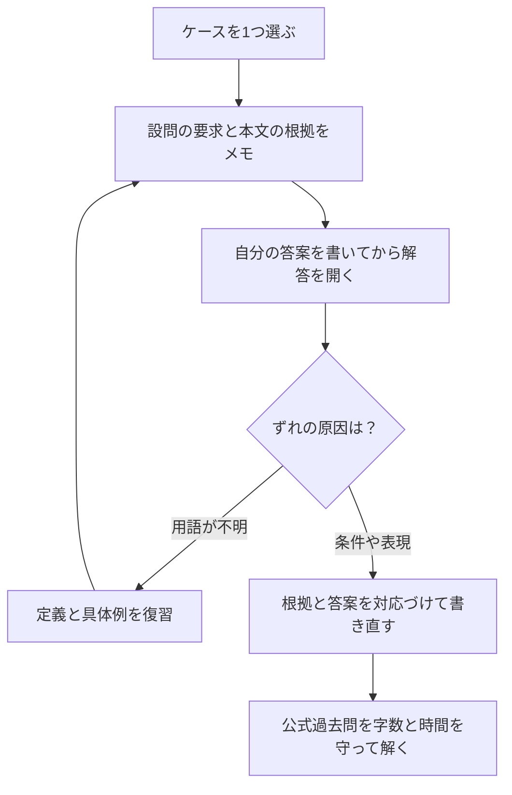

import SubjectBApp from '~/apps/ap-quiz/SubjectBApp';
import scenarios from '~/data/quiz/ap/subject-b.json';

科目Aの用語問題は解けるのに、科目Bでは何を書けばよいかわからない。そんなときは、長文を通して解く前に「設問の要求と本文の根拠を結ぶ」練習が役立ちます。

このページでは、ケースを選び、自分の答案を紙やメモに書いてから解答目安と比べます。答えの違いを分類し、次に用語を復習するか、読み方を練習するかを決められるようにします。

## この演習でできることと、本番との違い

本ツールはサイト内の学習用ケースを読み、考察ポイントごとに「答えを確認する」で解答目安・解説を開く形式です。答案入力、自動採点、制限時間、学習記録の保存はありません。公式過去問や本番CBTの再現ではありません。

2026年10月31日確認時点の応用情報科目Bは、150分の記述式で11問から5問を解答し、情報セキュリティは必須です。短いケースで読み方を練習したあと、公式問題で長文・字数制限・時間配分を確かめてください。[IPAの応用情報技術者試験](https://www.ipa.go.jp/shiken/kubun/ap.html)

2026年度はCBT方式です。前期の科目Bは2026年11月24日〜12月6日、後期は2027年3月3日〜3月15日の予定です。予約・受験条件は[IPAの実施期間案内](https://www.ipa.go.jp/shiken/2026/ap_koudo_sc_kikan.html)で確認してください（2026年10月時点）。

現行制度は2026年度で終了し、2027年度から新制度へ移る予定です。このツールを新試験の出題形式に対応した教材として使わないでください。[IPAの試験区分案内](https://www.ipa.go.jp/shiken/kubun/ap.html)

## ケーススタディ・ドリルの使い方

最初は「情報セキュリティ：標的型攻撃への対応」など、状況を想像できるケースを1つ選びます。設問を読み、「名称」「理由」「対策」のどれを求められているかをメモしてください。

次に本文から、答案の根拠になる条件を1つ抜き出します。たとえば、感染したPCからC&Cサーバへの通信を考える設問なら、「誰から誰への通信か」を先に整理します。プロトコルを本文だけで特定できないときは、推測と本文の事実を分けて書いてください。

答案を書き終えてから解答を開きます。表現の一致だけでなく、主体・対象・条件がそろっているかを確かめるのが練習の中心です。

<SubjectBApp client:visible scenarios={scenarios} examName="応用情報技術者試験" />

## 解答目安と違ったときの復習先

| 自分の答案の状態 | 原因の切り分け | 次にすること |
| --- | --- | --- |
| 用語の意味を説明できない | 知識不足 | 科目A教材で定義と具体例を確認する |
| 用語はわかるが、対象や通信方向が違う | 本文の条件の読み落とし | 根拠の一文と答案の対応を書き直す |
| 対策を聞かれて、用語名だけ書いた | 設問の要求とのずれ | 「誰に・何をするか」の形に直す |
| 要点は近いが、解答目安と表現が違う | 表現の違いの可能性 | 同じ条件を満たすか説明する。点数には換算しない |

このツールの解答目安も、唯一の正解や本番の採点基準ではありません。根拠が足りない設問では、答えを暗記せず、不足する前提を記録してください。

## 短いケースから公式過去問へ進む流れ

「設問の要求」「本文の根拠」「自分の答案」の3つを説明できたら、[IPAの過去問題](https://www.ipa.go.jp/shiken/mondai-kaiotu/index.html)に進みます。科目A全分野で8割を取るまで待つ必要はありません。過去問では解答例に加え、公開されている採点講評も読んで復習します。

用語が足りないとわかった場合は、[科目A対策シミュレーター](/app/ap-quiz/)で該当分野へ戻れます。

## AIに聞くなら、点数より根拠の照合を頼む

答案のどこがずれているかわからない場合は、[記述式のAIプロンプト集](/method/ap-pm-descriptive-ai-prompts/)を使い、本文のどの条件を読み落としたかを整理します。AIが出す点数を本番の得点とみなさず、指摘された根拠を自分でも本文で確かめてください。

---

## まとめ

科目Bケーススタディでは、解答を開く前に答案を書き、知識不足・条件の読み落とし・表現不足を分けて復習します。まず1ケースで根拠と答案を対応づけ、次に公式過去問で字数と時間の制約を加えてください。

筆者は応用情報を未受験です。試験全体の選び方は[応用情報・高度試験のハブ](/method/advanced-ipa-hub/)にまとめています。
