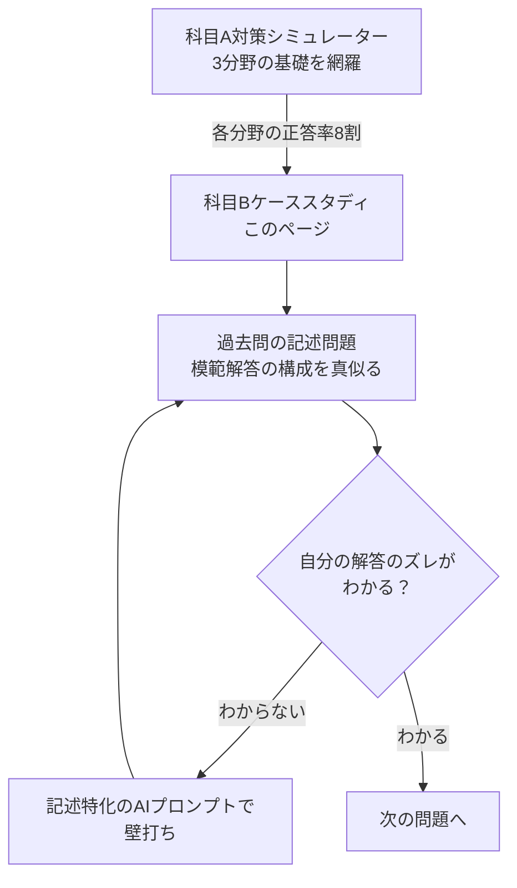

import SubjectBApp from '~/apps/ap-quiz/SubjectBApp';
import scenarios from '~/data/quiz/ap/subject-b.json';

## 科目B試験（旧 午後試験）の攻略戦略

科目B試験は、単純な知識の暗記だけでは通用しません。 <strong>「与えられたシナリオから何が課題かを見抜く力」</strong> と <strong>「知識を具体的事例に当てはめる応用力」</strong> が問われます。

### 試験の形式と日程（2026年度）

IPAの公式ページ（2026年10月25日確認）では、応用情報の科目Bは150分の記述式で、11問が出題され、5問を解答する形式です。現行の試験制度は2026年度で終了し、2027年度から新しい試験制度に移る予定とされています。

出典: [応用情報技術者試験｜IPA](https://www.ipa.go.jp/shiken/kubun/ap.html)

前期の科目Bの実施期間は2026年11月24日〜12月6日、後期は2027年3月3日〜3月15日です。（出典: [令和8年度 応用情報技術者試験、高度試験及び情報処理安全確保支援士試験の申込受付期間及び試験実施期間について｜IPA](https://www.ipa.go.jp/shiken/2026/ap_koudo_sc_kikan.html)）申込期間などの日程は、[応用情報・高度試験CBTの申込日程と試験期間](/trend/ipa-2026-cbt-schedule-guide/)にまとめています。新しい試験との関係は、[2027年からのIPA試験再編まとめ](/trend/ipa-2027-restructuring/)を参照してください。

### 学習のポイント

1.  <strong>知識の体系化</strong> : 科目Aで学んだ用語が、実際のシステム開発や経営判断でどのように使われるかを理解する。
2.  <strong>情報セキュリティの徹底</strong> : 全11問中、唯一の必須回答であるセキュリティを完璧に仕上げる。
3.  <strong>読解力の養成</strong> : 長文の中から解答のヒントとなる「条件」や「制約」を素早く抽出する。

---

## ケーススタディ・ドリル

本アプリでは、科目Bで頻出するテーマに基づいたケーススタディを提供します。

まずはシナリオをじっくり読み込み、設問に対して自分なりの答えを導き出してから、解答と解説を確認してください。

<SubjectBApp client:visible scenarios={scenarios} examName="応用情報技術者試験" />

---

## AIを活用した最新の学習法

科目Bのような記述式・長文読解問題の最大の壁は、<strong>「自分の解答が合っているか、どこが不足しているかが自己採点しづらい」</strong>という点です。

これを解決するために、当アプリのシナリオやご自身の解答をChatGPTやClaudeなどの生成AIに読み込ませて<strong>「専属の採点官」</strong>として活用するメソッドを推奨しています。

🔗 <strong>[応用情報・高度試験の「午後問題（記述式）」をAIで突破するプロンプト集](/method/ap-pm-descriptive-ai-prompts/)</strong>

こちらの記事では、AIから的確な添削やヒントを引き出すための「専用プロンプト（指示文）」を公開しています。本アプリでの演習とセットで使用することで、学習効率が飛躍的に向上します。

---

## 推奨される学習フロー

1.  <strong>[科目A対策シミュレーター](/app/ap-quiz/)</strong> で、テクノロジ・マネジメント・ストラテジの基礎知識を網羅する。
2.  各分野の正答率が8割を超えたら、本ページの <strong>科目Bケーススタディ</strong> で実践力を磨く。
3.  過去問の記述問題に取り組み、模範解答の「構成」を真似ることで、論理的なアウトプット能力を定着させる。
4.  自分の解答の「ズレ」がわからない場合は、<strong>[記述試験特化のAIプロンプト集](/method/ap-pm-descriptive-ai-prompts/)</strong>を用いてAIに壁打ちしてもらう。

---

> この記事は [IPA資格の高難易度対策｜応用情報・高度試験と2027年の新試験の選び方](/method/advanced-ipa-hub/) の一部です。
