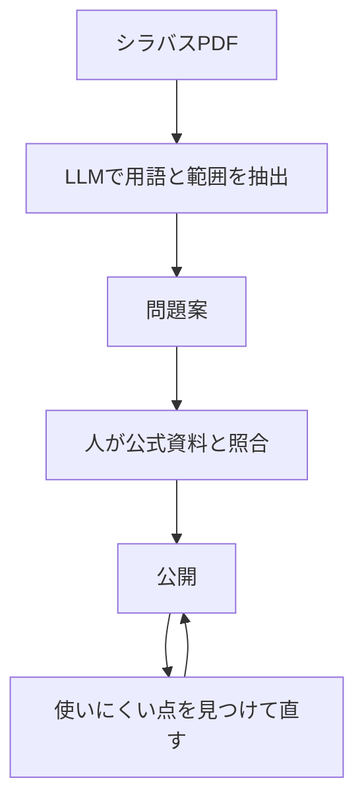

個人で学習アプリを作るとき、最初に決めるのは「何を作らないか」です。Syllabus Hackでは、ITパスポートのクイズから始め、応用情報の科目B、高度試験へと段階的に広げました。

この記事に開発の流れとMVPの判断基準をまとめています。

## 原点｜自分が欲しいツールを作る

欲しかったのは、「シラバスに忠実であること」と「最新のAIに対応していること」でした。既存のサイトでは、この2つを両立できなかったため、新しく作ることにしました。

## 開発の進め方｜MVPから段階的に広げる

最初からすべてを作らず、まずITパスポートのクイズから始め、次に応用情報の科目B、そして高度試験へと広げました。一度に作らず、<strong>MVP（最小限の機能の製品）</strong>から段階的に広げたのは、各段階で何を優先し、何を後回しにするかを決めやすくするためです。

MVPを切り分ける一般的な目安です。

| 条件 | MVPでの扱い |
| --- | --- |
| それがないと1問も解けない | 最初に入れる |
| あると便利だが、なくても解ける | 後回しにする |
| 元データの正しさを人が確かめられない | 公開する機能には入れない |

今も、アプリは試験ごとに追加しています。たとえば、次のアプリがあります。

- [ITパスポート クイズ](/app/it-passport-quiz/)
- [応用情報 科目A対策シミュレーター](/app/ap-quiz/)
- [応用情報 科目B ケーススタディ演習](/app/ap-subject-b/)

## 技術的な課題｜PDFシラバスとAIの使い方

IPAのシラバスは、形式が決まっていないPDFです。シラバスにあるのは基礎知識で、問題文はありません。課題は、そのPDFから、質の高い問題のセットをどう作るかでした。

GeminiなどのLLMを使ったデータの抽出、不自然な日本語を直すためのプロンプトの調整など、試行錯誤を重ねました。構造化と役割分担の考え方は [AIにサイト開発を任せる仕組み](/method/ai-driven-architecture-hack/) にまとめています。

## 使いやすさの改善｜小さな不快を消す

スマートフォンで学習していて、解説が長すぎて操作がストレスになることがあります。こうした小さな不快を一つずつ消していくことが、アプリの質を高めます。

- <strong>回答後のフィードバック</strong>：正解か不正解かの判定の直後に、スムーズに解説へ進めるようにした
- <strong>スクロール位置の自動調整</strong>：解説が長いと、回答後に情報が画面の外に流れてしまうため、回答ボタンを押したら、解説の位置へ自動でスクロールするようにした

## 開発環境と構成

サイト全体の技術構成と、AIに読ませるルールファイルの具体例も、[AIにサイト開発を任せる仕組み｜Syllabus Hackの技術構成とルール設計](/method/ai-driven-architecture-hack/)で確認できます。

## これから｜構想中の機能

次の2つは、構想の段階で、実装の約束ではありません。

- <strong>学習履歴にもとづく弱点の特定</strong>：どの分野でミスが多いかをAIが把握し、優先度の高い問題を重点的に出す
- <strong>実務やキャリアへの橋渡し</strong>：シラバスの知識が、実際の開発現場でどう使われるかを、事例で解説する

弱点を重点的に出す考え方のうち、間違えた問題ほど出やすくする仕組みは、[ITパスポートの分野別ドリル](/app/ip-field-drill/)で使えます。

## まとめ

知識を頭に入れるだけでなく、世の中の役に立つ形にすることは、私にとって大きな学びの場でした。この記事が、何かを作りたい人が最初の一歩を踏み出すきっかけになれば幸いです。
