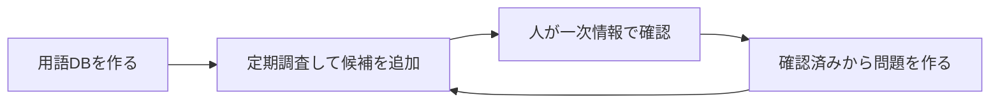

import QuizApp from '~/apps/genai-ethics-quiz/QuizApp';
import '~/apps/genai-ethics-quiz/quiz.css';
import questionsJson from '~/data/master/questions-genai-ethics.json';
import { transformRawQuestions } from '~/apps/genai-ethics-quiz/transformQuestions';
import TrendQuizApp from '~/apps/genai-trend-quiz/QuizApp';
import '~/apps/genai-trend-quiz/quiz.css';
import trendQuestions from '~/data/master/questions-genai.json';

export const allQuestions = transformRawQuestions(questionsJson);

## アプリについて

ITパスポート・基本情報を受ける人は用語編（20問・3分類）、用語は分かるが「なぜその技術を選ぶか」を説明できない人は実務ロジック編（25問）から始めてください。どちらも1回10問までの出題です。

ITパスポートに生成AIの項目が加わったのはVer.6.2（2023年8月公開、2024年4月の試験から）で、現行はVer.6.5です（2026年11月時点）。[IPAの改訂案内](https://www.ipa.go.jp/shiken/syllabus/henkou/2023/20230807.html)・[現行シラバス一覧](https://www.ipa.go.jp/shiken/syllabus/gaiyou.html)

| 受ける試験・困りごと | 最初に解くドリル |
| --- | --- |
| ITパスポート・基本情報で生成AIの用語を確かめたい | このページの用語編 |
| 用語は分かるが、技術を選ぶ理由を説明できない | このページの実務ロジック編 |
| 生成AIパスポートの範囲を練習したい | [生成AIパスポート 練習問題](/app/genai-passport-quiz/) |

用語の説明から読みたい人は、[ITパスポートの第7章 データとAI](/course/ip/07-data-ai/)へ進めます。

## 攻略のポイント

- <strong>仕組みからリスクまで</strong> : 大規模言語モデル（LLM）の基本構造だけでなく、ハルシネーションやプロンプトインジェクションといったリスク、著作権法などの法的側面の一部を確認。
- <strong>実務視点のキーワード</strong> : RAG（検索拡張生成）やHITL（Human-in-the-Loop）などを収録。RAGは現行のITパスポート（IP）・基本情報（FE）の用語例にはなく、2027年度のITパスポートのシラバス案Ver.0.1にあります（2026年11月時点）。[IP Ver.6.5](https://www.ipa.go.jp/shiken/syllabus/omgdg50000005kn1-att/syllabus_ip_ver6_5.pdf)・[FE Ver.9.2](https://www.ipa.go.jp/shiken/syllabus/omgdg50000005kpe-att/syllabus_fe_ver9_2.pdf)・[IP案Ver.0.1](https://www.ipa.go.jp/shiken/syllabus/minaoshi/rcu1hd000001ffp5-att/syllabus_ip_ver0_1.pdf)
- <strong>AI解説で深く理解</strong> : 全ての問題にAIによる詳細解説へのリンクを用意。単なる用語の暗記ではなく、背景にある技術的・倫理的意義を理解できます。

AI解説のリンクはGeminiを開きます。その場で生成される説明なので、ドリルの正解と公式資料に照らして確かめてください。用語例は例示であり、掲載の有無だけで出題の有無は決まりません。

<div class="not-prose">
  <QuizApp client:visible questions={allQuestions} examId="common" examName="生成AI・AI倫理特訓ドリル" />
</div>

## 高度試験向け：生成AIの実務ロジック編

高度試験では、用語を知っているかだけでなく、「なぜその技術を選ぶのか」が問われます。こちらは、情報処理安全確保支援士・ITストラテジスト・システムアーキテクトなど、高度試験の受験者向けの問題です。

- <strong>技術の使い分け</strong> : 新しい情報を参照させたいならRAG、出力の形式や専門分野の知識を定着させたいならファインチューニング、のように、選ぶ理由を問う
- <strong>リスクへの対策</strong> : ハルシネーションへのHITL（人による確認）、プロンプトインジェクションへのガードレールなど、守りの設計を問う
- <strong>ルールの枠組み</strong> : EU AI法や広島AIプロセスなど、リスクに応じて対応を変える考え方を問う

<div class="not-prose">
  <TrendQuizApp client:visible questions={trendQuestions} examId="common" examName="生成AIトレンド・ロジック演習ドリル" />
</div>

科目B（旧午後）の記述・論文では、選んだ理由を文章で説明する力が必要です。解説を読んだら、自分の言葉で書き直してみてください。高度試験の選び方は [IPA資格の高難易度対策](/method/advanced-ipa-hub/) で整理しています。

## 用語は変わり続ける｜クイズを最新に保つ仕組みの作り方

生成AIの用語は、新しく生まれては、使われなくなっていきます。固定の問題集は、できた時点から古くなっていきます。

だから、問題を作って終わりにせず、<strong>用語のデータベースを持ち、定期的に更新する</strong>仕組みにしておくと、長く使えます。自分で作ってみたい人のために、考え方を紹介します。

### 更新のしくみは4段階

1. <strong>用語データベースを作る</strong>: 用語ごとに、名前、定義、出典のURL、確認した日、状態（候補・確認済み・古い）を、JSONやスプレッドシートに記録する
2. <strong>定期的にウェブを調べる</strong>: ウェブ検索ができるAIに、最近話題になった新しい用語を集めさせ、「候補」として追加する
3. <strong>人が確認する</strong>: 出典の一次情報（公式の発表、IPAの資料など）で内容を確かめ、正しいものだけを「確認済み」にする
4. <strong>確認済みの用語から問題を作る</strong>: AIに問題と解説を作らせ、クイズのデータに加える。使われなくなった用語は、状態を「古い」に変える

AIが自動で本番のデータを書き換える形にはしないでください。AIは存在しない用語や古い説明を、もっともらしく答えることがあるので、3の人による確認を必ず挟みます。



調査の依頼は、たとえば次のようにします。

```text
この1か月で、生成AIの分野で話題になった新しい用語や技術を、5つ挙げてください。

- 用語の名前、定義、どんな場面で使われるかを書く
- 情報源（公式の発表や信頼できる記事）のURLを示す
- すでにデータベースにある用語と重なる場合は、重複として教えてください
- 断定できない情報は、「未確認」と書いてください
```

### 定期実行は「ループエンジニアリング」の入り口になる

ClaudeやChatGPTには、決めた時間にタスクを自動で実行する機能があります（使える画面・頻度・件数の上限はプランで変わります。2026年11月時点）。[OpenAIの案内](https://help.openai.com/en/articles/10291617-scheduled-tasks-in-chatgpt)・[Claude Coworkの案内](https://support.claude.com/en/articles/13854387-schedule-recurring-tasks-in-claude-cowork)

上の調査を、週に1回などの頻度で実行するようにしておくと、止めるまで繰り返し動く仕組みになります。

ただし、動かし続けるときは次を決めておきます。

- 実行の頻度と、1回の調査の件数の上限
- 結果の書き込み先は「候補」の欄だけにし、人が確認するまで本番には反映しない
- 止めるタイミング（試験が終わったら停止する、など）

最初は小さな範囲で試し、思ったとおりに動くかを確かめてから広げてください。

### 他の場面にも使える

「データベースを持ち、定期的に調べ、人が確認し、反映する」という形は、用語以外にも使えます。

- 受ける試験のシラバス改訂や、公式のお知らせを、定期的に確認する
- 法改正やルールの変更を追う（税制、宅建業法など）
- 志望する職種の求人票の条件を、毎週記録して、変化を見る
- 週ごとの学習記録を集めて、ふりかえりの材料にする

用語ノートの作り方は、[生成AI用語は参考書を買うより生成AIに聞く](/method/genai-vocabulary-learning-efficiency/)にまとめています。

## 解くときのポイント

1.  <strong>「ハルシネーション」などのリスクをまず把握</strong> : 生成AIの限界を知ることは、試験や実務のリスクを理解する助けになります。
2.  <strong>法的規制の動向をチェック</strong> : 日本の著作権法（30条の4）やEU AI法など、ルールの内容と適用される条件を確かめましょう。
3.  <strong>「ステップバイステップ」で考える</strong> : プロンプトエンジニアリングの基本（CoTなど）は、仕組みを理解すれば正解しやすくなります。
