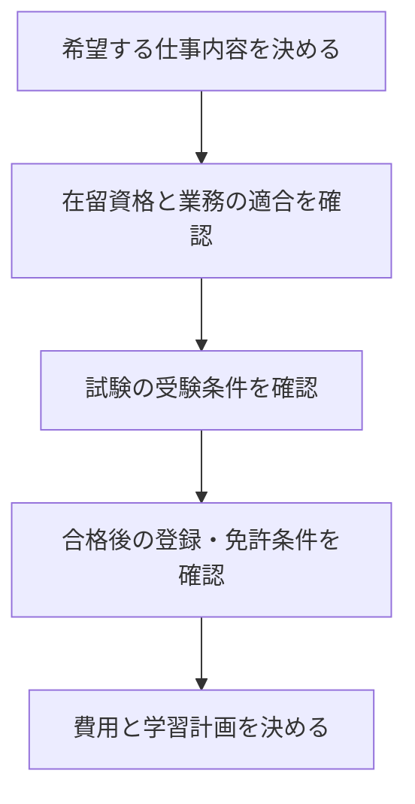

日本で働くために国家資格を取りたいとき、試験に合格すれば就職や在留の条件まで満たせるのかが気になります。

分かれ目は、受験の条件と、資格を仕事に使う条件を分けて調べられるかです。この記事では宅建・IT分野・介護を例に、募集要項と在留資格のどこを確認すべきかを整理します。

## 外国人の国家資格取得は3つの条件を別々に確認する

<strong>受験できること、登録できること、働けることは別の判断</strong>です。資格名だけでなく、希望する仕事内容まで決めてから確認します。

| 確認する段階 | 調べる内容 | 確認先 |
|---|---|---|
| 受験 | 国内居住、学歴、実務経験、本人確認書類など | 試験団体の当年度の受験案内 |
| 合格後の登録・免許 | 登録要件、実務経験、講習、交付手続き | 登録先の行政機関・資格団体 |
| 就労 | 現在の在留資格で、その業務に従事できるか | 出入国在留管理庁・雇用先 |

たとえば宅建は、日本国内に居住していれば年齢・学歴等を問わず受験できます。ただし、合格後の資格登録には別の条件があります。国籍だけを確認して「誰でもどこからでも受けられる」と判断しないでください。[不動産適正取引推進機構：試験の概要](https://www.retio.or.jp/exam/exam_detail/)（2026年10月時点）

この3段階を、次の順に絞り込むと、試験対策を始める前の確認漏れを減らせます。

## 在留資格は資格の名称ではなく仕事内容と照合する

就労できる範囲は在留資格により異なります。「永住者」「定住者」「日本人の配偶者等」「永住者の配偶者等」は、在留資格による就労活動の制限がありません。一方、「技術・人文知識・国際業務」などは、認められた活動の範囲との照合が必要です。[警視庁：日本で働くときのルール](https://www.keishicho.metro.tokyo.lg.jp/kurashi/anzen/live_in_tokyo/work_rule.html)（2026年10月確認）

| 自分の状態 | 資格選びの前にすること |
|---|---|
| 就労活動に制限のない在留資格がある | 求人の必須資格・登録要件と希望職種を比較する |
| 就労できる活動が限定されている | 職務内容を雇用先から具体的に聞き、在留資格の範囲と照合する |
| 留学中で卒業後に就職したい | 内定後の仕事内容と在留資格変更の要件を確認する |
| 在留資格や許可内容が分からない | 在留カードの表裏と許可内容を確認し、入管窓口に相談する |

留学中のアルバイトの許可を、そのまま卒業後の常勤就職にも使えると考えないことが大切です。留学生の就職時の在留資格変更は、[JASSOの日本留学情報サイト：在留資格](https://www.studyinjapan.go.jp/sc/work-in-japan/employment/status.html)でも案内されています。

次に、資格が在留資格の条件と関わるケースを見ます。

## IT告示の特例は、合格だけで働ける制度ではない

情報処理の技術・知識を要する仕事では、法務大臣が告示で定める試験・資格を持つ場合に、学歴・実務経験の基準の特例があります。ただし、雇用契約や業務内容など、在留資格の審査まで省略されるわけではありません。[出入国在留管理庁：技術・人文知識・国際業務](https://www.moj.go.jp/isa/applications/status/gijinkoku.html)

ここでは<strong>ITの国家資格であることと、告示の対象であることを同一視しない</strong>のが判断の要点です。受けたい試験の正式名称を、申請時点の対象一覧と照合してください。[出入国在留管理庁：外国人IT人材の在留資格と高度人材ポイント制](https://www.moj.go.jp/isa/applications/resources/nyuukokukanri06_00072.html)

- 学歴・実務経験の条件を満たすか迷う場合 → 先に特例の適用と対象試験を確認する
- すでに就労の要件を満たす場合 → 求人の仕事内容に合う知識・技能を学ぶために資格を選ぶ
- 試験名の変更や新試験への移行がある場合 → 旧試験との類似性だけで対象と判断せず、最新の告示を確認する

学習の入口としてのITパスポートと、在留資格のために必要な試験は、目的を分けて選びます。[ITパスポートの学習ガイド](/method/itp-hub/)は、IT用語の基礎を学ぶ必要がある場合の入口です。

## 介護福祉士も資格と雇用契約を組み合わせて考える

在留資格「介護」は、日本の公私の機関との契約に基づき、介護福祉士の資格を持つ人が介護または介護の指導を行う活動を対象としています。資格だけでなく、契約と従事する業務の確認が必要です。[出入国在留管理庁：在留資格「介護」](https://www.moj.go.jp/isa/applications/status/nursingcare.html)（2026年10月確認）

介護職を希望するなら受験・登録までの経路と雇用先を並行して確認します。希望がIT職なら、介護の在留資格につながるという理由だけで介護福祉士を選ぶのは、仕事内容との不一致になります。

## 永住を目指す場合も、資格取得と許可を分ける

高度人材ポイントを使った永住許可の在留期間の特例には、70点以上を3年以上、80点以上を1年以上継続して満たす場合などの条件があります。現在の点数だけでなく、過去の点数や継続在留の証明も必要です。[出入国在留管理庁：永住許可に関するガイドライン](https://www.moj.go.jp/isa/10_00279.html)（2026年10月1日改定版を確認）

資格1つで永住が決まるわけではありません。ポイント計算に入れる試験は、対象かどうかと証明書を確認し、その他の永住許可の条件も別に確認してください。

筆者は宅建・介護福祉士は未受験です。この記事は筆者の在留申請・受験体験ではなく、公式情報をもとにした確認手順の整理です。個別の申請可否は入管窓口や申請を扱う専門家に確認してください。

---

## まとめ

外国人が国家資格を選ぶときは、希望する仕事を決め、在留資格・受験条件・登録条件を分けて確認します。

最初の作業は、希望する求人を1件選び、「仕事内容」「必要資格」「登録の要否」を書き出すことです。その内容と公式の要件を照合してから、受験する資格を決められます。
