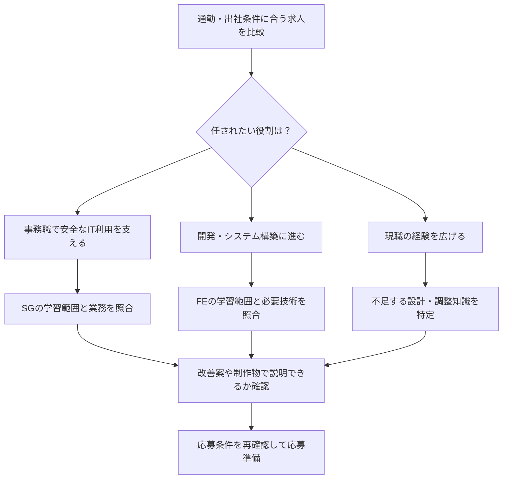

地元に残ってITの仕事に進みたいけれど、資格から始めるべきか、求人から探すべきか。地方での転職は、通勤できる範囲や出社条件も含めて考える必要があります。

資格選びの分かれ目は、地域の名前より、応募したい仕事で任される役割です。このページでは求人の読み方から学習ルートまでをつなぎ、今の仕事を続ける場合と職種を変える場合の次の一手を整理します。

## 地方IT転職は、通える範囲の求人を同じ軸で比べる

最初に「情報システム」「ITサポート」「開発」など、気になる仕事の求人を数件集めます。求人が少なければ地域を決め打ちせず、通勤可能圏や出社頻度の条件を一つずつ広げて比べます。

以下は調査用の項目です。求人件数や給与の実測結果ではありません。

| 求人で見る欄 | 記録する内容 | 資格選びへの影響 |
|---|---|---|
| 実際の仕事内容 | 問い合わせ対応、権限管理、開発、要件整理など | 学ぶ知識の領域を決める |
| 必須経験 | 未経験可か、担当年数や使用技術が必要か | 資格だけでは埋まらない差を見つける |
| 資格欄 | 必須・歓迎・記載なしのどれか | 応募条件と補助的な評価を分ける |
| 勤務条件 | 勤務地、転勤、出社頻度、夜間対応 | 続けられる仕事かを確認する |
| 賃金・手当 | 固定給、固定残業代、資格手当の適用条件 | 合格だけで増える金額と職務変更の効果を分ける |

「社内SE」のような職種名だけでは、任される仕事が十分に分からないことがあります。仕事内容の基礎をつかむには、厚生労働省の職業情報にある[システムエンジニア（基盤システム）](https://shigoto.mhlw.go.jp/User/Occupation/Detail/318)も参照できます。

次に、その求人の役割と学習内容が一致するかを見ます。

## 今の仕事と目指す役割から資格を選ぶ全体図

次の図は、資格を取れば転職できるという順番ではなく、求人の要件と自分の不足を確かめるための地図です。資格をすべて順に取る必要はありません。

SG（情報セキュリティマネジメント）は、組織の情報セキュリティ確保に必要な知識・技能を対象とします。事務部門での情報管理や利用者への周知を担いたい場合に、学習範囲を照合できます。[IPA：SGの対象者像](https://www.ipa.go.jp/shiken/kubun/sg.html)

FE（基本情報技術者）は、ITを作る人材に必要な基本的知識・技能などを対象とします。開発職を希望するなら、試験学習に加え、求人が求める言語・環境で説明できる制作物も検討します。[IPA：FEの対象者像](https://www.ipa.go.jp/shiken/kubun/fe.html)

## 条件ごとの学習ルートと、示せる材料

資格の優先順位は、次の条件で変えます。表の成果物は応募準備の提案であり、採用側が必ず評価するという保証ではありません。

| 条件 | 最初に選ぶ行動 | 応募・社内相談で示す材料 |
|---|---|---|
| 事務職を続け、情報管理も担当したい | SGの範囲を現業の困りごとと照合する | 架空の例で作った権限管理・周知の改善案 |
| 未経験可の開発求人に応募したい | 必須技術を確認し、FEの基礎と制作を並行する | 制作物、動かし方、設計理由、修正履歴 |
| 求人が実務経験を必須としている | 資格で代替可能かを採用窓口に確認する | 近い業務を担当した記録。代替不可なら別の入口を探す |
| 現職で運用経験があり、設計・調整へ進みたい | 希望業務と今の担当範囲の差を書き出す | 障害対応・改善の役割と判断を説明する資料 |
| 通える範囲に希望する役割の募集がない | 出社条件・勤務地・職種のどれを変えられるか決める | 変更できる条件と、譲れない条件の一覧 |

役割別の深掘りは、[バックオフィスでのSG活用](/career/backoffice-sg-career-hack/)、[現職エンジニアの学習とキャリア判断](/career/ses-ap-strategy/)へ進めます。地域ごとの賃金の見方は[地方の年収差と資格の使い方](/career/regional-salary-qualification-correlation/)で扱っています。

## 地域名だけで資格の価値や年収増を決めない

「製造業の地域ならSG」「都市部なら開発資格」と固定すると、同じ地域でも会社ごとに異なる担当業務を見落とします。地域の産業は求人を探す手がかりにし、受ける試験の決定は個別の求人要件まで確認してからにします。

資格手当も、求人や就業規則に支給条件が書かれていなければ、収入計画に含めません。取得時の一時金、毎月の手当、職務変更による昇給は別々に記録してください。

筆者は地方IT転職や各資格の受験体験を示すものとして本記事を書いていません。SG・応用情報技術者は未受験です。ここでの学習ルートは、公式の対象者像と求人を照合するための整理です。

---

## まとめ

地方での資格選びは、働ける範囲の求人を集め、役割・必須経験・資格の扱いを並べるところから始まります。

今日は気になる求人1件について、足りないのが知識・経験・勤務条件のどれかを分けてください。知識の差なら資格学習へ、経験の差なら担当業務や制作物の準備へ進む判断ができます。
