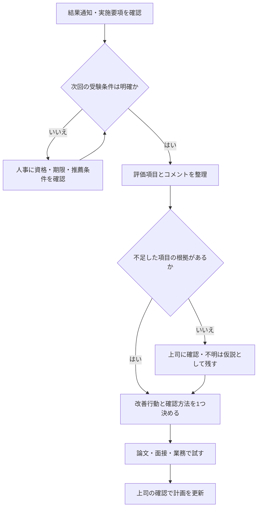

昇格試験に落ちると、次に受けられるのか、今回の評価がどう扱われるのかが気になります。しかし、対策を増やす前に確認したいのは、再受験の条件と、評価で不足した項目です。

この記事では、自社に聞くことと自分で振り返ることを分けます。「論文をもっと書く」といった漠然とした準備を、次回までに確かめられる行動へ変えるための整理です。

筆者自身の昇格試験の受験体験に基づく記事ではありません。以下の表と図は、制度確認と振り返りのための提案です。

## 落ちた後の扱いは、再受験条件と人事評価を別々に聞く

次回の受験可否や不合格の評価への反映は、会社の制度によって異なります。「多くの会社は現状維持」「半年後に再挑戦できる」といった一般論を、自社の約束として受け取らないでください。

確認先は、社内の昇格規程・試験実施要項・人事または上司です。通知を受けたら、次の項目を別々に確認します。

| 聞くこと | 質問例 | 分かるまで保留する判断 |
| --- | --- | --- |
| 再受験資格 | 次回も推薦が必要ですか。回数・待機期間の条件はありますか | 次回受験を前提にした予定 |
| 試験以外の条件 | 業績・在級年数・必須資格等に不足はありますか | 論文や面接だけで解決すると考えること |
| 評価への影響 | 今回の結果はどの評価項目に反映されますか | 降格・減給・配置転換等の自己判断 |
| 開示される情報 | 評価項目別の結果か、改善コメントを教えてもらえますか | 不合格理由の断定 |

口頭の説明は、確認できた事項と未確認事項に分けてメモします。同期と比較した推測は、改善計画の根拠にしないほうが整理しやすくなります。

## 再受験の準備は、条件確認から始める

次の図は、会社の制度を示すものではなく、確認漏れを防ぐための進め方です。



再受験の条件がまだ不明でも、面接で聞かれたことや提出した論文の振り返りは進められます。ただし、非公開問題の持ち出し・記録が禁止されている場合は、そのルールを守ってください。

次に、得られたコメントを具体的な改善へ置き換えます。

## 論文・面接・実績のどこを変えるか決める

「視座が低い」「具体性が足りない」だけでは、何を変えればよいか決まりません。評価項目、指摘の根拠、次の行動を1行で対応させます。

| 指摘または分かった条件 | 次に確認すること | 改善行動の例 |
| --- | --- | --- |
| 論文の具体性が不足 | どの主張に根拠が足りなかったか | 1つの提案に、現状・原因・施策・効果の根拠をそろえる |
| 面接で役割が伝わらない | チームの成果と自分の判断を分けて話せたか | 「自分が選んだ行動」と理由を説明する |
| 上位職の視点が不足 | 自社で上位職に求める判断は何か | 部署間調整、制約、リスク等を評価項目に沿って説明する |
| 業務実績等の要件が不足 | 次回までに何を満たす必要があるか | 上司と業務目標・確認日を決める |
| コメントが得られない | 公開された評価項目と回答にずれがあるか | 不足候補を仮説として1つ挙げ、上司に妥当性を聞く |

「管理職ならこう答えるはず」と理想像を作るより、自社の要件に合うかを確認することが優先です。インバスケットが選考にある場合は、[演習の振り返り方](/method/inbasket-taisaku-dokugaku/)も参考にできます。

## AIは、不合格理由の推定より回答の点検に使う

AIには選考の実際の採点や面接官の意図は分かりません。自社の評価項目に照らした説明漏れを探す補助として使います。

社内資料を入力してよいかを先に確認し、許可がない評価資料・顧客情報・非公開の試験問題を入れないでください。自分で作った匿名の練習文でも点検はできます。

### 論文の主張と根拠を対応させる

```text
以下は昇格試験に向けた練習文です。合否や点数は予測しないでください。
入力にない実績や数値を補わず、次の順で点検してください。

1. 主張と、それを支える本文の根拠を対応させる
2. 根拠がない主張は「確認が必要」と記す
3. 評価項目に対する説明漏れを示す
4. 書き直す前に、本人へ確認する質問を1つ返す

【入力が許可された評価項目】:
【匿名化した自作の練習文】:
```

<!-- AI_EXAMPLE: 使うAI=筆者が選ぶ対話AI / プロンプト=本文「論文の主張と根拠を対応させる」 / 見せたいこと=根拠不足の指摘と、実績を創作せず質問を返すか -->

### 面接では、追加質問に答える練習をする

```text
昇格面接の練習相手になってください。合格判定はしないでください。
「その成果の中で、あなた自身が判断したことは何ですか」と聞いてください。
私が答えたら、その回答の中にある曖昧な点を1つだけ質問してください。
入力にない成果・人数・金額は作らないでください。
最後に、話せた事実と、追加で確かめる必要がある事実を分けてください。
```

<!-- AI_EXAMPLE: 使うAI=筆者が選ぶ対話AI / プロンプト=本文「面接では、追加質問に答える練習をする」 / 見せたいこと=チームの成果と本人の判断を区別する対話 -->

AIに文章を整えてもらった後は、その内容を自分の事実として説明できるかを確認します。会社の評価に合うかは、上司・人事に確かめる必要があります。

---

## まとめ

昇格試験に落ちた後は、次回の受験条件と今回の評価を分けて確認します。そのうえで、根拠のある不足項目を1つ選び、改善行動と確認方法を決めてください。

次の一手は、人事・上司への確認メモを作ることです。条件がそろえば、準備を何から変えるべきかも絞れます。
