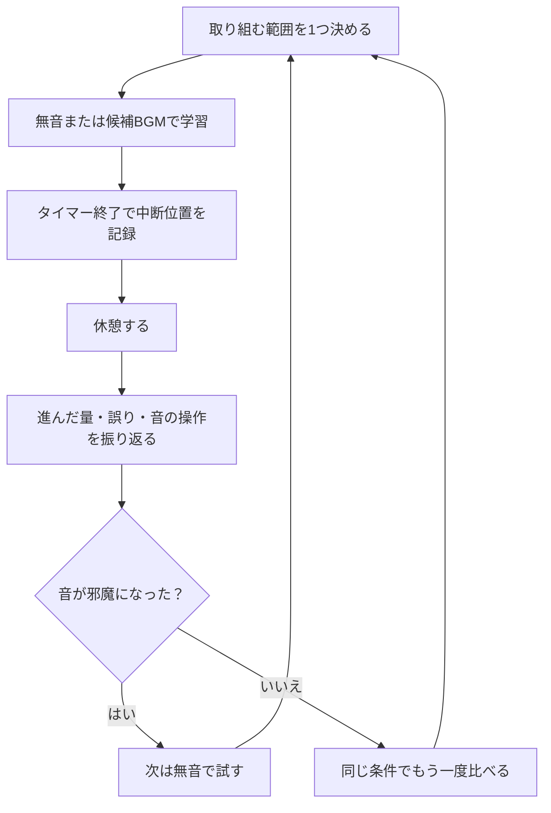

25分の学習を始めても、BGMの選曲や曲の切り替わりが気になり、問題集に戻れないことはないでしょうか。

AIを使うなら、「集中できる最適な音楽」を断定させるより、課題に合う音の条件を絞る使い方が考えられます。この記事では、無音とBGMを比べ、音楽を残すか、時間の区切りを変えるかを決める手順を紹介します。

## ポモドーロは集中力の限界を測るものではない

ポモドーロ・テクニックは、時間を区切るだけでなく、作業の計画・中断への対処・記録・振り返りを含む時間管理の方法です。考案者の案内も、単なるタイマー以上の仕組みとして説明しています。[Francesco Cirillo：Pomodoro Technique](https://www.pomodorotechnique.com/)

この記事では<strong>25分学習・5分休憩を試行の出発点</strong>にします。「誰でも30分で集中が切れる」「特定の周波数で必ず暗記が進む」といった前提は置きません。

タイマーは区切りの管理、BGMは学習環境の一要素、AIは条件整理の補助です。音楽を流すだけでAIが集中状態を測ったり、休憩を自動管理したりするわけではありません。

## 課題からBGMの条件を決める

次の表は効果を保証する一覧ではなく、最初に何を試すかを決めるための提案です。選曲に時間を使わないよう、候補は1つに絞ります。

| 学習する内容・状態 | 最初に試す条件 | 切り替える基準 |
|---|---|---|
| 英文や法律の文章を読む | まず無音で取り組む | 周囲の音が気になるなら歌詞なしを試す |
| 計算や短い確認問題を解く | 無音か、音量と曲調が変わりにくい音 | 音に合わせて手が止まるなら無音に戻す |
| TOEICなどの音声教材を聞く | BGMを重ねず教材音声だけにする | 聞き返しが必要なら再生位置を記録する |
| 曲名や次の曲を調べてしまう | 候補を固定し、再生画面を閉じる | それでも操作するなら音楽を止める |

AIには、好きなジャンルより先に、取り組む課題と避けたい音を伝えます。

## ChatGPTにはBGMの設計条件を整理させる

次は読者が実行するためのプロンプトです。回答や生成音源の実例ではありません。

```text
資格試験の民法の文章を25分読む予定です。
歌詞や突然の音量変化があると、読む手が止まります。
BGMを使う場合の条件を、次の3点に絞って提案してください。
・歌声や楽器の条件
・音量と曲の変化の条件
・音が気になったときに無音へ戻す基準
医学的な効果や集中力の向上は断定しないでください。
最後に、私が条件を説明し直すので、矛盾がないか確認してください。
```

<!-- AI_EXAMPLE: 使うAI=ChatGPT / プロンプト=本文「BGMの設計条件を整理させる」 / 見せたいこと=音楽の効果を断定せず条件を絞れるか、過剰な提案をどう修正するか -->

回答が「何Hzなら記憶力が上がる」といった断定に寄った場合は、その項目を選曲の根拠にしません。「効果の保証を外し、歌声・音量変化・長さだけに絞って」と修正します。

音楽生成サービスに条件を渡す場合も、生成後に実際の音を確認してください。条件を英語のタグにまとめると、次のような短い指示になります。

```text
Lo-fi Hip Hop style, 90 BPM, no vocals, focus study, deep focus
```

### Geminiで実行した結果

このプロンプトを、Gemini（無料プラン）にそのまま送りました（2026年10月）。Geminiは、チャットの中で音楽を作れます。

返ってきたのは、2分33秒の曲が1本です。指定どおりボーカルは入っておらず、チャット内のプレーヤーでそのまま再生できました。曲には「Paperback Under Lamp Light」というタイトルと、ジャケット画像まで付いていました。


英語のタグを並べただけのプロンプトでも、意図は伝わります。

ただし、1回で作れたのは2分半ほどです。25分を音楽だけで区切るには、10本ほど作ってつなげる必要があります。長さを指定できるかや、作った曲の使い方の決まりは、サービスごとに違うので確かめてください。

25分の曲を指定しても、長さや曲調がそのまま実現するとは限らないため、区切りの管理には独立したタイマーを使います。

> [!exp]
> ポモドーロは、私にとって「タスクをやりだすためのスイッチ」です。タイマーと連動して曲が流れるようにするのも、アプリ設計として重要だと思います。求めていることは人それぞれ違いますが、違うからこそアイデアになります。

次は、選んだ音が自分の学習を妨げていないかを確かめます。

## 無音とBGMを、学習の記録で比べる

同じ教材の近い難しさの範囲で、無音とBGMを別のセットに試します。順番や疲れの影響もあるため、1回の違いだけで効果があったと決めないでください。



| 記録欄 | 書く内容 | 次の判断に使う理由 |
|---|---|---|
| 範囲 | 問題番号やページ | 難しさの違いを見直せる |
| 進んだ量と誤り | 解いた数、誤り、説明できなかった語 | 作業量だけ増えていないかを見る |
| 中断 | 音量変更・選曲・通知を見た回数 | 音楽そのものが操作のきっかけかを見る |
| 再開位置 | 次に読む行・直す箇所 | 休憩後に探し直す手間を減らす |

この表は個人の運用を決めるための記録です。科学的な実験や、他の人にも当てはまる効果の証明にはなりません。

## 25分の区切りが合わない場合の調整

始めること自体が重ければ、まず短い1セットで着手できるかを試します。25分になる前に区切りやすい作業が終わるなら、次のセットに何をするかを記録します。

長文読解や設計の途中で中断位置を見失うなら、区切りの長さを見直す余地があります。本番形式の模試を解く日は、試験時間に合わせ、ポモドーロを優先しない選択もできます。

休憩では次の音源探しを始めず、席を離れるなど、学習からいったん切り替えます。時間調整とBGM変更を同時にすると違いを判断しにくいため、変える条件は1つにします。

---

## まとめ

AIにはBGMの条件を整理させ、使い続けるかは自分の学習記録で判断します。音楽の操作や読み直しが増えるなら無音に戻し、区切りが合わないなら時間を調整します。

最初の一手は、音源を増やすことより、次の25分で取り組む範囲と記録欄を決めることです。
