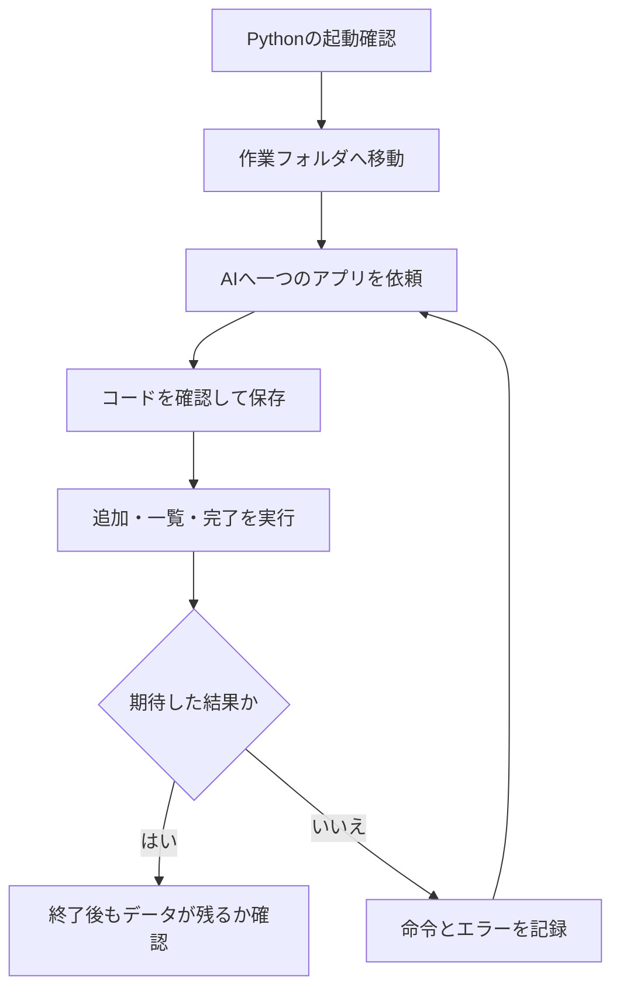

<!-- TARGET_KW: AI プログラミング 事前準備 Python 初心者 -->
<!-- READER: S4-知的好奇心-学習中 / 検索 ｜ コードを受け取っても実行できない人 -->
<!-- ANSWER: Pythonの起動・保存場所・動作確認の三つを順に確かめる -->
<!-- TAKEAWAY: OS別コマンド、エラーの切り分け、アプリの受入確認 -->

AIにコードを作ってもらったのに、どこへ保存して何を押せば動くのか分からない。最初にそろえたいのは、開発ツールの数よりも「どのファイルを、どこで動かすか」を確かめる手順です。

この記事では、外部ライブラリを使わないPythonのTODOアプリを題材に、準備から動作確認までをつなぎます。筆者が以前に実行した記録と、自分のパソコンで確かめる項目も分けて示します。

## 最初のアプリに必要なものを絞る

チャット型AIはコードを文章として返せますが、そのコードを実行する環境は別に必要です。この記事では、Pythonと作業用フォルダを用意し、ターミナルから実行します。

| 道具・用語 | 今回の役割 | 用意する判断 |
| --- | --- | --- |
| Python | コードを実行する | バージョンが表示されれば、まずその環境で進める |
| ターミナル | 文字で実行を指示する画面 | WindowsはPowerShell、Macはターミナルを使う |
| エディタ | コードをファイルへ保存する | メモ帳などで始めてよい。拡張子とUTF-8を確認する |
| 外部ライブラリ | 別途追加する部品 | 今回は使わない。インストール命令が出たら依頼条件を確認する |
| GitHub | コード共有や履歴管理のサービス | ローカルの練習だけなら、最初の起動には不要 |

まずは、Pythonを呼び出せるかから確認しましょう。

## WindowsとMacでPythonの起動を確かめる

2026年11月時点、CPython公式のWindows向け案内はPython install managerを紹介しています。入手先はpython.orgまたはMicrosoft Storeです。[Python公式・Windowsでの利用](https://docs.python.org/3/using/windows.html)

Mac向けにはpython.orgのインストーラが案内されています。既にPythonが入っている場合も、最初に使うコマンドを確かめてください。[Python公式・macOSでの利用](https://docs.python.org/3/using/mac.html)

| OS | 最初の確認 | 進める条件 |
| --- | --- | --- |
| Windows | `python --version`。動かなければ `py --version` | Pythonのバージョンが表示される |
| Mac | `python3 --version` | Pythonのバージョンが表示される |

ストアが開く、コマンドが見つからないなどの場合は、その表示とOSを控えて公式のトラブル対処を確認します。複数のPythonが入っている場合は、確認に使えたコマンドを以後も使ってください。

この段階でアプリのコードを直しても、Python自体を呼び出せない問題は解消しません。起動を確認できたら、次にファイルの場所をそろえます。

## ファイルの保存先とターミナルの場所をそろえる

作業用フォルダを一つ作り、ターミナルでそこへ移動します。下のパスは例なので、自分のフォルダの場所に置き換えてください。

```powershell
cd "C:\Users\your-name\Desktop\ai-practice"
Get-Location
dir
```

Macでは次のように確認します。

```sh
cd "$HOME/Desktop/ai-practice"
pwd
ls
```

`Get-Location`や`pwd`は現在のフォルダ、`dir`や`ls`はその中のファイルを確認する命令です。保存後に`todo.py`が一覧に出る状態を作ります。

Windowsで`todo.py.txt`になっていると、そのままでは`todo.py`として呼び出せません。保存時にファイルの種類と拡張子を確認し、文字コードはUTF-8にします。

準備から確認までの順番は、次のとおりです。



## 外部ライブラリ不要のTODOアプリを依頼する

次の依頼文は、後の実行記録に対応するものです。追加・一覧・完了とファイル保存に範囲を絞っています。

```
Pythonの初心者です。次のアプリを、Windowsのパソコンで動かせる形で作ってください。

**作りたいもの**
コマンドで使える、シンプルなTODOアプリ（追加・一覧・完了）

**条件**
- ファイルは todo.py の1つだけ。外部のライブラリは使わない
- データは、同じフォルダの todo.json に保存する
- コードの各部分に、初心者向けの短いコメントを付ける
- 最後に、実行するコマンドの例を示す
```

Macの人は、「Windowsのパソコン」を「Macのパソコン」に変えてください。

### 実際に試した結果

この依頼を、Claude Codeで実行しました。

AIは、`todo.py`というファイルを作り、次のように報告しました。

> `todo.py` は作成しましたが、動作確認はできていません。テスト用のコマンドが、実行の許可待ちでブロックされたためです。使う前に、下の例を一度実行して確かめてください。

このように、<strong>AIが「まだ動かしていません」と正直に伝えることがあります</strong>。

そうでなくても、動くかどうかを確かめるのは、自分の役目です。

作られたコードは、Windows 11・Python 3.12の環境で実行して確かめました。

AIが示したコマンドの例のとおりに、次のように動きました。

```
python todo.py add "牛乳を買う"
追加しました: [1] 牛乳を買う
python todo.py add "宿題をする"
追加しました: [2] 宿題をする
python todo.py list
1: [ ] 牛乳を買う
2: [ ] 宿題をする
python todo.py done 1
完了にしました: [1] 牛乳を買う
python todo.py list
1: [x] 牛乳を買う
2: [ ] 宿題をする
python todo.py done 9
番号 9 のタスクが見つかりません。
```

存在しない番号を指定したときも、エラーで止まらず、分かりやすいメッセージが表示されました。

データは、同じフォルダの`todo.json`に保存されます。


この記録はWindows 11・Python 3.12での結果です。別のAIが作るコードや別の環境で、同じ動作になることを保証するものではありません。

## 自分の環境では保存と例外まで確かめる

生成されたコードを読み、削除・外部送信・追加インストールなど、依頼していない処理がないか確認します。分からない処理は説明を求めてから、練習用フォルダに`todo.py`として保存してください。

Windowsで`python`が使える場合の入力例です。`py`で確認した場合は`python`を`py`に、Macは`python3`に置き換えます。

```sh
python todo.py add "テスト"
python todo.py list
python todo.py done 1
python todo.py list
```

上の命令は生成コードの仕様を確認してから使います。AIが異なるコマンド形式を提案した場合は、その説明に合わせて実行してください。

| 確認する条件 | 期待する動作 | 合わなければ |
| --- | --- | --- |
| タスクを追加して一覧を出す | 入力した文字が一件追加される | 実行した命令と実際の一覧を見比べる |
| 有効な番号を完了にする | 対象だけ完了になる | 番号と処理対象の対応を確認する |
| 存在しない番号を指定する | ほかのタスクを変えず、理由を表示する | 入力検証の修正を依頼する |
| コマンドを終了して、再び一覧を出す | 保存したデータを読み直せる | `todo.json`の場所と読込処理を確認する |

既存データを残したい場合は、改造前に`todo.py`と`todo.json`をコピーしておきます。動いた後の変更は「期限を一つ追加」など一回一機能に絞り、同じ確認を繰り返します。

<!-- LEARNER_NOTE: 候補=AIが動作未確認と伝えた後、自分で保存と一覧表示を確かめたときの気づき / 種類=think / 筆者の実体験で記入 -->

## エラーを直す前に、どの段階かを切り分ける

| 表示・状況 | 最初に確認すること |
| --- | --- |
| Pythonコマンドが見つからない | 導入とコマンド名。アプリのコードより前の問題 |
| `can't open file`などでファイルが見つからない | 現在のフォルダ、保存した場所、`todo.py.txt`になっていないか |
| `SyntaxError`など、コードの行番号が出る | コピー漏れ、インデント、エラーの指す行 |
| 起動するがデータが残らない | 保存ファイルの場所と、読み込みに使う場所 |

AIへは、伏せるべきユーザー名などを除き、OS・Pythonのバージョン・実行命令・エラー全文・該当コードを渡します。原因と確認方法を一つずつ説明してもらいましょう。

```text
PythonのTODOアプリで止まりました。まだ修正版コードは出さず、原因を切り分けてください。
OS：[記入]
Pythonの確認に使ったコマンドとバージョン：[記入]
現在のフォルダとファイル一覧：[個人情報を伏せて記入]
実行した命令：[記入]
エラー全文と該当コード：[貼り付け]
まず「実行環境・保存場所・コードの内容」のどこを確認するか説明し、
次に試す操作を一つだけ示してください。追加情報が必要なら質問してください。
```

<!-- AI_EXAMPLE: 使うAI=Claude / プロンプト=本文「エラーを直す前に、どの段階かを切り分ける」 / 見せたいこと=ファイルの場所が違う例で、コードの書換えより先に現在地を確かめる回答 -->

---

## まとめ

AIプログラミングの最初の準備は、Pythonが起動すること、ファイルの保存先が分かること、期待した動作と照合できることです。まずTODOを一件追加し、終了後にも保存内容を読めるか確認してください。

目的・入力・制約・検証をそろえて依頼する練習は、[生成AI実務練習コース](/course/ai-work/)でも扱います。
