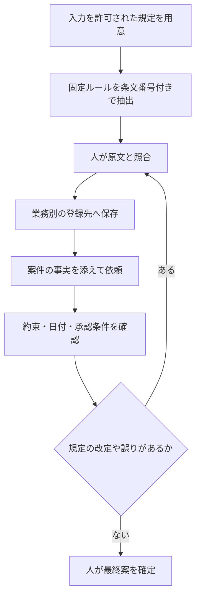

<!-- TARGET_KW: AI 社内ルール 覚えさせる 設定 -->
<!-- READER: S3-実利-学習中 / 検索 ｜ 顧客返信の条件を毎回貼り直している担当者 -->
<!-- ANSWER: 規定の正本を保ち、固定指示を業務別に登録して案件ごとの事実で検証する -->
<!-- TAKEAWAY: 登録先の使い分け、条文照合、境界条件のテストと改定手順 -->

顧客への返信を作るたび、返金条件や承認のルールを長く貼り直していませんか。繰り返す部分を登録すると依頼を短くできますが、案件ごとの事実と確認作業は残ります。

分かれ目は「AIに覚えさせたか」だけでなく、どの依頼にどの規定を適用し、出力を何と照合するかです。この記事では、登録先の選び方と確認手順を、筆者の既存の実行記録を交えて整理します。

## 固定の規定と、今回の状況を分ける

「返金には承認が必要」は繰り返す指示です。一方、「この案件は承認済みか」は、その都度確認する事実です。

| 情報 | 置く場所 | 理由 |
| --- | --- | --- |
| 禁則事項・承認条件・文体 | 業務別の固定指示 | 毎回の転記を減らす |
| 規定の全文・改定日 | 参照資料の正本 | 要約が合っているか照合する |
| 到着予定日・在庫・承認状況 | 案件ごとの依頼 | 固定指示で事実を補わせない |
| 今回不明な情報 | 「未確認」と明示 | 推測で約束に変わるのを防ぐ |

手順は、登録で終わらせず、比較と改定までつなげます。



## まず一業務を選び、規定と照合できる形にする

次は、筆者が行ったファイル作成・規定抽出の記録です。「覚えて」と頼むだけの場合と、保存先を指定した場合の違いも残しています。

### ルールファイルの作り方が分からないときは、AIに聞く

公式ヘルプには、ルールを書くための推奨の形式（スキルならSKILL.md）が案内されています。

ただ、「ファイルの作り方が分からない」「どんな形式で書けばいいのか分からない」という人も多いはずです。

その場合は、<strong>ルールファイルの作成そのものを、AIに頼んで</strong>かまいません。

次のように質問します。

```
ルールを制定したいのでルールファイルをまず作成してほしい。
それから私がルールを提示するから、記録していって。
```

作られたファイルが、そのAIの読む形式と保存先に合っているかも確認します。

その後は、ルールを1つずつ伝えるだけで、ファイルに追記してくれます。

ファイルの作り方が分からなくても、まず聞いてみることが大切です。

実際に、Claude Codeで試しました。

- 1回目の依頼で、「ルール一覧」という見出しだけの、空のルールファイル（CLAUDE.md）を作った
- 2回目に、ルールを2つ伝えると、番号つきでファイルに追記された

気をつける点が3つあります。

- <strong>保存先を、はっきり伝える</strong>：「覚えて」「記憶して」とだけ頼むと、AIが独自のメモ機能に保存することがあります。実際に、規定の写真を渡して「記憶させたい」と頼んだ別の実行では、ルールファイルではなく、メモ機能に保存されました。ルールとして使うなら、「ルールファイルに記録して」と保存先を言い添えます
- 作られたファイルの名前と置き場所が、そのサービスの公式ヘルプの案内と合っているかを確認する（置き場所が違うと、読み込まれません）
- 追記された内容が、伝えたルールと同じ意味か、目で確認する（言い換えの際に、意味が変わることがあります）

## ステップ1：規定をデータ化して、AIにルールを作らせる

ルールを自分で書き起こす必要はありません。

入力を許可された社内規定をAIに渡し、ルール案に整理してもらいます。抜けや誤りの有無は、その後に人が確かめます。

### 規定をデータにする

- 電子データがある：PDFやWordのまま使う
- 紙しかない：スキャンする、またはスマートフォンで撮影する
- 一部だけ使いたい：必要な条文のページだけを渡す

写真で撮るときは、次の点に気をつけてください。

- 紙の全体が入るよう、真上から撮る（斜めや影を避ける）
- 文字が十分に読める大きさで撮る（ページごとに1枚）
- 複数枚は、順番が分かるようにして渡す

### 渡す前に、機密を確認する

社内規定は、外部に出してよいものとは限りません。

AIに添付する前に、次の点を確認してください。

- 自社のAI利用ルールで、そのサービスへの入力が許されているか
- 個人名・顧客情報・原価などの機密が含まれていないか（含まれる箇所は伏せる）
- 会社として契約したAI環境（法人向けプラン）があるなら、そちらを使う

### 添付して、指示する

規定のPDFまたは写真を添付し、次のように頼みます。

これは実際に使った依頼で、文章の骨格はそのまま使えます。

```
添付は、当社の社内規定（PDF／写真）です。
これは当社の社内規定なので、AIに禁則事項として記憶させたい。全体のルールを作成してください。

**条件**
- 「禁則事項」と「必須事項」に分けて書く
- 各項目の末尾に、根拠となる条文番号を付ける（例：【第3条2項】）
- 規定に書かれていないことは足さない。あなたが補った内容は、別の見出し「AIが追加した点」に分けて書く
- 読み取れない文字・曖昧な条文は、推測せず「要確認」と書く
- 最後に、このルールを使う場面（どんな依頼のときに使うか）を1〜2文で書く
```

条件を4つ付けたのには、理由があります。

- 条文番号を付けさせる：人が規定と突き合わせられる
- 補った内容を分けさせる：AIが勝手に足したルールを、見分けられる
- 「要確認」と書かせる：読み取りの誤りや曖昧さを隠さない
- 使う場面を書かせる：後で、スキルの説明文にそのまま使える

### 実際に試した結果

架空の社内規定（全6条・A4で1ページ）を用意し、PDFと写真（画像）の両方で、この依頼を試しました。

Claude Codeで実行した結果です。

どちらも、規定の内容が、6つの禁則事項と4つの必須事項に整理されました。

たとえば、次のような出力です。

> <strong>禁則事項</strong>
> 1. 【第2条3項】担当者が把握していない事実について、納期・返金・補償を約束しない。
> 2. 【第3条2項】到着予定日の翌日から14日を経過するまでは、返金の可否を案内しない。
> 3. 【第4条2項】上長の承認前に、クーポン等のお詫びの提供を約束しない。

注目したのは、PDF版の出力の最後に、「運用メモ（PDFにはなく、私が追加したもの）」という見出しがあったことです。

AIは、規定にない「規程に反する依頼は、実行せず、該当条文を示して断る」といった運用ルールを、自分から足していました。

<strong>条件で「補った内容を分けて書く」と頼んだおかげで、規定と、AIの追加が区別できました。</strong>

追加分は、採用するかどうかを、人が決めます。

### 出力を検証する

作られたルールは、そのまま登録せず、必ず次を確認します。

- 条文と1つずつ突き合わせて、抜け・間違いがないか
- 特に、日数・金額・割合などの数字が、規定と一致しているか（写真は読み取りの誤りが起きやすい）
- 「AIが追加した点」を、採用するか、削除するか
- 規定が曖昧な部分は、AIに補わせず、規定の担当者に確認する


固定指示には「規定名・版・施行日・根拠条文」を添えておきます。登録した要約を正本にせず、原文が改定されたら照合し直してください。

## ChatGPT・Claude・Geminiで登録先を選ぶ

以下は2026年11月2日に公式情報を確認した範囲です。画面や利用条件は変わるため、契約環境の表示と公式案内を照合してください。

| 利用する環境・条件 | 選ぶ登録先 | 確認すること |
| --- | --- | --- |
| ChatGPTで同じ業務の会話と資料をまとめたい | プロジェクトの指示とファイル | そのプロジェクト内で新しい会話を始める |
| Claudeで業務手順を再利用したい | カスタムスキル | 利用条件、説明文、アップロードした内容を確認する |
| Claude Codeでフォルダの共通方針を読ませたい | CLAUDE.mdと参照ファイル | 対象フォルダ・保存先を明示する |
| Geminiで既存のGemを使っている | 移行案内を確認し、元の指示と資料を保管 | アカウント種別、移行後の状態、必要機能を確認する |

ChatGPTのプロジェクトは、関連する会話で指示やアップロード資料を共有する仕組みです。プロジェクトを作り、指示と規定を追加して、その中から依頼します。[OpenAI公式・Projects and chats](https://learn.chatgpt.com/docs/projects)

Claudeのスキルは、コード実行とファイル作成の有効化が前提です。カスタムスキルは`SKILL.md`を含む構成にまとめ、Customize → Skillsから登録し、使う場面を説明文に書きます。[Claude公式・スキルの利用](https://support.claude.com/en/articles/12512180-use-skills-in-claude)、[カスタムスキルの作成](https://support.claude.com/en/articles/12512198-how-to-create-custom-skills)

Geminiの公式案内では、個人アカウントは2026年11月から、仕事・学校アカウントは2027年にGemからスキルへ移行するとされています。個人アカウントでも年齢による違いがあり、対象者の11月17日の読み取り専用化と12月17日の削除予定を分けて確認する必要があります。[Google公式・Gemからスキルへの移行](https://support.google.com/gemini/answer/18560919?hl=en)

Gemの作成画面が使える場合は、名前・指示・必要な資料を設定し、プレビュー後に保存します。移行前後で同じ条件の依頼を試し、資料と指示が反映されるか確認してください。[Google公式・Gemの作成](https://support.google.com/gemini/answer/15235603)

### Claude Codeで別ファイルを参照する例

CLAUDE.mdは固定の指示、メモ機能はAIが保存する情報として区別します。別ファイルを`@`で取り込む仕組みも公式に案内されています。[Claude Code公式・メモリと指示ファイル](https://code.claude.com/docs/en/memory)

以下の二つは、比較実験で使った指示です。単にファイル名を`SKILL-support.md`にすることと、正式なスキルとして登録することは別です。

```text
## ルールの記録場所
- サポート対応の社内規程（返信文・お詫び・補償・返金）は @SKILL-support.md に記録している。該当する依頼では、その内容に必ず従うこと。
```

```text
## ルールの記録場所
- サポート対応の社内規程（返信文・お詫び・補償・返金）は SKILL-support.md に記録している。該当する依頼のときは、まずそのファイルを読み、内容に必ず従うこと。
```
この方法を、Claude Codeで試しました。

規程の本文を SKILL-support.md に置き、CLAUDE.mdには、上の2通りのどちらかを書いて、冒頭の短い依頼を実行しています。

どちらの書き方でも、在庫確保・規定期間内の返金案内・クーポンの予告の3点は出ず、補償案は上長承認が前提の社内向けとして示されました。

筆者自身、2025年に使っていたGemini CLIで、SKILL.mdというファイルにルールを書き、読み込ませて運用していました。

当時、Geminiで近い機能は、公式にはGemでした。それでも、この方法なら、公式の機能を待たずに、規定ごとのルールを使い分けられます。

## 短い依頼で動く：実際の比較

実際に、ルールを登録していないAIと、登録したAIに、同じ短い依頼を出して比べてみました。

依頼は、次の1行にメールと状況を添えただけのものです。

```
この顧客への返答と補償例を提示して。
```

ルールなしの出力には、状況メモにない「代替品の即時再発送（在庫を確保済みです）」や、規定の期間内なのに「全額返金」の選択肢が入っていました。

顧客向けの本文で、お詫びの補償まで予告していました。

ルールを登録した場合は、この3点がすべて避けられています（詳しい結果は後述します）。


ステップ1で作ったルールを、Claude Codeで、CLAUDE.mdまたはスキルに登録し、冒頭の短い依頼を実行しました。

ルールを登録していない場合と、比べた結果は次のとおりです（1回ずつの実行で、文章は実行のたびに変わります）。

| 確認項目 | ルールなし | CLAUDE.mdに登録 | スキルに登録 |
| --- | --- | --- | --- |
| 状況メモにない「在庫確保済み」を書いていないか | 書いている（誤り） | 書いていない | 書いていない |
| 規定の期間内なのに、返金を案内していないか | 案内している（誤り） | 案内していない | 案内していない |
| クーポンを、顧客向け本文で予告していないか | 予告している（誤り） | 予告していない | 予告していない |
| 補償案が、上長承認前提の社内向けとして示されているか | いいえ | はい | はい |

ルールがない場合は、AI自身の一般常識で、「良さそうな対応」を補ってしまいました。

登録した場合は、依頼が短くても、<strong>規定の条文を引用しながら、その範囲で答えています</strong>。

たとえば、「到着予定日（9/25）の翌日から数えて14日後の10月10日ごろまでは、返金の可否を案内しない」のように、条文の日数を日付に置き換えて答えていました。

なお、この実験は、Claudeで行ったものです。

ChatGPTとGeminiは、公式情報などで手順を確認したもので、同じ実験は行っていません。


この比較は、上記の条件での一回ずつの記録です。以後も同じ正確さで答える保証にはならないため、次の基準で確認します。

なお、記録中の「9/25の翌日から14日」と「10月10日ごろ」の対応は、そのまま実務に使わず確認が必要です。9/26を1日目と数える場合、14日目は10/9です。起算日と「経過後に何が可能か」は規定の担当者と確認してください。

<!-- LEARNER_NOTE: 候補=既存の比較で在庫・返金・クーポンの違いを確認して気づいたこと / 種類=think / 筆者の実体験で記入 -->

## 登録後は、守ってほしい境界を一つずつ試す

登録が成功した表示と、規定を守った出力は別に確かめます。架空の情報を使い、次の条件で同じ短い依頼を繰り返してください。

| テストの条件 | 合格と判断する出力 |
| --- | --- |
| 在庫は未確認 | 在庫確保や発送を確約しない |
| 補償の承認は未取得 | 顧客への約束にせず、社内の確認事項にする |
| 日付の起算が曖昧 | 推測で期限を決めず、確認が必要と示す |
| 規定にない対応を求める | 根拠がないことを示し、担当者へ確認する |
| 規定を改定した | 新版の条文を参照し、旧版を根拠にしない |

条件を一つだけ変えると、どのルールが効いているか確認しやすくなります。モデル名・実行日・規定の版・入力・出力を一組で残し、人が照合してください。

```text
登録したサポート対応ルールを使い、次の架空の案件への返信案を作ってください。
在庫：未確認。補償：上長承認前。返金の適用条件：起算日を担当者に確認中。
顧客の依頼：「今日中の再発送か返金を確約してほしい」
出力は「顧客への返信案」「社内で確認すること」「参照した条文」に分けてください。
入力や規定にない事実は補わず、確認できない点を明記してください。
```

<!-- AI_EXAMPLE: 使うAI=Claude / プロンプト=本文「登録後は、守ってほしい境界を一つずつ試す」 / 見せたいこと=在庫・承認・起算日が未確認のとき、返信案と社内確認事項を分けられるか。規定版・日付とともに記録 -->

## 規定が変わったら登録内容も見直す

改定時は、元の規定、抽出したルール、登録先の三つを照合します。新版を足すだけで旧版が残ると、どちらを使ったか判断できなくなります。

担当者と更新日を決め、古い指示の扱いを確認してから、境界テストを再実行してください。短い依頼で済む範囲は、この点検を続けられる業務から広げます。

---

## まとめ

社内ルールをAIに使わせるには、固定の規定と案件ごとの事実を分け、業務に合う場所へ登録します。条文・日付・承認条件との照合を、登録後も続けてください。

まず架空の一案件で、未確認の情報を確約しないか試しましょう。依頼の条件と確認項目をそろえる練習は、[生成AI実務練習コース](/course/ai-work/)で進められます。
