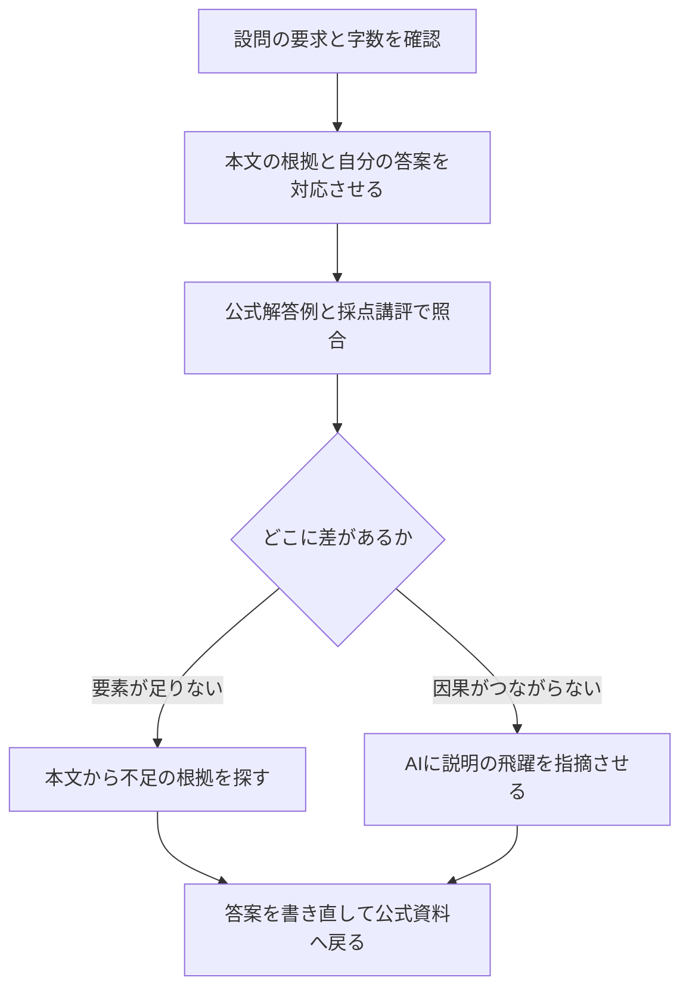

応用情報技術者試験の午後で、「自己採点では取れていたはずなのに、点数が伸びなかった」という経験はないでしょうか。

記述式の採点がブラックボックスに感じられるのは、採点の細かい基準が公開されていないからだけではありません。<strong>記述式は、答えの形がひとつではない</strong>からです。

分かれ目は、正しい言葉を書けたかどうかよりも、<strong>正解の要素を含めて、それを論理的に説明できているかどうか</strong>にあります。

この記事では、記述式の答えがなぜ揺れるのかを整理したうえで、点につながる答案の条件と、生成AIとの壁打ちで論理的に説明する力を鍛える方法を紹介します。応用情報に限らず、記述式のある試験に共通する考え方です。

## 記述式は、答えの形がひとつではない

選択式の問題には、正解の選択肢がひとつあります。けれど記述式では、同じ内容を言い表す書き方がいくつもあります。

たとえば「この対策を行う目的を答えよ」という設問なら、「不正アクセスを防ぐため」と書く人もいれば、「認証を強化して、なりすましによる侵入を防ぐため」と書く人もいます。どちらも、言いたいことの芯は同じです。

### 学習テキストの解答例も揺れる

答えの形がひとつではないので、市販の問題集や学習テキストでも、同じ問題の解答例が本によって少しずつ違うことがあります。IPAが公開している解答例も、「この書き方でなければ×」という唯一の正解ではなく、答え方の一例と考えたほうが実態に近いです。

ここで「どの解答例が正しいのか」を探し始めると、勉強は迷子になります。見るべきは、解答例の言い回しではなく、<strong>どの解答例にも共通して入っている要素</strong>です。

では、点につながる答案には何が必要なのでしょうか。

## 点につながる答案の2つの条件

### 正解の要素が含まれている

記述式の答案は、設問が求めている要素がいくつか含まれていることが前提です。

たとえば「目的」を聞かれているなら、「何を」「何から守るのか」「どうやって」といった要素が入っているかどうかです。要素が欠けていると、文章がきれいでも点になりにくくなります。

複数の解答例を見比べると、言い回しが違っても、必ず入っている要素が見えてきます。それが、その設問の「正解の要素」です。

### 要素どうしが論理でつながっている

もう1つの条件は、要素どうしが論理でつながっていることです。

「なぜそう言えるのか」が、問題文の状況から自然にたどれる答案は、読み手に伝わります。逆に、問題文に書かれていない前提を持ち込んだり、途中の説明を飛ばして結論だけを書いたりすると、言いたいことが伝わらず×になりやすくなります。

| 答案の書き方 | 評価されやすさ |
|---|---|
| 問題文の状況を根拠に、要素を順に説明している | 伝わりやすい |
| 要素は入っているが、つながりが説明されていない | 部分的にしか伝わらない |
| 問題文にない前提から、いきなり結論を書いている | 飛躍していて×になりやすい |
| 関連しそうな専門用語を並べただけ | 何を言いたいのかが伝わらない |

専門用語をたくさん書けば点になる、と考える人もいますが、用語を並べただけでは論理になりません。大事なのは、用語を使って、問題文の状況と答えをつなぐことです。

では、論理的に説明する力は、どうすれば鍛えられるのでしょうか。

## 解答例と採点講評で、正解の要素を確かめる

IPAは、過去の応用情報技術者試験の午後問題について、解答例と採点講評を公開しています。[IPAの過去問題・解答例・採点講評](https://www.ipa.go.jp/shiken/mondai-kaiotu/index.html)採点講評には、受験者の答案によく見られた誤りや、正答率が低かった設問の傾向が書かれています。

過去問を解いたら、次の順で答え合わせをします。

1. 自分の答案と解答例を見比べ、<strong>入っている要素と足りない要素</strong>を書き出す
2. 採点講評を読み、その設問で多くの受験者がどう間違えたかを確かめる
3. 足りなかった要素を入れて、答案を書き直す

言い回しが違うだけなら、すぐに誤答と決めず、対象・条件・因果関係を見比べます。要素がそろったという自己判断だけで、得点を確定することはできません。



<!-- LEARNER_NOTE: 候補=学習開始後に解答例と自分の表現の差で迷った箇所 / 種類=question / 筆者の実体験で記入。現時点は学習予定のため実施後のみ -->

ただ、要素の過不足は自分でも確かめられますが、「論理がつながっているか」は、自分で書いた文章だと判断しにくいものです。そこで役に立つのが、生成AIとの壁打ちです。

## AIとの壁打ちで、論理的に説明する力を鍛える

記述式が苦手な人ほど、生成AIを相手に説明の練習をするのがおすすめです。

### AIが理解しやすい文章は、人にも伝わる

AIは、文章に書かれていることだけを手がかりに内容を読み取ります。前提が抜けていたり、説明が飛躍していたりすると、AIはその部分を誤解したり、確認の質問を返してきたりします。

AIが理解したように答えても、書いていない前提を補っている場合があります。AIには本文の根拠と答案の対応を示させ、補われた前提がないかを自分で確認します。人に伝わる説明の練習には使えますが、採点者の判断を再現するものではありません。

### 答案の論理を点検してもらう

過去問の答案を書いたら、AIに論理の点検を頼みます。

```text
応用情報技術者試験の午後問題の記述式答案を練習しています。
問題文の要約、設問、私の答案を貼ります。

次の観点で点検してください。
1. 設問が求めている**要素**のうち、入っているものと足りないもの
2. 問題文の状況から答えまでの**論理のつながり**に、飛躍がないか
3. 問題文に書かれていない前提を持ち込んでいないか

言い回しを整える前に、まず論理の穴を指摘してください。
```

<!-- AI_EXAMPLE: 使うAI=ChatGPT / プロンプト=本文「答案の論理を点検してもらう」 / 見せたいこと=本文にある根拠とAIが補った前提を分け、公式解答例との照合で指摘を採否判断する -->

| 点検で見つかった差 | 直す順番 |
| --- | --- |
| 設問が「理由」なのに対策だけ書いた | まず答える対象を合わせる |
| 対象は合うが本文に根拠がない | 使った前提を本文で確認し、ない前提を外す |
| 根拠はあるが解答例と表現だけ違う | 意味と字数を確認し、言い換えだけの修正を急がない |

### 自分の言葉で説明し、質問してもらう

答案を書く前の段階でも、壁打ちは使えます。設問の答えを、まずAIに口頭で説明するつもりで書いてみます。

```text
これから、ある設問の答えを私なりに説明します。
あなたは、ITの知識はあるが、この問題文を読んでいない人だと思って聞いてください。

説明を読んで、
- 意味がわからなかった部分
- 「なぜそう言えるのか」が説明されていない部分
を、質問の形で1つずつ返してください。
```

AIから質問が返ってきた部分が、説明が飛んでいる部分です。その質問に答える形で書き足していくと、答案の論理が自然とつながっていきます。

この練習は、試験のためだけのものではありません。仕事で報告書を書くときや、人に何かを説明するときにも、そのまま役に立ちます。

なお、AIの指摘も完璧ではありません。用語の定義や技術的な内容で迷ったら、解答例やシラバスに戻って確かめてください。

---

## まとめ

応用情報の記述式で点が取れないのは、答えの形がひとつではなく、何を書けば正解なのかが見えにくいからです。

- 記述式の答えは、言い回しがひとつではない。学習テキストの解答例も揺れやすい
- 点につながる答案は、正解の要素が含まれていて、それが論理でつながっている
- 問題文にない前提や、飛躍した説明は×になりやすい
- 解答例と採点講評で、正解の要素を確かめる
- AIとの壁打ちは論理の穴を探す補助。指摘を本文と公式解答例に照らして確かめる

これで、記述式の答案を書いたときに、どこを直せば点につながるのかを自分で判断できるはずです。

2026年11月時点の現行試験は科目A・科目Bの構成です。本文の「午後」は公開過去問の記述式を指し、受験時の形式は[IPAの試験概要](https://www.ipa.go.jp/shiken/kubun/ap.html)で確認してください。

応用情報の試験全体の進め方は、[IPA資格の高難易度対策｜応用情報・高度試験と2027年の新試験の選び方](/method/advanced-ipa-hub/)にまとめています。午後で選ぶ分野の決め方は、[応用情報の捨て問戦略](/method/ap-discard-strategy/)も参考にしてください。
