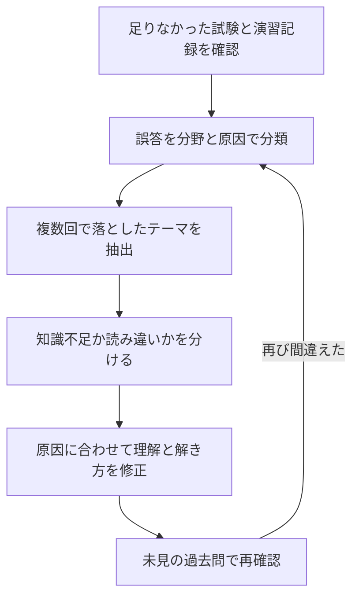

応用情報技術者試験（AP）で、自己採点をして「あと数点で基準点に届かなかった」と分かったとき、何を直せばよいのか分からなくなりませんか。

こういうときに、解答の書き方や採点のくせを探しても、点は増えにくいものです。試験中にAIを使えるわけではないので、<strong>試験の日に自分の力で取れる問題を増やす</strong>必要があります。

分かれ目は、5点が実際に何問ぶんなのかを数え、<strong>落としている問題が特定の分野に偏っていないか</strong>を確かめることです。

この記事では、5点を問題数に直す方法から、苦手分野の洗い出し、点を補う順番までを整理します。読み終えたときに、次の試験までに何を何問ぶん取り戻せばよいかを、自分の言葉で言える状態にします。

## まず、5点が何問ぶんかを数える

2026年11月時点のAPは科目A・科目Bそれぞれで基準点を満たす必要があります。この記事の「午前・午後」は旧形式の過去問での呼び方で、現行の形式は[IPAの試験概要](https://www.ipa.go.jp/shiken/kubun/ap.html)で確認してください。

どちらか一方が足りないだけでも、不合格になります。

どちらが足りなかったかで、取り戻す点の数え方が変わります。

| 足りなかった試験 | 5点の目安 |
| --- | --- |
| 午前の公開過去問での練習 | 80問を100点換算すると1問1.25点。5点は4問ぶんの学習目安 |
| 午後の記述式での練習 | 小問の自己採点から5点を確定できない。設問の読み違い・根拠の欠落を分類する |

公開過去問の100点換算なら、5点は4問ぶんです。これは復習量を決める目安であり、本番の得点を保証する換算ではありません。

まず<strong>知っていたのに落とした問題</strong>を探します。

午後は、記述の一部を足す形で点が動きます。まずは午前の取り戻し方を整理し、午後は後で扱います。

試験の配点や形式は、試験制度の変更で変わることがあります。次に受ける回の案内で確認してください。

## 落とした問題が、どの分野に偏っているかを調べる

4問を取り戻すには、<strong>どの分野で落としているか</strong>を知る必要があります。

午前の問題は、大きく3つの分野に分かれます。

- ストラテジ系：経営戦略や法務など
- マネジメント系：プロジェクト管理やサービスマネジメントなど
- テクノロジ系：ネットワーク、セキュリティ、データベース、アルゴリズムなど

分野ごとの課題は、試験結果だけから推測せず、自分の演習記録で確かめます。そこで、<strong>過去問を自分で解いて、分野別に正答率を出します</strong>。

1. 過去問を直近の数回ぶん解く
2. 間違えた問題を、3つの分野に振り分ける
3. 分野ごとの正答率を出し、いちばん低い分野を見つける

得意だと思っていた分野で、意外に落としているのは、よくあることです。



<!-- LEARNER_NOTE: 候補=学習開始後に誤答を分類して気づいた読み違い / 種類=think / 筆者の実体験で記入。受験結果への感想は不可 -->

## 苦手分野の中で、頻出のテーマから潰す

苦手な分野が見つかったら、その分野を最初から全部勉強し直す必要はありません。

<strong>よく出るテーマで、自分が落としているもの</strong>を優先します。ここでAIが役に立ちます。

```text
応用情報技術者試験の午前問題について、直近の過去問の
間違えた問題を貼り付けます。

【間違えた問題と、私の答え】
（ここに貼り付ける）

次の3つをしてください。
1. 間違えた問題を、テーマごとにグループ分けする
2. 同じテーマが複数回出ているものを、多い順に並べる
3. 上位3テーマについて、なぜ間違えやすいのかを説明する
```

<!-- AI_EXAMPLE: 使うAI=ChatGPT / プロンプト=本文「直近の過去問の間違えた問題」 / 見せたいこと=入力した誤答の範囲だけで重複テーマを抽出し、全出題の頻出傾向と混同しないか -->

この分類で分かるのは、貼り付けた誤答の中で繰り返したテーマです。試験全体での出題頻度とは分けて扱います。

AIの分類や説明には誤りが混ざることがあります。用語の意味はシラバスや公式の解説で確かめてください。

テーマが絞れたら、次の順で学習します。

1. 用語の意味を理解する（暗記せず、「なぜその仕組みがあるのか」を確かめる）
2. 過去問で、同じテーマの問題をまとめて解く
3. 間違えた理由を記録して、パターンを見つける

記録の取り方は、[資格の間違いノートをAIで分析する方法](/method/miss-note-db/)で整理しています。

## 午後は、選ぶ問題を見直す

午後は、いくつかの大問から選んで解く形式です。点が足りなかった人は、<strong>選んだ問題が自分に合っていたか</strong>を見直してください。

得意なつもりで選んだ分野が、実は記述の失点が多いこともあります。次の表で確かめます。

| 見直す点 | 確かめること |
| --- | --- |
| 選んだ大問 | 過去問で解いたとき、安定して点が取れた分野か |
| 取れなかった設問 | 知識が足りなかったのか、設問の読み違いか |
| 時間配分 | 最後の設問まで解く時間が残っていたか |

捨てる分野と選ぶ分野の決め方は、[応用情報の捨て問戦略](/method/ap-discard-strategy/)で整理しています。

| 失点の原因 | 次の練習 |
| --- | --- |
| 用語の違いを説明できない | 仕組みを説明し直し、同テーマの別問題で確かめる |
| 知っていたが否定語・条件を読み落とした | 知識の追加より、条件を書き出す手順を練習する |
| 後半が時間切れになった | 時間を測り、どの大問で止まるか記録する |

## 試験までの時間で、やることを変える

試験までの残り時間によって、優先することが変わります。

| 残り期間 | 優先すること |
| --- | --- |
| 1か月以内 | 苦手分野の頻出3テーマだけを、過去問で繰り返す |
| 2〜3か月 | 苦手分野を一通り見直し、午後の大問の選び方も固める |
| 半年以上 | 苦手分野の基礎から学び直し、他の分野の取りこぼしも減らす |

## 専任の講師のように、AIで理解を確かめる

苦手分野の用語は、読んだだけでは「分かったつもり」になりやすいものです。理解を確かめるために、AIに質問させます。

```text
応用情報技術者試験のテクノロジ系で、私が苦手な「[テーマ名]」について、
理解度を確かめる質問を3つ出してください。
私が答えたあとで、理解が曖昧な点を指摘してください。
```

試験の場面ではAIを使えません。AIは、<strong>試験の前に、理解の穴を見つける道具</strong>として使います。

## まとめ

「あと5点」を公開過去問の練習量に直すなら、午前80問の100点換算で4問ぶんが目安です。弱点は分野だけでなく、知識不足・読み違い・時間切れに分けて、原因に合う練習を選びます。

これで、次の試験までに取り戻す問題の数と、そのために優先するテーマを、自分の言葉で言えるはずです。

まず、直近の過去問を1回分解き、間違えた問題を3つの分野に振り分けてみてください。全体の学習の流れは、[IPA資格の高難易度対策](/method/advanced-ipa-hub/)から確認できます。
