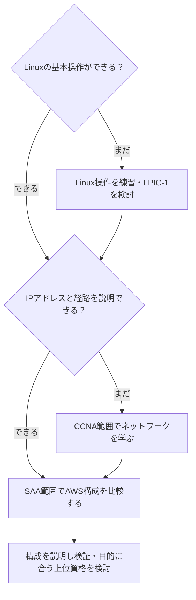

AWS・CCNA・LPICを全部取るべきか、どれから始めるべきか。順番を考える前に、Linux操作とネットワークのどちらが今の自分に足りないかを確認します。

このページでは、目指す仕事と説明できる知識から入口を分け、資格の勉強を構成・操作の練習につなげる道筋を整理します。筆者はこれらの資格を未受験で、公式範囲をもとにした学習ルートの提案です。

## インフラ資格の全体像

インフラエンジニアのスキルは大きく3層に分かれます。

| 層 | 対応資格 | 証明するスキル |
|---|---|---|
| OS基盤 | LPIC-1 / LinuC | Linuxサーバーの操作・管理 |
| ネットワーク | CCNA 200-301 | ネットワーク設計・運用の論理 |
| クラウド | AWS SAA / AWS ANS | クラウドアーキテクチャの設計 |

3層は学習内容を整理するための分類です。全員が下から資格を取得する必要はありません。[ネットワークスペシャリスト（NW）など高度情報処理技術者試験](/method/advanced-ipa-hub/)の合格者は、ネットワーク設計の知識をそのまま活かせるため、この階段を早く上れます。

## なぜCCNAがAWS SAAの前提になるか

AWSのネットワーク設計で使うVPC（仮想プライベートクラウド）は、CCNAで学ぶIPアドレスや経路選択といった知識を使います。ただし、AWS独自の設定・管理の仕組みは別に学びます。

見出しの「前提」は学習上の土台という意味です。CCNAの取得をSAAの受験条件にする制度ではありません。サブネットと経路を説明できるなら、CCNAの受験を挟まずSAAから始める選択もあります。[AWSのSAA案内](https://aws.amazon.com/certification/certified-solutions-architect-associate/)

未経験なら、CCNAのネットワーク基礎を学び、宛先IPから通信経路を説明する練習を先にします。受験するかは、ネットワーク運用も目指すかで決めてください。

## 推奨ロードマップ

| 現在地・目的 | 最初の学習 | 次へ進む確認点 |
| --- | --- | --- |
| Linux操作もネットワークも初めて | Linuxのファイル・権限・プロセス操作。LPIC-1を範囲表として使う | ログを探し、権限を説明できる |
| Linux操作はできるが通信経路を説明できない | CCNAのIPアドレス・経路・アクセス制御 | 端末から宛先までの経路を図にできる |
| サブネット・経路を説明でき、AWSの設計が目的 | SAAの公式範囲と構成比較 | 可用性・セキュリティ・コストから選択理由を説明できる |

LPIC-1は101と102の2試験に合格して認定される資格です。Linuxを学ぶことと、認定取得まで進むことは分けて決めます。[LPIのLPIC-1案内](https://www.lpi.org/our-certifications/lpic-1-overview/)



### 合格までの勉強時間

ここで一律の必要時間は示しません。次の入口別に最初の1週間を試し、理解にかかった時間と残りの公式範囲から計画を作ります。

| 前提 | 最初に時間を測る課題 | 配分の決め方 |
| --- | --- | --- |
| 知識なし | Linuxの権限設定とIPアドレスの説明 | 操作と用語の時間を分けて見積もる |
| 一部の背景知識あり | サブネット間の通信経路を図にする | 説明できなかった範囲に時間を割く |
| 関連資格あり | AWSで複数構成の採用理由を比べる | 既知の範囲を短く確認し、AWS固有の差を学ぶ |

### AI活用で専任講師を月額20ドルで雇う感覚

疑問が出た場所で聞き直せる学習相手としてAIを使います。この見出しは家庭教師になぞらえた表現で、特定サービスの料金案内ではありません。無料で使える範囲でも、「ルータのACLとAWSのセキュリティグループは何が違うか」と聞き、公式資料で答えを確認できます。

このあと、上位の専門性を選ぶ場合も、資格名より担当したい業務から考えます。

## キャリアアップ・管理職をめざすなら取っておきたい資格

LPIC・CCNA・AWS SAAは、インフラエンジニアとして現場で働くための土台です。その先で、上位のエンジニアや、チームを率いる管理職として安定したポジションをめざすなら、次の資格が候補になります。

| めざす方向 | 資格の例 | 示せること |
| --- | --- | --- |
| クラウドの設計の専門家 | AWS ソリューションアーキテクト – プロフェッショナル、AWS 高度なネットワーキング – 専門知識 | 大規模構成の設計知識を学ぶ |
| ネットワークの専門家 | CCNP、ネットワークスペシャリスト試験 | 設計・構築の知識を深める |
| セキュリティの責任者 | 情報処理安全確保支援士試験 | インフラ全体の守り方を考えられる |
| チームやプロジェクトの管理職 | プロジェクトマネージャ試験など（受験年度のIPA公式案内を確認） | 計画・進捗・リスクの管理知識を学ぶ |

管理職になると、自分で手を動かすより、メンバーの設計を確かめて判断する場面が増えます。メーカーの資格（CCNA・AWS）で技術の幅を、IPAの国家試験で設計やマネジメントの深さを示すと、評価してもらえる場面が広がります。

IPAの高度試験の選び方は [IPA資格の高難易度対策](/method/advanced-ipa-hub/) で整理しています。

## AI対話でインフラ概念を理解する

インフラ領域の概念は「なぜその設計が必要か」という設計意図から理解することで、サービス名だけでなく、採用理由を確認できます。

```text
インフラエンジニアとして学習を始めます。
「オンプレミスのネットワーク設計をクラウドに
移行する際に、どの概念がどう対応するのか」を
CCNA知識をAWS VPCに応用する観点で整理してください。
対応関係の論理を先に理解したいです。
```

<!-- AI_EXAMPLE: 使うAI=Gemini / プロンプト=本文のオンプレミスからAWS VPCへの対応整理 / 見せたいこと=共通する経路選択とAWS固有の設定単位を分ける回答 -->

対応表を受け取ったら、共通点だけでなく相違点も聞きます。AWSではセキュリティグループはリソース単位、ネットワークACLはサブネット単位で作用します。単純に同じACLだと覚えないでください。[AWSのVPCセキュリティ](https://docs.aws.amazon.com/vpc/latest/userguide/VPC_Security.html)

> [!think]
> 対応表を見るだけで理解できるなら苦労はありません。AWSの広い機能性を理解するためにも、まずは地道に「自分と関連が深そうな機能と性能を探す」ことから始めて、興味を掘り下げていきます。

## 学習メソッド

- [CCNAとは？勉強時間の目安とIPA試験でいうとどのレベルか](/method/ccna-hub/) — 試験の内容・勉強時間・落ちたときの立て直し方
- [CCNAを文系・未経験から6ヶ月で目指す手順](/method/ccna-liberal-arts-roadmap/) — ITパスポート過去問で現在地を測ってからの月別計画
- [AWS SAA、未経験でも本当に取れるか](/method/aws-saa-beginner-reality/) — 基本情報・応用情報と比べた難易度と学習の順番

## 取得順番・比較情報

- [CCNAとAWS SAA、どちらを先に取るべきか](/trend/ccna-vs-aws-saa/) — 学習効率から見た状況別の答え

## よくある質問

<strong>Q: CCNAとAWS SAAはどちらを先に取るべきですか？</strong>

A: 経路を説明できずネットワーク運用も目指すなら、CCNAの学習を先にします。AWS設計が目的で基礎を説明できるなら、SAAから始められます。詳細な判断基準は[CCNAとAWS SAA、どちらを先に取るべきか](/trend/ccna-vs-aws-saa/)を参照。

<strong>Q: LPICはCCNAの前に必要ですか？</strong>

A: 必須ではないが、Linux経験がない場合は推奨される。LPICで習得するファイルシステム・プロセス管理・シェルスクリプトの知識は、AWSのEC2・Lambda・CLI操作で直接役立つ。サーバーサイドの実務経験があればLPICをスキップしてCCNAから入ることも現実的だ。

<strong>Q: CCNAは独学で合格できますか？</strong>

A: 独学で準備する場合も、公式範囲と演習で理解を確かめます。AIの類題は、解答を教材と照合して使ってください。[CCNAを文系・未経験から6ヶ月で目指す手順](/method/ccna-liberal-arts-roadmap/)に具体的な月別計画を掲載している。

<strong>Q: AWS SAAに有効期限はありますか？</strong>

A: 2026年10月時点で有効期限は3年です。SAAは現行のSAA試験またはSolutions Architect – Professional試験への合格で更新できます。任意のアソシエイト認定で更新できるわけではありません。[AWSの再認定案内](https://aws.amazon.com/certification/recertification/)

---

## まとめ

インフラ資格の入口は、Linux操作とネットワークの現在地で選びます。どちらも初めてなら基礎操作から、経路を説明できるならAWSの設計判断から始められます。

資格を一つずつ必ず取るルートではありません。最初の1週間で説明できない範囲を見つけ、上の確認点を使って次の学習へ進んでください。
