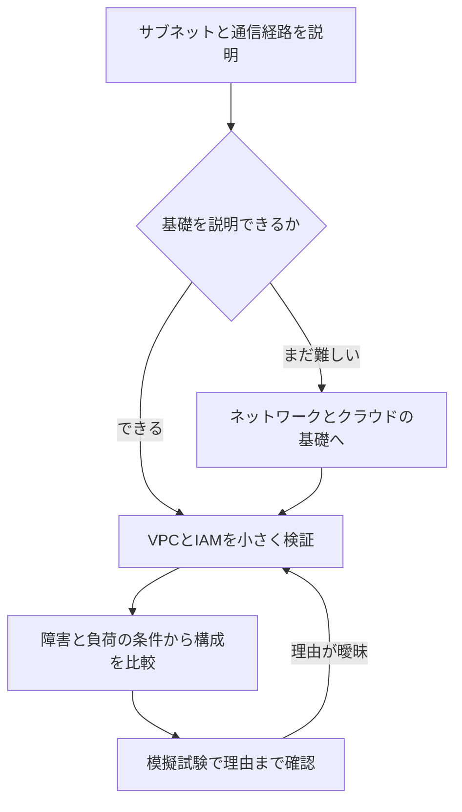

「IT未経験でもAWS SAAに合格できますか？」

クラウドエンジニアを目指して調べ始めると、まずこの疑問にぶつかるはずです。

AWS SAAはAssociateレベルの資格です。IT未経験の入口と、AWS経験者にとっての入口は分けて考える必要があります。

ただし、<strong>AWS未経験の人にとっては、覚えるべき用語や用例が多い試験</strong>でもあります。

この記事では、AWS SAAの難しさをIPAの試験と比べて整理し、自分にとっての道のりの長さを見分ける方法を示します。

読み終えたときには、自分がどこから学び始めればいいかを判断できるようになります。


## AWS SAAの難易度はIPA試験と何が違うのか

筆者はAWS SAAを未受験です。以下は受験体験ではなく、試験範囲と前提知識を比較した学習の判断材料です。

AWS SAAの難しさは、基本情報技術者（FE）や応用情報技術者（AP）とは<strong>違う方向にあります。</strong>

IPAの試験は、ITの基礎理論を幅広く問います。

一方のAWS SAAは、AWSのサービスを組み合わせて「どう設計するか」を問う試験です。

| 比べる観点 | AWS SAAの位置づけ |
|---|---|
| 難易度 | ネットワークや権限設計の前提知識が乏しいと、AWS固有の用語と同時に学ぶ必要がある |
| 出題範囲 | IT全般を扱う応用情報と、AWSの設計に重点を置くSAAは軸が異なる |
| 難しさの種類 | AWS固有のサービス名・用語・設計の用例を覚える量が多い |

つまり、範囲は応用情報ほど広くないものの、AWSならではの言葉と使い方に慣れていないと、問題文の段階で手が止まります。

2026年11月時点、AWS公式はSAAをAWSやオンプレミスITの経験者に適した出発点とし、IT業務未経験者にはCloud Practitionerからの学習を勧めています。[AWS公式のSAA概要・受験対象者](https://aws.amazon.com/jp/certification/certified-solutions-architect-associate/)

では、未経験者は具体的にどこでつまずくのでしょうか。

## AWS SAAで未経験者がつまずく3箇所

### VPC（仮想プライベートクラウド）の設計

AWS SAAの中核であるVPCは、ネットワーク設計の知識を前提とします。

サブネット・ルートテーブル・NATゲートウェイ・セキュリティグループ・NACLは、TCP/IPとサブネットの概念を知っていれば「AWSでの実装方法」として理解できます。

ネットワーク未経験の場合は、<strong>概念と実装が同時にやってきて消化不良になります</strong>。

### IAM（Identity and Access Management）の権限設計

ポリシー・ロール・グループの3つの概念が絡み合うIAMは、設計の意図から理解していないと混乱します。

「誰が何をできるか」を管理するという本質を先に押さえずに設定例を追うと、応用問題で判断できなくなります。

### 高可用性アーキテクチャの設計論理

Multi-AZ・Auto Scaling・ELBを組み合わせた高可用性設計は、「なぜその構成が必要か」という障害対策の考え方から理解する必要があります。

そうしないと、設問の条件の微妙な違いに対応できません。

## 自分の道のりの長さを見分ける

ここまでの3箇所を読んで、どう感じたでしょうか。

<strong>VPC・IAM・高可用性設計のどれも全くわからないなら、合格までの道のりは長いかもしれません。</strong>

その場合は、AWSの学習に入る前に、ネットワークとクラウドの基礎から積み上げる必要があります。

逆に、<strong>なんとなくでもイメージがつくなら</strong>、話は変わります。

基礎のどこを補い、AWSの設計比較へいつ進むかを、次の表で切り分けます。

背景ごとの学習時間は、計画を組むための仮の目安です。公式の合格所要時間でも、筆者の実測でもありません。

| 背景 | 目安時間 |
|---|---|
| ネットワーク基礎あり・AWS実務経験あり | 80〜120時間 |
| ネットワーク基礎あり・AWS未経験 | 100〜180時間 |
| ネットワーク基礎なし・IT未経験 | 200〜300時間 |

時間だけで判断せず、次の説明が自力でできるかで、始める位置を選びます。

| 今できないこと | 始める位置 |
| --- | --- |
| IPアドレスとサブネットの関係を説明できない | ステップ1のネットワーク基礎 |
| ネットワーク基礎は分かるが、AWSの権限・経路が分からない | ステップ2のVPC・IAMの検証 |
| サービス名は分かるが、条件から構成を選べない | ステップ3の設計理由の比較 |

では、道のりが長い人は、何から始めればいいのでしょうか。

## 学習の順番はネットワークとクラウドの基礎から

AWSといっても、土台にあるのはネットワークとクラウドの一般的な知識です。

そのため、<strong>まずネットワークとクラウドの基礎知識を固める</strong>ことが学習の前提になります。



### ステップ1：ネットワーク基礎をAIとの対話で整える

AWS SAA本体に入る前に、ネットワークの基礎をAIとの対話で整えます。

```text
AWS SAAの学習を始めます。
まずVPCを理解するために必要な前提知識として
「TCP/IPのサブネット」を学びたいです。
計算方法より先に、「なぜIPアドレスをサブネットに
分割する設計が生まれたのか」という背景から
教えてください。
```

背景から理解しておくと、VPCの章でサブネットが出てきたときに「AWSでの実装方法」として読めるようになります。

<!-- AI_EXAMPLE: 使うAI=ChatGPT / プロンプト=本文「TCP/IPのサブネット」 / 見せたいこと=一般のサブネットとAWSでの実装上の条件を分けて説明できるか -->

### ステップ2：AWS専用の設計論理を実際に試しながら学ぶ

基礎が整ったら、VPC・EC2・S3・RDS・IAMなど、AWS専用の設計の考え方を学びます。

この段階では、<strong>実際にAWSで手を動かして試す</strong>のがいちばん身につきます。

2026年11月時点のAWS無料利用枠は、アカウントの作成時期・プラン・対象サービスによって条件が異なります。「学習用だからすべて無料」と考えず、利用前に対象と期限を確認してください。[AWS無料利用枠](https://aws.amazon.com/jp/free/)

あわせて、AWSが提供する学習サイト「AWS Skill Builder」も活用できます。

AWS公式の教材なので、サービスの位置づけや用語の使い方を正しい形で学べます。

### ステップ3：設計の理由をAIとの対話で理解する

AWSの設計パターンは、「なぜその構成が推奨されるか」という理由から理解すると、試験で正しい選択肢を選べるようになります。

```text
AWS SAAの「高可用性設計」を学んでいます。
Multi-AZとAuto Scalingを組み合わせる構成について、
「なぜこの2つが別々の問題を解決するのか」という
設計上の役割の違いから教えてください。
```

理解できたら、自分の言葉で説明して確認します。

```text
Multi-AZとAuto Scalingの違いについて理解したことを
話します。論理の穴があれば指摘してください。

「Multi-AZは障害発生時の冗長性（可用性）のための仕組みで、
Auto Scalingは負荷変動への対応（スケーラビリティ）のための仕組み。
どちらも高可用性設計に必要だが解決する問題の軸が違う、
という理解です。」
```

<strong>なぜ2つの仕組みが共存するのかがわかると、問題文の条件から必要な構成を論理で選べます。</strong>

### 12週間の学習の流れ

ネットワーク基礎がない人を想定した、12週間の目安です。

| 期間 | テーマ | 学習法 |
|---|---|---|
| 1〜2週目 | ネットワーク基礎（TCP/IP・サブネット）の理解 | AI対話で「なぜ」から入る |
| 3〜6週目 | VPC・EC2・S3・RDS・IAMの設計論理 | AWS Skill Builder＋無料枠で実際に試す |
| 7〜9週目 | 高可用性設計・セキュリティアーキテクチャ | 設計パターンをAIとの対話で理解する |
| 10〜12週目 | 模擬試験と弱点補強 | 模擬試験の解説をAIで深掘りする |

---

## まとめ

AWS SAAは、AWSの設計を学ぶAssociateレベルの資格です。IT未経験なら、サービス名の暗記に入る前に、ネットワークとクラウドの基礎を確かめます。

IPA試験との上下関係より、ネットワーク・権限・可用性の設計理由を説明できるかで、学習の出発点を判断してください。

VPC・IAM・高可用性設計の名前を知っているだけで短期合格を見込まず、構成を選ぶ理由まで説明できるかを確かめます。

これで、自分がネットワーク基礎から始めるべきか、AWSの設計論理から入っていいかを判断できるはずです。

まずは、サブネットの「なぜ」をAIに問いかけるところから始めてみてください。


> この記事は [AWS・CCNA・LPICの取る順番](/method/aws-hub/) の一部です。
