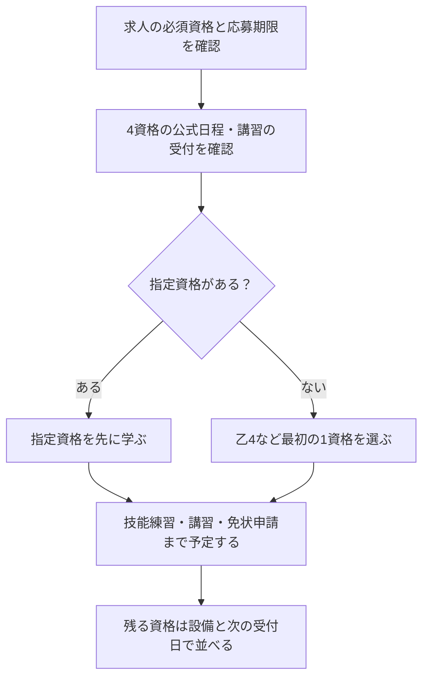

ビルメン4点セットは、乙4から取るべきか、電気工事士を先にするべきか。迷ったときは、難易度の順位より、応募先の必須条件と申込期限を先に確認します。

同じ順番で学んでも、技能試験や講習の日程が合わなければ、応募までに免状が間に合わない場合があります。この記事では「学ぶ順」と「申し込む順」を分け、自分の期限に合う計画の作り方を整理します。

筆者は4資格を未受験です。以下は公式の制度と、未経験者向けの計画案を分けて示しています。

## ビルメン4点セットは、4つで1つの免許ではない

「ビルメン4点セット」は、次の資格をまとめた呼び方です。4資格共通の試験や、全員に共通する取得順はありません。

| 資格 | 担当する知識・作業の例 | 順番を決めるときの確認 |
| --- | --- | --- |
| 危険物取扱者乙種4類 | ガソリン・灯油など引火性液体の危険性と取扱い | 応募先の指定と、地域の試験日程 |
| 第二種電気工事士 | 電気設備の工事に関する知識・技能 | 学科・技能の両方の準備期間 |
| 二級ボイラー技士 | ボイラーの構造・取扱い・法令 | 試験合格後、免許交付要件を満たせるか |
| 第三種冷凍機械責任者 | 冷凍設備の保安 | 担当設備に必要か、当年度の申込期限 |

乙4の試験は五肢択一です。選択肢の答えだけでなく、誤りの理由も確認して練習します。受験資格と実施方式は[消防試験研究センターの試験案内](https://www.shoubo-shiken.or.jp/kikenbutsu/)で確認します。

第二種電気工事士は学科試験と技能試験があります。2026年度は上期・下期があり、学科の受験方式も含めて当年度の案内を確認してください。[電気技術者試験センター](https://www.shiken.or.jp/)（2026年10月時点）

二級ボイラー技士は、試験を受ける条件と免許交付の条件が別です。未経験者は、ボイラー実技講習などの要件を試験勉強と一緒に確認します。[日本ボイラ協会の免許取得案内](https://www.jbanet.or.jp/license/boiler-license/second-boiler/)

ここまでが資格ごとの差です。次に、どれを先にするかを条件で分けます。

## 取得順番は求人条件から決める

| あなたの条件 | 最初にすること | 学ぶ順の候補 |
| --- | --- | --- |
| 応募先が電気工事士を必須にしている | 必要なのが合格か免状交付か、期限も確認する | 電気工事士を優先。技能練習の枠を先に確保 |
| 必須資格の指定がなく、最初の学科試験に集中したい | 乙4の試験日と未見問題を確認する | 乙4から始め、次に電気工事士を検討 |
| 配属先でボイラー資格を求められている | 免許交付要件と実技講習の空きを確認する | ボイラーを先に。試験合格だけを終点にしない |
| 冷凍資格が応募・配属条件になっている | 当年度の申込状況と、第三種で足りるかを確認する | 冷凍を先に。既定の順番の最後に固定しない |
| どんな設備を扱うか未定 | 希望する求人の必須・歓迎資格を書き出す | 4つ全部の受験を決める前に、最初の1つを選ぶ |

これは難易度のランキングではなく、学習配分の提案です。指定がなければ「乙4→電気工事士→残る2資格を設備と日程で判断」が一案ですが、試験を受けやすい時期が先に来るなら入れ替えます。

冷凍資格が必要かは、業界名だけでは決められません。[第三種冷凍機械責任者は必要ない？](/method/reitoukikai-3shu-iranai/)で、設備の選任対象と免状の範囲を分けて確認できます。

## 学ぶ順と申し込む順を分ける

今月は乙4だけを学んでいても、別の資格の申込期限は先に確認できます。日程確認と学習の同時進行を、4資格すべての問題集を同時に進めることと混同しないでください。



カレンダーには、試験日だけでなく「申込締切」「技能練習」「講習」「免状・免許申請」を別々に書きます。冷凍機械責任者の日程は[KHKの国家試験申込案内](https://www.khk.or.jp/qualification/qualification_application/)で確認し、過年度の日付を翌年へ流用しないでください。

日程が重なったら、必須資格と技能練習を優先し、資格の追加を後の回へ送る選択もあります。次は、週の学習時間に収まるかを確かめます。

## 合格までの勉強時間は最初の1週間で見積もる

一律に「4資格合計何時間」とは置きません。電気の計算を知っているか、工具を扱ったことがあるかで必要な練習が変わり、講習や移動にも時間を使います。

| 前提 | 最初の1週間で試すこと | 計画の見直し方 |
| --- | --- | --- |
| 関連知識なし | 選んだ資格の入門範囲と未見問題を試す | 用語確認と演習の時間を分ける |
| 理科・設備の背景知識あり | 解説なしで理由を説明できるか試す | 説明できない法令・安全上の条件を優先する |
| 関連資格あり | 共通範囲と新規範囲を分ける | 技能・講習など省略できない準備を確保する |

たとえば週7時間なら、主資格の学習5時間、復習1時間、日程確認・翌週の計画1時間という配分から試せます。これは合格に必要な時間ではなく、予定を詰め込みすぎないための配分例です。

### AI活用で専任講師を月額20ドルで雇う感覚

わからない箇所を繰り返し聞ける学習相手としてAIを使います。この見出しは家庭教師になぞらえた表現で、特定サービスの料金や効果の保証ではありません。

乙4の指定数量なら「式のどこで単位をそろえるか」、冷凍サイクルなら「圧縮・凝縮・膨張・蒸発で何が変わるか」のように、疑問を1つに絞ります。電気工事士の技能は、文章の説明だけで完了にせず、公式の候補問題・欠陥の判断基準と実際の作業で確認してください。

## AIに計画を点検してもらうプロンプト

AIに試験日を推測させず、自分で公式案内から拾った情報を渡します。未確認の日付があっても、まず不足項目を列挙してもらいます。

```text
未経験から設備管理の仕事を目指しています。
ビルメン4点セットの学習計画を、以下の条件から点検してください。

応募先の必須資格と必要な状態（合格／免状交付）：［記入］
応募・配属期限：［記入］
週に確保できる時間：［記入］
現在の知識・工具を使った経験：［記入］

公式案内で確認した情報：
- 乙4：申込締切、試験日、URL、確認日［記入］
- 第二種電気工事士：学科と技能の日程、URL、確認日［記入］
- 二級ボイラー技士：試験日と免許交付要件、講習候補日、URL［記入］
- 第三種冷凍機械責任者：申込締切、試験日、URL、確認日［記入］

出力：
1. 情報が足りず判断できない点
2. 申し込む順と、学ぶ順を別々に提案
3. 技能練習・講習・免状申請を含めた週単位の計画
4. 日程が重なったときに後へ送る候補と理由

日程・必要学習時間を推測で埋めないでください。
4資格の一括取得を前提にせず、必須資格を優先してください。
```

### Geminiで試した結果：日程を渡さずに頼むとどうなるか

上のプロンプトで「日程を推測で埋めないで」と書いている理由を確かめるために、公式の日程を渡さない聞き方をGemini（無料プラン）で試しました（2026年10月）。

```text
私は文系・未経験からビルメン業界への転職を目指しています。
これから以下4つの国家資格を、この順番で取得する予定です。

1. 危険物取扱者乙4（試験はほぼ毎月）
2. 第二種電気工事士（筆記は年2回、技能試験あり）
3. 二級ボイラー技士（試験はほぼ毎月）
4. 第三種冷凍機械責任者（試験は年1回・11月のみ）

平日は1日1時間、休日は1日2時間の学習時間が確保できます。
今日から12ヶ月で4資格すべてを取得するスケジュール案を、
月単位で提案してください。特に電気工事士の技能試験対策の時間確保と、
冷凍機械責任者の年1回試験を逃さないための逆算スケジュールを重視してください。
```

回答は、週9時間（月36〜40時間）を前提にした12か月の表でした。流れを抜き出すと次のとおりです。

| 時期 | Geminiの計画 |
| --- | --- |
| 11〜12月 | 危険物乙4を学習し、12月に受験 |
| 1〜3月 | 第二種電気工事士の筆記対策。<strong>3月上旬に筆記を受験</strong> |
| 4〜5月 | 技能試験の練習（候補問題13問、40分で完成させる練習）。<strong>5月下旬に技能を受験</strong> |
| 6〜7月 | 二級ボイラー技士を学習し、7月に受験。合格後に実技講習の手続き |
| 8〜10月 | 第三種冷凍機械責任者を3か月かけて学習し、11月に受験 |

技能試験の候補問題が13問であること、試験時間が40分であること、ボイラーの免許にはボイラー実技講習（3日間）などが必要なことは、正しく押さえていました。年1回の冷凍機械に3か月をまとめて充てる組み方も、考え方としては使えます。

ただし、第二種電気工事士の日程は合っていません。令和8年度の上期は、学科がCBT方式で4月23日〜6月7日、筆記方式で5月24日、技能試験が7月18日・19日でした（下期は学科が9月下旬〜11月上旬、技能が12月）。「3月に筆記、5月に技能」という日程はありません。

この表のまま進めると、電工を受ける時期が実際の日程と合わず、その後のボイラー・冷凍機械の時期も組み直しになります。AIは、渡していない日付をもっともらしく埋めてきます。日程は自分で公式案内から拾って渡し、AIには「足りない情報」と「組み方」だけを考えさせるのが安全です。


提案を受け取ったら、週の合計時間、必須資格の期限、技能・講習の枠を自分でも照合します。日程が合わなければ「今年中に4つ」の条件を外して作り直します。

<!-- LEARNER_NOTE: 候補=上記プロンプトを実行し、講習や技能練習の抜けを指摘して組み直した実際のやりとり / 種類=think / 筆者の実体験で記入。受験体験は書かずAI実行記録に限る -->

---

## まとめ

ビルメン4点セットの取得順番は、応募先の条件、申込期限、技能・講習の準備から決めます。指定がなければ乙4から始める案があり、電気工事士や冷凍資格が必須ならそちらを先にします。

まず希望する求人の資格条件と、4資格の公式受付日程を1枚にまとめてください。そこから最初の1資格を選べます。設備管理の関連資格と次の進路は[ビル管理の管理者を目指す資格](/method/biru-kanri-hub/)にまとめています。
