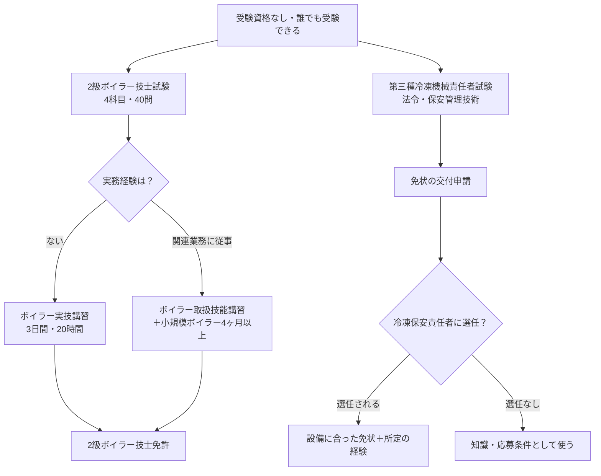

ボイラー技士や冷凍機械責任者を取ろうと調べ始めると、「試験合格」と「免許取得」という2つの言葉が出てくる。

分かれ目は、<strong>受験資格は不要で誰でも受けられるが、免許をもらうには別の条件がある</strong>という点だ。

この違いを知らずに挑むと、合格後に「なぜ免許がもらえないのか」で戸惑うことになる。

本記事では試験制度の構造を整理し、未経験者と実務経験者それぞれの進め方をAI活用とあわせて解説する。

筆者はボイラー技士・冷凍機械責任者を未受験だ。以下は試験団体の公式情報をもとにした整理で、受験・現場業務の体験談ではない。

---

## 合格までの勉強時間

公式の標準学習時間は示されていない。下の表は、学習の枠を決めるための仮置きで、合格を保証する時間ではない。

| 資格 | 対象者 | 計画の仮置き |
|---|---|:---:|
| 2級ボイラー技士 | 知識ゼロからの独学 | 40〜60時間 |
| 2級ボイラー技士 | 設備の実務があり、過去問中心 | 25〜30時間 |
| 第三種冷凍機械責任者 | 理科の計算に自信がない | 80〜100時間 |
| 第三種冷凍機械責任者 | 理科の基礎がある | 60時間前後 |

最初の1週間で公表問題を1回分解き、知らない用語が多いのか、計算や法令の数値で止まるのかを確かめてから、残りの時間を見積もり直す。

### AI活用で専任講師を月額20ドルで雇う感覚

ボイラー技士・冷凍機械責任者の独学最大の壁は、<strong>過去問の丸暗記では通用しない引っ掛け問題</strong>と、<strong>冷媒の状態変化のような目に見えない現象の理解</strong>だ。テキストには「圧縮・凝縮・膨張・蒸発」という言葉が並ぶが、なぜその順番で起きるのかまでは説明されないことが多い。

生成AIは、何度でも質問できる学習相手になる。<strong>月額20ドル程度で、設備系の専任講師を雇うような感覚</strong>だ（比喩であり、料金や回答の正しさを保証するものではない）。

- 「ボイラーの安全弁はなぜこの圧力で作動するのか」といった数値の背景を説明してもらえる
- 冷凍サイクルの4工程を、エアコンや冷蔵庫の身近な例えに置き換えて教えてもらえる
- 過去問の引っ掛け表現を「なぜ間違いなのか」まで分解してもらえる
- 深夜でも、休憩5分でも、何度同じ質問をしても対応してくれる

過去問を機械的に3周するだけの学習から、<strong>理解を伴った学習</strong>に切り替えることが、短い学習時間でも足切り（科目ごと40%）を回避する鍵になる。引っ掛け問題の具体的な攻略プロンプトは、後述の「ボイラー技士の引っ掛け問題が解けない理由」にまとめている。

---

## 試験合格と免許取得は別物という壁

ボイラー技士・冷凍機械責任者ともに、<strong>試験そのものには受験資格が存在しない</strong>。年齢・学歴・職歴を問わず誰でも受験できる。

しかしボイラー技士は、試験に合格しただけでは、現場で業務にあたるための<strong>免許</strong>は発行されない。2級の場合、免許の申請には、試験合格に加えて次のような要件が必要になる。

| ルート | 内容 | 対象者 |
|---|---|---|
| 実技講習ルート | ボイラー実技講習（3日間・20時間）を修了 | 実務経験がない人 |
| 実務経験ルート | ボイラー取扱技能講習の修了後、小規模ボイラーを4ヶ月以上取り扱った経験 | すでに関連業務に従事している人 |

このほか、学校で所定の学科を修めて実地修習を受けたルートなどもある。自分が当てはまる要件は、[日本ボイラ協会の二級ボイラー技士免許の案内](https://www.jbanet.or.jp/license/boiler-license/second-boiler/)で確認してほしい（2026年10月31日確認）。

冷凍機械責任者は、試験に合格すれば免状の交付を申請できる。ただし、<strong>免状を持つことと、職場で冷凍保安責任者に選任されることは別</strong>だ。選任されるには、設備に合った種類の免状に加えて、所定の経験が要る（冷凍保安規則第36条）。

2つの資格を、合格から仕事で使えるまでの流れで並べると次のようになる。



この構造を知らずに「試験に受かれば資格が取れる」と思い込むと、合格発表後に慌てて実技講習の日程を探すことになる。<strong>受験を決めた時点で、免許取得までのルートを先に決めておく</strong>のが正しい進め方だ。冷凍機械責任者がそもそも必要かは、設備の区分と選任の要否から[第三種冷凍機械責任者は必要ない？](/method/reitoukikai-3shu-iranai/)で確認できる。

---

## 資格の全体像

### ボイラー技士（特級・1級・2級）

ボイラーの取扱いに関する国家資格で、上位から特級・1級・2級の3区分がある。ビルメンテナンス業界で最初に取得を求められるのは<strong>2級</strong>で、合格率は例年<strong>50%前後</strong>と国家資格の中では高い。

### 冷凍機械責任者（第一種・第二種・第三種）

冷凍設備の保安管理に関する国家資格（高圧ガス製造保安責任者のうち冷凍の区分）で、上位から第一種・第二種・第三種の3区分がある。空調・食品倉庫・製氷施設など冷凍機を使う現場で求められることがあるが、必要かどうかは業界名ではなく設備の区分で決まる。入口となる<strong>第三種</strong>の合格率は<strong>30〜40%</strong>程度で、ボイラー技士より低い。

第三種の国家試験は年1回で、日程と申込期間は高圧ガス保安協会（KHK）が毎年公表する。KHKの講習を修了し、その検定に合格すると、国家試験の「保安管理技術」が免除される仕組みもある。出典: [KHKの国家試験・講習の案内](https://www.khk.or.jp/qualification/national_qualification/)（2026年10月31日確認）

### 試験形式の比較

| 項目 | 2級ボイラー技士 | 第三種冷凍機械責任者 |
|---|---|---|
| 出題形式 | マークシート4科目・計40問 | 法令＋保安管理技術の2科目 |
| 科目別足切り | あり（科目ごとに40%以上、かつ合計60%以上で合格） | あり |
| 合格率目安 | 約50%（2025年度は52.9%） | 約30〜40%（2024年度の知事試験は36.1%） |
| 年間受験者数 | 約2万人（2025年度は21,349人） | 約1万人規模（2024年度の知事試験の受験者は7,605人） |

出典: [二級ボイラー技士の紹介｜安全衛生技術試験協会](https://www.exam.or.jp/introduction/h_shokai122/)、[統計（令和7年度）｜安全衛生技術試験協会](https://www.exam.or.jp/h_gokakuritsu/)、[令和6年度 知事試験の結果｜高圧ガス保安協会](https://www.khk.or.jp/file_download.php?fileid=OZ62UjaGxIc%3D)（2026年10月30日確認）

---

## ボイラー技士の引っ掛け問題が解けない理由

2級ボイラー技士の過去問で、「見たことがある問題なのに間違える」ことがあります。原因の多くは、法令の数値や用語を<strong>点</strong>として暗記していて、<strong>線</strong>としてつながっていないことです。引っ掛けは、次のような型で繰り返し出ます。

| 型 | 例 |
| --- | --- |
| 似た数値の入れ替え | 安全弁などの基準値を、別の数値に差し替える |
| 似た用語の入れ替え | 「常用水位」と「最高水位」のような、紛らわしい用語のすり替え |
| 条件の一部変更 | 「〇〇の場合を除き」のような例外条件を見落とさせる |

数値や用語を丸暗記しただけでは見抜けません。「なぜその数値・用語なのか」という背景を理解していれば、条件が変わっても対応できます。

### 間違えた問題は、「なぜその数値か」をAIに聞く

正解を確認して終わりにせず、背景を聞きます。

```text
ボイラー技士の過去問で、以下の問題を間違えました。
（問題文と、正解、私が選んだ誤りの選択肢をここに貼る）
なぜその基準値が定められているのか、安全上の理由と法令上の位置づけを含めて説明してください。
そのうえで、似た数値の引っ掛けが出やすい他の基準値を3つ挙げ、それぞれなぜその数値なのかを教えてください。
```

背景が分かると、数字が独立した暗記事項ではなく、安全を確保する考え方の一部だと見えてきます。ただし、AIの説明が正確とは限りません。数値や条件は、テキストの記載や、ボイラー構造規格などの公的な資料で必ず確かめてください。

### 紛らわしい用語は、ペアで整理する

```text
ボイラー技士の試験に出てくる、意味が紛らわしい用語のペアを、できるだけ多くリストアップしてください。
各ペアについて、次の3点を教えてください。
- それぞれの正確な定義
- 試験でどう入れ替えて出題されやすいか
- 覚え方のコツ（語感ではなく、意味のつながりで覚える方法）
```

#### ChatGPTで実行した結果

このプロンプトを、ChatGPT（有料プラン）で実行しました（2026年10月）。

返ってきたのは、2級を中心に<strong>60ペア</strong>の表でした。「熱・圧力・蒸気」「伝熱・構造・循環」「燃料・燃焼・通風」「水処理・障害・腐食」「安全装置・制御・取扱い」の5つに分かれています。一部を抜き出すと、次のとおりです。

| ペア | 定義 | 出題での取り違え | 意味で覚えるコツ |
| --- | --- | --- | --- |
| 放射伝熱面／接触伝熱面 | 放射伝熱面は主に火炎の放射熱を受ける面。接触伝熱面は主に燃焼ガスとの対流で熱を受ける面 | 火炉に面する面を接触伝熱面とする | 火炎を「見る」位置か、流れてきたガスに熱を渡される位置か |
| 過熱器／節炭器 | 過熱器は蒸気を加熱して過熱蒸気にする。節炭器は排ガスの熱で給水を予熱する | 節炭器で蒸気を過熱するとする | 熱を受ける相手で分ける。過熱器は蒸気、節炭器は給水 |
| プライミング／フォーミング | プライミングはボイラー水が激しく持ち上がり蒸気側へ飛ぶ現象。フォーミングは水面に消えにくい泡ができる現象 | 泡立ちをプライミングとする | 水の塊が動くか、泡が残るか |
| 安全弁／逃がし弁 | 安全弁は主に蒸気の過圧を逃がす。逃がし弁は主に温水の過圧を逃がす | 蒸気用と温水用を逆にする | 蒸気は縮む気体、温水はほぼ縮まない液体。守る流体で覚える |

表の最後には、どのペアにも使える4つの問いがまとめられていました。

> - どこで起こるか：水側／ガス側、入口／出口、管内／管外
> - 何を対象にするか：水／蒸気／空気、質量／体積
> - 原因か結果か：フォーミングが原因になり、キャリオーバにつながる
> - 状態か能力か：pHは今の状態、アルカリ度は酸を中和する能力

放射伝熱面と接触伝熱面を逆にする問題は、安全衛生技術試験協会が公表している2級の問題でも確認できます。「取り違え」の列は、すべてが過去問どおりではありませんが、誤りの選択肢を見抜く練習の材料になります。

> [!exp]
> さすがに長い。GPT6.1Solの軽量（思考レベル低）でもこれ。このままNotebookLMになげてフラッシュカードを作成する手もある。

一度に全部を覚える量ではありません。表をNotebookLMに読み込ませてフラッシュカードにする、苦手な分類だけを残す、といった形で、手元で使える量に絞ります（NotebookLMの使い方は[NotebookLM資格試験活用ガイド](/method/notebooklm-features-guide/)）。

一度に覚えようとせず、間違えた問題が出るたびに、このリストへ追記します。自分専用の「引っ掛けパターン集」になります。

## AIを専任講師にする学習プラン

### 未経験から挑戦する人向け

実務知識がゼロの状態からは、まず全体像をAIに整理させてから過去問に入るのが効率的だ。

```
ボイラー技士2級の試験範囲を、まったくの初心者向けに整理してください。

条件:
- 「ボイラーの構造」「取扱い」「燃焼」「関係法令」の4科目それぞれで
  最低限おさえるべきポイントを3つずつ挙げる
- 専門用語は身近な例えを使って説明する
- 1日1時間の学習を前提に、最初の2週間で取り組む順番も提案してください
```

<!-- AI_EXAMPLE: 使うAI=筆者が選ぶチャットAI / プロンプト=本文「未経験から挑戦する人向け」の4科目整理 / 見せたいこと=4科目のポイントと例えが教材と合うか、法令の数値を推測で書かないか -->

過去問を解いていて間違えた問題は、<strong>「なぜその選択肢が間違いなのか」まで理由を聞く</strong>クセをつけると、同じ引っ掛けパターンで二度落とさなくなる。

### 実務経験がある人向け

すでに設備管理の現場にいる人は、実務で体で覚えている知識を試験用語に翻訳する作業がボトルネックになりやすい。

```
私は設備管理の実務でボイラーの日常点検を担当していますが、
資格の勉強はしたことがありません。

現場でやっている点検作業（水面計の確認、圧力の確認など）が、
試験ではどの科目・どの用語で問われるのか対応表を作ってください。
その上で、実務では意識していないが試験で問われる知識（法令の数値基準等）
を重点的に教えてください。
```

現場感覚と試験知識のズレを先に埋めておくと、実務経験者は未経験者より短い時間で合格ラインに到達できる。

---

## ボイラー技士・冷凍機械責任者と組み合わせるべき資格

ビルメンテナンス業界では、危険物取扱者乙4・第二種電気工事士・二級ボイラー技士・第三種冷凍機械責任者をまとめて<strong>「ビルメン4点セット」</strong>と呼ぶ。4つで1つの免許ではなく、どれが必要かは求人と担当設備で変わる。取る順番は[ビルメン4点セットの取得順番](/method/bilmen-4tenset-junban/)で、求人条件と申込期限から決める方法を整理している。

| 資格 | 組み合わせる意味 |
|---|---|
| <a href="/method/denken-hub/">電験三種（電気主任技術者）</a> | 電気設備の保安まで知識の範囲が広がる。設備管理の上位資格の候補 |
| <a href="/method/kiken-butsu-hub/">危険物取扱者（乙4）</a> | ビルメン4点セットの一つ。ボイラーの燃料（重油・灯油）の取扱いとつながる |
| <a href="/method/biru-kanri-hub/">ビル管理の資格（ビル管理士等）</a> | 設備管理の実務経験を積んだ後、上位資格への足がかりになる |
| <a href="/method/shobo-setsubi-hub/">消防設備士</a> | 消防用設備の点検・整備を担当する場合の候補。担当設備に合う類を選ぶ |

---

## まとめ

ボイラー技士・冷凍機械責任者は、<strong>誰でも受験できる入口の広さ</strong>と<strong>免許取得までのルートが試験合格後にも続くという構造</strong>を両方理解しておくことが攻略の第一歩だ。

- 受験前に、ボイラーは免許の要件（実技講習か実務経験か）を、冷凍は選任の予定と設備の区分を確かめておく
- 引っ掛け問題は、数値や用語の「なぜ」を理解して解く
- AIの説明は理解の補助に使い、数値や条件はテキストと公式資料で確かめる

まずは応募先や職場で求められている資格を確かめ、2級ボイラー技士か第三種冷凍機械責任者のどちらか1つから始めよう。
