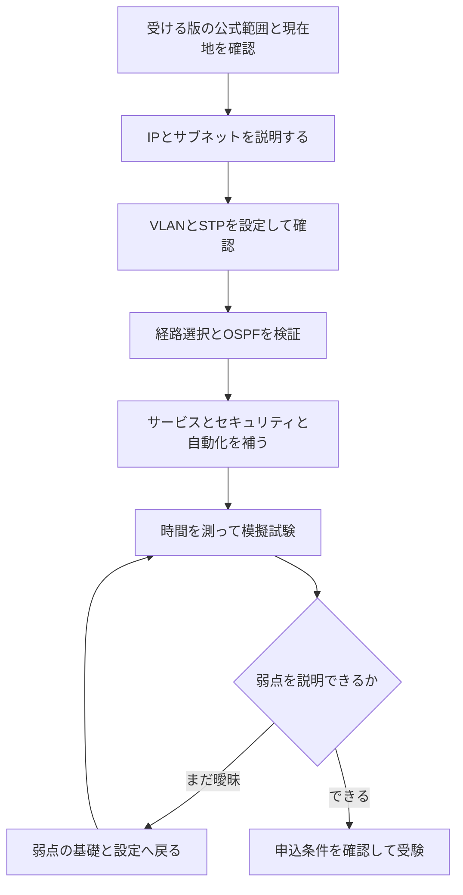

ネットワークの仕事に興味を持って調べると、「CCNA」という資格の名前をよく見かけます。けれど、どんな資格で、どのくらい勉強すれば受かるのかは、意外とまとまった情報がありません。

IPAの試験のように日本で広く知られた資格ではないので、「基本情報と比べてどのくらい難しいのか」がわからない、という人も多いはずです。

この記事では、CCNAがどんな資格なのかを説明したうえで、<strong>合格までの勉強時間の目安</strong>と、<strong>IPAの試験でいうとどのレベルにあたるのか</strong>を整理します。

合格までの進め方と、もし落ちたときの立て直し方もあわせてまとめるので、受けるかどうかの判断から本番の準備まで、この記事1本で見通せるようにします。

## CCNAはネットワークの基礎を証明する資格

<strong>CCNA（Cisco Certified Network Associate）</strong>は、ネットワーク機器のメーカーであるCisco Systemsが認定する資格です。

Ciscoの資格ですが、内容はCisco製品の操作だけではありません。IPアドレスの設計、ルーティング、スイッチング、セキュリティの基礎、ネットワークの自動化まで、<strong>ネットワーク全般の基礎</strong>を幅広く問います。

ネットワークの構築や運用を担うインフラエンジニアの求人では、「CCNA歓迎」と書かれていることがあります。未経験からネットワークの仕事を目指すときに、基礎を学んだことを示す資格として使われています。

### 試験の形式

| 項目 | 内容 |
| --- | --- |
| 試験 | 200-301 CCNA |
| 試験時間 | 120分 |
| 問題数 | 固定の問題数を前提にせず、受験時の公式案内を確認 |
| 合格点 | 公表されていない |
| 有効期限 | 3年（[Ciscoの認定概要](https://www.cisco.com/site/us/en/learn/training-certifications/certifications/enterprise/ccna/index.html)） |
| 受験方法 | テストセンター、またはオンライン |

シミュレーション問題では、画面上のネットワーク機器にコマンドを入力して設定します。知識を覚えるだけでなく、実際に手を動かして設定できるかも問われる点が、IPAの試験と大きく違うところです。

試験時間は[Ciscoの200-301試験ページ](https://www.cisco.com/site/us/en/learn/training-certifications/exams/ccna.html)で確認しました（2026年11月時点）。受験料・予約可能日・受験方法は、同ページから申込時の条件を確認してください。問題数は公式概要で固定値を確認できないため、100問などと決めて時間配分を組まないでください。

### 出題範囲

| 分野 | 比率 | 主な内容 |
| --- | :---: | --- |
| ネットワークの基礎 | 20% | OSI参照モデル、TCP/IP、IPアドレスとサブネット |
| ネットワークアクセス | 20% | VLAN、スパニングツリー（STP）、無線LAN |
| IPコネクティビティ | 25% | ルーティング、OSPF |
| IPサービス | 10% | NAT、DHCP、DNS、NTP |
| セキュリティの基礎 | 15% | ACL、VPN、認証の仕組み |
| 自動化とプログラマビリティ | 10% | REST API、設定管理ツールの考え方 |

上表は[公式のCCNA v1.1出題範囲](https://learningcontent.cisco.com/documents/marketing/exam-topics/200-301-CCNA-v1.1.pdf)に基づきます（2026年11月時点）。受験する版の範囲を確認し、比率を将来の試験へそのまま当てはめないでください。

いちばん比率が高いのは<strong>IPコネクティビティ（25%）</strong>です。ルーティングとサブネットの計算を固めることが、学習の土台になります。

## 合格までの勉強時間の目安

CCNAの勉強時間は、ネットワークの知識と設定の経験で変わります。以下は学習計画を組むための目安で、Ciscoの公式所要時間や筆者の実測ではありません。

| 今の状態 | 勉強時間の目安 |
| --- | :---: |
| ネットワークの知識がほとんどない | 200〜250時間 |
| ITパスポートや基本情報で、ネットワークの基礎を学んだことがある | 130〜180時間 |
| ネットワークの仕事をしている | 80〜130時間 |

平日に1時間、休日に3時間ほど勉強できるなら、未経験からでおよそ6か月が目安です。

ネットワークの知識がほとんどない人は、最初の1か月を、IPアドレスやTCP/IPといった基礎の理解に使うことになります。

## IPAの試験でいうとどのレベルか

CCNAとIPAの試験は、出題の形式も範囲も違うので、単純には比べられません。それでも、<strong>ネットワークの分野に絞って</strong>比べると、次のような位置づけになります。

| IPAの試験 | ネットワーク分野の深さ | CCNAとの関係 |
| --- | --- | --- |
| ITパスポート | 用語と仕組みの概要 | CCNAの入口の、さらに手前 |
| 基本情報技術者 | IPアドレス、TCP/IPの基礎 | CCNAの「ネットワークの基礎」と重なる |
| 応用情報技術者 | 設計の考え方まで | ネットワーク分野の深さは、CCNAとおおむね同じくらい |
| ネットワークスペシャリスト | 設計・構築を記述で問う高度試験 | CCNAよりはるかに深い。CCNAの上位資格のCCNPに近い |

目安としては、<strong>ネットワーク分野に限れば、基本情報と応用情報の間から応用情報くらいのレベル</strong>と考えるとわかりやすいでしょう。

ただし、IPAの試験はマネジメントや経営の分野も問う一方で、CCNAはネットワークだけを深く問い、コマンドの入力まで求めます。CCNAに受かったからといって応用情報に受かるわけではなく、その逆も同じです。

この比較は学習範囲を見通すための目安で、資格の同等性を示す公式換算ではありません。ネットワークスペシャリストの合格者でも、Ciscoの設定操作が初めてなら、実際に設定して確認する練習を分けて確保します。IPAの試験全体の位置づけは、[IPA資格の高難易度対策](/method/advanced-ipa-hub/) で整理しています。

## 合格までの進め方（6か月の例）

未経験から6か月で受ける場合の進め方の例です。月数よりも、各段階の「説明できる・設定を確認できる」を次へ進む条件にします。



| 今の状態 | 最初にすること |
| --- | --- |
| /26の範囲を説明できない | 基礎の章と手計算から始める |
| 計算はできるが通信失敗の原因を追えない | Packet Tracerで設定とshow出力を照合する |
| 設定はできるが選択肢の理由を説明できない | 仕組みを言葉にしてから模擬試験へ戻る |

| 期間 | テーマ | ポイント |
| --- | --- | --- |
| 1か月目 | ネットワークの基礎、IPアドレスとサブネット | サブネットの計算は、慣れるまで手で計算してくり返す |
| 2か月目 | VLAN、スイッチング、STP | 「なぜSTPが必要なのか」という目的から入る |
| 3か月目 | ルーティング、OSPF | コマンドを覚える前に、ルートが選ばれる仕組みを理解する |
| 4〜5か月目 | セキュリティ、NAT、IPサービス、自動化 | 自動化は考え方を問う問題が中心なので、深入りしすぎない |
| 6か月目 | 模擬試験と弱点の補強 | 時間を測って解き、間違えた分野に戻る |

### Packet Tracerで手を動かす

シミュレーション問題に備えるには、Ciscoが無料で提供しているネットワークのシミュレーター<strong>Packet Tracer</strong>が役立ちます。ルーターやスイッチを画面上に置き、実際にコマンドを入力して設定を試せます。

最初の練習としては、ルーター3台をつないでOSPFを設定し、`show ip route` で経路を学習できているか、`ping` が通るかを確かめる構成がおすすめです。ルーティングの基礎をひと通り体験できます。

### わからない所はAIに「なぜ」から聞く

テキストには計算や設定の手順が書かれていても、「なぜそうするのか」までは書かれていないことがあります。そこで手が止まったら、生成AIに理由から説明してもらいます。

```text
CCNAの勉強でサブネットの計算がわかりません。

192.168.1.0/26 というネットワークについて、次の順で教えてください。
1. /26 が何を意味するか（ビットで説明）
2. ホストに使えるIPアドレスの範囲
3. **使えるホストの数が62になる理由**
4. 計算を速くするコツ
```

<!-- AI_EXAMPLE: 使うAI=ChatGPT / プロンプト=本文「192.168.1.0/26」 / 見せたいこと=ネットワークアドレス・ブロードキャスト・ホスト範囲と62台の根拠を、手計算と照合できるか -->
<!-- LEARNER_NOTE: 候補=サブネットのAI解説を手計算と比べて分かりやすかった点や誤り / 種類=think / 筆者の実体験で記入。CCNA受験体験は不可 -->

Packet Tracerで設定がうまくいかないときは、`show` コマンドの出力をそのままAIに貼り、考えられる原因と確認する順番を聞くと、トラブルシューティングの練習にもなります。

```text
Packet TracerでルーターをOSPFでつなぎましたが、pingが通りません。
以下は show ip route の出力です。
考えられる原因を仮説として挙げ、確認するコマンドの順番を教えてください。
この出力だけで断定できない点と、追加で必要な情報も分けてください。

（ここに出力を貼る）
```

AIの説明には、まれに誤りがあります。気になった所は、テキストやCiscoの公式の資料と照らし合わせて確かめてください。

## もし不合格だったら、スコアレポートから立て直す

CCNAは、一度で受からないことも珍しくない試験です。落ちたときに大切なのは、同じ勉強をくり返すのではなく、<strong>どこが足りなかったかを確かめてから</strong>勉強をやり直すことです。

### 落ちる原因によくある3つのパターン

- <strong>参考書を1周しただけで受けた</strong>: 比率の高いIPコネクティビティに十分な時間をかけられていない
- <strong>手順の暗記で乗り切ろうとした</strong>: 設問の条件が少し変わると、どのルートが選ばれるかを判断できない
- <strong>Packet Tracerの操作だけ練習した</strong>: コマンドは打てても、仕組みを問う問題に答えられない

### 立て直しの手順

1. 試験後に受け取るスコアレポートで、分野ごとの出来を確かめる
2. 出来が悪かった分野を3つ以内に絞る
3. その分野の仕組みを、問題を解く前にAIとの対話で理解し直す。理解したことを自分の言葉で説明し、論理の抜けを指摘してもらう
4. 理解できたら、模擬試験で確かめる

再受験までの期間は、弱点の分野の数にもよりますが、2〜3か月ほど見ておくと落ち着いて立て直せます。再受験のルールは変わることがあるので、Ciscoの公式サイトで確認してください。

## 似た資格との違いと、次に取る資格

インフラの仕事を目指すときに、CCNAと並んで候補になる資格があります。

| 資格 | 内容 | 向いている人 |
| --- | --- | --- |
| CCNA | ネットワーク全般の基礎と、機器の設定 | ネットワークの構築・運用を目指す人 |
| CompTIA Network+ | 特定のメーカーに依存しないネットワークの基礎 | CCNAの前に、範囲の浅い試験で基礎を確かめたい人 |
| LPIC-1 | Linuxサーバーの操作 | サーバーの運用も担当したい人 |
| AWS認定 ソリューションアーキテクト – アソシエイト | クラウドでのシステムの設計 | クラウドのインフラに進みたい人 |

CCNAで学ぶTCP/IPやルーティングの知識は、AWSのネットワーク（VPC）の設計を理解するときにもそのまま使えます。資格を取る順番は [AWS・CCNA・LPICの取る順番](/method/aws-hub/) で、CCNAとAWSのどちらを先にするかは [CCNAとAWS SAAはどっちが先？](/trend/ccna-vs-aws-saa/) で扱っています。

## CCNAを取ったあとのキャリア

「CCNAを取ったら、どんな仕事ができるのか」。受ける前に、合格後の姿を知っておくと、学習の動機が続きます。年収の水準は、経験年数・地域・会社で幅が大きいため、ここでは数字を示さず、職種と進み方を整理します。

### CCNAで目指せる職種

| 職種 | 内容 | CCNAとの関わり |
| --- | --- | --- |
| ネットワーク運用・保守 | 社内ネットワークやデータセンターの機器の監視、障害対応、設定変更 | 最も入りやすい入口。求人に「CCNA歓迎」「基礎知識があれば可」と書かれることが多い |
| ネットワーク設計・構築 | 新しい拠点の設計、機器の選定、設定の投入 | 運用で数年の経験を積んでから進むことが多く、「CCNA必須」「CCNP歓迎」の求人もある |
| クラウドインフラ | AWSなどでのネットワークやセキュリティの設計 | サブネット、ルーティング、VPNの知識が、AWSのVPCやセキュリティグループの理解に直結する |
| セキュリティ | 社内の防御やセキュリティ製品の運用 | ACL、ファイアウォール、VPNの知識が基礎になる |

### 転職で有利になる条件

CCNAは、IT資格のなかでも、資格の有無が書類選考に影響しやすいものの1つです。ただ、資格があっても実務経験がないと、面接で実務の薄さを問われます。次のような取り組みが、差別化になります。

- <strong>Packet Tracerで作ったネットワーク構成図</strong>：実践への意欲を示せる
- <strong>Linuxの基礎</strong>（LPICレベル1相当）：サーバー側も扱えるエンジニアとして評価される
- <strong>自宅ラボでの検証</strong>（GNS3、EVE-NGなど）：実務経験がない部分を、ある程度補える

年齢だけで採用の可能性を決めず、求人ごとの担当業務・必要経験・未経験者の育成条件を確認してください。CCNAで学んだ範囲と、構成図や検証記録で説明できることを分けて示します。

### CCNAのあとの3つのルート

1. <strong>インフラ特化（CCNP路線）</strong>：CCNA、実務を2〜3年、CCNP（Enterprise・Securityなど）、シニアエンジニアの順。ネットワーク専門職として深く掘るなら、有力なルート
2. <strong>クラウドへ（AWS路線）</strong>：CCNAのあとにAWS SAAを取り、クラウドインフラへ進む。ネットワークの基礎があるとSAAの学習が進めやすく、オンプレミスとクラウドの両方が分かる人材は、選択肢が広い
3. <strong>セキュリティ（SG・Security+路線）</strong>：CCNAのあとに、情報セキュリティマネジメントやCompTIA Security+へ進み、社内のセキュリティ担当を経て、CISSPなどを目指す

取得後の方向性は、早めに決めておくと、次に取る資格が絞れます。

## 新卒の就活でCCNAを使う

CCNAは、日本の新卒採用では知名度が低く、「聞いたことがない」と返されることもあります。しかしこの知名度の低さは、<strong>企業を見極める材料</strong>にも使えます。

### 面接での反応から、会社の技術との距離を読む

| 反応 | 読み取れること |
| --- | --- |
| 試験範囲や難易度を具体的に把握している | 現場のエンジニアが採用に関わっている、技術理解が深い組織 |
| 「ネットワーク系の資格ですよね」と概要は知っている | 一定のIT理解はあるが、現場との距離がある可能性 |
| 資格名を知らない、価値を測りかねている | インフラ人材の採用経験が少ない、または技術部門と人事の連携が薄い |

これは断定ではなく、入社後に技術がどう評価される組織かを予測する材料です。反応が薄かったときは、逆に質問するチャンスにもなります。

```text
CCNAは世界共通のネットワーク技術者資格で、シスコ社が認定するものです。
御社では、社内ネットワークやインフラの構築を専門のチームで担っていますか？
それとも、外部への委託が中心でしょうか？
```

答えから、インフラを内製化しているかが分かります。新卒でネットワークエンジニアとして成長したいなら、内製している会社のほうが学べる機会は多くなります。

### 学生のうちに取る価値と、伝え方

社会人になると、実務と並行した学習になり、まとまった時間を確保しにくくなります。時間に余裕のある学生のうちに、OSI参照モデル、ルーティング、スイッチングの基礎を固めておくと、配属後のキャッチアップが速くなります。実機に触ったことがなくても、AIに身近な例え（郵便配達や道案内など）で動作の違いを説明してもらうと、概念が理解しやすくなります。

就活では、資格を持っていること自体より、<strong>なぜCCNAを選んだか</strong>の説明が評価されやすくなります。

- 動機を言語化する（たとえば、ネットワークがDXの土台だと考え、基礎を学生のうちに固めたかった）
- 学習のなかで苦労した点と、乗り越え方を具体的に話す（暗記でなく、理解して合格したことが伝わる）
- CCNAを、ゴールではなく、エンジニアとしての姿勢を示す手段として位置づける

## CCNAの関連記事

- [CCNAを文系・未経験から6ヶ月で目指す手順｜最初にITパスポート過去問で現在地を測る](/method/ccna-liberal-arts-roadmap/)
- [CCNAのサブネット計算は実務で使う？社内LANの分け方から理解する計算の手順](/method/ip-address-ai-metaphor-hack/)
- [VLAN・STP・ルーティング（OSPF・EIGRP・RIP）とは？CCNAの主要2領域](/theory/ccna-vlan-stp/)

---

## まとめ

CCNAは、Ciscoが認定するネットワークの基礎の資格です。

- 勉強時間の目安は、未経験で200〜250時間。ネットワークの基礎を学んだことがあれば130〜180時間
- IPAの試験でいうと、ネットワーク分野に限れば基本情報と応用情報の間から応用情報くらい。ネットワークスペシャリストはさらに上
- 比率の高いルーティングとサブネットを固め、Packet Tracerで手を動かす
- 落ちたら、スコアレポートで弱点の分野を絞り、仕組みから理解し直す

これで、CCNAを受けるかどうか、受けるならどのくらいの期間で準備するかを決められるはずです。まずは1か月目のテーマであるサブネットの計算を、上のプロンプトを使って1問解いてみてください。
