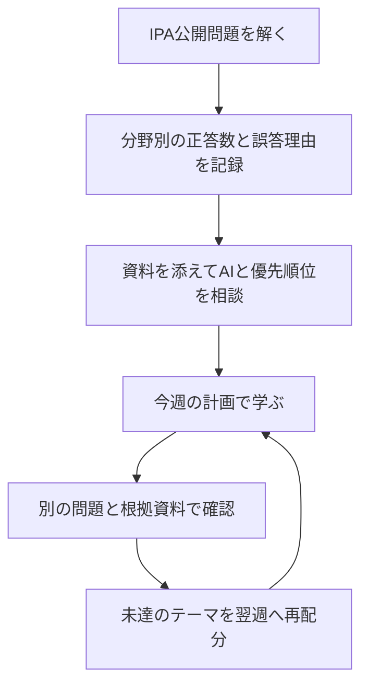

ITパスポートの勉強に生成AIを使ってみたいけれど、ChatGPT・Gemini・Claudeのどれを選べばいいのか、何から聞けばいいのかで迷っていないでしょうか。

結論から言うと、どのサービスを使っても、進め方は同じです。プロンプトもサービスごとに分ける必要はありません。

分かれ目は、ツール選びではなく、<strong>AIを「答えを教えてくれる先生」ではなく、「自分の結果を見て一緒に計画を立てるコーチ」として使えるかどうか</strong>です。

この記事では、まず公式の過去問で今の実力を測り、その結果をAIに読ませて得意と苦手を切り分け、学ぶ項目のスケジュールをAIと一緒に積み上げていく手順を、どのサービスでも使える共通のプロンプトで紹介します。

---

## サービスはどれでもいい

ChatGPT・Gemini・Claudeは、いずれもITパスポートの勉強に十分使えます。用語の説明、間違えた問題の分析、学習計画づくりといった、この記事で紹介する使い方は、どのサービスでもできます。

| 迷ったときの選び方 | 例 |
|---|---|
| すでに使っているサービスがある | そのまま使う。新しく覚える手間がいちばん少ない |
| Googleのサービスをよく使う | Gemini |
| 特にこだわりがない | 無料プランで1つ試し、使いやすいと感じたものを続ける |

まずは手元のプランで、短い質問を一つ試してください。利用上限や機能は変わるため、教材の参照と質問を続けられるかで判断します。

大事なのは、どのサービスを使うかより、何をAIに渡し、何を一緒に決めるかです。その最初の材料が、公式の過去問です。

## まず公式の過去問を解いて、今の実力を測る

AIに相談する前に、まず自分の実力を測ります。AIは、あなたの今の状態を知らないからです。

IPAの公式サイトでは、ITパスポートの過去の公開問題と解答が無料で公開されています。本番と同じ画面で解ける「CBT疑似体験ソフトウェア」も用意されています。[IPAの公開問題・解答例](https://www3.jitec.ipa.go.jp/JitesCbt/html/openinfo/questions.html)から1回分（100問）を選び、解いてみてください。操作練習用の疑似体験も同ページから案内されています。

解き終えたら、次のことを記録します。

- 総合の正答数
- ストラテジ系・マネジメント系・テクノロジ系、それぞれの正答数
- 間違えた問題のテーマ（例：損益分岐点、ネットワーク、知的財産権）

勉強を始める前の状態で解いてかまいません。わからない問題は勘で答えて大丈夫です。この記録が、AIと計画を立てるための材料になります。



> [!exp]
> テキストも一応購入していますが、過去問を繰り返し解いて、9割以上を安定して取れるくらいにしたほうがいいと考えています。過去問を5年分ほど解くと分かりますが、出題はおおむね共通しています。ただし毎年の出題には最新の情報やトレンドが含まれ、今は生成AI関連も入るので注意が必要です。

## 結果をAIに読ませて、得意と苦手を切り分ける

過去問の結果をAIに渡します。次の数字は入力形式を示す仮の例で、筆者の受験結果ではありません。自分の記録に置き換えてください。

合格基準は総合評価点600点以上、各分野300点以上です。ただしIRT方式のため、公開問題の正答率から評価点や合否は算出できません。[IPAの合格基準・採点方式](https://www3.jitec.ipa.go.jp/JitesCbt/html/about/range.html)

```text
ITパスポート試験の勉強を始めます。
IPAの公開問題を1回分解いた結果は次のとおりです。

- 総合：**52問 / 100問**
- ストラテジ系：**22問 / 35問**
- マネジメント系：**10問 / 20問**
- テクノロジ系：**20問 / 45問**
- 間違えたテーマ：損益分岐点、稼働率、IPアドレス、暗号化、プロジェクトの日程計算、著作権

この結果から、
1. 私の**得意な分野**と**苦手な分野**
2. 正答率と誤答テーマから、復習を優先する分野（評価点や合否は推定しない）
3. 苦手なテーマのうち、優先して学ぶべきものの順番
を整理してください。
添付するシラバスと公式解答例を根拠とし、情報が足りなければ先に質問してください。
```

AIは、結果を分野ごとに整理し、どこから手をつけるべきかを提案してくれます。

自分で表を眺めているだけでは、「全部できていない気がする」と感じてしまいがちです。AIに整理してもらうと、得意な分野と、伸ばす必要がある分野がはっきり分かれて見えてきます。

| 記録から分かる状態 | 計画に入れること |
| --- | --- |
| 正解したが理由を説明できない | 解けた問題も復習対象に残す |
| 用語の意味を知らなかった | 参考書の該当節で定義を確かめる |
| 計画した時間を確保できなかった | 翌週の量を減らし、優先順位を付け直す |

学ぶテーマの抜けは[ITパスポート20時間コース](/course/ip/)の診断と目次でも探せます。得意と苦手が分かれたら、次は日々の予定に落とし込みます。

## 学ぶ項目のスケジュールを、AIと一緒に積み上げる

### 最初の計画を立ててもらう

```text
さきほどの分析をもとに、ITパスポートの学習計画を立ててください。

- 試験日：**〇月〇日**
- 勉強できる時間：平日30分、休日2時間
- 教材：IPAの公開問題と、手持ちの参考書1冊（使用年度・章目次を添付）

週ごとに「学ぶテーマ」と「その週の終わりに確かめること」を決め、
1日ごとのタスクは30分以内で終わる大きさにしてください。
```

### 毎週、結果を報告して組み直す

計画は、一度立てたら終わりではありません。1週間ごとに、進み具合をAIに報告して、翌週の計画を組み直します。

```text
今週の結果を報告します。
- 予定どおり終わったテーマ：損益分岐点、著作権
- 終わらなかったテーマ：IPアドレス（理解に時間がかかった）
- 確認の問題の正答率：ストラテジ系 7割、テクノロジ系 4割

この結果をふまえて、来週の計画を組み直してください。
遅れているテーマは、無理に詰め込まず、全体の順番から見直してください。
```

計画を立て、やってみて、結果を報告し、組み直す。この繰り返しを、AIと一緒に積み上げていくイメージです。一人で計画を立てると、遅れたときに計画ごと投げ出してしまいがちですが、AIに報告して組み直してもらえば、何度でも立て直せます。

計画が回り始めたら、日々の勉強でつまずいた用語を、AIとの対話で一つずつ解消していきます。

## つまずいた用語は、対話で理解する

### 用語を身近な例で説明してもらう

```text
ITパスポートの「**[用語名]**」がよくわかりません。
ITの知識がない人にもわかるように、日常生活の例えを使って説明してください。
説明のあと、私が理解できたか確かめる質問を1つだけしてください。
```

最後の「質問を1つだけ」がポイントです。説明を読んでわかった気になるのを防ぎ、自分の言葉で答えることで理解が定着します。

### 間違えた問題を分析してもらう

```text
ITパスポートの過去問で、次の問題を間違えました。
（問題文、選択肢、自分が選んだ答え、正解を貼る）

1. なぜ私の答えが間違いなのか
2. 正しい答えにたどり着く考え方の手順
3. この問題と混同しやすい用語の組み合わせ
を教えてください。
```

### 似た用語の違いを整理してもらう

```text
ITパスポートの「**[用語A]**」と「**[用語B]**」の違いがわかりません。
定義・使われる場面・試験での問われ方の3つで、表にまとめてください。
```

AIの説明には、誤りが混ざることがあります。用語の定義や数値で迷ったら、IPAのシラバス・公開問題・解答例や参考書で確かめてください。AIの答えを確かめる習慣そのものが、正しい知識を選び取る練習にもなります。

## 試験の2週間前に、もう一度過去問を解く

試験の2週間ほど前に、最初とは別の年度の公開問題を1回分解きます。CBT疑似体験ソフトウェアで、本番と同じ画面に慣れておくのもこのタイミングがおすすめです。

結果を最初の診断と同じ形でAIに渡し、残りの2週間で何を優先するかを決めてもらいます。正答率が低い分野や、正解理由を説明できないテーマを優先します。公開問題の結果は本番の300点と直接比較しません。

---

## この記事の深掘りインデックス

| 記事 | こんな人に |
|---|---|
| [IPA試験のAI勉強法まとめ｜学習の段階と試験区分から、読む記事を選ぶ](/method/practice-guide-ipa/) | IPA試験全体の進め方を知りたい |
| [AIをメンターにする学習ロードマップ](/method/ai-mentor-study-method-roadmap/) | 社会人として学習時間をつくりたい |
| [NotebookLM資格試験活用ガイド](/method/notebooklm-features-guide/) | シラバスを読み込ませて、フラッシュカードや音声で学びたい |
| [ストラテジ系をAIの「たとえ話」で理解する](/method/ip-strategy-ai-hack/) | ストラテジ系だけが苦手 |
| [資格試験の直前10日の過ごし方](/method/exam-final-10-days/) | 試験まで2週間を切っている |
| [FE科目Bを生成AIで学ぶプロンプト集](/method/fe-subject-b-ai-prompt-hub/) | ITパスポートの次に基本情報を目指す |

---

## まとめ

生成AIをコーチにしてITパスポートに合格するまでの進め方は、ChatGPT・Gemini・Claudeのどれを使っても同じです。

- サービスはどれでもいい。すでに使っているものから始める
- まず公式の過去問を解き、分野ごとの結果を記録する
- 結果をAIに読ませて、得意と苦手を切り分ける
- 学ぶ項目のスケジュールをAIと立て、毎週報告して組み直す
- つまずいた用語は、対話で一つずつ理解する。AIの答えは公式資料で確かめる

これで、AIに何を渡し、何を一緒に決めればいいかがわかり、今日から自分のコーチとしてAIを使い始められるはずです。

ITパスポートの試験の全体像は、[ITパスポート 合格ロードマップ](/method/itp-hub/)にまとめています。
