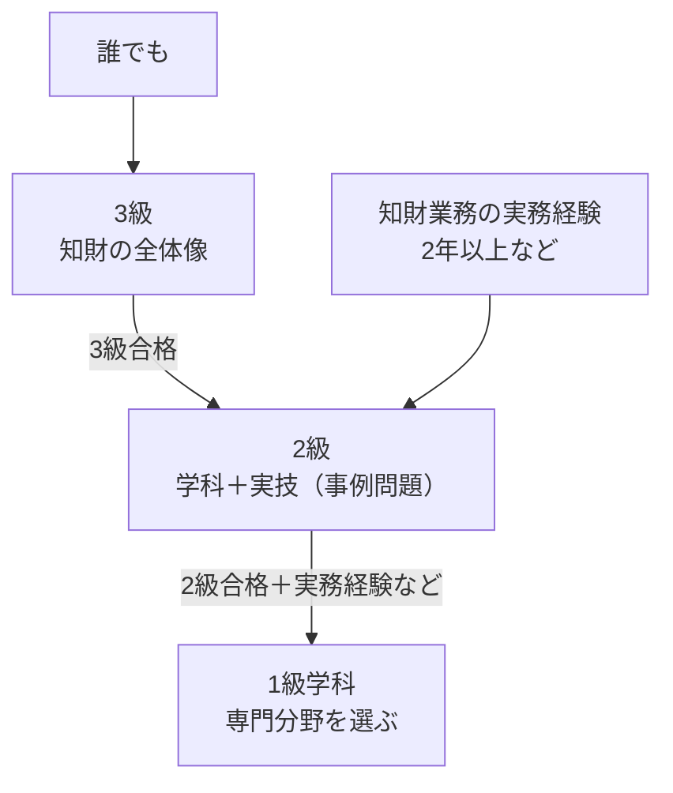

生成AIの普及で、著作権や商標の話題を仕事で耳にする機会が増えていないだろうか。

知財検定で学ぶのは、特許・著作権・商標などを仕事の場面で扱うための知識だ。どの級から始めるかは、知識だけでなく受検資格で分かれる。

筆者は知財検定を未受験であり、この記事は公式の試験要綱をもとに整理している。

この記事では、3級から1級までの違い・合格ロードマップ・AIを使った学習法を整理し、自分がどの級から始めればいいかを判断できるようにする。


## 知財検定とは何か

知的財産管理技能検定（通称：知財検定）は、一般財団法人知的財産研究教育財団（知的財産教育協会）が実施する国家検定（技能検定）だ。特許・実用新案・意匠・商標・著作権といった知的財産権の実務知識を、体系的に理解しているかを測る試験になっている。出典: [検定の概要](https://www.kentei-info-ip-edu.org/)。

弁理士のような業務独占資格ではないため、「この資格がないとできない仕事」があるわけではない。しかし、企業の法務・知財部門はもちろん、コンテンツ制作・マーケティング・商品開発など、<strong>知的財産に関わるあらゆる職種で「知識の証明」として機能する</strong>資格だ。

たとえば商品企画では名称と商標、制作では画像と著作権というように、担当する仕事と学ぶ権利を結びつけると目的が定まる。次に、受けられる級と学習の出発点を分けて考えよう。


## 合格までの勉強時間

学習時間には公式の標準値がないため、合格に必要な時間は断定しない。まず受検資格を確認し、公式の過去問題で、用語と事例判断のどちらに時間がかかるかを測る。

| 前提知識 | 最初に確保する学習枠（計画例） | 見直す条件 |
| --- | --- | --- |
| 法律・知財の知識なし | 3級の5権利を各1時間確認 | 用語が説明できなければ基礎を追加 |
| 業務で一部の権利に触れている | 未経験の権利を先に各1時間 | 得意分野だけで判断しない |
| 3級合格済み | 2級の学科・実技を各1回解く | 事例で要件を挙げられなければ演習を追加 |

これは合格時間の統計ではなく、残りの計画を作るための試行枠だ。[公式の過去問題](https://www.kentei-info-ip-edu.org/gakushujoho/kakomon/)で、解答だけでなく判断の根拠まで確かめる。

### AI活用で専任講師を月額20ドルで雇う感覚

知財検定の学習で最初につまずくのは、<strong>法律の条文が抽象的で、実務のイメージが湧かない</strong>ことだ。特許法・著作権法の条文をそのまま読んでも、「結局それが自分の身の回りの何に当てはまるのか」が分からず暗記に頼りがちになる。

AIを使えば、この「条文と実務の距離」を縮められる。

```
著作権法の「複製権」について、法律の定義をそのまま説明するのではなく、
「スマホで撮った写真をSNSに投稿する」「会議資料に他社の画像を貼る」といった
身近な行為が複製権とどう関係するか、具体例で説明してください。
```

2級・1級の実技試験では「この事例で権利侵害が成立するか」を判断させる問題が出る。判例や条文の要件を丸暗記するのではなく、AIとの対話で「なぜその要件が必要とされているか」の論理から理解しておくと、初見の事例問題にも対応しやすくなる。2級実技の判断ステップを分解する具体的な練習法は、後述の「2級の実技（事例問題）が解けないとき」で解説している。


## 3級・2級・1級の違い

### 3級 — 知財の全体像を掴む入門級

3級は特許・実用新案・意匠・商標・著作権の基本を横断的に学ぶ内容だ。受験資格がなく、誰でも挑戦できる。法律の知識がない場合は、この級の範囲から用語と保護対象を整理する。

まず知財の世界の「地図」を作ることが目的の級であり、深い実務判断までは求められない。

### 2級 — 実務での判断力が問われる中級

2級になると、単なる制度の理解だけでなく「この状況でどう対応すべきか」という実務的な判断力が問われる。3級合格や知財業務2年以上などの受検資格がある場合に、直接目指すこともできる。出典: [受検資格](https://www.kentei-info-ip-edu.org/exam#s_range)。

実技試験では事例問題が中心になり、「この製品デザインは意匠権と著作権のどちらで保護すべきか」といった、複数の権利の使い分けを考える練習が役立つ。

### 1級 — 専門分野に特化した最難関級

1級は「特許専門業務」「コンテンツ専門業務」「ブランド専門業務」の3分野に分かれており、自分の実務や志向に合わせて選択する。学科と実技で条件が異なり、学科は知財業務4年以上、または2級合格と知財業務1年以上などが入口になる。実技は当該分野の学科合格などの条件を別に確認する。出典: [1級の試験要綱・受検資格](https://www.kentei-info-ip-edu.org/exam#s_range)。

実務経験者向けの資格であり、知財部門でのキャリアを本格的に築きたい場合の到達点となる。


| 状況 | 最初の選択 | 判断の理由 |
| --- | --- | --- |
| 知財業務未経験で2級の受検資格もない | 3級 | 全体像を学び、2級への受検資格を得る |
| 2級の受検資格があり、基礎用語も説明できる | 2級の過去問題で不足を確認 | 3級を順番に受ける必要はない |
| 専門分野の業務経験がある | 1級の学科・実技の条件を別々に確認 | 2級合格だけで1級の全試験を受けられるとは限らない |

3つの級と受検資格の関係は次のとおり。図は代表ルートに絞っている。出典: [受検資格一覧](https://www.kentei-info-ip-edu.org/exam#s_range)。



## 特許・実用新案・意匠・商標・著作権の違い

知財検定の学習で最初に整理すべきなのが、5つの権利の違いだ。

| 権利 | 保護対象 | 存続期間の目安 |
|---|---|---|
| 特許権 | 技術的なアイデア（発明） | 出願から20年 |
| 実用新案権 | 物品の形状・構造の考案（簡易な技術） | 出願から10年 |
| 意匠権 | 物品や画面のデザイン | 出願から25年 |
| 商標権 | 商品・サービスを識別するマーク・ネーミング | 登録から10年（更新可） |
| 著作権 | 思想・感情を創作的に表現したもの | 原則、著作者の死後70年 |

期間は原則を示している。意匠の25年は2020年4月1日以後の出願が対象で、権利の発生時点とは区別する。法人名義の著作物などには別の期間規定がある。出典: [産業財産権の概要｜特許庁](https://www.jpo.go.jp/system/patent/gaiyo/seidogaiyo/chizai01.html)、[著作権法第51〜54条](https://laws.e-gov.go.jp/law/345AC0000000048)。

この5権利は「何を守るか」が明確に異なる。試験対策としては、具体的な製品を1つ想定し、「この製品のどの部分がどの権利で守られているか」を自分で仕分ける練習が効果的だ。生成AIと著作権の関係については[知的財産権・不正競争防止法・下請法・契約形態とは？](/theory/it-legal-basics-ip-subcontract-contracts/)で詳しく解説している。


## AIを専任講師にする学習プラン

### これから勉強する人向け

知財の実務経験がない場合、まず3級の全体像を掴んでから2級に進むのが王道ルートだ。

```
私は法務・知財の実務経験がない社会人です。
知的財産管理技能検定3級を1ヶ月で合格したいので、
平日1時間・休日2時間の学習時間を前提に、
特許・実用新案・意匠・商標・著作権の5分野を
バランスよくカバーする4週間の学習スケジュールを、
その配分にした理由も含めて作成してください。
```

スケジュールを丸ごと受け取るのではなく、AIに理由を説明させることで、進捗が遅れた際に自分で計画を調整できるようになる。

### 現場経験者向け

すでに知財関連の実務に携わっている場合は、実務知識を試験向けに翻訳する作業がボトルネックになりやすい。

```
私は商品企画職で、意匠登録の実務には多少関わっていますが、
特許法・著作権法の体系的な知識は独学したことがありません。
実技試験の過去問形式で、私の実務知識で対応できる部分と、
明確に知識が不足している部分を切り分けて指摘してください。
```

「知っているつもり」を可視化し、知識の穴だけをピンポイントで埋めるアプローチが、実務経験者にとって最も時間対効果が高い。

### 2級の実技（事例問題）が解けないとき

2級の実技試験は、学科と違い、事例への<strong>当てはめ</strong>が中心です。「この商品デザインは意匠権と著作権のどちらで保護されるか」「この行為は特許権の侵害に当たるか」のように、条文の知識をその場で応用して答えます。伸び悩む原因は、知識の不足というより、「この事例で権利の侵害が成立するか」を判断する<strong>ステップの型</strong>が身についていないことが多くあります。

つまずく所は、次のような状態です。

- 条文の要件は知っているが、具体的な事例にどう当てはめるか分からない
- 似た権利（意匠権と著作権、特許権と実用新案権）のどちらが問われているのか、事例文から読み取れない
- 「成立する・しない」で判断が割れたときに、決め手が分からない

事例問題を解いたら、答え合わせで終わらせず、AIに「どういう順番で判断すればよかったか」を分解してもらいます。

```text
知財検定2級の実技問題です。以下の事例を読んで、私は（自分の判断）と考えましたが、模範解答では（模範解答の判断）とされていました。

【事例】
（事例文を貼る）

この事例を正しく判断するために、どういう順番で、何を確認すればよかったのか、判断ステップを1から順番に説明してください。
私がどこで判断を誤ったのかも指摘してください。
```

分解してもらった判断ステップは、他の事例にも使える「型」になります。何問か繰り返すと、「まず保護の対象の性質を確認する、次に該当する権利を絞り込む」という流れが身についてきます。

混同しやすい権利のペアは、具体的な製品を題材に、判定の練習をくり返します。

```text
身近な製品を1つ挙げて、それがどの知的財産権（特許・実用新案・意匠・商標・著作権）で保護され得るか、複数の権利が重複する可能性も含めて分析してください。
分析のあと、私に同じ形式のクイズを1問出してください。
私が答えたら、判断の根拠が合っているかどうかを添削してください。
```

問題を出してもらって解くだけでなく、自分の判断の<strong>根拠</strong>を毎回添削してもらうことで、暗記ではなく判断のロジックそのものが鍛えられます。AIの判断は誤ることがあるので、条文や公式の過去問・解答で確かめてください。

<!-- AI_EXAMPLE: 使うAI=筆者が選ぶチャットAI / プロンプト=本文「2級の実技（事例問題）が解けないとき」の判断ステップ / 見せたいこと=条文の要件と事例の事実を分けられるか、公式解答との照合 -->


## キャリア戦略 — 知財検定をどう活かすか

### 生成AI時代に高まる知財リテラシーの需要

生成AIで作成したコンテンツの著作権・商標権の扱いは、多くの企業でまだ明確なルールが整備されていない。知財検定で学ぶ基礎知識は、権利関係を調べる必要がある場面の切り分けに使える。ただし、検定合格と個別案件への法的助言は別に考える。

マーケティング・コンテンツ制作・商品開発など、直接「知財担当」でない職種でも、AI活用が広がるほど知財リテラシーの知識を使う場面がある。

### 弁理士へのステップとしての位置づけ

知財検定は弁理士資格とは別の試験だが、知財の実務知識の土台を作る意味で、弁理士を目指す人の最初のステップとしても使われる。2級・1級で得た知識には弁理士試験と重なる部分があるが、検定合格で弁理士業務ができるわけではない。

### 資格の組み合わせ

- <strong>知財検定 + ITパスポート</strong>：DX推進部門で「技術と権利の両方が分かる」知識の組み合わせを説明できる
- <strong>知財検定 + マーケティング系資格</strong>：コンテンツビジネス・ブランディング領域での専門性を補強できる

---

## まとめ

知財検定は「特許・商標・著作権を知っている」という証明にとどまらず、生成AI時代に急増する知財論点を整理できる実務力の土台になる資格だ。

- 3級は誰でも挑戦できる入門級、2級は実務判断力、1級は専門分野特化の最難関級
- 5つの権利（特許・実用新案・意匠・商標・著作権）の違いを具体例で仕分ける練習が学習の鍵
- AIとの対話で条文の抽象度を実務レベルまで具体化することが、独学の最大の壁を越える方法になる

まず3級の範囲から、身の回りの製品を題材にAIと「これはどの権利で守られているか」を対話してみるところから始めてほしい。
