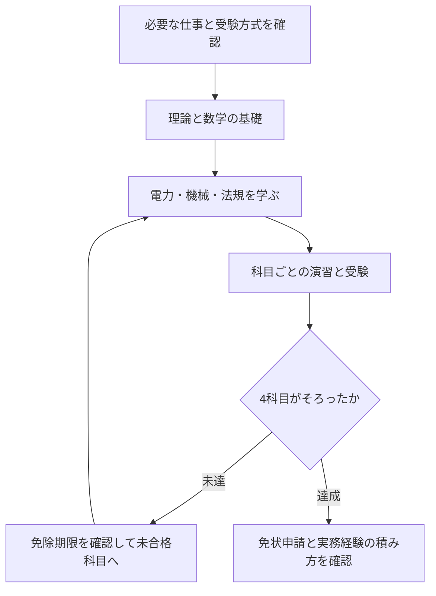

電験三種という資格の名前を聞いたことはあっても、どんな仕事に使う資格なのかまでは知らない、という人は多いのではないでしょうか。

電験三種を検討するときは、合格後に設備管理の仕事へ進むのか、実務経験を積んで独立を目指すのかで、確認すべき条件が変わります。タイトルの「高給と独立」は進路の可能性を示すもので、免状だけで収入が決まるわけではありません。

ただし、合格までに1000時間ほどかかるとも言われる難しい試験です。答えの方向性を先に言うと、受けるかどうかは、<strong>自分の仕事に必要か、電気に興味があるか</strong>で決めるのがおすすめです。

この記事では、電験三種がどんな資格かを整理したうえで、受けるかどうかの決め方と、合格までの進め方を説明します。

## 電験三種は電気設備の保安を任される資格

<strong>電験三種</strong>は、正式には<strong>第三種電気主任技術者試験</strong>といいます。電気事業法にもとづく国家資格です。

高圧・特別高圧で受電するビルや工場などでは、原則として電気設備の保安を監督する<strong>電気主任技術者</strong>の選任が必要です。第三種の範囲は電圧5万ボルト未満の事業用電気工作物で、出力5千キロワット以上の発電所は除きます。[電気技術者試験センターの資格概要](https://www.shiken.or.jp/chief/about/)

保安の監督を担う進路を選ぶ際は、勤務先が求める免状と、実際に担当する設備を合わせて確認します。

### 実務経験を積むと、独立して働ける

電験三種のもうひとつの特徴は、<strong>独立して働く道がある</strong>ことです。

一定の要件を満たす施設では、設置者が保安管理業務を外部委託し、承認を受ける制度があります。受託する<strong>電気管理技術者</strong>には免状に加えて実務経験などの要件があります。第三種の実務期間は原則5年以上ですが、講習・訓練等による短縮もあるため、一律5年とは限りません（2026年11月時点）。[経済産業省の外部委託承認制度の概要](https://www.meti.go.jp/shingikai/sankoshin/hoan_shohi/denryoku_anzen/hoan_seido/pdf/016_01_01.pdf)

会社に勤めながら選任されて資格手当を受けることも、経験を積んで独立することもできる。この両方の道があることが、電験三種が「高給かつフリーランスを狙える資格」と言われる理由です。委託の条件は変わることがあるので、くわしくは経済産業省や各地の産業保安監督部の案内で確認してください。

## 電気工事士との違い

電気の資格としてよく比べられるのが、<strong>電気工事士</strong>です。

| 資格 | できること | 試験 |
| --- | --- | --- |
| 電気工事士（第二種・第一種） | 電気の配線などの工事をする | 筆記試験と、実際に配線を作る技能試験 |
| 電験三種 | 電気設備の保安を監督する | 4科目の筆記試験（技能試験はない） |

電気工事士は「工事をする資格」、電験三種は「設備を安全に保つよう監督する資格」です。

配線工事の作業を目指すなら電気工事士、設備全体の保安監督を目指すなら電験三種、という仕事の違いから選びます。技能と筆記のどちらが難しいかだけで決めないようにしましょう。

電験三種は、技能試験はないかわりに、電気の理論や法律を深く問う筆記試験が難関になります。

## 受けるかどうかは「必要か」「興味があるか」で決める

受けるかを決めるときは、他人の短期合格例より、自分が確保できる学習時間と目指す仕事を基準にします。

多くの人にとって、電験三種は数百時間から1000時間を超える勉強が必要な試験です。勢いで始めると、途中で続かなくなりがちです。挑戦する前に、次の2つを考えてみてください。

| 考えること | 当てはまる人 |
| --- | --- |
| 仕事で必要か | ビルメンテナンスや工場の設備管理で働いている、または目指している。会社から取得を求められている |
| 電気に興味があるか | 電気の仕組みを知ること自体が楽しい。将来、独立して働く道に魅力を感じる |

どちらかに当てはまるなら、長い勉強を続ける理由になります。どちらにも当てはまらないなら、まずはほかの資格から考えても遅くありません。ビル管理の仕事の入口としては、[ボイラー技士・冷凍機械責任者 合格ロードマップ](/method/boiler-refrigeration-hub/) や [ビルメン4点セットの取得順番](/method/bilmen-4tenset-junban/) から検討する方法もあります。

## 試験の全体像

試験は4科目で、年に2回（上期・下期）行われます。会場で紙の問題を解く方式のほか、テストセンターのパソコンで受ける方式（CBT）も選べます。

2026年11月時点、令和8年度下期の申込は11月9〜26日、CBTは2027年2月4〜28日、筆記は3月21日です。受験手数料はインターネット7,700円・書面8,100円（非課税）。[試験センターの令和8年度日程・手数料](https://www02.shiken.or.jp/chief/upload/R08denkennittei2.pdf)

同時点で公表済みの令和8年度上期は、受験者25,127人に対する4科目合格者3,223人、合格率12.8%です。この全体の数字と、各科目の合格率は分けて読みます。[試験センターの上期結果](https://www.shiken.or.jp/ecee-overview/press/upload/251R08denkenT01kekka.pdf)

| 科目 | 内容 |
| --- | --- |
| 理論 | 電気回路、電磁気、電子回路の基礎 |
| 電力 | 発電、変電、送電、配電 |
| 機械 | 電動機、変圧器、照明、パワーエレクトロニクスなどの機器 |
| 法規 | 電気事業法、電気設備の技術基準 |

### 科目別合格で、数年に分けて取れる

電験三種には<strong>科目別合格</strong>の仕組みがあります。合格した科目は、その後の一定期間（おおむね3年間）の試験で免除されます。

4科目を1回で合格する必要はなく、年に2回の試験を使って、数年かけて取り切る計画が立てられます。正確な条件や最新の日程は、[電気技術者試験センター](https://www.shiken.or.jp/)で確認してください。



免除期限が近い科目があるなら、その期限から逆算します。初回で期限がないなら、まず理論の短い計算を自力で説明できるかを見て、同時に取り組む科目数を決めましょう。

## 合格までの勉強時間と進め方

勉強時間は、数学や物理にどのくらい慣れているかで大きく変わります。

以下は本記事の計画用の目安で、公式の必要時間ではありません。最初の演習で、式の意味と単位を説明できるかを確かめて配分を調整します。

| 今の状態 | 勉強時間の目安 |
| --- | --- |
| 数学・物理をほとんど忘れている | 1,200〜1,500時間 |
| 高校の理系科目の基礎がある | 800〜1,000時間 |
| 電気工事士を持っている | 600〜800時間 |

### 2年で取り切る進め方の例

| 時期 | 科目 | ポイント |
| --- | --- | --- |
| 1年目の前半 | 理論 | ほかの3科目の土台。高校の数学（三角関数・複素数など）の復習もここで |
| 1年目の後半 | 法規 | 覚える内容が中心で、理論より取り組みやすい。理論と法規の2科目合格を狙う |
| 2年目 | 電力・機械 | 理論の知識を前提に、機器や設備の仕組みを学ぶ。機械は計算が多く手強い |

最初に理論を固めることが、いちばん大切です。電力や機械の問題も、理論の考え方の上に成り立っているからです。

## 数式で止まったら、AIに意味から聞く

電験三種の独学で多くの人が止まるのは、テキストに並ぶ数式の意味が腹に落ちないまま進んでしまうことです。「なぜこう変形できるのか」「この法則はどんな場面で使うのか」がわからないまま進むと、後半の科目で崩れます。

手が止まったら、生成AIに意味から説明してもらいます。参考書の式をスマホで撮影して画像で渡すと、式を打ち込む手間も省けます。

```text
電験三種の「理論」を勉強しています。
次の問題の解き方を教えてください。

問題:（ここに問題文を貼るか、画像を添付する）

次の順で説明してください。
1. どの法則を使うか、なぜその法則を選ぶのか
2. 計算の過程（式の変形の理由も添えて）
3. 答えと単位の確認
4. **この問題のパターンで間違えやすい所**
```

専門用語がわからないときは、「電気の専門家ではない人に、日常の例えで説明して」と頼むと、イメージがつかみやすくなります。

AIの計算や説明には、まれに誤りがあります。答えは必ず参考書の解説と照らし合わせて確かめてください。

<!-- AI_EXAMPLE: 使うAI=普段使う生成AI / プロンプト=数式で止まったら、AIに意味から聞く / 見せたいこと=法則の選択理由・式変形・単位が参考書と一致するか -->

## 電験三種と組み合わせたい資格

| 資格 | 組み合わせる意味 |
| --- | --- |
| 電気工事士（第二種・第一種） | 監督だけでなく、工事の作業もできるようになる |
| エネルギー管理士 | 工場などの省エネの管理も任されるようになる |
| 消防設備士（甲種4類） | 自動火災報知設備の工事や点検もできる。電験の免状があれば甲種の受験資格を満たせる |
| ビル管理士 | ビルの衛生管理まで含めて、ビル管理全体を任されやすくなる |

消防設備士の進め方は [消防設備士 合格ロードマップ](/method/shobo-setsubi-hub/)、ビル管理士は [ビル管理の管理者を目指す資格](/method/biru-kanri-hub/) で扱っています。

---

## まとめ

電験三種は、電気設備の保安監督を目指す資格です。独立を考える場合は、合格後の実務経験などの要件も確認します。

- ビルや工場の電気設備の保安を監督する資格で、資格がないとできない仕事がある
- 実務経験を積むと、電気管理技術者として独立する道もある
- 電気工事士は「工事をする」資格、電験三種は「保安を監督する」資格。目指す仕事から選ぶ
- 勉強には長い時間がかかる。仕事で必要か、電気に興味があるかで挑戦を決める
- 科目別合格を使い、理論から順に数年かけて取り切る

これで、電験三種に挑戦するかどうかを、自分の状況から判断できるはずです。挑戦すると決めたら、まずは理論の過去問を1問読み、どの法則を使う問題なのかを確かめてみてください。
