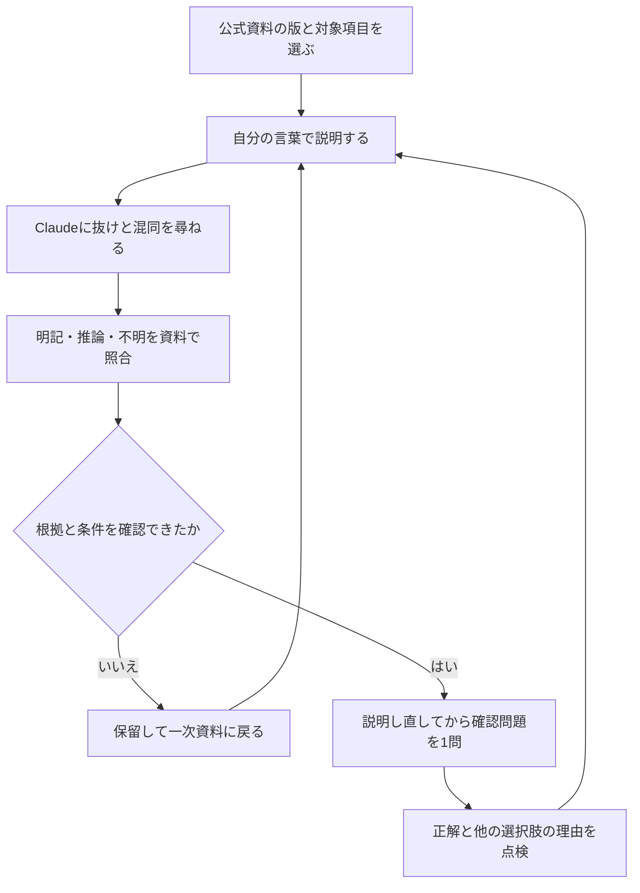

データマネジメント試験を勉強したくても、過去問が見つからず、何を解けばよいか分からない。新設予定の試験では、問題の量より先に、正誤を確かめる資料を決める必要があります。

公式資料とClaudeを組み合わせるなら、まず概念を説明できるか点検し、その後に確認問題を使います。この記事では、資料の選び方と、AIの説明を学習に採用してよいかの判断基準を用意します。

## 過去問・公式サンプル・AIの確認問題を分ける

2026年11月2日時点で、IPAはDMを含む新試験制度を2027年度から開始予定とし、科目A・科目Bのサンプル問題を公開しています。ここで使うのは実施済み本試験の過去問ではなく、公開サンプルです。[IPA「新試験制度のサンプル問題」](https://www.ipa.go.jp/shiken/syllabus/henkou/2026/20260622.html)

IPAはサンプルについても、本試験と同じ問題作成・チェックのプロセスを経たものではないと注記しています。AIが作る問題の難易度を、サンプルに似ているだけで本番相当とは判断できません。[同ページ「サンプル問題」の注記](https://www.ipa.go.jp/shiken/syllabus/henkou/2026/20260622.html)

| 資料 | 学習での役割 | そこから断定できないこと |
| --- | --- | --- |
| 公式シラバス案 | 学ぶ知識と技能の幅・深さを確認する | 今後も文言や範囲が変わらないこと |
| 公式サンプル問題 | 示された場面と選択肢の読み方を確認する | 本番の全難易度や分野ごとの出題比率 |
| AIが作る説明・確認問題 | 自分が説明できない点を見つける | 公式見解・本番の予測・合格判定 |

シラバス案は公表時点の検討状況に基づき、変更の可能性がある資料です。学習開始時と受験案内の確認時に、版を見直してください。[IPA「新試験制度のシラバス案」](https://www.ipa.go.jp/shiken/syllabus/henkou/2026/20260630.html)

## 最初の一題は、説明できる範囲から決める

シラバス案の中分類8「データマネジメント」には、ガバナンスや品質管理などが含まれます。用語名だけをAIへ投げるより、その用語が載る項目の説明も一緒に読みます。[IPA公表のシラバス案](https://www.ipa.go.jp/shiken/syllabus/henkou/2026/20260630.html)

たとえば「データ品質」であれば、「欠損値はすべて削除すればよい」と覚える前に、何が欠けていて、どの業務判断に影響するのかを考えます。これは学習用の論点であり、公式問題の解答やAIの実行結果ではありません。

先に[データマネジメント試験のコース](/course/dm/)で用語の関係を読み、公式サンプルで設問の条件を確認します。説明できない語を一つ選んだら、次の対話に進みます。

## Claudeには、出題の前に理解の穴を点検してもらう

公式シラバス案の対象項目を開き、項目名・版・該当箇所を控えます。必要な範囲の抜粋と自分の説明を、以下の欄へ入れて使ってください。

本文に根拠があることと、自分で考えた例であることを分けて答えさせるのが狙いです。資料を渡しても、範囲外の説明や誤った出典がなくなるわけではありません。

### 理解を点検するプロンプト

```text
データマネジメント試験（仮称）の学習を手伝ってください。
あなたは公式の作問者ではありません。出題予測や合格判定はしないでください。

【資料名・版・ページ・項目名】
（ここに記入）
【シラバス案の対象箇所の抜粋】
（必要な箇所だけを記入）
【私の理解】
（用語の意味と、なぜ業務で必要かを自分の言葉で記入）

まず、私の説明に抜け・混同・飛躍があるか指摘してください。
次の3つを分けてください。
- 抜粋に直接書かれていること：対応する語句を示す
- 抜粋をもとに説明したこと：推論であると示す
- この資料だけでは確かめられないこと：不明と示す

一度に一つだけ質問し、私の説明し直しを待ってください。
説明を直せたあとでのみ、理解確認の短い問題を1問提案してください。
その問題は学習用の自作問題と明示し、公式問題や本番相当と表現しないでください。
正解を一つに決めるための条件が足りなければ、問題を出す前に指摘してください。
```

<!-- AI_EXAMPLE: 使うAI=Claude / プロンプト=本文の理解を点検するプロンプト / 見せたいこと=データ品質の理解の穴を指摘し、資料の明記・推論・不明を分けた実際の回答と、利用者が照合した記録 -->

確認問題が出たら、答えを覚える前に根拠を見ます。以下の表を通らない問題は、その回の練習から外してください。

## AIの説明・確認問題を採用する基準

| 確認した条件 | 判断 | 次の行動 |
| --- | --- | --- |
| 指した項目と語句が実際の資料にあり、説明も対応する | 学習メモに採用できる | 資料名・版・項目を一緒に記録する |
| 用語は載るが、正解の根拠となる条件がない | 保留する | 足りない前提を尋ね、例と定義を分ける |
| 他の選択肢も正しく読める | 問題としては使わない | 複数解になった理由を確認する |
| 出典のページや文言が存在しない | 採用しない | 一次資料に戻り、その説明を覚えない |

シラバスは項目を列挙した学習指針でもあるため、用語の定義や細かな実務ルールがすべて書かれているわけではありません。「シラバスに語がある」だけで、AIの解説全体に裏付けが付いたことにはなりません。

法令や個別の技術仕様に踏み込む説明は、その一次資料を別に確認できるまで保留します。AI自身に「正しいです」と言わせることは、検証の代わりになりません。

## 一問ずつ、説明と照合を回す流れ



<!-- LEARNER_NOTE: 候補=AIの説明に存在しない出典や条件不足を見つけ、指示を直した実際の場面 / 種類=think / 筆者の実体験で記入 -->

この流れでは、作った問題数より「根拠を確認して説明し直せた項目」を記録します。資料名・項目・最初の説明・修正した点の4欄を残すと、次に読む場所を決められます。

## 次の一歩は、問題を増やす前に根拠を一つ確かめる

過去問がない時期でも、学ぶ項目と理解の穴は確認できます。ただし、AIの確認問題は公式の代わりにはならず、本番の難易度や合格までの時間も推定できません。

まずは公式サンプルの一題と関連するシラバス項目を選び、説明できない語を一つだけ点検してください。分野のつながりへ戻りたい場合は[DMコースの入口](/course/dm/)から該当章を選べます。
