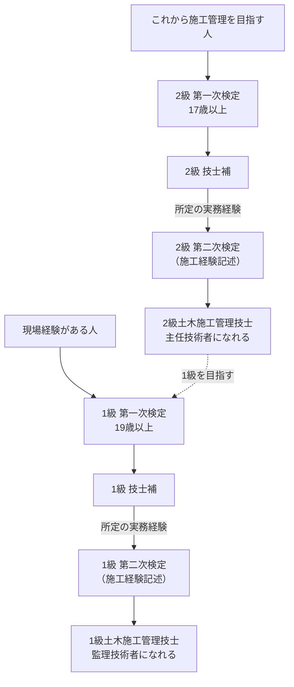

結論：土木施工管理技士は独学でも十分に合格を狙える資格だが、第二次検定の<strong>施工経験記述</strong>だけは一人での対策に限界がある。本記事では1級・2級の制度の違いと必要勉強時間を整理したうえで、生成AIを専任講師として使い、経験記述をAIに添削してもらいながら独学で合格まで到達する具体的な手順を解説する。

「これから施工管理の仕事に就きたい」人と「現場経験を活かして1級・監理技術者を目指したい」人、それぞれに合ったAI活用法を紹介する。

---

## 合格までの勉強時間

1級と2級では、対象とする工事の規模も必要な学習時間も大きく異なる。

| 区分 | 第一次検定 受験資格 | 必要勉強時間の目安 |
|---|---|:---:|
| 2級土木施工管理技士 | 17歳以上（学歴・実務経験不問） | 100〜150時間 |
| 1級土木施工管理技士 | 19歳以上（学歴・実務経験不問、第一次検定のみ） | 300〜400時間 |

<strong>2024年度の制度改正により、第一次検定は学歴・実務経験を問わず受験できるようになった</strong>。一方で第二次検定（実地）の受験には、第一次検定合格後に所定の実務経験を積むことが必要だ。<strong>「これから施工管理の世界に入る人」は2級から、「現場経験があり監理技術者を目指す人」は1級から</strong>がそれぞれの起点になる。

2級と1級、それぞれの第一次検定・第二次検定の関係を1枚にまとめると、次のようになります。



第二次検定に必要な実務経験の年数は、学歴や保有資格によって変わります。自分の条件は、受検の手引で確認してください。

### AI活用で専任講師を月額20ドルで雇う感覚

土木施工管理技士の独学には、2つの異質な壁がある。

- 第一次検定（学科）の<strong>土木一般・専門土木の用語</strong>は、コンクリートの配合や土工の施工順序など、現場を知らないとイメージしにくい
- 第二次検定の<strong>施工経験記述</strong>は、市販の模範解答がそのまま使えない。「自分が経験した工事」について書く必要があり、添削してくれる相手が身近にいないと改善できない

ChatGPTやClaude、Geminiのような生成AIを使えば、<strong>月額20ドル程度で、何度でも質問・添削を依頼できる専任の試験講師を雇うようなもの</strong>になる。

- 学科で出てくる工法・用語を、図解イメージとともに背景から説明してもらえる
- 自分が書いた施工経験記述の文章を、何度でも添削・ブラッシュアップしてもらえる
- 「この書き方で減点されないか」を、深夜の作業終わりでもすぐ確認できる
- 同じ質問を繰り返しても、相手のスケジュールを気にする必要がない

特に施工経験記述は、<strong>「自分の経験」という唯一無二の素材をAIと一緒に磨き上げる</strong>という、他のどの資格よりもAI活用の効果が分かりやすい分野だ。

---

## 1級・2級の違いとは

1級と2級の最大の違いは「対応できる工事の規模」と「就ける職務」だ。

| 区分 | 取得後にできること |
|---|---|
| 2級土木施工管理技士 | 一般建設業の<strong>主任技術者</strong>になれる |
| 1級土木施工管理技士 | 特定建設業の<strong>監理技術者</strong>になれる（大規模工事の現場に必須） |

公共工事を含む一定規模以上の土木工事では、<strong>元請会社が監理技術者（1級保有者）を配置することが法律で定められており、工事の規模によっては専任が求められる</strong>。金額などの基準は改正されることがあるため、国土交通省の最新の案内で確認してください。そのため建設会社にとって1級保有者の数は、受注できる工事の規模に直結する経営資源そのものになる。

---

## 試験制度の比較表

試験日程と合格率は、年度ごとに変わります。令和8年度（2026年度）の日程は、国土交通省の「令和8年度技術検定スケジュール」では次のとおりです。

| 区分 | 申込受付 | 試験日 | 合格発表 |
|---|---|---|---|
| 1級 第一次検定 | 3月23日〜4月6日 | 7月5日 | 8月13日 |
| 1級 第二次検定 | 3月23日〜4月6日 | 10月4日 | 令和9年1月8日 |
| 2級 第一次検定（前期） | 3月4日〜3月18日 | 6月7日 | 7月7日 |
| 2級 第一次検定（後期）・第二次検定 | 7月8日〜7月22日 | 10月25日 | 12月2日（第一次）／令和9年2月3日（第二次） |

2級の第一次検定（前期）は、種別「土木」のみ実施されます。令和9年度の日程は、国土交通省と、国土交通大臣の指定試験機関である全国建設研修センター（JCTC）の公式サイトで、公表されたら確認してください。合格率は、JCTCの「合格発表公表資料」で確認できます（2026年10月25日時点で、令和8年度の2級第一次検定（前期）と1級第一次検定の合格者発表が掲載されていました）。日程は2026年10月25日に国土交通省の公表資料で確認し、10月27日に全国建設研修センターの案内でも確認しました。

出典: [令和８年度土木施工管理技術検定の実施について｜国土交通省（PDF）](https://www.mlit.go.jp/tochi_fudousan_kensetsugyo/const/content/001850493.pdf)、[１級土木施工管理技術検定｜全国建設研修センター](https://www.jctc.jp/exam/doboku-1/)、[２級土木施工管理技術検定｜全国建設研修センター](https://www.jctc.jp/exam/doboku-2/)

| 項目 | 2級土木施工管理技士 | 1級土木施工管理技士 |
|---|---|---|
| 試験時期 | 第一次：年2回（前期・後期）、第二次：年1回 | 第一次：年1回（7月頃）、第二次：年1回（10月頃） |
| 出題形式 | マークシート（第一次）＋記述式（第二次） | マークシート（第一次）＋記述式（第二次） |
| 第一次検定 合格率 | 年度や回で変わる（公式の合格発表資料で確認） | 年度で変わる（同左） |
| 第二次検定 合格率 | 年度で変わる（同左） | 第一次より低くなる傾向があると言われる（同左） |
| 最大の難所 | 専門土木の用語・施工順序の暗記量 | 施工経験記述（自分の工事経験の記述） |

<strong>1級の第二次検定は、学科より「経験記述」の出来不出来で合否が分かれる</strong>といわれるほど比重が大きい。第一次検定を通っても、第二次検定で合格率が下がる傾向があるのは、このためだと言われる。

---

## 各検定の詳細

### 第一次検定（学科）

第一次検定は、土工・コンクリート工・基礎工などの「土木一般」、法規・施工管理法を含む「専門土木」、共通工学などから出題される、マークシート形式の試験だ。

- 土木一般（土工、コンクリート、基礎工など）
- 専門土木（河川、道路、橋梁、トンネル、ダムなど）
- 法規（建設業法、労働基準法、道路法など）
- 施工管理法（品質管理、安全管理、施工計画）

<strong>出題範囲が広いが、過去問の類似問題が多く出題される</strong>ため、過去問演習の反復が最も効率の良い対策になる。

### 第二次検定（施工経験記述）

第二次検定の中心は、自分が実際に経験した工事について、指定されたテーマ（品質管理・安全管理・工程管理など）に沿って記述する<strong>施工経験記述</strong>だ。

出題されるテーマは試験まで分からないため、<strong>複数のテーマに対応できるよう、事前に自分の工事経験を整理しておく必要がある</strong>。書き方の型（工事概要→課題→対応→結果）は決まっているが、内容は一人ひとり異なるため「模範解答の暗記」では対応できない。

### 技士補になったあと｜第二次検定に向けた実務経験の積み方

第一次検定に合格して得られる「技士補」は、実務経験を積んでいる期間の身分を示すものです。現場の主任技術者になれる権限は、第二次検定に合格して、技士の免許を得て初めて持てます。第二次検定の受験には、区分（2級・1級）や学歴などに応じた実務経験の年数が必要です。年数や、実務経験として認められる範囲の細かい条件は、制度の改正や受験区分によって変わるため、必ず試験実施機関の最新の案内で確認してください。

実務経験として評価されるのは、施工管理の業務に直接関わった経験です。

- 工程管理：工事の予定の立案と、進み具合の管理
- 安全管理：現場の安全対策、KY活動（危険予知活動）
- 品質管理：施工の品質の確認、検査への対応
- 出来形管理：完成した構造物が設計どおりかの測定と記録

現場にいても、施工管理の業務に関わらない補助的な立場では、実務経験として認められない場合があります。配属先を選べるなら、これらの業務に実際に関われる立場かを、事前に確認しておきます。

実務経験は、後から証明する必要があります。証明書には、工事名、工期、発注者、自分が担当した業務を具体的に書くため、配属された日から、次の3点を記録しておくと、後で楽になります。

- 担当した工事の名称、工期、発注者
- 自分が担当した業務の内容（工程管理、安全管理など、どの区分か）
- 自分の立場（主任技術者の補助か、単独の担当か）

日々の業務メモをAIに整理させ、月ごとに「今月担当した業務が、どの区分の経験か」をまとめておく方法もあります。証明書や職務経歴書では、「現場に配属されていた」ではなく、「どの工程で、どんな役割を担ったか」を、工事ごとに書き分けることが評価のポイントです。

```text
次の業務メモは、土木工事の現場で私が担当した内容です。
施工管理技士の実務経験証明書の下書きとして使えるように、工程管理・安全管理・品質管理・出来形管理のどれに当たるかを分けて、工事ごとに整理してください。
事実にないことは書き足さず、不明な点は質問してください。
（ここに業務メモを貼る）
```

AIが整える下書きは、事実と食い違いがないか、自分で確かめてから使います。実務経験証明書は、事実と異なる記載をしてはいけません。

---

## AIを専任講師にする学習プラン

ここからは、読者の状態を2つのセグメントに分けて、AIを使った具体的なプロンプト例を紹介する。

### これから勉強する人向け：2級合格までのロードマップを作る

施工管理の仕事に就いたばかり、または異業種からの転職でこれから2級を目指す場合は、まず<strong>用語の土台づくりから過去問演習までの全体スケジュールをAIに設計させる</strong>のが最初の一歩になる。

```
私は施工管理の仕事を始めたばかりで、2級土木施工管理技士の第一次検定に挑戦します。
以下の条件をもとに、合格までの学習スケジュールを作成してください。

- 現在の知識レベル: 土木工事の現場経験はまだ浅く、専門用語に不安がある
- 試験日: 約4ヶ月後
- 1日に確保できる学習時間: 平日1時間、休日2時間
- 苦手意識のある分野: 専門土木（河川・道路・橋梁などの分野別の工法）

スケジュールは月単位で区切り、各月で「何を」「どのレベルまで」理解すればよいかを示してください。
特に専門土木の分野については、現場でイメージしやすいように、工法ごとの違いを図解的に説明してください。
```

このプロンプトのポイントは、<strong>「現場でイメージできる形に翻訳させる」</strong>ことだ。テキストの文章だけでは結びつかない用語と現場の作業を、AIとの対話でつなげていく。

#### ChatGPTで実行した結果

このプロンプトを、ChatGPT（無料プラン）で実行した（2026年10月）。

回答は、平日1時間×5日・休日2時間×2日を週9時間として、<strong>16週・約144時間</strong>の計画だった。上の表の目安（2級は100〜150時間）とも合っている。

| 月 | 到達目標（回答の要約） |
| --- | --- |
| 1か月目 | 土工・コンクリート・河川・道路・橋梁の基本用語を、自分の言葉で説明できる |
| 2か月目 | 似た工法の違いを、目的・施工方法・適用条件で説明できる |
| 3か月目 | 分野別の過去問を解き、間違えた原因を特定できる |
| 4か月目 | 時間を測った過去問で、合格基準を安定して超える |

苦手と伝えた専門土木は、似た工法を2つずつ並べて説明していた。たとえば次のような覚え方だ。

> - 護岸工と根固め工：護岸は「斜面」、根固めは「足元」を守る
> - 切土と盛土：切土は「削る」、盛土は「足す」
> - 直接基礎と杭基礎：浅い所に支える地盤があるか、杭で深い地盤まで伝えるか

ほかに、平日60分の配分（新しい知識25分・過去問20分・復習15分）や、間違いノートの書き方、月ごとのチェックリストまで付いていた。

> [!exp]
> かなり細かいスケジュールが出てきました。画像はリンク先からの引用ですが、タイル状に並ぶので見やすいです。ChatGPTの無料プランでいきなりこのレベルが返ってくるので、初めてAIを使う人は驚くと思います。

回答の最後では、実行した時点で今年度の第一次検定が終わっていることに触れ、次年度の日程に合わせて16週を組み直すよう促していた。第一次検定の合格で得られるのは「2級土木施工管理技士補」だという点も添えられていた。

一方で、添えられた画像には日本語ではないサイトの図も混ざっていた。試験日・合格基準・過去問は、回答にもあったとおり[全国建設研修センターの公式ページ](https://www.jctc.jp/)で確かめてほしい。

## 現場経験者向け：施工経験記述をAIに添削させる

すでに現場経験があり1級を目指す場合、最大の課題は<strong>自分の工事経験を、試験で評価される文章に仕上げること</strong>だ。AIに「書かせる」のではなく、自分が書いた文章を「添削させる」使い方が中心になる。

```
1級土木施工管理技士の第二次検定に向けて、施工経験記述の文章を作成しました。
テーマは「品質管理」です。以下の文章を添削してください。

【工事概要】
（自分が経験した工事の概要をここに記入）

【課題と対応】
（その工事で発生した品質管理上の課題と、自分が取った対応をここに記入）

添削のポイント:
1. 「課題」と「対応」の論理に矛盾や飛躍がないか
2. 採点者が評価しやすい具体的な数値・行動が含まれているか
3. 同じ内容を「安全管理」「工程管理」のテーマで書く場合、どの部分を書き換えればよいか
```

この使い方の利点は、<strong>自分の経験という変えられない素材を前提に、表現だけを試験向けに磨き上げられる</strong>ことだ。AIは模範解答を与える講師ではなく、自分の経験を最大限に評価される形に整える編集者として機能する。

### ChatGPTで実行した結果

このプロンプトを、ChatGPTで実行した（2026年10月）。筆者は土木の現場経験がないため、【工事概要】と【課題と対応】には<strong>架空の例文</strong>を入れている。

> 【課題と対応】（架空の例文）
> 擁壁のコンクリート打設が8月の暑い時期に重なり、打設したコンクリートの温度が上がって、ひび割れが出るおそれがあった。そこで、打設を朝のうちに行い、コンクリートの温度を測って管理した。また、打設後は散水して養生した。その結果、ひび割れは発生せず、品質を確保できた。

例文は、わざと数値をはっきり書かずに渡した。ChatGPTの指摘は、まさにそこだった。

- 論理に大きな矛盾はない。ただし「<strong>何の温度を、どの基準で管理したか</strong>」「散水養生を、どの方法・期間で行ったか」が読み取れない
- 文章を【課題】【対応】【結果】に分け、「荷卸し時の温度を測り、仕様書の管理基準を満たしていることを確かめた」のように書き直した
- 数値を足す場所は「○℃」「○日間」のように空欄で示し、<strong>実際の施工記録を見て埋めること、推測で埋めないこと</strong>をくり返し注意した

3つ目は、経験記述の添削として大切な点だ。AIに頼むと、それらしい数値まで作ってしまうのではと心配になるが、今回は経験していない対策や測定値を足さないよう、はっきり書かれていた。

ポイント3の書き換えについては、同じ工事を次のように書き分ける案が出た。

| テーマ | 防ぎたい問題 | 対策の中心 |
| --- | --- | --- |
| 品質管理 | ひび割れ・品質不良 | 温度の測定と基準との照合、養生 |
| 安全管理 | 熱中症・労働災害 | 暑さ指数（WBGT）の確認、休憩・水分、体調の確認 |
| 工程管理 | 作業の遅れ・工期の超過 | 早朝の打設計画、人員・資材・生コンの事前手配 |

> [!exp]
> 添削としては、これで正解だと思います。ただ、少し長すぎるので、要点だけを言ってくれたほうがいいと感じました。トークンのコストも考えると、プロンプトに「添削は簡潔に」と加えて調整してもいいかもしれません。

回答は、書き直し案・表・注意書きまで入って、かなりの長さだった。毎回の添削で要点だけほしいときは、プロンプトの最後に次の1行を足すとよい。

```
添削は簡潔に。指摘は重要なものから3つまで、書き直し案は【課題】【対応】【結果】の文章だけにしてください。
```

---

## キャリア戦略：1級・監理技術者を目指す意味

土木施工管理技士は、取得して終わりの資格ではなく<strong>「会社が受注できる工事の規模」に直結する資格</strong>だ。

- <strong>2級保有</strong>：一般建設業の主任技術者として、中小規模の工事現場を任される
- <strong>1級保有</strong>：特定建設業の監理技術者として、大規模・公共工事の現場に専任配置できる
- <strong>建設キャリアアップシステム（CCUS）</strong>：資格の保有状況が技能者のレベル判定に影響し、賃金水準にも関わる

会社にとって1級保有者は「対応できる工事の幅」そのものであり、資格手当や昇進の判断材料になりやすい。<strong>2級を足がかりに現場経験を積み、1級・監理技術者を目指す</strong>のが、この資格における王道のキャリアパスだ。

---

## まとめ

土木施工管理技士攻略の3原則：

<strong>1. 第一次検定は過去問演習を反復する</strong>

出題範囲は広いが類似問題が多い。AIで用語を現場イメージに翻訳しながら反復する。

<strong>2. 第二次検定は「施工経験記述」の準備が9割</strong>

模範解答の暗記ではなく、自分の経験をAIに添削させて磨き上げる。

<strong>3. 2級→1級・監理技術者をキャリアの軸にする</strong>

資格は会社が受注できる工事の規模に直結する。現場経験と資格をセットで積み上げる。

施工経験記述という「自分だけの素材」を扱う以上、AIを専任講師として使う効果が最も分かりやすい資格の一つだ。学科の暗記量に気を取られすぎず、早い段階から経験記述の準備をAIと一緒に進めておきたい。

建設業界未経験でまだ実務経験がない人は、<a href="/method/doboku-sekou-mikeiken-gakka-hack/">土木施工管理技士は学科だけ受かっても意味がある？</a>で、実務経験不要な第一次検定から始めるルートを解説している。

技士補取得後の実務経験の積み方は、前述の「技士補になったあと」に書いている。
