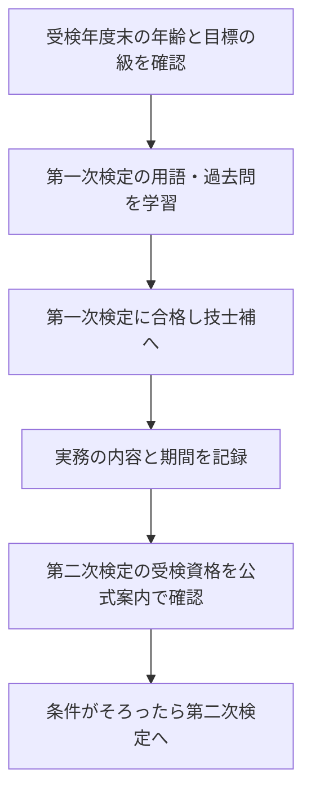

土木施工管理技士の第一次検定（学科）は、実務経験がなくても受けられると聞いて、「まず学科だけでも受けておこうか」と考えていないでしょうか。

先に結論を言うと、<strong>学科に受かっただけで、任される仕事が大きく変わるわけではありません</strong>。現場を任される土木施工管理技士になるには、実務経験を積んで第二次検定に合格する必要があります。

一方で、この筆記試験は、実務経験がある人でも苦戦するほど難しい試験です。答えの方向性を先に言うと、管理職をめざすなど、先のキャリアを見据えているなら、早めに合格を狙う価値があります。

この記事では、土木施工管理技士の検定の仕組みを整理したうえで、筆記試験がなぜ難しいのか、どう勉強すればいいのかを説明します。

## 第一次検定と第二次検定の仕組み

土木施工管理技士は、1級・2級ともに、<strong>第一次検定</strong>（学科）と<strong>第二次検定</strong>（実地）の2段階に分かれています。

| 検定 | 受験の条件 | 合格すると |
| --- | --- | --- |
| 2級 第一次検定 | 17歳以上（その年度の末日時点）。実務経験は不要 | 2級土木施工管理技士補 |
| 2級 第二次検定 | 実務経験が必要 | 2級土木施工管理技士 |
| 1級 第一次検定 | 19歳以上（その年度の末日時点）。実務経験は不要 | 1級土木施工管理技士補 |
| 1級 第二次検定 | 実務経験が必要 | 1級土木施工管理技士 |

上表は2026年11月時点の条件です。受験年度末の年齢で確認してください。[全国建設研修センターの2級案内](https://www.jctc.jp/exam/doboku-2/)・[1級案内](https://www.jctc.jp/exam/doboku-1/)

同時点の令和8年度2級第一次検定は前期6月7日・後期10月25日、受検手数料は第一次のみ6,000円（非課税、インターネット申込は別途事務手続手数料250円）です。いずれの日程も終了しているため、これから申し込む場合は次年度の案内を確認します。[2級の実施日程・手数料](https://www.jctc.jp/exam/doboku-2/)

### 学科だけでは、現場を任されない

第一次検定に合格すると「施工管理技士補」になれます。1級の技士補は、条件を満たせば監理技術者の補佐として現場に置かれることがありますが、2級の技士補だけで任される仕事が大きく広がるわけではありません。

施工管理技士として主任技術者などを目指すルートでは、第二次検定まで合格する計画が必要です。学科の合格は、あくまで<strong>その手前の段階</strong>です。配置できる役割を技士補という名称だけから判断せず、勤め先と要件を確認してください。



第一次の合格と第二次の受検資格は別に確認します。図の実務経験は、単に建設会社に在籍した期間と同じとは限りません。[全国建設研修センターの受検資格](https://www.jctc.jp/exam/doboku-2/)

## 実務経験があっても筆記試験は難しい

では、現場で働いている人なら、筆記試験は簡単なのでしょうか。実際には、実務経験がある人でも苦戦することが多い試験です。

理由のひとつは、出題の範囲の広さです。第一次検定では、土工、コンクリート、基礎工、河川、道路、上下水道、法規、施工管理など、<strong>土木のさまざまな分野をまとめて</strong>問われます。ふだんの仕事で扱っている分野はわかっても、担当したことのない分野は一から覚えることになります。

2026年11月時点で公表済みの令和8年度2級第一次検定（前期）は、受検者14,060人、合格者6,723人、合格率47.8%でした。これは受検者全体の数字で、実務経験者だけの合格率ではありません。[試験団体の合格発表資料・別紙](https://www.jctc.jp/kentei/info/datasheets20260707.pdf)

### 最初の壁は、勤め先の言葉と試験の用語のずれ

もうひとつの理由が、言葉のずれです。

現場では、勤め先や地域によって、同じものを<strong>固有の呼び方</strong>で呼んでいることがあります。ふだん使っている呼び方と、試験で使われる正式な用語が違うと、知っているはずのことなのに、問題文を読んでもピンとこない、ということが起きます。

現場で働いている人ほど、この「すりあわせ」が最初の壁になります。逆に言えば、ここを越えれば、実務で身につけた知識を試験の得点に変えやすくなります。

## 勉強の進め方

### 自分の現場の言葉と、試験の用語を対応させる

実務経験がある人は、まずテキストを読みながら、<strong>自分の現場での呼び方と試験の用語の対応表</strong>を作るのがおすすめです。ふだん使っている言葉に置き換えられると、問題文が一気に読みやすくなります。

生成AIに手伝ってもらうこともできます。

```text
私は土木の現場で働いていて、2級土木施工管理技士の第一次検定を受けます。
現場で使っている呼び方と、試験で使われる正式な用語がずれていて、問題文が読みにくいです。

次の現場での呼び方について、試験で使われる正式な用語と、その意味を表にしてください。
わからないものは「わからない」と書いてください。

- （例: 現場で使っている呼び方を書く）
- （例: 現場で使っている呼び方を書く）
```

AIの答えは、地域や会社ごとの呼び方を正しく知っているとは限りません。表にしたら、必ずテキストや先輩の話と照らし合わせて確かめてください。

用語だけを対応させず、「対象物・作業の目的・使う場面」も並べます。同じ呼び方でも目的が違うなら同義語として覚えず、問題文の条件ごとに分けて残してください。

<!-- AI_EXAMPLE: 使うAI=普段使う生成AI / プロンプト=現場での呼び方と試験用語の対応表 / 見せたいこと=不明な呼称を断定せず、対象物や目的の追加確認を求められるか -->

### 未経験の人は、用語の「目的」から覚える

建設業界の経験がない人は、現場を見たことがないまま用語を覚えることになります。用語の意味だけでなく、<strong>なぜその作業が必要なのか</strong>をセットで覚えると、暗記ではなく仕組みとして頭に入ります。

```text
私は建設業界の経験がなく、2級土木施工管理技士の第一次検定を受けます。
次の用語について、身近な例えを使って、意味と「その作業が必要な理由」を説明してください。

盛土、切土、路床、路盤
```

### 担当していない分野に時間をかける

勉強の時間は、自分が担当していない分野に多めに配分します。ふだんの仕事で扱っている分野は、用語のすりあわせができれば得点しやすいので、過去問で確かめる程度で十分なことが多いです。

勉強時間の目安は、建設の知識がない人で150〜250時間、関連する学校を出ている人や現場の経験がある人で100〜150時間ほどです。

この時間は本記事の計画用の目安です。初見の過去問で「用語が読めない」なら目的の確認へ、「用語は読めるが選べない」なら工法や適用条件の比較へ戻ります。担当分野でも選択肢の誤りを説明できなければ、省略せず復習します。

## 管理職をめざすなら、早めに合格を狙う

学科に受かっただけでは、任される仕事は大きく変わりません。それでも、早めに合格を狙う価値はあります。

土木施工管理技士の資格は、現場の責任者や、その先の管理職をめざすうえで欠かせない資格です。第二次検定には実務経験が必要なので、<strong>第一次検定を先に済ませておくと、実務経験がたまったときにすぐ第二次検定に進めます</strong>。

管理職をめざしている人や、何年か先のキャリアを見据えている人は、仕事に慣れてきた段階で第一次検定に合格しておくと、その後の道が開けやすくなります。

第二次検定に必要な実務経験の積み方、1級・2級の全体像、経験記述の対策は [土木施工管理技士1級2級の独学ガイド](/method/doboku-sekou-hub/) で扱っています。

---

## まとめ

土木施工管理技士の第一次検定は、実務経験がなくても受けられます。

- 学科に受かると施工管理技士補になれるが、それだけで任される仕事は大きく変わらない
- 筆記試験は範囲が広く、実務経験がある人でも苦戦する
- 現場で働いている人は、勤め先の呼び方と試験の用語のすりあわせが最初の壁になる
- 管理職など先のキャリアを見据えるなら、第一次検定を早めに済ませておくと、第二次検定に進みやすい

これで、第一次検定をいつ、どう受けるかを決められるはずです。まずはテキストを1章読み、自分の現場での呼び方と違う用語を3つ書き出してみてください。
