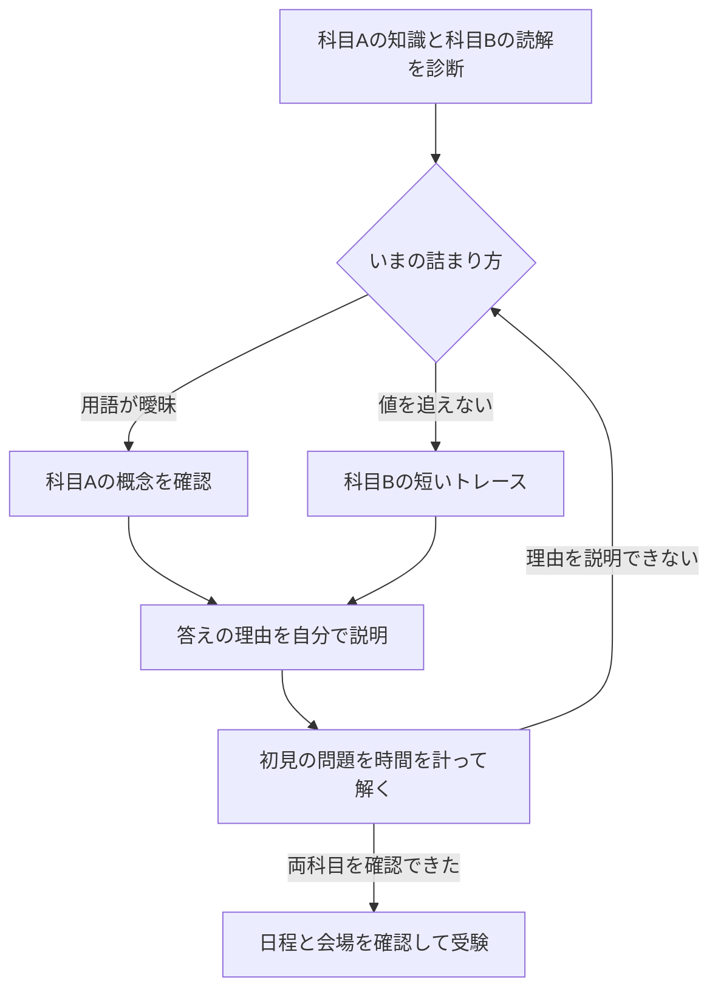

「基本情報技術者試験、どこから手をつければいいか分からない」

特に<strong>科目Bの擬似言語とアルゴリズム</strong>で手が止まっている人に伝えたいことがあります。

対策の分かれ目は、用語がわからないのか、処理を追えないのか、時間が足りないのかです。AIの説明を読むだけで終えず、自分で説明できない箇所から復習先を選びます。

このページでは、<strong>合格までのロードマップ</strong>を軸に、勉強時間の目安、科目別の対策、合格後のキャリアまでを順に整理します。

読み終えたときには、今の自分がロードマップのどの段階にいて、次に何をすればいいかがわかるようになります。


## 基本情報技術者試験とは

基本情報技術者試験（FE）はIPAが実施する国家試験で、<strong>ITエンジニアとして必要な基礎知識・技能を証明する最初のプロフェッショナル資格</strong>です。

2026年11月時点ではCBT方式で、科目Aと科目Bに分かれています。[IPAのFE試験案内](https://www.ipa.go.jp/shiken/kubun/fe.html)

2027年度向けのシラバスは2026年9月30日公開のVer.0.1の「案」で、変更の可能性があります。[IPAのシラバス案掲載ページ](https://www.ipa.go.jp/shiken/syllabus/henkou/2026/20260630.html)。受験年度に合わせた資料選びは[新試験の対策一覧](/method/ipa-2027-new-exam-hub/)で確認できます。

| 科目 | 出題形式 | 問題数 | 試験時間 | 内容 |
|---|---|---|---|---|
| 科目A | 多肢選択（4択） | 60問 | 90分 | テクノロジ・マネジメント・ストラテジ |
| 科目B | 多肢選択 | 20問 | 100分 | アルゴリズム16問・情報セキュリティ4問 |

出題数・時間・内訳と、両科目とも600点以上（1000点満点）という基準は、[IPAの試験要綱](https://www.ipa.go.jp/shiken/syllabus/rcu1hd00000141gq-att/youkou_ver5_6.pdf)に基づきます。IRTによる評価点なので、正答率6割と600点は同じではありません。

2024年度の受験者数は133,732人、合格率は40.8%です（2026年11月確認）。この年度の集計から、個人の合格可能性は判断できません。[IPAの統計資料・推移表](https://www.ipa.go.jp/shiken/reports/ps6vr70000016ew6-att/202603_fe_toukei.pdf)

## 合格までの勉強時間

基本情報技術者試験の勉強時間は、ITの前提知識によって大きく変わります。

下表は学習計画を立てるための本記事の目安です。公式の必要時間ではなく、初見の演習で説明できなかった範囲に応じて調整します。

| 学習経験 | 目安時間 |
|---|---|
| IT知識なし・プログラミング未経験 | 200時間前後 |
| ITパスポート合格・IT系の仕事に就いている | 100〜150時間 |
| 開発経験があるエンジニア | 50〜100時間 |

時間の差が大きく出るのは、科目Bの擬似言語です。

プログラムを読んだ経験がない人ほど、擬似言語に慣れるまでの時間が長くなります。

### AI活用で専任講師を月額20ドルで雇う感覚

基本情報の独学で多くの人が止まるのは、擬似言語の1行が何をしているのかわからない場面です。

テキストの解説を読んでも、変数の値がどう変わっていくのかが頭の中で追えません。

生成AIを使えば、<strong>月額20ドル程度で、何度でも質問できる専任の講師を雇うようなもの</strong>になります。

「月額20ドル」は学び方の比喩です。特定サービスの現在の料金や、利用上限を示すものではありません。

- 擬似言語の変数の変化を、1行ずつ表にして見せてもらえる
- 「なぜここでループを抜けるのか」を何度聞いても怒られない
- 夜中の数分の空き時間でも、詰まった箇所をその場で解消できる

AIは学習時間を半分にする魔法ではありません。

<strong>詰まって立ち止まる時間をなくす講師</strong>として使うと、上の目安時間を無駄なく使えます。

## 合格までのロードマップ



言葉で止まるなら科目Aの概念へ、記法が読めても値がずれるなら科目Bの追跡へ戻ります。両方説明できて時間だけが足りない場合に、計時演習を増やしてください。

基本情報は、科目Aと科目Bの両方で600点以上を取る必要があります。

そのため、2つの科目を並行して進め、最後に過去問で仕上げるのが基本の流れです。

| 段階 | 期間の目安 | 科目A | 科目B |
|---|---|---|---|
| 1. 現在地を知る | 最初の1週間 | 過去問を解いて分野別の正答率を把握する | 擬似言語のサンプル問題を読んでみる |
| 2. 基礎を固める | 1〜2ヶ月目 | テクノロジ基礎（HW・SW・DB）をAI対話で理解 | 変数・配列・繰り返しの基本構造を把握 |
| 3. 苦手分野を埋める | 3〜4ヶ月目 | ネットワーク・セキュリティに集中 | スタック・キュー・線形探索を視覚化で理解 |
| 4. 過去問で仕上げる | 5〜6ヶ月目 | ストラテジ・マネジメントの仕上げ | 過去問の擬似言語20本を追跡演習 |
| 5. 受験を決める | 仕上げ期 | 模擬試験で安定して7割 | 模擬試験で安定して7割 |

期間はIT知識なしの人を想定した目安です。

ITパスポートを持っている人は、段階2の科目Aを短くし、科目Bに時間を回しましょう。

科目AとBを並走させながら、<strong>弱点が出た分野をその都度AIとの対話で補強する</strong>のが効率のよい進め方です。

CBT方式は受験日を自分で選べるため、段階5の基準を満たしてから予約を入れると、準備不足のまま本番を迎えずに済みます。

ここからは、段階2〜4で取り組む科目ごとの対策を見ていきます。

## 科目A対策：広さを制圧する

科目Aは60問・90分で3大分野（テクノロジ・マネジメント・ストラテジ）を問います。

ITパスポートを取得済みであれば、ストラテジ・マネジメント分野は同水準の知識がすでに整っています。<strong>テクノロジ分野（ハードウェア・ソフトウェア・ネットワーク・DB・セキュリティ）の深掘りに集中することが科目A対策の核心</strong>です。

AIとの対話で概念の「なぜ」から理解することで、テクノロジ用語の暗記量を大幅に削減できます。

```text
基本情報技術者の科目A「ネットワーク」を学んでいます。
「OSI参照モデルの7層構造がなぜ必要なのか」という
設計思想の背景から教えてください。
各層の役割を覚える前に、層分けの論理を理解したいです。
```

## 科目B対策：擬似言語を制する

科目Bの最大の壁は擬似言語によるアルゴリズム問題です。

擬似言語はPythonでもJavaでもない「試験専用の記法」で、初見では意味不明に見えます。しかし<strong>擬似言語の読み方は「変数の状態変化を1ステップずつ追う」だけです</strong>。

この追跡作業をAIに「視覚化」させることで、多くの受験者が詰まる壁が突破できます。

```text
以下の擬似言語コードを読んでいますが理解できません。
変数の値が各行でどう変化するかを
表形式で追跡して見せてください。
その後、このコードが何をしているかを
日本語で説明してください。

[擬似言語コードをここに貼り付け]
```

「問題を解く」前に「コードを読める」状態を作ることが、科目B対策の最優先事項です。

<!-- AI_EXAMPLE: 使うAI=普段使う生成AI / プロンプト=科目B対策の変数追跡表 / 見せたいこと=自分の表とAIの表の最初の不一致から復習する概念を選べるか -->

<!-- LEARNER_NOTE: 候補=AIの追跡表を読み、自分で追い直して気づいた説明の不足 / 種類=think / 筆者が実際にAIを使用した記録だけで記入。FEの受験体験は不可 -->

## なぜ基本情報技術者試験か

### エンジニアとしてのOSが手に入る

[ITパスポート](/method/itp-hub/)が「IT語彙の入口」なら、基本情報技術者試験は<strong>エンジニアとして考えるための論理構造（OS）を手に入れる試験</strong>です。

アルゴリズム・データ構造・ネットワーク・セキュリティ・データベースをすべて体系的に学ぶことで、AWSやクラウド設計・セキュリティ対策・システム開発の議論に「論理で参加できる」状態になります。

### 科目Bが職業スキルとして直結する

科目Bで問われる擬似言語の読解力は、プログラムの動作を追いかける能力の証明です。

コードレビュー・バグ調査・設計書の読解——<strong>エンジニアの日常業務で要求される論理追跡能力が、科目B対策の過程で身につきます</strong>。

### 高度試験・AWS・CCNAへの足固めになる

基本情報技術者試験で整理するネットワーク・セキュリティ・データベースの知識は、[応用情報技術者](/method/advanced-ipa-hub/)・[AWS SAA](/method/aws-hub/)・[情報セキュリティマネジメント](/method/sg-hub/)の学習コストを大幅に下げます。

## 「基本情報は意味ない」と言われても、意味がないことはない

「基本情報技術者 意味ない」という声を見て、受けるか迷っている人もいると思います。先に言い切ると、<strong>基本情報技術者試験に意味がないことはありません</strong>。

### 意味ないと言われる理由

そう言われる理由には、次のようなものがあります。

- 試験の内容と、実際の開発の仕事にはギャップがある。最新の技術を深く扱うわけではない
- 医師や弁護士のような業務独占の資格ではなく、持っていなくてもエンジニアとして働ける
- 受ける人が多く、経験を積んだエンジニアにとっては「持っていて当たり前」に見られることがある
- 経験者の採用では、資格より実務の経験や作ったものが重く見られやすい

どれも一理ありますが、多くは<strong>すでに経験を積んだエンジニアの立場から見た話</strong>です。

### それでも意味がある理由

- <strong>時代が変わっても使える基礎が身につく</strong>: データベース、ネットワーク、セキュリティ、アルゴリズムは、クラウドやAIを理解するときの土台になる
- <strong>経験がない人が、学んだことを示せる</strong>: 未経験からIT業界をめざす人や学生にとって、知識と学ぶ意欲を客観的に示せる手段は多くない
- <strong>会社によっては手当や評価につながる</strong>: 資格手当や報奨金、昇格の要件に入れている会社がある
- <strong>上位の資格に進む土台になる</strong>: 応用情報技術者試験や、AWS認定などの学習が進めやすくなる

### 取る価値が大きい人・優先度が低い人

| 取る価値が大きい人 | 優先度が低い人 |
| --- | --- |
| 未経験からIT業界をめざす人、就職活動中の学生 | 実務の経験が豊富なエンジニア |
| ITの基礎を体系的に学び直したい人 | 作ったものや実績で十分に力を示せる人 |
| 資格手当や昇格の要件がある会社で働く人 | 国内の資格がほとんど評価されない会社だけをめざす人 |
| 応用情報など上位の資格をめざす人 | － |

優先度が低い人にとっても、学んだ内容が無駄になるわけではありません。受けるかどうかは、<strong>何のために取るのか</strong>を決めてから判断すると迷いにくくなります。


## 科目B・アルゴリズム対策

- [FE科目Bを生成AIで攻略するプロンプト集](/method/fe-subject-b-ai-prompt-hub/) — 場面別・ツール別の使い分けと、類題の生成
- [基本情報の科目Bアルゴリズム対策｜ITパスポート合格者でも一気に難しくなる理由](/method/fe-algorithm-roadmap/) — 擬似言語のトレース、Pythonへの翻訳、日常の手順から考える入門

## 科目A対策・全般学習

- [SQLのJOINが覚えられない人へ｜AIの図解で、基本情報とDS検定のSQL問題に備える](/method/sql-join-visual-ai-hack/) — DB分野の頻出テーマを、図と身近な例で理解
- [CCNAのサブネット計算は実務で使う？](/method/ip-address-ai-metaphor-hack/) — 社内LANの分け方から理解するサブネット計算の手順
- [Geminiで過去問を自分専用に作らせるプロンプト集](/method/gemini-cert-complete/) — 科目A用の問題生成・解説自動化
- [基本情報の科目BはPythonだけで大丈夫？擬似言語でつまずく3つの違い](/trend/fe-pseudo-language-trap/) — 独学でよくある失敗パターンの回避

## 試験情報

- [2027年からのIPA試験再編まとめ](/trend/ipa-2027-restructuring/) — CBT化・AI知識・区分再編の動向整理

## キャリア設計

- [生成AI時代の「エンジニアOS」——基本情報で手に入れる指示の解像度](/career/fe-engineer-foundation/) — 合格後の実務活用方法と、会社命令・フリーランス・非エンジニアの立場別の価値
- [ITパスポートを飛ばして基本情報から受けてよい人｜過去問7割が目安、開発部門を目指す資格ステップ](/career/fe-career-modern-web/) — ITパスポートとの差と合格後の進路

## 練習アプリ

- [基本情報技術者試験 攻略シミュレーター](/app/fe-quiz/) — CBT形式の科目A総合演習

## 科目B頻出アルゴリズムパターン完全分析

以下は探索・並べ替え・データ構造などを理解するための練習の題材です。本試験の問題をこのパターンだけに限定するものではありません。各処理の目的と、値が変わる順番を確認してから演習に進みます。

### 線形探索と二分探索

<strong>線形探索</strong>は配列の先頭から順に目的の値を探す処理。問題では「何回の比較で見つかるか」「平均何回かかるか」が問われる。

<strong>二分探索</strong>はソート済み配列の中央値と比較して探索範囲を半分に絞る処理。「この配列で目的値を探すと最大何回の比較が必要か」という計算問題が頻出だ。

```text
以下の二分探索の疑似言語コードについて、
配列サイズがN=8のとき「存在しない値を探す場合の最大比較回数」を
ステップごとの探索範囲の変化を表で示しながら計算してください。

[疑似言語コードをここに貼り付け]
```

### バブルソートと選択ソート

<strong>バブルソート</strong>は隣接する要素を比較・交換を繰り返してソートする。問題ではループが何回実行されるか、n回目のループ後の配列状態を問われる。

<strong>選択ソート</strong>は未ソート部分の最小値を先頭に移動させる処理。バブルとの違い（交換回数）を比較する問題が頻出だ。

```text
以下のバブルソートの疑似言語コードを実行したとき、
配列 [5, 3, 8, 1, 9, 2] に対して
各パス（外側ループの1回）終了後の配列の状態を表形式で示してください。
交換が発生した箇所も明示してください。
```

### スタックとキュー

<strong>スタック</strong>はLIFO（後入れ先出し）構造。push/popの操作後のスタックの状態を問われる。

<strong>キュー</strong>はFIFO（先入れ先出し）構造。enqueue/dequeueの操作後の先頭・末尾ポインタの値が問われることが多い。

どちらも「操作を追跡して現在の状態を答える」という形式が基本だ。

### 再帰関数

再帰関数は自分自身を呼び出す関数。「この再帰関数をf(4)で呼び出したときの戻り値は何か」という問題が典型的だ。

```text
以下の再帰関数の疑似言語コードについて、
f(5) を呼び出したときの実行の流れを
「どの呼び出しがどの引数で実行されるか」の
コールスタックの形式で追跡してください。
最終的な戻り値も求めてください。
```

再帰は手動追跡をAIに実演させることで、「自分の中でどこが分からないか」が明確になる。一度理解が定着すると初見の再帰問題にも対応できる。

### 2次元配列の処理

行列（2次元配列）の操作はシフト・転置・探索の3パターンが頻出。添え字の操作ミスが最も多い誤答パターンで、「行・列の添え字が0始まりか1始まりか」の確認が重要だ。

## 過去問から見る出題傾向と得点パターン

IPAが公表するサンプル問題と過去公開問題から、安定した出題パターンを把握できる。

<strong>科目B（20問・100分）の内訳</strong>: 2026年11月時点ではアルゴリズムとプログラミング16問・情報セキュリティ4問です。[IPA試験要綱](https://www.ipa.go.jp/shiken/syllabus/rcu1hd00000141gq-att/youkou_ver5_6.pdf)。セキュリティも、用語の暗記だけでなく問題の条件に沿って判断する練習をします。

<strong>1問あたりの目安時間</strong>: 100分÷20問＝5分/問が目安。長い疑似言語コードの問題は8〜10分かかることがある。60〜90秒で解けるセキュリティ問題を先に処理して時間バッファを作る戦略が有効だ。

<strong>練習するアルゴリズムの種類</strong>: 上で扱った探索・ソート・スタック・キュー・再帰・配列処理を、理解確認の題材として使います。公開問題は本試験全体ではないため、そこから本番の出題比率を推定して学習範囲を狭めないようにします。[IPAの公開問題](https://www.ipa.go.jp/shiken/mondai-kaiotu/index.html)

<strong>解き直しで確認する3つの誤り</strong>:

トレースでの更新漏れ、配列の添え字のずれ、ループの終了条件の誤読を確認します。頻度の順位ではなく、自分の誤答理由を分類するための項目です。

## よくある質問

<strong>Q: 科目Aと科目Bはどちらを先に対策すればいいですか？</strong>

A: 並走させるのが最も効率的だ。科目Aの知識（ネットワーク・セキュリティ・DB）は科目Bの問題文を理解するのに直接役立つ。学習の最初の2ヶ月は科目Aを7割・科目Bを3割の配分で進め、後半は科目Bの疑似言語演習を増やす形が推奨される。

<strong>Q: 疑似言語が全く読めないのですが、どこから始めればいいですか？</strong>

A: まず疑似言語の記法辞書を作ることから始める。「←（代入）」「÷（除算（丸め方は問題文を確認））」「mod（余り）」「while〜endwhile」などの基本記法を一覧にしてから問題に入ると読める部分が格段に増える。擬似言語をPythonに書き直して動かし、変数の動きを確かめる方法は[基本情報の科目Bアルゴリズム対策](/method/fe-algorithm-roadmap/)で扱っている。 [IPAの記述形式・別紙2](https://www.ipa.go.jp/shiken/syllabus/doe3um0000002djj-att/shiken_yougo_ver5_1.pdf)と照合し、問題文の注記を優先する。

<strong>Q: 合格率の数字から、実際の難易度は判断できますか？</strong>

A: 合格率は受験者全体の値です。自分の準備では、初見の問題で解答理由を説明できるか、時間内に処理を追えるかを確認します。[基本情報の科目Bアルゴリズム対策｜ITパスポート合格者でも一気に難しくなる理由](/method/fe-algorithm-roadmap/)で、トレースの進め方を整理しています。

<strong>Q: プログラミング経験ゼロでも合格できますか？</strong>

A: 未経験から学ぶ場合は、変数・配列・条件分岐・繰り返しを確認してから短い擬似言語を追います。言語の経験の有無だけで判断せず、処理を自力で説明できるかを確かめましょう。

<strong>Q: 科目A・Bの合格点はそれぞれ何点ですか？</strong>

A: 両科目とも1000点満点で600点以上が合格ライン。一方の科目だけ600点以上でも、もう一方が600点未満なら不合格になる。CBT形式のため両科目の受験は同日に行い、当日に結果が確認できる。

---

## まとめ

基本情報技術者試験は、ITエンジニアとして「論理で考える土台」を証明する資格です。

合格までの道筋は、現在地を知る → 基礎を固める → 苦手分野を埋める → 過去問で仕上げる → 受験を決める、の5段階です。

科目Aは広い知識を「概念の論理」で理解すること、科目Bは擬似言語を「ステップ追跡」で読めるようにすること。<strong>どちらもAIとの対話で「なぜ」から入ると、詰まって立ち止まる時間を減らせます</strong>。

まず科目Bの短いコードを紙で追い、説明できなかった最初の1行をAIに質問します。説明を読んだら、AIを閉じて追い直せるかを確認してください。

科目Aで頻出のOS制御・ネットワーク基礎は、[OS（タスク管理・割込み・仮想記憶）](/theory/os-operating-systems/)と[TCP/IP・サブネットを含むネットワーク基礎](/theory/network-database-fundamentals/)で仕組みから理解できる。
