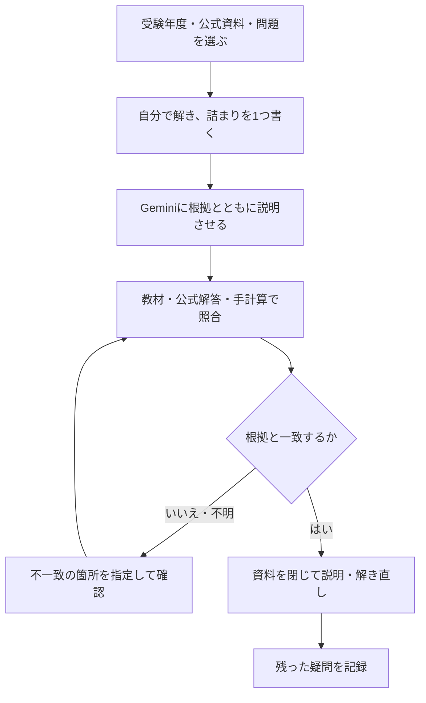

Geminiに用語を聞けば説明は返ってきます。それでも問題を解けないときは、説明を読むだけで終わり、自分の理解を確認できていない可能性があります。

資格勉強では、試験の範囲と公式解答を手元に置き、分からない一点を対話で確かめる使い方が考えられます。この記事では、用語・アルゴリズム・記述の3場面で、質問から検証、解き直しまでの手順を示します。

## Geminiで資格勉強をする前に、公式の範囲と正解を用意する

Googleは、Geminiが不正確な情報を事実のように提示する場合があると説明しています。役割を「専門講師」にしても、回答の正しさが保証されるわけではありません。[GoogleのGemini回答に関する説明](https://support.google.com/gemini/answer/16279220?hl=ja)

最初に用意するのは、受ける年度のシラバスと、解いている問題の公式解答です。2026年度の現行区分と2027年度の再編後の資料を混ぜないようにします。[IPAの現行シラバス](https://www.ipa.go.jp/shiken/syllabus/gaiyou.html)、[新試験制度の案内](https://www.ipa.go.jp/shiken/minaoshi/index.html)

AIに任せるのは、分からない言葉の説明、比較、答案の説明漏れの候補出しです。受験日程の確定、非公開の採点基準の再現、合格可能性の判定まで求めないようにしましょう。

入力は利用が許された問題・資料の範囲に限ります。非公開の本試験問題、社内資料や個人情報を使わず、自作の短い例でも練習できます。

## 詰まった場面ごとに、質問と確認方法を選ぶ

| 詰まり方 | AIに頼むこと | 自分で確認すること |
| --- | --- | --- |
| 用語の説明を読んでも区別できない | 同じ例で定義と相違点を示す | シラバス・教材の定義に戻し、例えの限界を確認する |
| 科目Bで変数を追えない | 1行ずつの値の変化を表にする | 最初の数行を手で追い、添字・更新順を照合する |
| 記述の答えが曖昧になる | 設問要求と自分の回答を対応させる | 公式解答例と問題文の根拠を照合する |
| 回答同士が矛盾する | どの資料・箇所を根拠にしたか示す | 根拠が見つからなければ採用せず、資料に戻る |

AIの回答に納得することと、自分で解けることを分けます。次の流れでは、最後に資料を閉じて説明し直す工程を置きます。



誤りを直させても正しさが確かめられない場合は、その回答を教材にせず保留します。

## ITパスポートの用語は、定義と具体例を行き来する

BSCのような経営用語は、短い定義だけでなく「何を測るための考え方か」を具体例で確かめると、似た用語との違いを整理できます。

以下は、既存の筆者の実行記録と対応する原プロンプトです。後掲の結果はClaudeでの実行であり、Geminiの実測結果としては扱いません。

### シラバス分野の概念理解

```text
あなたはITパスポート試験の専門講師です。

「[シラバス用語: 例 BSC・バランススコアカード]」について、
ITパスポートの試験レベルで理解すべきポイントを教えてください。

出力形式:
1. 一言定義（30文字以内）
2. 具体的な企業の例を使った解説
3. 試験でよく問われるひっかけパターン
4. 混同しやすい類似用語との違い
```

##### Claudeで実行した結果

このプロンプトの用語に「BSC（バランススコアカード）」を入れて、Claude（Sonnet 5.5、有料プラン）で実行しました（2026年10月）。プロンプトはGemini向けに書いていますが、他のAIでも同じ形で答えが返ります。

回答は、指定した4項目の順にそろっていました。

一言定義は「4つの視点で業績を管理する経営手法」です。末尾に「（19文字）」と添えられていましたが、数えると17文字でした。30文字以内という条件は満たしていますが、AIは文字数を正確に数えるのが苦手です。

企業の例は、架空のカフェチェーンで4つの視点を表にしたものでした。

| 視点 | 目標の例 | 指標（KPI）の例 |
| --- | --- | --- |
| 財務 | 営業利益率10%を達成 | 売上高、利益率 |
| 顧客 | リピーターを増やす | 顧客満足度、再来店率 |
| 業務プロセス | 提供時間を短縮する | 注文から提供までの時間、廃棄ロス率 |
| 学習と成長 | 店員のスキルを高める | 研修受講率、資格保有者数 |

表の下には「研修で接客力が上がる → 提供が速くなる → 満足度が上がる → 利益が増える」という因果のつながりが添えられ、下の視点が上の視点を支える関係だと説明していました。

ひっかけパターンは5つ挙がっていました（要約）。

> - 「市場の視点」「技術の視点」など、存在しない視点を混ぜる
> - 「財務指標を重視する手法」と説明する（BSCは非財務の視点を加えるのが特徴）
> - 視点の数を3つや5つにする
> - 「顧客満足度は財務の視点」「従業員教育は業務プロセスの視点」のように、中身を入れ替える
> - 「過去の結果だけを見る」と思わせる

類似用語は、KPI・KGI・CSF・SWOT分析・PDCA・PPMとの違いを表にし、「SWOTは現状を知る分析、BSCは戦略を実行・管理する枠組み、KPI・KGIは数値で測る指標」と区別のコツをまとめていました。ITパスポートで問われる範囲として、内容は合っています。


上の結果にある文字数の誤差は、指定した形式がそろっていても細部の確認が必要な例です。「試験でよく問われる」というAIの説明も、出題の実績は公式問題で照合して使います。

<!-- AI_EXAMPLE: 使うAI=Gemini / プロンプト=本文「シラバス分野の概念理解」の原プロンプト（用語=BSC） / 見せたいこと=同じ原プロンプトをGeminiで実行し、定義・4視点・文字数を照合した実測結果。既存Claude記録とは別に追加 -->

<!-- LEARNER_NOTE: 候補=同じBSCプロンプトの出力を確認し、説明が役立った所または誤差に気づいた点 / 種類=think / 筆者の実体験で記入 -->

用語の全体像を学ぶ順番は[ITパスポートの学習ガイド](/method/itp-hub/)、体系的に読み進める場合は[ITパスポート20時間コース](/course/ip/)で確認できます。20時間で合格や学習完了を保証するものではありません。

## 基本情報の科目Bは、元の疑似言語を先に追う

Pythonへの変換から入ると、添字の始まりや代入・評価の順序の違いで、元の処理を取り違える場合があります。まず疑似言語のまま、最初の数行を手で追ってからAIの表と比べます。

```text
基本情報技術者試験の疑似言語の練習です。
以下の自作コードと入力値を、別の言語に変換せず追跡してください。

各行について「実行行・条件の真偽・変数の更新前・更新後」を表にしてください。
添字の起点、繰返しの終了条件、代入順序が不明なら推測せず質問してください。
最後に、私が手で追えるよう最初の1回の繰返しだけを説明してください。

【自作コード・添字の規則】:
【入力値】:
【自分で追った最初の数行】:
```

<!-- AI_EXAMPLE: 使うAI=Gemini / プロンプト=本文「基本情報の科目Bは、元の疑似言語を先に追う」 / 見せたいこと=筆者の自作コードの手計算とAIのトレース表を照合し、更新順を確認する過程 -->

一致したら、AIの表を閉じて最後まで追います。単に同じ正答が出たかではなく、途中の値と分岐が一致しているかが確認点です。[基本情報の学習ガイド](/method/fe-hub/)から、科目別の準備も確認できます。

## 応用情報の記述は、公式解答例と設問要求を対応させる

2026年度の応用情報は科目A・科目Bで実施されます。旧教材の「午後」は現行の科目Bに対応しますが、2027年度の新試験と同じ形式とは限りません。[IPAの科目名称・実施案内](https://www.ipa.go.jp/shiken/2026/ap_koudo_sc_kikan.html)

記述の点検では、問題文・設問・公式解答例・自分の答案をそろえます。公式解答例だけを見せて「何点か」と聞いても、非公開の採点基準は再現できません。

```text
応用情報の記述答案の練習です。公式の採点を再現したり、点数を付けたりしないでください。

1. 設問が求める対象・条件・答えの種類を分ける
2. 私の答案が、その要求に答えている箇所を引用する
3. 公式解答例と意味が違う点、問題文に根拠がない点を分ける
4. 判断できない点は「要確認」とする

【利用が許された問題文・設問】:
【公式解答例】:
【自分の答案】:
```

<!-- AI_EXAMPLE: 使うAI=Gemini / プロンプト=本文「応用情報の記述は、公式解答例と設問要求を対応させる」 / 見せたいこと=点数を断定せず、設問の要求と答案の不足を対応させる点検 -->

指摘された語句を足すだけでなく、その語句が設問に必要な理由を説明できるか確かめます。現行区分と新制度の選び方は[応用情報・高度試験のガイド](/method/advanced-ipa-hub/)で整理しています。

## 続けるか、質問を変えるかの判断基準

説明が長すぎるなら、用語を1つに絞り、定義と具体例だけを求めます。出典を示さない回答なら、資料の該当箇所を自分で開いて確認します。

同じ誤りを繰り返す場合は、会話を続けて直ったと思い込まず、手計算や教材の解説に戻ってください。AI生成の類題は公式問題ではないため、本番相当の難易度や出題傾向の裏付けには使えません。

モデル間の優劣や、合格までに短縮できる時間は、この実行記録からは判断できません。まず1問で、根拠を確認できるか、自分で解き直せるかを見ます。

---

## まとめ

Geminiで資格勉強を進めるときは、公式資料を用意し、詰まりを1つに絞り、回答を照合してから自分で解き直します。

用語なら定義、科目Bなら途中の値、記述なら設問要求との対応が確認点です。今日の1問で、AIの説明を閉じても説明できるか試してください。
