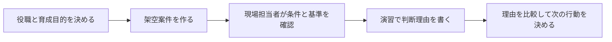

<!-- TARGET_KW: インバスケット 社内 育成 -->
<!-- READER: S5-義務-検討前／検索・管理職研修を設計する人事 -->
<!-- ANSWER: 自作は研修用、昇進判定は評価設計が先 -->
<!-- TAKEAWAY: 目的別の導入判断と回答の確認項目 -->

管理職の昇進のアセスメントで「インバスケット」という言葉を聞いて、どんな演習なのか、自社の育成にどう使えるのかが気になっていないでしょうか。

インバスケットは、資格試験のように知識を問うものではありません。制限時間の中で、たまった仕事をどうさばくかという<strong>判断のスキル</strong>を見る演習です。

答えの方向性を先に言うと、インバスケットは外部の研修で受けさせるだけでなく、<strong>自社の業務に合わせて独自に作る</strong>ことで、社員の育成のトレーニングとして使えます。

この記事では、インバスケットの仕組みを整理したうえで、経営層・人事・管理職が社員の育成に取り入れる考え方と手順を説明します。

## インバスケットは「未処理箱」をさばく演習

インバスケット（in-basket）は、もともと机の上に置かれた<strong>未処理の書類を入れる箱</strong>のことです。いまでいえば、未読のメールや、決裁を待っている書類がたまった状態にあたります。

インバスケット演習では、受ける人が架空の役職（たとえば、着任したばかりの課長）になりきり、複数の案件を制限時間の中で処理します。案件数や採点方法は教材・実施者によって異なります。[教材開発元のトレーニング解説](https://www.in-basket.jp/members/training/)でも、試験作成会社による採点形式の違いが案内されています。

| 案件の例 | 判断すること |
| --- | --- |
| 取引先からのクレームのメール | 自分で対応するか、誰に任せるか。いつまでに |
| 部下からの休暇の申請 | 承認するか。ほかの予定と重なっていないか |
| 上司からの資料作成の依頼 | ほかの案件より先にやるべきか |
| 他部署からの会議の調整 | 出席するか、代理を立てるか |

限られた時間で案件を処理するため、<strong>どの案件を優先し、何を誰に任せ、何を後回しにするか</strong>という判断の基準そのものが見られます。

## 知識を問う試験とは違う

インバスケットは、資格試験の対策とは性質がまったく違います。

| 比べる点 | 資格試験 | インバスケット |
| --- | --- | --- |
| 問われること | 知識を覚えて使えるか | 限られた時間と情報で、どう判断するか |
| 正解 | ひとつに決まることが多い | ひとつに決まらない。判断の一貫性と根拠が見られる |
| 身につけ方 | テキストと問題演習 | 判断をくり返し、ふり返る経験 |

ものづくりの現場で、技能検定や業界の技能大会が個人の腕前を実際の作業で確かめるのと同じように、インバスケットは、管理職に必要な判断の腕前を、実際の仕事に近い場面で確かめる方法です。<strong>個人のスキルを判定するトレーニングのひとつ</strong>と考えるとわかりやすいでしょう。

## 経営層・人事が自社の育成に取り入れる

インバスケットは、研修会社が提供する演習を受けさせるのが一般的です。ただ、市販の演習の案件は、どの会社にも当てはまるように作られています。自社の業務とかけ離れた場面だと、受ける側が実感を持ちにくいこともあります。

そこで検討したいのが、<strong>自社の業務に合わせた独自のインバスケット</strong>を作ることです。

### 育成と昇進判定では使い方を分ける

自作の教材は、育成したい行動を話し合う材料にできます。ただし、社内で作った練習課題の得点を、そのまま管理職への適性や合否の証明にすることは避けましょう。

| 目的・条件 | 選ぶ使い方 | 演習後に残すもの |
| --- | --- | --- |
| 新任管理職に会社の優先順位を伝えたい | 自作の架空案件で研修する | 安全・顧客・納期が競合したときの判断理由 |
| 昇進の可否に使いたい | 評価基準・評価者間の一致を人事で検討する | 観点別の評価根拠と説明手順 |
| 部門間で判断が分かれる | 同じ案件を複数人で検討する | 判断が分かれた前提と追加で必要な情報 |
| 個人で本番に備えたい | 実施者の案内と練習教材で条件を確認する | 指示先・期限・確認方法を含む自分の回答 |

たとえば「今日中の資料」と「安全に関わる設備異常」が同時に届いたなら、締切の近さだけで並べず、事故の影響、応急対応の担当、上司への報告まで書きます。これは判断を検討する例であり、共通の採点基準ではありません。

### 独自に作るメリット

- 自社で実際に起こりうる案件で、判断の力を確かめられる
- 「この会社では、何を優先すべきか」という判断の基準を、演習を通して伝えられる
- 昇進の前だけでなく、新任の管理職の研修や、日々の育成にくり返し使える

### 作り方の手順

1. <strong>育てたい役職を決める</strong>: 新任の課長、店長、現場のリーダーなど
2. <strong>その役職に実際に届く案件を集める</strong>: 過去のメールや相談の内容から、個人情報を除いて題材にする
3. <strong>判断の基準を決めておく</strong>: 顧客への影響、法令や安全、部下の育成など、自社が大切にしている観点を言葉にする
4. <strong>演習のあとにふり返りの場を設ける</strong>: 受けた人が「なぜその順番にしたか」を説明し、上司や人事が観点ごとに意見を返す

インバスケットで大切なのは、正解を教えることではなく、<strong>判断の根拠をふり返る経験</strong>を積ませることです。社内研修では、処理件数だけで評価を終えず、受けた人が理由を説明する時間を確保しましょう。



### 生成AIで案件の下書きを作る

案件をゼロから作るのは手間がかかります。生成AIに下書きを作らせ、人事や管理職が自社の実情に合わせて直すと、準備の負担を減らせます。

```text
社内の管理職研修で使うインバスケット演習の案件を作りたいです。

条件:
- 受ける人の役職: （例: 小売店の新任の店長）
- 案件の数: 15件
- 緊急度と重要度が異なる案件を混ぜる。判断が分かれやすい案件を3件以上入れる
- 案件ごとに、**判断で見たい観点**（顧客への影響、法令・安全、部下の育成など）を添える
- 実在の会社名や個人名は使わない
```

<!-- AI_EXAMPLE: 使うAI=Gemini / プロンプト=本文の案件下書き / 見せたいこと=架空案件の矛盾を人事が直す前後 -->

AIが作った案件は、そのままでは自社の実情と合わないことがあります。必ず現場をよく知る人が読み、ありえない状況や、自社の規則と食い違う内容を直してから使ってください。AIには実際のメールを貼らず、個人・取引先・機密情報を含まない架空の案件に書き換え、社内のAI利用規則も確認してください。

## 受ける側は、判断の根拠を言葉にする練習をする

インバスケットを受ける側にとって、独学が難しいのは、<strong>判断のどこが甘いかを指摘してくれる相手がいない</strong>ことです。

一人で練習するときは、自分の回答を生成AIに見せて、論理の弱い所を指摘してもらう方法があります。

```text
インバスケット演習の回答を作りました。
案件ごとに「誰に・何を・いつまでに・なぜ」の順で判断しています。
評価する立場で、**判断の根拠が弱い所**と、抜けている観点を指摘してください。
正解を示すのではなく、私が考え直せるように質問の形で返してください。

【案件】（ここに貼る）
【私の判断】（ここに貼る）
```

AIに考えさせるのではなく、自分で判断を書き切ってから、穴を見つけてもらう使い方が大切です。

筆者はインバスケットの受験・評価実務を経験していません。本記事は公開資料と、社内研修を検討するための整理に基づきます。

---

## まとめ

インバスケットは、未処理の案件がたまった「未処理箱」を、制限時間の中でさばく演習です。

- 知識を問う試験とは違い、判断の基準と優先順位のつけ方を見る。個人のスキルを判定するトレーニングのひとつ
- 経営層・人事・管理職は、自社の業務に合わせた独自のインバスケットを作ると、判断の基準を伝えながら社員を育てられる
- 効果を上げるのは、演習のあとに判断の根拠をふり返る対話
- 案件の下書きは生成AIで作れる。自社の実情に合わせて人が直してから使う

これで、インバスケットを社内の育成にどう取り入れるかを考えられるはずです。まずは育てたい役職を1つ決め、その役職に実際に届く案件を5件書き出すところから始めてみてください。
