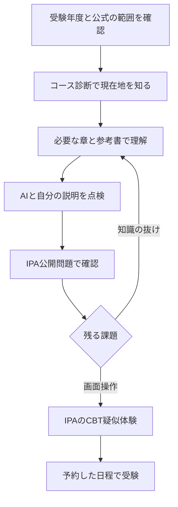

ITパスポートの合格ロードマップは、受験する年度と、すでに説明できる分野を確かめるところから始めます。

資格を取る意味は、今の仕事や応募条件で必要な知識と結び付けて考えます。

このページでは、ITパスポートをなぜ今取るべきかという背景から、合格までの具体的な手順、関連する全記事へのリンクまでを一冊分の情報量で整理します。

<strong>まず全体像を20時間でつかみたい方は、無料の <a href="/course/ip/">ITパスポート20時間コース</a> から始めるのがおすすめです。</strong>診断テストで現在地を測り、8章の要点だけを効率よく学べます。

---

## ITパスポートとは

ITパスポート試験（iパス）は、情報処理推進機構（IPA）が主催する国家資格です。

ITを利活用する社会人・学生の基礎的な知識を問う試験です。エンジニア向けではなく、<strong>ITを使うすべての職種を対象にした資格</strong>という点が最大の特徴です。

2026年11月時点、CBT方式で年間を通じて随時実施され、100問を120分で解きます。総合評価点600点以上、各分野300点以上が合格基準です。正答率をそのまま評価点へ換算することはできません。[IPAの試験内容・採点方式](https://www3.jitec.ipa.go.jp/JitesCbt/html/about/range.html)

現行の出題範囲は3大分野に分かれています。[IPAの出題範囲](https://www3.jitec.ipa.go.jp/JitesCbt/html/about/range.html)

| 分野 | 出題比率の目安 | 内容 |
|---|---|---|
| ストラテジ系 | 約35% | 経営戦略・法務・マーケティング |
| マネジメント系 | 約20% | 開発手法・サービスマネジメント・監査 |
| テクノロジ系 | 約45% | ネットワーク・セキュリティ・データベース・AI・ハードウェア |

## なぜ今、ITパスポートなのか

### AI時代の共通語彙を手に入れる

生成AIを業務で使うときも、ITの語彙があると目的や制約を伝えやすくなります。

生成AIやプロンプト、クラウド、セキュリティ、データ活用の基礎は現行シラバスの学習対象です。2026年11月時点の現行版はVer.6.5、2027年度向けはVer.0.1の案です。[IPAの現行シラバスと案](https://www3.jitec.ipa.go.jp/JitesCbt/html/about/range.html)

ITパスポートはエンジニアリングの資格ではなく、<strong>AI時代を生きる全社会人が共通言語として持つべき知識体系の入口</strong>です。「AIを使う側」として最低限知っておくべき論理の枠組みが、このシラバスに詰まっています。

### リスキリング支援の中心に位置している

政府・企業のリスキリング支援の流れの中で、ITパスポートは最もアクセスしやすい国家資格として位置づけられています。

受験手数料は2026年11月時点で7,500円（税込）です。[IPAの試験概要（受験手数料）](https://www3.jitec.ipa.go.jp/JitesCbt/html/examination/exam_summary.html)

費用補助を利用したい場合は、勤務先や自治体に対象資格・申請時期・領収書の要否を確認してください。補助があることを前提に申し込まないようにします。

「資格を取ってキャリアを変えたい」という動機に対して、最初のステップとして費用対効果が最も高い資格のひとつです。

### 企業が最低ラインとして参照し始めている

勤務先の昇進規程や求人票にITパスポートの記載があるなら、「必須」「歓迎」「入社後取得」のどれかを確認します。

必須なら取得期限、歓迎なら業務での活用例、入社後取得なら研修・受験費用の扱いを確かめると、取得の優先順位を決められます。

### 他の資格への学習コストを下げる土台になる

ITパスポートで学ぶ概念は、[基本情報技術者試験（FE）](/method/fe-hub/)・[情報セキュリティマネジメント（SG）](/method/sg-hub/)・[AWS認定](/method/aws-hub/)・[DS検定](/method/ds-kentei-hub/)の基礎と直結します。2027年度の制度見直しで新設予定の<a href="/course/dm/">データマネジメント試験（DM、仮称）</a>も、ITパスポートで学んだデータ活用の基礎をそのまま土台にできる資格です。

<strong>ITパスポートは「単独の資格」ではなく、IT学習全体のOSを導入するプロセス</strong>です。ここで整理した知識体系は、次の資格・次の実務の土台にできます。新制度の区分と予定は[IPAの対策一覧](/method/ipa-2027-new-exam-hub/)に整理しています。[IPAのシラバス案](https://www.ipa.go.jp/shiken/syllabus/henkou/2026/20260630.html)

## 学習にかかる時間の目安

| 背景 | 目安時間 |
|---|---|
| IT・業務知識がある社会人 | 20〜40時間 |
| 文系・IT未経験の社会人 | 50〜80時間 |
| 学生（情報I履修あり） | 20〜30時間 |

スキマ時間のみで学習する場合でも、1日30〜60分を2〜3ヶ月確保する計画を仮置きし、公開問題で説明できない分野が残るなら延長します。

この表は当サイトの計画用の目安で、IPAが定めた標準時間ではありません。20時間コースを終える時間と、合格までの総学習時間も別です。

## AI対話学習で理解を先行させる

ITパスポートの問題を「解いて覚える」アプローチは、広大な出題範囲に対して非効率です。

生成AIはITや経営の知識体系を深く学習しているため、<strong>概念の「なぜ」を説明する能力に長けています</strong>。問題を解く前に、AIとの対話でシラバスの論理構造を理解することが、最終的に効率のよい対策になります。

```text
ITパスポートの「プロジェクトマネジメント」を学び始めます。
用語の説明よりも先に、
「なぜプロジェクトをマネジメントする必要があるのか」という
**背景と課題**から教えてください。
概念の存在意義を理解してから詳細に入りたいです。
```

理解が深まったら、自分の言葉で説明し直してAIに添削させます。

```text
プロジェクトマネジメントについて理解したことを話します。
論理の穴や誤解があれば指摘してください。

「計画・実行・監視・完了という4段階のサイクルで
スコープ・時間・コストの3制約を管理する。
どれかを変えると他に影響が出るトレードオフ構造で、
それを可視化して関係者が合意するためにWBSやガントチャートが使われる、
という理解です。」
```

この「説明して添削」ループが<strong>記憶の定着と応用力の両立を実現します</strong>。テキストを読む時間を、AIとの対話に置き換えることで学習密度が大幅に上がります。

## 推奨学習フロー

学習は次の順序が効果的です。

まず<strong>ストラテジ系から入ること</strong>。経営・法務・マーケティングの分野は日常語彙に近く、最も早く得点源になります。AIとの対話で「なぜこの概念が試験に出るか」を理解してから問題演習に進みます。

次に<strong>テクノロジ系の基礎概念を対話で理解</strong>。ネットワーク・セキュリティ・データベースは用語数が多いですが、論理の構造から入ることで暗記量を大幅に削減できます。

最後に<strong>過去問で理解の確認</strong>。IPAが公開しているサンプル問題や市販の模擬試験で、理解が得点に変換できるかを検証します。学習前の診断にも公開問題を使い、学習後は別の年度で確認します。

| 今の状態 | 次に使うもの |
| --- | --- |
| 範囲全体を知らない | コースの診断と目次で、学ぶ章を決める |
| 用語は見たが理由を説明できない | 参考書とAI対話で、定義と具体例を結び付ける |
| 1分野だけ正答率が低い | 分野別ドリルで誤答理由を整理する |
| 知識はあるがPC操作が不安 | IPAのCBT疑似体験で選択・見直しを練習する |



> [!exp]
> 私が受験したころはそれほどでもありませんでしたが、今は知名度も上がり、オフィスワークなら最低限の資格という立ち位置になっています。

## 学習メソッド

学習効率を最大化するための主要記事です。

- [ITパスポート20時間コース](/course/ip/) — 文系・未経験がAIを相棒に進める手順
- [生成AIをコーチにしてITパスポートに合格するには](/method/chatgpt-itpassport-ai-complete-guide/) — 過去問の結果からAIと計画を組む共通プロンプト
- [資格試験の直前10日の過ごし方](/method/exam-final-10-days/) — 1日2時間で20時間を使う逆算スケジュールと、ITパスポートの頻出キーワード確認リスト
- [ITパスポートのスマホ勉強法｜スキマ時間の長さで変えるアプリとAIの使い方](/method/smartphone-study-guide/) — スキマ時間の長さ別にアプリとAIを使い分ける
- [「全力捨て問」戦略](/method/ip-discard-strategy/) — 基礎がある社会人が残り1週間で復習を絞る方法
- [ITパスポート NotebookLM勉強法](/method/notebooklm-ip-study-hack/) — シラバスから無料で問題集を自作し、印刷して手書きで解く手順
- [NotebookLM資格試験活用ガイド](/method/notebooklm-features-guide/) — 音声・マインドマップなど機能全体の使い方
- [ストラテジ系をAIの「たとえ話」で攻略する技術](/method/ip-strategy-ai-hack/) — 経済学ゼロからでも解ける解説法

## 試験情報・トレンド

試験の最新動向と周辺情報をまとめた記事です。

- [2027年のIPA試験見直しで何が変わる？](/trend/syllabus-ai-knowledge-introduction/) — 試験見直しの内容と、今のうちに取る理由を整理
- [生成AIパスポートvsITパスポート。AI時代にまず取るべき資格は](/trend/genai-passport-vs-it-passport/) — 2資格の役割分担と優先順位、生成AI系資格の価値（認知度と活用場面）
- [生成AIパスポート 20時間コース](/course/genai-pass/) — 2027年2月試験からの新シラバスに沿って、ITパスポートの次に生成AIのリスクと使い方を8章で学ぶ無料コース
- [CBT試験の会場予約で失敗しない方法](/trend/cbt-exam-venue-booking-tips/) — 混む時間帯の避け方と、遅延への備え
- [いま評価されやすいIT資格は？](/trend/cost-effective-certification-path-2025/) — 資格名に「情報セキュリティ」「生成AI」が入る資格が伝わりやすい理由

## キャリア戦略

ITパスポートに合格しても、「履歴書の資格欄に一行増えただけ」と感じる人は少なくありません。とくにエンジニアにならない事務職や営業職ほど、資格をどう仕事に活かせばいいか迷いがちです。

ITパスポートが示せるのは、ストラテジ・マネジメント・テクノロジの3分野にわたる、ITの共通の基礎知識です。プログラミングの深さでは基本情報技術者などに及びませんが、「業務の現場を知っていて、ITの言葉でエンジニアと話せる人」の土台になります。

### 非エンジニアが資格を仕事に活かす3つの行動

- <strong>業務の課題を、シラバスの言葉で説明する</strong>：「なんとなく非効率」ではなく、「この作業は投資対効果（ROI）が低い」「サービスレベルの合意（SLA）が決まっていない」のように、学んだ言葉で課題を言い表す
- <strong>生成AIで定型業務の効率化を提案する</strong>：議事録の作成やデータの集計など、部署の定型業務を生成AIで効率化する提案をする。ITパスポートで学んだ情報セキュリティやAI倫理の知識があれば、機密情報の扱いまで考えた使い方を示せる
- <strong>職種に合わせて、次の資格を重ねる</strong>：事務・経理なら日商簿記、企画・営業でITと経営をつなぎたいなら中小企業診断士、部署の情報管理を任されるなら情報セキュリティマネジメント（SG）

### 資格欄だけでは伝わりにくいときの伝え方

ITと直接関係しない会社では、資格名を書くだけでは評価につながりにくいのが現実です。その場合は、資格の知識で何ができるかを、職務に結びつけて伝えます。

- 紙やExcelの手作業を分解し、デジタル化できる工程を見つけられる
- 現場の要望を、IT部門や外部の業者に伝わる言葉に置き換えられる
- 情報セキュリティを意識した、生成AIの使い方のルールを考えられる

以下は、ITパスポート取得後の活用と次の一手を考えるための記事です。

- [地方でIT資格は意味ない？都道府県別の年収差と、資格が効く地域・職種の見分け方](/career/regional-salary-qualification-correlation/) — 地方の事務職が資格を活かす経路
- [IPA資格の高難易度対策｜応用情報・高度試験と2027年の新試験の選び方](/method/advanced-ipa-hub/) — ITパスポートからSG・FEを経て応用情報へ進む順番
- [リスキリングとは？スキルアップ・リカレント教育との違いと、キャリアに役立つ資格・使える公的支援](/theory/reskilling-basics/) — 資格を活かす実績の作り方
- [30代未経験エンジニア転職にITパスポートは武器になる？目指す職種で変わる価値とポートフォリオ](/career/30s-career-change/) — 職種ごとの見方とポートフォリオの作り方
- [ITパスポートの次はAWSかFPか](/career/next-step-aws-vs-fp-strategy/) — 進みたい方向別の選び方と、金融系に進む人のFP＋SG
- [金融IT検定とは？ITパスポートの次に取る価値があるか](/trend/fintech-it-cert-intro/) — 金融機関志望・金融DX担当向けの新しい選択肢
- [データマネジメント試験 20時間コース](/course/dm/) — 2027年度新設予定（仮称）。データ活用の担当になった方向けの次のステップ

## 練習アプリ

理解の確認と問題演習に使える無料のCBT対応アプリです。

- [ITパスポート 模擬試験シミュレーター（CBT対応）](/app/it-passport-quiz/) — 本番形式で全分野を総合演習
- [ITパスポート 分野別ドリル（283問）](/app/ip-field-drill/) — ストラテジ・マネジメント・テクノロジ系を切り替えて演習。間違えた問題ほど出やすい

## 分野別頻出パターン分析

3分野の出題傾向を把握することが、20時間学習の設計を正確にする。

| 分野 | 頻出テーマ | 出題パターン |
|---|---|---|
| ストラテジ系 | BSC・KPI・SWOT分析・BCP・コーポレートガバナンス・マーケティング4P | 用語の定義選択・状況に合った経営手法の特定 |
| マネジメント系 | PDCA・ウォーターフォール・アジャイル・SLM・ITサービス継続 | フローの正誤判断・手法の特徴比較 |
| テクノロジ系 | OSI参照モデル・TCP/IP・公開鍵暗号・AES・SQL・ER図・生成AI | 計算問題（2進数・稼働率・確率）・仕組みの正誤判断 |

<strong>テクノロジ系の計算問題</strong>は、ここで例示する3つの型から練習できます。毎回の出題数や組み合わせを保証するものではありません。2進数変換・稼働率計算・確率統計の3パターンを「公式の意味から」理解すれば、初見の数値でも解ける。公式だけ暗記したアプローチは本番で詰まる原因になる。

<strong>セキュリティの攻撃名</strong>はフィッシング・ランサムウェア・SQLインジェクション・ソーシャルエンジニアリング・DDoSの5つを「攻撃の仕組み → 対策名」のセットで覚えることが最優先だ。バラバラに暗記すると選択肢で迷う。

<strong>現行シラバスのAI用語</strong>は、学習した教材の版によっては説明が不足します。現行Ver.6.5の用語と照合してください。[IPAの現行シラバス](https://www3.jitec.ipa.go.jp/JitesCbt/html/about/range.html)

## 20時間学習の具体プロンプト設計

20時間の学習を5フェーズに分け、各フェーズで使うAIプロンプトを設計する。

### フェーズ1: ストラテジの地図を作る（4時間）

ストラテジは「語彙の問題」だ。一度概念の意味を理解すれば自然に整理される。

```text
添付したシラバスの版は〇〇、学習対象の中分類は〇〇です。
その範囲から、私が説明できない用語を最大15個、一つずつ確認してください。
出題頻度は推測せず、根拠の項目名を付けてください。
各用語について以下を教えてください:
1. 企業経営における存在意義（なぜ必要か）
2. 試験で出やすい状況の具体例
3. 混同しやすい類似用語との違い
```

### フェーズ2: テクノロジの構造を理解する（6時間）

テクノロジは「暗記より仕組みの理解」が先。理解したものは計算問題でも応用できる。

```text
「OSI参照モデルの7層」を学んでいます。
各層の名前を列挙する前に、
「なぜ通信機能を7層に分けて設計する必要があったのか」
という設計思想の背景から教えてください。
層分けがなかった場合に起きる問題も示してください。
```

### フェーズ3: 計算問題を型化する（3時間）

計算問題は3パターンに絞って型を固める。本番での時間ロスを最小化するためだ。

```text
ITパスポートの計算問題で頻出の以下の3パターンについて、
「公式の意味」「計算手順」「典型的な引っかけパターン」を
それぞれ表形式で整理してください。

対象: ①2進数/16進数変換 ②稼働率計算 ③確率・統計の基礎
```

### フェーズ4: マネジメントを整理する（3時間）

マネジメントは開発手法の比較が試験のコア。状況に応じた手法の選択を問われる。

```text
ソフトウェア開発手法（ウォーターフォール・スクラム・スパイラル・プロトタイプ）の
違いを「どんなプロジェクト条件に向くか」という観点で比較してください。
「この状況に最も適した開発手法を選べ」という形式の問題に対応できるよう整理してください。
```

### フェーズ5: 弱点補強と仕上げ（4時間）

模擬試験後、間違えた問題を集めてAIに根本原因を分析させる。

```text
ITパスポートの模擬試験で以下の分野が弱点でした:
[例: 「データベース正規化」「BCP」「公開鍵暗号」]

この弱点の根本原因を「知識不足・理解不足・暗記不足」の観点で分析し、
残り〇〇時間で効率的に補強するプランを提案してください。
```

## 過去問・サンプル問題から見る出題傾向

過去の公開問題は、問われ方を知り、自分の説明が選択肢の判断につながるかを確かめる教材です。以下は学習の観点であり、本番の出題数や出題頻度の予測ではありません。

- 計算問題：公式の意味・単位・途中式を確認する。解くのに時間がかかる問題は後から戻る練習をする
- セキュリティ：攻撃名だけでなく、仕組みと対策の対応を説明する
- シラバス改訂の用語：古い教材にないものを現行の一覧で補う。追加されたことだけで頻出と判断しない

[IPAの公開問題・解答例](https://www3.jitec.ipa.go.jp/JitesCbt/html/openinfo/questions.html)で確認してください。操作練習用のCBT疑似体験も同ページから案内されています。

## よくある質問

<strong>Q: 独学での合格率はどのくらいですか？</strong>

A: 全受験者の合格率から独学者だけの合格率は分かりません。公開問題の結果と、誤答理由を説明できるかで進み具合を判断します。学習時間の表は計画用の仮置きです。

<strong>Q: 試験の申し込みから受験まで何日かかりますか？</strong>

A: 受験できる日は、希望会場の空席と申込時点の受付条件によります。[IPAの受験申込み](https://www3.jitec.ipa.go.jp/JitesCbt/html/application/applies.html)から確認し、特定の日数で受験できる前提にしないでください（2026年11月時点）。

<strong>Q: 合格点は何点ですか？</strong>

A: 総合評価点は1,000点満点で600点以上、各分野の評価点はそれぞれ300点以上です。分野別の正答率30%でよいという意味ではありません。[IPAの合格基準](https://www3.jitec.ipa.go.jp/JitesCbt/html/about/range.html)

<strong>Q: 試験直前に何から確認すればいいですか？</strong>

A: 優先順位は①セキュリティ攻撃名10種②ストラテジ系頻出用語15語③計算問題の3パターン（稼働率・2進数・確率）の順。この順番は復習の一案であり、自分の誤答が多い分野を優先する。詳細は[資格試験の直前10日の過ごし方](/method/exam-final-10-days/)に掲載している。

<strong>Q: スマートフォンのみでの学習は可能ですか？</strong>

A: 日々の勉強は、ほぼスマホで進められる。用語の確認・AIとの対話・過去問アプリは、どれもスマホに対応している。

ただし、試験当日はPCで解くCBT方式だ。全体像をつかむ最初の段階と模擬試験だけはPCやタブレットを使うと、本番の画面にも慣れられる。

<strong>Q: ITの専門家にならない人にも、ITパスポートは役に立ちますか？</strong>

A: 役に立つ。ITパスポートはプログラマーやエンジニアになるための試験ではなく、ITを使う側が共通の言葉を持つための試験だ。

たとえば、情報システム部門やエンジニアと要件を話し合うときに、「お任せします」ではなく、セキュリティや運用の観点で質問できるようになる。生成AIに指示を出すときも、ITの基礎があるほうが、何を頼めば動くのかを具体的に伝えられる。

最初につまずきやすいのは、技術の用語ではなく、損益分岐点やコンプライアンス、アジャイル開発といったストラテジ系・マネジメント系の用語だ。抽象的で暗記になりがちなので、生成AIにたとえ話で説明してもらうと進めやすい。方法は[経済学ゼロからでも解ける！ストラテジ系をAIの「たとえ話」で攻略する技術](/method/ip-strategy-ai-hack/)にまとめている。

スキマ時間の長さ別の進め方は、[ITパスポートのスマホ勉強法｜スキマ時間の長さで変えるアプリとAIの使い方](/method/smartphone-study-guide/)で紹介している。

---

## まとめ

ITパスポートは「難しくないから価値がない」資格ではありません。

<strong>ITを語彙として持ち、AIや組織の変化に対応できる社会人の最低ラインを証明する資格</strong>として、その意味は変化しています。

リスキリングやAI活用の基礎を学びたい人には、ITパスポートを最初の一手にする選択肢があります。取得が必要かは、業務や応募条件に照らして判断してください。

まず今日、生成AIに次のプロンプトを投げてください。

```text
ITパスポートのシラバスを3大分野（ストラテジ・マネジメント・テクノロジ）に
分けて、**私が日常業務で最も接点がある分野**から順に学ぶとしたら
どの順序がいいか、私の職種を踏まえて提案してください。

私の職種：[自分の職種を入力]
```

自分専用のロードマップをAIに引かせることから、学習が始まります。
