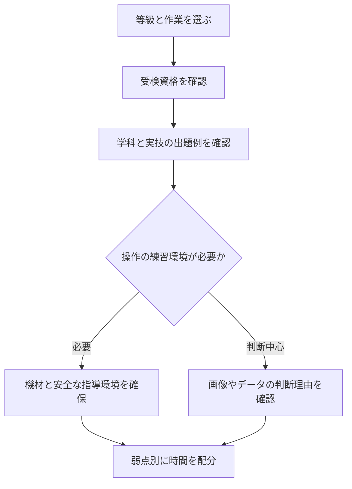

<!-- TARGET_KW: 機械保全技能士 独学 実技 -->
<!-- READER: S3-武器-検討前／検索・製造から保全へ異動を考える人 -->
<!-- ANSWER: 作業別の形式と練習環境で選ぶ -->
<!-- TAKEAWAY: 受検資格と弱点の切り分け -->

製造ラインから保全部門への異動を考え、機械保全技能士を独学で目指せるか調べているなら、先に確かめたいのは「実技」の中身です。

実技試験という名前でも、部品や状態を判断する形式と、機器を使って作業する形式では準備が違います。受ける等級・作業と練習環境を照合して、教材で進める部分と支援が要る部分を分けましょう。

筆者は機械保全技能検定を未受検です。以下は実施団体の公開情報と学習計画の整理であり、合格体験ではありません。

## 独学できるかは作業区分と実技形式で分かれる

2026年10月時点、1・2級には機械系保全作業、電気系保全作業、設備診断作業があり、3級は機械系・電気系です。特級は作業別の区分ではありません。[日本プラントメンテナンス協会・2026年度第2回試験概要](https://www.kikaihozenshi.jp/test_2nd/)

実技をすべて「機械の分解・組立をする試験」と捉えると、準備を誤ります。公式要項の実施方法と、受ける級の出題例を確認してください。[機械保全技能検定・試験要項](https://www.kikaihozenshi.jp/points/)

| 受ける作業 | 実技対策で確かめること | 独学の始め方 |
| --- | --- | --- |
| 機械系保全作業 | 判断等試験の出題例で、部品の状態・不良原因などを見分けられるか | 写真や図を見て判断理由を説明し、正答と照合する |
| 電気系保全作業 | 製作等作業試験の課題と、必要な機器・工具・操作を用意できるか | 課題を読んだ段階で練習機材と指導を受ける方法を確認する |
| 設備診断作業 | 公開出題例の測定データや診断対象を読み取れるか | 数値の読み方と、異常と判断する根拠を学ぶ |

この表は準備を選ぶ目安です。級ごとの具体的な課題は、[公式の実技試験問題・出題例](https://www.kikaihozenshi.jp/test_2nd/)を起点に確認します。3級でも、機械系は判断等試験、電気系は製作等作業試験という違いがあります。[2026年度第1回受検案内](https://www.kikaihozenshi.jp/pdf/2026_vol1_annai.pdf)

次は、教材選びの前に受けられる等級を確定します。

## 製造ラインの経験年数だけで受検級を決めない

2026年度第2回の基本の実務経験年数は、1級7年以上、2級2年以上、3級は問わないとされています。学歴・職業訓練歴などによる短縮要件もあります。[公式の受検資格](https://www.kikaihozenshi.jp/test_2nd/)

「製造業に2年勤務した」ことと「機械保全に関する業務を2年経験した」ことは、同じとは限りません。担当した点検、異常への対応、測定データの収集などを書き出し、公式の業務例と照合してください。

| 自分の状況 | 次の行動 |
| --- | --- |
| 保全経験がなく、受検資格を満たすか不明 | 3級と、学歴等の短縮要件を確認する |
| 点検や異常対応を担当している | 業務内容と期間を会社に確認し、対象級の資格要件と照合する |
| 電気系を受けたいが練習機器を使えない | 学科だけ先行させず、課題の実施環境を確保できるか調べる |
| 機械系の出題例を理由つきで解ける | 間違いが学科知識不足か、状態の見分け方かを分類する |

設備や工具を使う練習は、職場の許可と安全手順を守って行います。稼働設備に独断で手を加える計画にはしません。

## 学科と実技を小さく試してから時間を配分する

実施団体による一律の標準学習時間は、今回確認した資料では見つけられませんでした。経験別の時間を合格に必要な数値として示す代わりに、最初の学習枠を次のように使います。

1. 受ける級・作業の試験範囲と出題例を開く。
2. 学科を解き、誤答を用語・仕組み・計算に分ける。
3. 実技の出題例を確認し、判断や操作ができない箇所を記録する。
4. 読めば直る弱点と、機器・人の助けが必要な弱点に分ける。
5. 翌週の学習枠に割り当て、同じ弱点が残るか確認する。



学科を終えてから実技を初めて見ると、必要な機材を用意できないまま直前期に入るおそれがあります。実技の確認を計画の最初に置くのがポイントです。

## AIは判断理由の説明に使い、実技の代行には使わない

たとえば軸受の損傷を見分けられないときは、画像だけでAIに故障を診断させず、教材の解説と自分の理解を照合する役に使います。

```text
機械保全技能検定の教材を読んでいます。
次の解説と私の理解だけを材料に、因果関係の抜けを質問してください。
教材にない故障原因や試験の採点基準は推測しないでください。
【教材の解説を自分の言葉で要約】
【なぜその損傷が起きると考えたか】
最初は質問を一つだけ返してください。
```

<!-- AI_EXAMPLE: 使うAI=Gemini / プロンプト=本文の判断理由の照合 / 見せたいこと=故障名の丸暗記と原因の理解の違い -->

AIの説明は教材と照合し、現場の設備に適用する判断は保全担当者に確認します。AIが作った説明を、そのまま試験の公式解説や現場の作業指示にはしません。

---

## まとめ

機械保全技能士の独学可否は、学科と実技という名前だけでは決まりません。作業区分ごとの形式、受検資格、判断や操作を練習できる環境の3点で決めます。

まず希望する級・作業の公式出題例を一つ確認し、何を判断し、何を操作するのかを書き出してください。それが、教材中心で進めるか、練習環境を先に整えるかの分かれ目です。
