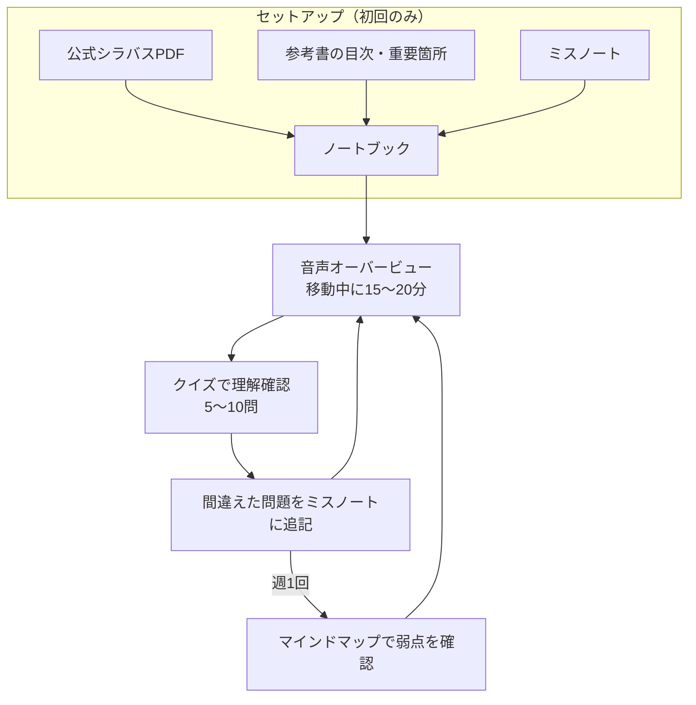

<!-- TARGET_KW: NotebookLM 資格試験 機能 使い分け -->
<!-- READER: S3-知的好奇心-学習中／検索・機能を選べない社会人 -->
<!-- ANSWER: 困り事から選び生成物を引用で照合 -->
<!-- TAKEAWAY: 機能選択表と更新確認を含む復習手順 -->

NotebookLMを開いても、機能が多くて何から使えばよいか迷うことがあります。

資格学習では、教材をたくさん生成する前に「資料に戻って確かめられるか」を軸に使い方を決めます。この記事では、困り事ごとの機能選びと、公式資料から復習までの流れを整理します。

2026年10月時点、GoogleはNotebookLMをGemini Notebookへ改称する案内を出しています。本記事では検索で使われているNotebookLMも併記します。[Google Workspace公式案内](https://knowledge.workspace.google.com/admin/generative-ai/gemini-notebook/turn-gemini-notebook-on-or-off-for-users)

ITパスポートに絞った手順は[ITパスポート NotebookLM勉強法](/method/notebooklm-ip-study-hack/)を参照してください。

## なぜNotebookLMが資格学習に向いているか

最大の特徴は、<strong>「集める・作る・覚える・聴く・図にする」がひとつのサービスで完結する</strong>ことです。

- <strong>集める</strong>：公式シラバス・過去問PDFをアップロード。Deep Researchでネットの情報も収集
- <strong>作る</strong>：チャットで理由を確認。クイズ機能で理解度チェック
- <strong>覚える</strong>：フラッシュカードで単語・用語を反復
- <strong>聴く</strong>：音声オーバービューでポッドキャスト風に学習
- <strong>図にする</strong>：スライド・インフォグラフィック・マインドマップで整理

もうひとつの強みは、<strong>選択したソースに基づくチャットで引用元を確認できる</strong>ことです。ただし、引用があるだけで回答全体の正しさが保証されるわけではありません。[Google公式・チャットの使い方](https://support.google.com/gemininotebook/answer/16179559?hl=ja)

ChatGPTやGeminiを家庭教師にする方法は[AIを家庭教師にする使い方](/method/ai-mentor-study-method-roadmap/)で解説しています。

## Deep ResearchとNotebookLMの組み合わせ

資料が手元にない分野は、Deep Researchで集めてからNotebookLMに取り込むのが効率的です。

<strong>手順は2通りあります。</strong>

1. NotebookLMの「ソースを追加」で、検索欄に調べたいテーマを入力し、Deep Researchを選ぶ。数分で複数ページのレポートと出典リストが生成され、そのままノートブックに取り込める
2. GeminiアプリでDeep Researchを実行し、レポートをGoogleドキュメントに書き出して、NotebookLMにドキュメントとして追加する

対応するファイルやWeb資料をソースとして追加できます。Web検索・Deep Researchから資料を探す方法もありますが、取り込む前に発行元と対象年度を確認します。[Google公式・ソースの追加と検索](https://support.google.com/gemininotebook/answer/16215270?hl=ja)

<strong>注意点が2つあります。</strong>Deep Researchの結果は、必ず公式のシラバスや一次情報と照合してください。また、教材の利用条件・権利を確認し、使える範囲が分からない資料は取り込まず、自分の理解を記したメモを使います。PDFが読み込みにくいときは、本記事の「シラバスPDFを使いやすいテキストにする」節も使えます。

## 無料でどこまで使えるか

2026年10月31日確認の公式プラン表では、Standardはノートブック100件、1ノートブックにつきソース50件です。プランや機能の上限は変更されることがあります。[Google公式・プランの詳細](https://support.google.com/gemininotebook/answer/16213268?hl=ja)

日々の生成回数は、プランと利用状況を公式ヘルプ・利用画面で確認してください。古い日次上限表を前提に教材作成の予定を組むことは避けます。

| 困っていること | 先に試すこと | 有料枠を検討する条件 |
| --- | --- | --- |
| ソースが多すぎる | 試験・年度・分野でノートを分ける | 必要資料だけでもソース上限に届く |
| 生成できる回数が足りない | 苦手分野に絞って作り、既存の教材で復習する | 日常的に必要な生成が上限で止まる |
| 何を作ればよいか不明 | 一つの用語をチャットで説明し引用を確認する | 課金より学習目的の整理を優先する |

## 学生向け：お金をかけずに、参考書の代わりにする

学生にとっての最大の価値は、<strong>月額課金なしで、公開資料から復習用の教材を作れる</strong>ことです。

<strong>おすすめの使い方：</strong>

1. 公式のシラバス・過去問（公開されているもの）をソースにする
2. 分からない分野はDeep Researchで補い、教材ノートを作る
3. 単語・用語はフラッシュカードで反復する
4. 概念を自分の言葉で説明し、チャットで資料と照合する（後述）
5. 移動中は音声オーバービューで概念をつかむ

まず公式資料の一分野だけで、チャットの説明と引用元を照合します。教材に十分な説明がなければ、資料を補う必要もあります。公開シラバスだけで参考書の全内容を置き換えられるとは限りません。

## ビジネスパーソン向け：聴く学習と、業務への転用

社会人にとっての価値は、<strong>机に向かう時間がなくても学習が進む</strong>ことと、<strong>学習用に作ったしくみをそのまま仕事に使える</strong>ことです。

<strong>聴く学習：</strong>音声オーバービューは、AIの2人がポッドキャスト形式で資料を解説します。通勤・家事・運動中に再生すれば、Audibleのような「聴く学習」の感覚で、机に向かわない時間が学習時間に変わります。苦手分野だけを抜き出したノートブックを作り、繰り返し聴くのが効果的です。

<strong>業務への転用：</strong>資格学習で身につけるのは、「資料をソースにして、問い・要約・図解を生成する」操作です。仕事に応用する場合は、会社のAI利用規則と資料の取扱い条件を確認し、許可された資料に限定します。有料のAIサービスを契約する前に、無料の範囲で試せるのも利点です。

<strong>時間のない人の型：</strong>

- 通勤中：音声オーバービューを1本（15〜20分）
- 昼休みか帰宅後：クイズ機能で5〜10問
- 週末：ミスノートを更新し、マインドマップで弱点を確認

## 機能の仕分けと試験勉強での使い所

次のランクは、本記事で初めに試す順序の提案です。公式の評価ではありません。機能一覧と操作は[Google公式のノートブック作成ガイド](https://support.google.com/gemininotebook/answer/16206563?hl=ja)で確認できます。

| ランク | 機能 | 試験勉強への用途 |
|---|---|---|
| <strong>S</strong> | 引用・メモの保存 | 根拠確認・重要箇所の保存 |
| <strong>S</strong> | チャット（質問応答） | 用語の自分事化・理由の照合 |
| <strong>A</strong> | フラッシュカード | 用語の反復確認（進捗が保存される） |
| <strong>A</strong> | クイズ機能 | 理解度チェック（問題数・難易度を指定可） |
| <strong>A</strong> | 音声オーバービュー | 移動中の聞き流し学習 |
| <strong>A</strong> | レポート（学習ガイド） | 分野ごとの要点整理・確認問題 |
| <strong>B</strong> | マインドマップ | 弱点の可視化 |
| <strong>B</strong> | 動画解説 | 概念の視覚的整理 |
| <strong>B</strong> | スライド・インフォグラフィック | 要点の一枚絵化・復習用資料 |
| <strong>C</strong> | 共有・コラボ機能 | 個人学習では不要 |

### フラッシュカード——用語確認の手軽なツール

Studioでフラッシュカードを選ぶと、ソースをもとにカードを生成できます。[Google公式・フラッシュカードとクイズ](https://support.google.com/gemininotebook/answer/16958963?hl=ja)

フラッシュカードでは、<strong>進捗がセッションをまたいで保存され</strong>、各カードに「覚えた（Got it）」「間違えた（Missed it）」を付けられます。デッキのシャッフルや、結果画面から間違えたカードだけを再挑戦することもできます。[Google公式・カードの操作](https://support.google.com/gemininotebook/answer/16958963?hl=ja)

生成後は、用語の名前だけでなく、意味や使い分けを確かめるカードになっているかを見ます。足りない観点は、ソースと生成時の指示を見直して補います。

<strong>効果を上げる3つのソース設計：</strong>

「自分のミスノート」（作り方は[ミスノートDBの記事](/method/miss-note-db/)）を復習用のソースにする方法があります。過去問で間違えた問題と正解を記録したドキュメントをアップロードすると、<strong>自分の弱点を扱うフラッシュカードを作るよう指定できます</strong>。対象ソースをミスノートに絞ると、復習する範囲を管理できます。生成後は実際にその範囲から作られているか確認してください。

```text
（NotebookLMへの指示メモ）
このノートにある「間違えた問題」をもとに
フラッシュカードを生成してください。
「問い」は問題文そのままではなく、
その概念の本質を問う形に変換してください。
```

### 用語を集めて、自分のナレッジにする

単語や用語を覚えるなら、フラッシュカードがいちばん手軽です。ただ、毎回シラバス全体からカードを作っていると、すでに覚えた用語と、まだ覚えていない用語が混ざったままになります。

そこでおすすめなのが、<strong>覚えたい用語を1つのドキュメントに集めておき、それを自分専用のナレッジとしてNotebookLMのソースにする</strong>方法です。

<strong>用語ノートの作り方：</strong>

1. GoogleドキュメントなどにITパスポートなら「ITパスポート用語ノート」のように、試験ごとに1つドキュメントを作る
2. 過去問や参考書で引っかかった用語、[フラッシュカードアプリ](/app/flashcard-app/)で「✕」を付けた用語を、見つけたその日のうちに書き足す
3. 1つの用語につき、次の4項目を書く

| 項目 | 書く内容 |
|---|---|
| 用語 | 正式な名称（略語なら正式名も） |
| 意味 | シラバスや参考書の説明を1〜2文で |
| どこで間違えたか | 「〇〇と混同した」「選択肢の言い換えに気づかなかった」など |
| 自分の言葉で | 自分の仕事や生活に置き換えた説明 |

「自分の言葉で」の欄は、次の節で紹介する「用語の自分事化」をNotebookLMに頼み、その答えを自分の言葉に直して書き込むと埋めやすくなります。

<strong>NotebookLMでの使い方：</strong>

- 用語ノートをソースとして追加し、フラッシュカードを生成する。シラバス全体ではなく、自分が覚えていない用語だけのデッキができる
- 用語ノートを更新したら、ソースへの反映を確認して、カードを作り直す
- 試験の直前は、用語ノートをソースにした音声オーバービューを作り、移動中に聞き流す

用語ノートは、試験が終わっても手元に残ります。次に上位の試験を受けるときは、このノートを最初のソースにすれば、すでに積み上げた知識の上から学び始められます。

### 用語の自分事化——抽象概念を自分のことに変換する

資格試験の最大の壁は、実務経験がない分野の専門用語の多さです。抽象的な用語は「記号の羅列」にしか見えず、暗記しようとするほど苦しくなります。

NotebookLMに資料を追加し、自分の職業・生活に置き換える説明を頼めます。元の定義と身近な例を対応づける使い方です。

<strong>自分事化の手順：</strong>

1. 公式シラバスPDFをソースとして追加する
2. チャットで自分の属性を宣言する

```text
私は不動産営業をしている30代の社会人です。
試験勉強を始めたばかりで、知識はほぼゼロです。
以降の質問に答える際は、不動産営業の日常業務を例えとして使ってください。
```

3. 苦手な用語を一つずつ翻訳させる

```text
シラバスにある「CRM（顧客関係管理）」という概念を、
私の営業活動（テレアポ・訪問記録・成約管理）に例えて説明してください。
```

たとえ話が出てきたら、資料の定義と対応する部分、対応しない部分を確認します。生活上の例を、試験の正式な定義として覚えないようにします。

<!-- AI_EXAMPLE: 使うAI=NotebookLM / プロンプト=本文のCRMを営業活動に例える指示 / 見せたいこと=たとえと資料の定義の対応を引用で確認 -->

<!-- LEARNER_NOTE: 候補=CRMのたとえを原典に戻して確認した際の気づき / 種類=think / 筆者の実体験で記入 -->

### クイズ機能——説明できるかを確認する

クイズでは難易度、問題数の多寡、扱うトピックを調整できます。正解の選択だけで終わらず、説明を読んで資料と照合します。[Google公式・クイズ](https://support.google.com/gemininotebook/answer/16958963?hl=ja)

そのうえで、クイズ機能の本来の価値は「問題を解く」ことではなく、<strong>「自分が説明できるかどうかを確認する」</strong>ことにあります。

ファインマンテクニックの考え方で使います。答えを選ぶのではなく、選択前に「自分ならどう答えるか」を先に言語化してからクイズに答えます。

```text
（ノートブックのメモに記録）
「○○という概念について、試験範囲の資料を見ずに
説明してください」という形式で問題を出してください。
私が答えた後に資料との照合と採点をしてください。
```

<strong>選択肢の正解を確認するより、「自分が説明できる」状態を作ることが本番での応用力につながります。</strong>間違えた問題は、不正解の選択肢まで掘り下げる[逆転学習法](/method/miss-note-db/)と組み合わせると、1問から得られる知識が増えます。

### オリジナルドリル生成——チャットで演習問題を量産する

チャットで理解確認用の問題を作る場合も、最初は少数に絞ります。生成問題は公式過去問ではなく、シラバスだけから出題傾向を推測できるわけでもありません。

公式シラバスに加え、利用できる公開問題・解説をソースに選び、次のように頼みます。

```text
選択した資料の【分野名】について、理解確認用の問いを一つ作ってください。
出題傾向や本番での出題確率は推測しないでください。
まず問いだけ出し、私の回答後に根拠の引用と照合してください。
資料にない説明は「資料に記載なし」と区別してください。
```

多数の問題を作る前に、正答が一意か、根拠を引用で確かめられるかを確認します。間違いのある問題を繰り返さないことを優先してください。

### 音声オーバービュー——移動中に理解を積み上げる

音声オーバービューでは、資料を会話形式で解説する音声などを生成できます。[Google公式・音声解説](https://support.google.com/gemininotebook/answer/16212820?hl=ja)

<strong>聞き流しながら「なぜその概念が重要か」の文脈が自然に入ってくる</strong>のが最大のメリットです。通勤・家事・運動中に再生することで、机に向かわない時間も学習時間に変わります。

効果的な使い方は、シラバスの「苦手な分野だけ」を抽出したドキュメントを別ノートブックに作成し、その分野の音声を繰り返し聞くことです。

聴いたあとに、内容を自分の口で話して確認する音声アウトプット学習を組み合わせると、聴くだけで終わらずに定着します。

注意点として、音声オーバービューは「理解の補助」に使います。問題演習の代替にはなりません。<strong>聞き流しで概念の輪郭をつかんでから、机での問題演習に入る順序が効果的です。</strong>

### レポート・スライド・インフォグラフィック——要点を資料化する

Studioには、上記のほかにレポート（学習ガイド・FAQ・ブリーフィング資料など）、スライド、インフォグラフィック、データテーブルの生成機能があります。

試験勉強で使いやすいのは次の使い方です。

- <strong>レポート（学習ガイド）</strong>：分野ごとの要点と確認問題をまとめ、Googleドキュメントに書き出せる
- <strong>スライド</strong>：生成後に修正指示を出して再生成でき、PDFとして書き出せる
- <strong>インフォグラフィック</strong>：手順書き・比較表など、暗記したい内容を一枚絵にして眺める
- <strong>データテーブル</strong>：用語の比較表を作り、Googleスプレッドシートに書き出せる

スライドは18歳以上向けと案内されています。利用条件や操作は機能ごとのヘルプで確認し、生成物の図や数値も原典と照合します。[Google公式・スライド](https://support.google.com/gemininotebook/answer/16757456?hl=ja)

### マインドマップ——弱点を視覚化して塞ぐ

マインドマップ機能の試験勉強での使い方は、教科書の要約ではなく<strong>「自分が間違えた問題のクラスタリング」</strong>です。

間違いをマインドマップ化すると、「この間違いはネットワークの基礎概念が抜けているから」というように、復習対象を分野ごとに整理できます。[Google公式・マインドマップ](https://support.google.com/gemininotebook/answer/16212283?hl=ja)

エンジニアや図解好きな学習者向けに、マインドマップをMermaid記法で出力させることもできます。

```text
このミスノートのマインドマップを
Mermaid記法で出力してください。
ルートノードを「弱点カテゴリ」にし、
葉ノードに具体的な間違い事例を配置してください。
```

Mermaid出力はNotionやMarkdownエディタに貼り付けて管理できます。

### 動画解説機能——概念を見て理解する

動画解説機能は、テキストだけでは理解しにくい概念を視覚的に整理するのに使います。

<strong>「図解」ではなく「概念の流れ」を学ばせることが効果的な使い方</strong>です。OSI参照モデルやTCP/IPの通信フロー、トランザクションのACID特性といった「プロセスが連鎖する概念」に向いています。

利用できる形式・言語・プランは、[Google公式・動画解説](https://support.google.com/gemininotebook/answer/16454555?hl=ja)と自分の画面で確認してください。動画の説明を見て分かったつもりになったら、元の資料を開き、処理の順番を自分で説明し直します。

## 学習ワークフロー（NotebookLM単独）

NotebookLMを中心にする復習フローの提案です。問題演習や制度確認は、必要に応じて公式資料・教材で補います。

<strong>セットアップ（初回のみ）:</strong>
1. IPAの公式シラバスPDFをアップロード（EPUB形式のソースにも対応）
2. 使用している参考書の目次・重要箇所をテキストで追加
3. 自分のミスノートドキュメントを作成して追加

<strong>毎日の学習ルーティン:</strong>
1. 音声オーバービューを移動中に1セッション（15〜20分）
2. 着席後にクイズ機能で理解確認（5〜10問）
3. 間違えた問題をミスノートに追記
4. 週1でマインドマップを更新して弱点パターンを確認

生成する前にソースを選び、生成した教材で間違えたら原典へ戻る、という順序を保ちます。

セットアップと毎日のルーティンの関係を図にすると、次のようになります。ミスノートの更新がソースに反映されたことを確かめ、復習用の生成物を作り直します。Googleドライブから取り込む対応ファイルは自動同期されますが、必要に応じて手動同期も確認します。[Google公式・ソースの更新](https://support.google.com/gemininotebook/answer/16215270?hl=ja)



## シラバスPDFを使いやすいテキストにする

IPAの公式シラバスはPDFで公開されています。PDFから用語をコピーすると、表の構造が崩れたり、ページの区切りで文章が途切れたりして、そのままではAIや単語帳に使いにくいことがあります。

NotebookLMはPDFを直接読み込めますが、レイアウトの影響で用語の対応関係が読み取りにくくなる場合があります。そこで、シラバスの「用語例」の部分だけをコピーして、構造化したテキストに整えてから追加する方法があります。生成AIに「用語を中分類ごとに整理し、表記ゆれをそろえて」と頼めば、構造化したテキストにできます。

出力したテキストは、次のように使えます。

- Googleドキュメントに貼り付けて、NotebookLMのソースに追加する（元のシラバスとの対応を確認してから使う）
- ChatGPTやGeminiへのプロンプトの素材にする
- Notionやスプレッドシートにリストとしてインポートしてチェックリストにし、「未学習」「学習中」「完了」で進捗を管理する

## 他のAIと組み合わせる

NotebookLM単独でも学習は回りますが、「NotebookLMで確認できないこと」が出てきたら、他のAIを足します。考え方は、<strong>NotebookLMを知識ベース、ChatGPT・Gemini・Claudeを対話エンジン</strong>として役割を分けることです。他のAIへ持ち込むときも、対象テーマと根拠となる資料を一緒に渡します。

| タスク | 向いているAI | 理由 |
| --- | --- | --- |
| シラバスの知識ベース管理 | NotebookLM | アップロードした資料の範囲で、引用元つきで答える |
| 概念の「なぜ」を対話で理解 | ChatGPT・Gemini | 言い換えやたとえ話が得意 |
| 最新情報の調査 | Gemini（Deep Research） | 検索を使った調査に向く |
| 記述答案の添削 | Claude | 長文の論理構造を見て、どこが弱いかを指摘しやすい |
| 理解の確認（クイズ） | NotebookLM | 試験範囲に閉じて出題できる |

### 基本の3ステップ

どの組み合わせでも使える流れです。

1. <strong>NotebookLMで範囲と弱点を確認する</strong>：シラバスとミスノートを読み込み、今日学ぶ範囲を特定する
2. <strong>別のAIで「なぜ」を対話で理解する</strong>：NotebookLMで確認したテーマを、ChatGPT・Gemini・Claudeに持ち込んで、設計意図から説明してもらう
3. <strong>NotebookLMのクイズで確かめる</strong>：対話で理解した内容が、試験の範囲で使えるかを確認する

```text
（ステップ2：ChatGPT・Gemini・Claudeへ）
今日学ぶテーマは「OSI参照モデルの7層構造」です。
計算や暗記の前に、「なぜ通信プロトコルを層に分けて設計するのか」という設計意図から教えてください。
概念の存在理由を先に理解したいです。
```

```text
（ステップ3：NotebookLMへ）
OSI参照モデルについて学びました。
シラバスの範囲でクイズを3問出してください。
選択肢より先に自分で答えてから解説を見たいので、まず問題文だけ出してください。
```

#### GeminiとNotebookLMで実行した結果

ステップ2をGemini、ステップ3をNotebookLMで実行しました（2026年10月）。

ステップ2のGeminiは、「なぜ層に分けるのか」を3つの設計意図で説明しました（要約）。

> - <strong>関心の分離</strong>：通信を1つの巨大な仕組みにすると、どこを直せばよいか分からなくなる。役割ごとに層に分けると、各層が自分の仕事だけに集中できる（手紙を書く人・封筒に宛名を書く人・配達員が分かれているのと同じ）
> - <strong>変更の独立性</strong>：ケーブルが銅線から光ファイバーや無線に変わっても、ブラウザを作り直さなくてよい。下の層が変更を吸収し、隣の層に影響させない
> - <strong>標準化による相互接続</strong>：層ごとにルールを決めておけば、メーカーが違う機器やソフトでも組み合わせられる

最後に、下位層（1〜4層）は「データを確実に届ける役割」、上位層（5〜7層）は「届いたデータをアプリがどう解釈するかの役割」とまとめていました。暗記の前に、7層を見る地図ができる説明です。

ステップ3のNotebookLMは、プロンプトのとおり問題文だけを出しました。

> 【第1問】OSI基本参照モデルにおいて、送信元と宛先の間でのデータ伝送の中継や、IPアドレス等の識別子にもとづいて最適な伝送経路を選択・制御する機能（ルーティング）を担う層は、「第何層」で何と呼ばれる層でしょうか？

答えはネットワーク層（第3層）です。ステップ2で「下位層はデータを届ける役割」と理解していれば、その中で経路を選ぶ層を考えられます。

ただし、頼んだのは3問ですが、出てきたのは<strong>1問だけ</strong>でした。「答え」か「選択肢を出して」と返すと次に進む、1問ずつの出題になっています。また、問題を作る前にWebの調査をして、「第3層と第4層の違い」「機器がどの層で動くか」がよく問われる、とまとめていました。

まとめて3問ほしいときは、「3問を続けて出して」と言い直すか、1問ずつ答えて進めます。NotebookLMの回答の形は、資料やその時の動きで変わることがあります。

ペースは、NotebookLMを軸にして、他のAIでの深掘りは週1〜2回で十分です。毎日すべてのツールを使おうとすると、管理の手間で疲れてしまいます。記述式の答案の添削は、[応用情報・高度試験の午後記述プロンプト集](/method/ap-pm-descriptive-ai-prompts/)のプロンプトをClaudeなどに渡す使い方が向いています。試験別のプロンプトは、[GeminiでIT資格試験を勉強する方法](/method/gemini-cert-complete/)にまとめています。

## よくある質問

<strong>Q: 何をアップロードすればいいですか？</strong>

公式シラバスPDF + 参考書の目次・重要箇所 + 自分のミスノートの3点が基本です。教材の利用条件を確かめ、権利が不明なものは取り込まず、自分の理解を書いたメモを使います。

<strong>Q: フラッシュカードの問題数が少ないです</strong>

ソースの情報量や指定した範囲を確認し、難易度・カード数の設定を調整します。数を増やす前に、必要な用語が資料に含まれているか確認してください。

<strong>Q: 音声オーバービューが英語で生成されます</strong>

ソース資料が日本語でも英語出力になる場合があります。設定の出力言語を日本語に変更し、音声を再生成します。[Google公式・出力言語の変更](https://support.google.com/gemininotebook/answer/16261963?hl=ja)

<strong>Q: 「Gemini Notebook」と「NotebookLM」は別のサービスですか？</strong>

GoogleはNotebookLMからGemini Notebookへの改称を案内しています。名前の違いでノートブックを作り直す前に、同じアカウントで開いてください。[Google公式案内](https://knowledge.workspace.google.com/admin/generative-ai/gemini-notebook/turn-gemini-notebook-on-or-off-for-users)

<strong>Q: チャットの履歴は残りますか？</strong>

履歴やメモに残す内容を分け、重要な説明は引用元と一緒に自分のノートに記録してください。共有の範囲も[Google公式・チャット](https://support.google.com/gemininotebook/answer/16179559?hl=ja)で確認します。

<strong>Q: NotebookLMとChatGPT/Geminiは使い分けが必要ですか？</strong>

NotebookLM単独でも十分学習できます。他のAIと組み合わせるとさらに効果が高まります。役割分担は、本記事の「他のAIと組み合わせる」にまとめています。

---

## まとめ

NotebookLMは、<strong>選んだ資料を起点に、理解の対話と復習用の教材を組み合わせられる</strong>ツールです。生成した内容は引用元へ戻って確認します。

機能は、用語を確認するならカード、理由を説明するならチャット、移動中の復習なら音声というように、困り事から選べます。

まず今日、IPAのシラバスPDFをNotebookLMにアップロードして、フラッシュカードを生成するところから始めてください。

複数のAIを組み合わせたい方は、本記事の「他のAIと組み合わせる」から読んでください。
