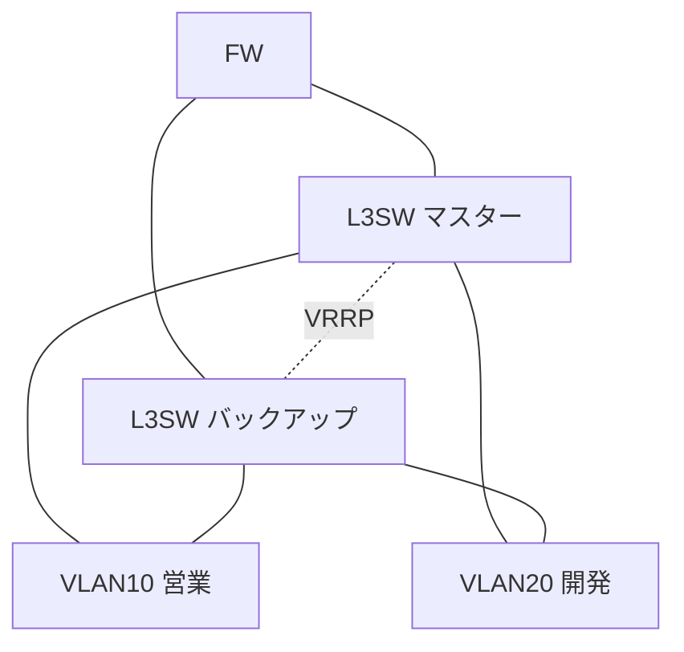

ネットワークスペシャリスト（NW）試験の午後は、複数の要件が絡み合うパズルのような問題です。

（2026年度からCBT方式になり、午後Ⅰ・午後Ⅱは科目B-1・科目B-2に名前が変わりました。出題形式は変わっていません。出典: [CBT方式での実施について｜IPA](https://www.ipa.go.jp/shiken/2026/ap_koudo_sc-cbt.html)）

物理構成、論理構成、ルーティングプロトコル、VRRPによる冗長化などが、文字だけで延々と書かれています。読んだだけで、頭の中に正確な構成図を描ける人は多くありません。

図にしながら読むと解きやすくなる、というのはよく言われます。そこで、Mermaid記法でネットワーク図を書く方法が注目されています。

ただ、ここに落とし穴があります。<strong>Mermaid記法を、文字だけで一から書こうとすると、かえって難しい</strong>のです。

この記事では、まず手書きのメモで図を描き、その写真をAIに送ってMermaidに整形してもらう手順を説明します。

---

## Mermaidを文字だけで書くのが難しい理由

Mermaidは、テキストで図を書ける記法です。コードを書けば、構成図として表示されます。

けれど、図の中身を考えながら、同時に記法のコードを書くのは、負担が大きい作業です。

- 機器同士の接続を、文字の並びで頭の中に保ちながら書かなければならない
- 接続の抜けや、線のつなぎ間違いが、コードのままでは見つけにくい
- そもそも図の構想が固まっていないまま書き始めると、書き直しが増える

回路図を設計するとき、いきなり清書をする人はいません。まずは紙にメモで描いて、考えを整理してから、きれいに直します。ネットワーク図も同じです。

## 手順：手書きの図を写真に撮ってAIに整形させる

今は、手書きの図の写真をAIに送って、「このネットワーク図をMermaidで書いて」と頼めば、記法に整形してくれます。次の5ステップで進めます。

### 要件を読みながら、紙に図を描く

問題文の要件を読みながら、紙やノートに、丸と線で図を描きます。きれいに描く必要はありません。

- 機器（ルータ、L3スイッチ、FWなど）を丸や四角で描く
- 機器同士の接続を線で描く
- VLAN番号、IPアドレスの範囲、VRRPの優先度、OSPFのエリアなど、問題文に書かれた条件を、図の横にメモする

この段階で、接続の関係が曖昧な所に気づけます。気づいた所を問題文に戻って読み直すことが、理解を深める作業になります。

### 写真に撮って、AIに送る

描いた図をスマホで撮影し、画像を受け取れるAIに送ります。次のように頼みます。

```text
添付の手書きのネットワーク図を読み取り、Mermaidの graph TD 形式で書いてください。

- 機器の接続関係を、図のとおりに再現する
- VLAN番号やVRRPの優先度など、メモに書いてある条件は、ラベルや注釈で残す
- 読み取れない部分や、接続が不明な部分は、推測せずに「不明」と書いて教えてください
```

最後の指示が大切です。AIが読み取れなかった所を黙って補うと、間違いに気づけません。

### Mermaidを表示して、確認する

返ってきたコードを、Mermaid Live EditorやObsidian、VS Codeなどに貼り付けると、図として表示されます。

出力のイメージは次のとおりです。VRRPで冗長化されたL3スイッチの配下に、複数のVLANがぶら下がる、NW試験でよく出る形です。

```text
graph TD
    FW[FW] --- L3M[L3SW マスター]
    FW --- L3B[L3SW バックアップ]
    L3M -.VRRP.- L3B
    L3M --- VLAN10[VLAN10 営業]
    L3M --- VLAN20[VLAN20 開発]
    L3B --- VLAN10
    L3B --- VLAN20
```

このコードを表示すると、次の図になります。文字の並びでは追いにくかった「どちらのL3スイッチからも、両方のVLANに線が出ている」ことが、図ではひと目で分かります。



### 問題文と突き合わせて、検算する

AIが整形した図には、写真の読み取りの誤りが含まれることがあります。表示された図と、自分の手書きの図、そして問題文を見比べて、接続関係が一致しているかを確認します。

この検算が、図を使った学習のいちばん大切な部分です。AIの出力をそのまま信じないでください。

### 設問の条件を、図に書き足す

「VLAN10からVLAN30への通信のみを許可する」のような設問ごとの条件は、図に注釈として書き足します。図を見ながら解答を組み立てると、文章を何度も読み返さずに済みます。

過去問の演習全体への組み込み方は、続編の[午後記述のプロンプト集（NWの過去問の進め方）](/method/ap-pm-descriptive-ai-prompts/)で扱っています。

## 文章だけから、図を作らせる方法もある

手書きで描くのが難しい長い要件は、問題文をそのままAIに貼って、図にしてもらう方法もあります。

```text
以下のネットワーク要件を読み取り、Mermaidの graph TD 形式で構成図を作成してください。

各VLAN、L3スイッチ、FWの接続関係を明確にし、VRRPが適用されている箇所は注釈を入れてください。
要件に書かれていない接続は、足さないでください。

（問題文の要件定義）
```

ただし、この方法は、最初から自分で図を描く過程が抜けるため、理解の確認にはなりにくくなります。慣れるまでは、手書きの図を先に描くことをおすすめします。

## 頻出の技術別：図にするときのポイント

| 分野 | つまずきやすい点 | 図にするときのポイント |
| --- | --- | --- |
| VLAN・トランキング | どのポートがどのVLANに属するか混乱する | ポートごとにVLAN番号をラベルに書く |
| OSPF | エリア設計とコストの関係が見えない | エリアの境界を枠で囲み、コストを線のラベルに書く |
| VRRP | マスター／バックアップの切り替えが曖昧になる | 優先度を書き、障害時の切り替え先を矢印で示す |
| ACL・FW | 許可・拒否ルールの適用順序を見失う | ルールを上から順に並べ、通信が通るか通らないかを追う |

## 図ができたら、障害を想像してみる

図ができたら、AIに障害を想像してもらうと、理解が深まります。

- 「L3スイッチAが故障した場合、パケットはどう流れるか。図を更新して説明して」
- 「VLAN10からVLAN30への通信だけを許可するACLは、どこに設定するべきか。図で示して」

AIの答えは、自分の図と照らして、納得できるかを確かめながら読んでください。

## 図は自分用の資料として残す

過去問を解くたびに、手書きの図とMermaidのコードを、分野ごとに名前をつけて保存しておくと、直前期に見直せる「図解ノート」になります。OSPFのエリア設計、VRRPの冗長構成など、頻出のパターンが手元にたまります。

## 合格までの勉強時間

| 前提知識 | 目安時間 | 主な学習内容 |
| --- | --- | --- |
| ネットワーク知識ゼロ | 300〜400時間 | 基礎用語・プロトコルの理解から図解の練習まで |
| 基本情報・応用情報合格済み | 200〜300時間 | 午前対策は最小限、午後の構成図読解に集中 |
| CCNA等ベンダー資格保有者 | 150〜200時間 | 実務知識を国家試験の記述形式に翻訳する訓練が中心 |

## ほかの試験にも使える

手書きで描いてから、AIに整形させる方法は、NW試験専用ではありません。データベーススペシャリストのER図、システムアーキテクトの構成図、プロジェクトマネージャのWBSなど、文章で説明された構造を図で理解する場面で使えます。

手書きの図をMermaidにする方法を、AWSなどほかの分野でも見たい場合は、[手書きノートをAIでMermaidにする記事](/method/vision-to-mermaid-hack/)も参考にしてください。

## よくある質問

<strong>Q. Mermaidの文法を覚える必要がありますか？</strong>

A. 基本的には不要です。AIにコードを書かせるので、暗記する必要はありません。ただ、生成されたコードを少し直せると便利なので、`graph TD`（上から下）と`graph LR`（左から右）の書式だけ知っておくとよいでしょう。

<strong>Q. 試験本番でもMermaidを使えますか？</strong>

A. 使えません。試験会場にはPCやスマホを持ち込めないので、Mermaidは学習段階用です。学習で手書きの図を描く習慣をつけておくと、本番では問題用紙の余白にラフな図を描く形で活かせます。

<strong>Q. 手書きの図をAIがうまく読み取れないときは？</strong>

A. 文字を大きく書く、線を太くする、明るい所で撮影する、などで改善することがあります。それでも読み取れない部分は、AIに「不明」と言ってもらい、自分で直してください。

<strong>Q. Mermaid以外の作図ツールでも代用できますか？</strong>

A. draw.ioやPlantUMLなどのテキストベースのツールでも、同じ進め方ができます。使い慣れたものに置き換えて構いません。

---

## まとめ

- Mermaidを文字だけで書くのは難しいので、先に手書きのメモで図を描く
- 手書きの図の写真をAIに送り、「このネットワーク図をMermaidで書いて」と頼めば、記法に整形してくれる
- AIの出力は、自分の図と問題文で必ず検算する
- 図は自分用の資料として残し、直前期の見直しに使う

まずは今日解く過去問1問で、要件を読みながら紙に丸と線を描いてみてください。

---

> この記事は [IPA資格の高難易度対策｜応用情報・高度試験と2027年の新試験の選び方](/method/advanced-ipa-hub/) の一部です。
