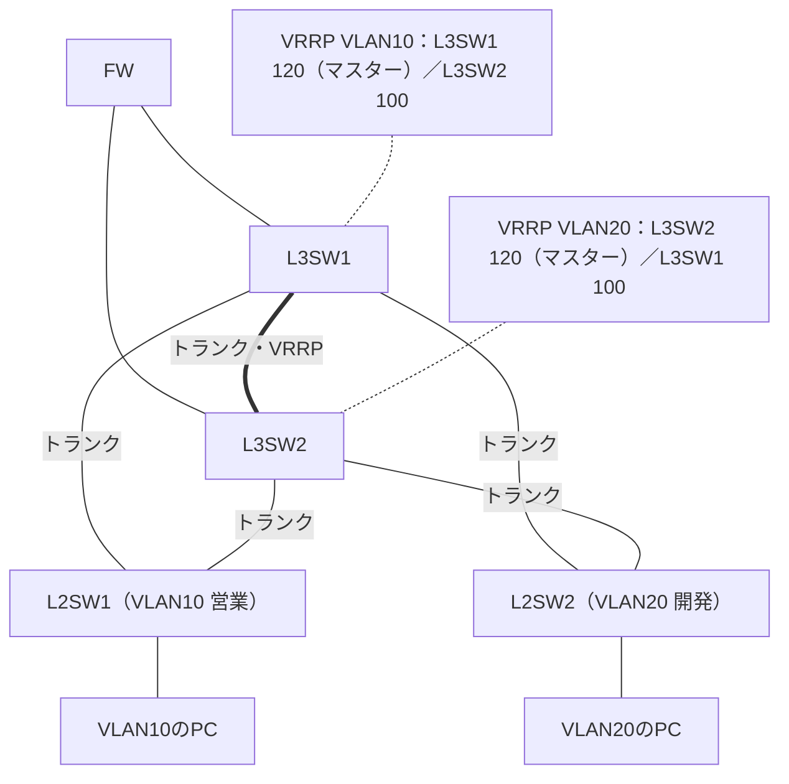
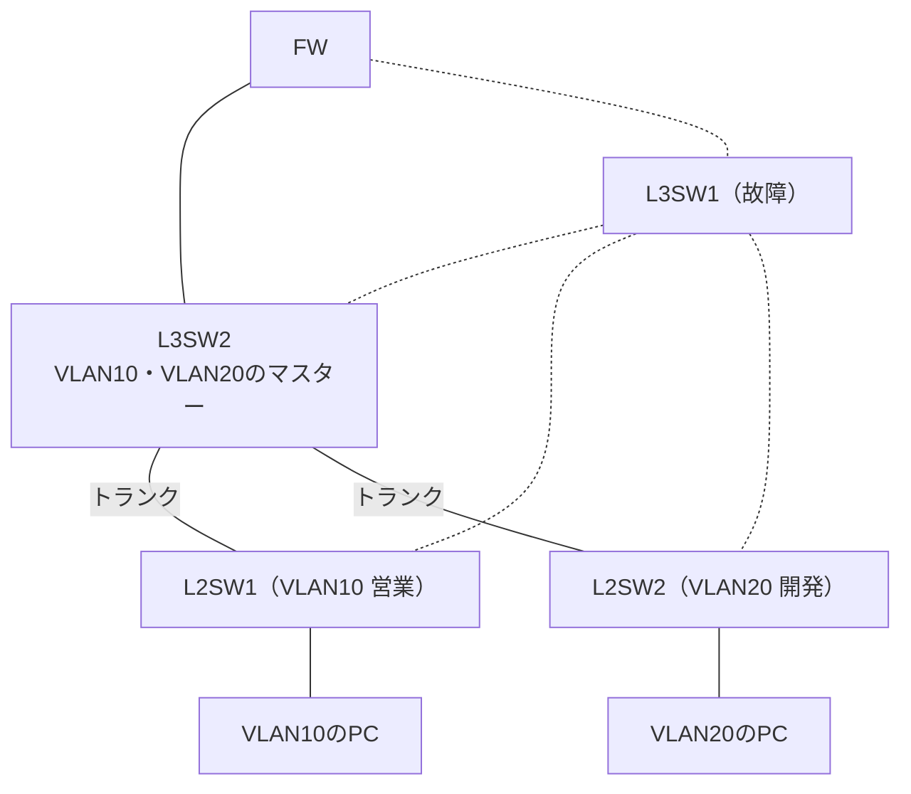

ネットワークスペシャリスト（NW）試験の科目B（旧午後）は、複数の要件が絡み合うパズルのような問題です。

（2026年度からCBT方式になり、午後Ⅰ・午後Ⅱは科目B-1・科目B-2に名前が変わりました。出題形式は変わっていません。出典: [CBT方式での実施について｜IPA](https://www.ipa.go.jp/shiken/2026/ap_koudo_sc-cbt.html)）

物理構成、論理構成、ルーティングプロトコル、VRRPによる冗長化などが、文字だけで延々と書かれています。読んだだけで、頭の中に正確な構成図を描ける人は多くありません。

図にしながら読むと解きやすくなる、というのはよく言われます。そこで、Mermaid記法でネットワーク図を書く方法が注目されています。

ただ、ここに落とし穴があります。<strong>Mermaid記法を、文字だけで一から書こうとすると、かえって難しい</strong>のです。

この記事では、要件の文章をAIに渡してMermaidの構成図にしてもらう手順を、Claudeで実行した例と一緒に説明します。後半では、自分で手書きした図が合っているかを、写真でAIに確かめてもらう使い方も紹介します。

---

## Mermaidを文字だけで書くのが難しい理由

Mermaidは、テキストで図を書ける記法です。コードを書けば、構成図として表示されます。

けれど、図の中身を考えながら、同時に記法のコードを書くのは、負担が大きい作業です。

- 機器同士の接続を、文字の並びで頭の中に保ちながら書かなければならない
- 接続の抜けや、線のつなぎ間違いが、コードのままでは見つけにくい
- そもそも図の構想が固まっていないまま書き始めると、書き直しが増える

記法はAIに任せて、人は「要件と図が合っているか」を確かめる側に回るほうが、学習の時間を本題に使えます。

## 手順：要件の文章をAIに渡して、Mermaidの図にする

問題文の要件をAIに貼って、Mermaidの構成図にしてもらいます。次のように頼みます。

```text
以下のネットワーク要件を読み取り、Mermaidの graph TD 形式で構成図を作成してください。

各VLAN、L3スイッチ、FWの接続関係を明確にし、VRRPが適用されている箇所は注釈を入れてください。
要件に書かれていない接続は、足さないでください。

（問題文の要件定義）
```

最後の指示が大切です。AIが要件にない接続を黙って補うと、図が正しいのか分からなくなります。

### Claudeで実行した結果

このプロンプトを、Claudeで実行しました（2026年10月）。過去問の文章ではなく、NW試験によく出る形をまねた<strong>架空の要件</strong>を使っています。

> A社の本社LANは、FW1台、L3SW2台（L3SW1・L3SW2）、L2SW2台（L2SW1・L2SW2）で構成する。FWは、L3SW1とL3SW2のそれぞれと接続する。L3SW1とL3SW2の間はトランクで接続し、VRRPで冗長化する。
>
> VLAN10（営業）とVLAN20（開発）のデフォルトゲートウェイは、VRRPの仮想IPアドレスとする。VRRPの優先度は、VLAN10ではL3SW1を120・L3SW2を100、VLAN20ではL3SW2を120・L3SW1を100とする。
>
> L2SW1にはVLAN10のPCを、L2SW2にはVLAN20のPCを収容する。L2SW1とL2SW2は、それぞれL3SW1とL3SW2の両方にトランクで接続する。

返ってきたコードは次のとおりです。

```text
graph TD
    FW[FW] --- L3SW1[L3SW1]
    FW --- L3SW2[L3SW2]
    L3SW1 ===|トランク・VRRP| L3SW2
    L3SW1 ---|トランク| L2SW1["L2SW1（VLAN10 営業）"]
    L3SW2 ---|トランク| L2SW1
    L3SW1 ---|トランク| L2SW2["L2SW2（VLAN20 開発）"]
    L3SW2 ---|トランク| L2SW2
    L2SW1 --- PC10[VLAN10のPC]
    L2SW2 --- PC20[VLAN20のPC]
    N10["VRRP VLAN10：L3SW1 120（マスター）／L3SW2 100"] -.- L3SW1
    N20["VRRP VLAN20：L3SW2 120（マスター）／L3SW1 100"] -.- L3SW2
```

コードのあとに、次の説明が付きました（要約）。

> - VLANごとにマスターが分かれているので、ふだんはVLAN10の通信がL3SW1、VLAN20の通信がL3SW2を通る（負荷分散の形）
> - <strong>要件に書かれていないため、図に入れていないもの</strong>：FWとL3SWの間のセグメントやVLAN、VRRPの仮想IPアドレスの値、PCの台数

2つ目の説明が、プロンプトの最後の指示が効いている所です。書かれていない値をそれらしく埋めず、「書かれていない」と伝えてくれています。

### Mermaidを表示して、確認する

返ってきたコードを、Mermaid Live EditorやObsidian、VS Codeなどに貼り付けると、図として表示されます。上のコードを表示すると、次の図になります。



文章では追いにくかった「どちらのL2SWも、2台のL3SWの両方につながっている」ことが、図ではひと目で分かります。

### 問題文と突き合わせて、検算する

AIが作った図にも、読み違いが含まれることがあります。表示された図と問題文を、1文ずつ見比べて、接続関係が一致しているかを確認します。

この検算が、図を使った学習のいちばん大切な部分です。AIの出力をそのまま信じないでください。

### 設問の条件を、図に書き足す

「VLAN10からVLAN30への通信のみを許可する」のような設問ごとの条件は、図に注釈として書き足します。図を見ながら解答を組み立てると、文章を何度も読み返さずに済みます。

過去問の演習全体への組み込み方は、続編の[午後記述のプロンプト集（NWの過去問の進め方）](/method/ap-pm-descriptive-ai-prompts/)で扱っています。

## 図ができたら、障害を想像してみる

図ができたら、同じ会話のまま、AIに障害を想像してもらうと理解が深まります。

```text
L3SW1が故障した場合、パケットはどう流れるか。図を更新して説明して
```

### Claudeで実行した結果

上の構成の続きとして、Claudeで実行しました。説明の要点は次のとおりです。

> - VLAN10は、マスターのL3SW1からのVRRPの通知が止まるため、<strong>L3SW2がマスターを引き継ぐ</strong>。VLAN10のPCの通信は、L2SW1 → L3SW2 → FW の経路になる
> - VLAN20は、もともとL3SW2がマスターなので、経路は変わらない
> - L3SW1が復旧したとき、マスターをL3SW1に戻すか（プリエンプト）は、要件に書かれていないため決められない
> - L2SWとL3SWは三角形につながっているので、スパニングツリーでどのポートが止まっているかも、要件には書かれていない。実際の経路を確かめるには、その設定も必要になる

更新された図は次のとおりです（故障したL3SW1につながる線を点線にしています）。



NW試験では、「切り替わったあと、戻るのか」「どの経路が止まっているのか」がよく問われます。AIが「要件からは決められない」と答えた所は、問題文のどこかに条件が書かれていないかを探すきっかけにもなります。

ACLの位置を考える練習にも使えます。

- 「VLAN10からVLAN30への通信だけを許可するACLは、どこに設定するべきか。図で示して」

AIの答えは、自分の図と照らして、納得できるかを確かめながら読んでください。

## 手書きの図が合っているか、写真でAIに確かめる

AIに図を作ってもらうと、自分で図を描く過程が抜けます。理解を確かめたいときは、順番を逆にします。

まず、要件を読みながら、自分で紙に図を描きます。きれいに描く必要はありません。

- 機器（ルータ、L3スイッチ、FWなど）を丸や四角で描く
- 機器同士の接続を線で描く
- VLAN番号、VRRPの優先度、OSPFのエリアなど、問題文に書かれた条件を、図の横にメモする

描き終えて「これで合っているのかな」と思ったら、図をスマホで撮影し、要件と一緒に画像を受け取れるAIに送ります。

```text
添付の写真は、以下の要件を読んで、私が手書きしたネットワーク構成図です。
要件と図を照らし合わせて、合っているかを判定してください。

- 要件と食い違う接続や、抜けている機器・接続があれば、要件のどの文と食い違うかを示す
- 写真から読み取れない部分は、推測せずに「読み取れない」と書く
- 直した図は作らず、どこが違うかだけを教える

（問題文の要件）
```

「直した図は作らない」がポイントです。AIが正しい図を出すと、それを写して終わりになりがちです。どこが違うかだけを聞いて、自分で描き直すほうが、本番の問題用紙で図を描く力につながります。

## 頻出の技術別：図にするときのポイント

| 分野 | つまずきやすい点 | 図にするときのポイント |
| --- | --- | --- |
| VLAN・トランキング | どのポートがどのVLANに属するか混乱する | ポートごとにVLAN番号をラベルに書く |
| OSPF | エリア設計とコストの関係が見えない | エリアの境界を枠で囲み、コストを線のラベルに書く |
| VRRP | マスター／バックアップの切り替えが曖昧になる | 優先度を書き、障害時の切り替え先を矢印で示す |
| ACL・FW | 許可・拒否ルールの適用順序を見失う | ルールを上から順に並べ、通信が通るか通らないかを追う |

## 図は自分用の資料として残す

過去問を解くたびに、手書きの図とMermaidのコードを、分野ごとに名前をつけて保存しておくと、直前期に見直せる「図解ノート」になります。OSPFのエリア設計、VRRPの冗長構成など、頻出のパターンが手元にたまります。

## 合格までの勉強時間

| 前提知識 | 目安時間 | 主な学習内容 |
| --- | --- | --- |
| ネットワーク知識ゼロ | 300〜400時間 | 基礎用語・プロトコルの理解から図解の練習まで |
| 基本情報・応用情報合格済み | 200〜300時間 | 科目A対策は最小限、科目Bの構成図読解に集中 |
| CCNA等ベンダー資格保有者 | 150〜200時間 | 実務知識を国家試験の記述形式に翻訳する訓練が中心 |

## ほかの試験にも使える

要件をAIに図にしてもらい、自分の図と照らす方法は、NW試験専用ではありません。データベーススペシャリストのER図、システムアーキテクトの構成図、プロジェクトマネージャのWBSなど、文章で説明された構造を図で理解する場面で使えます。

## よくある質問

<strong>Q. Mermaidの文法を覚える必要がありますか？</strong>

A. 基本的には不要です。AIにコードを書かせるので、暗記する必要はありません。ただ、生成されたコードを少し直せると便利なので、`graph TD`（上から下）と`graph LR`（左から右）の書式だけ知っておくとよいでしょう。

<strong>Q. 試験本番でもMermaidを使えますか？</strong>

A. 使えません。試験会場にはPCやスマホを持ち込めないので、Mermaidは学習段階用です。学習で手書きの図を描く習慣をつけておくと、本番では問題用紙の余白にラフな図を描く形で活かせます。

<strong>Q. 手書きの図をAIがうまく読み取れないときは？</strong>

A. 文字を大きく書く、線を太くする、明るい所で撮影する、などで改善することがあります。それでも読み取れない部分は、AIに「読み取れない」と言ってもらい、その部分だけ文字で補足してください。

<strong>Q. Mermaid以外の作図ツールでも代用できますか？</strong>

A. draw.ioやPlantUMLなどのテキストベースのツールでも、同じ進め方ができます。使い慣れたものに置き換えて構いません。

---

## まとめ

- Mermaidを文字だけで書くのは難しいので、要件の文章をAIに渡して図にしてもらう
- 「要件に書かれていない接続は足さない」と頼むと、書かれていない所をはっきりさせてくれる
- 図ができたら、障害時の流れをAIに聞き、問題文と照らして検算する
- 理解を確かめたいときは、自分で手書きした図の写真を送り、どこが違うかだけを聞く

まずは今日解く過去問1問で、要件をAIに図にしてもらい、問題文と1文ずつ見比べてみてください。

---

> この記事は [IPA資格の高難易度対策｜応用情報・高度試験と2027年の新試験の選び方](/method/advanced-ipa-hub/) の一部です。
