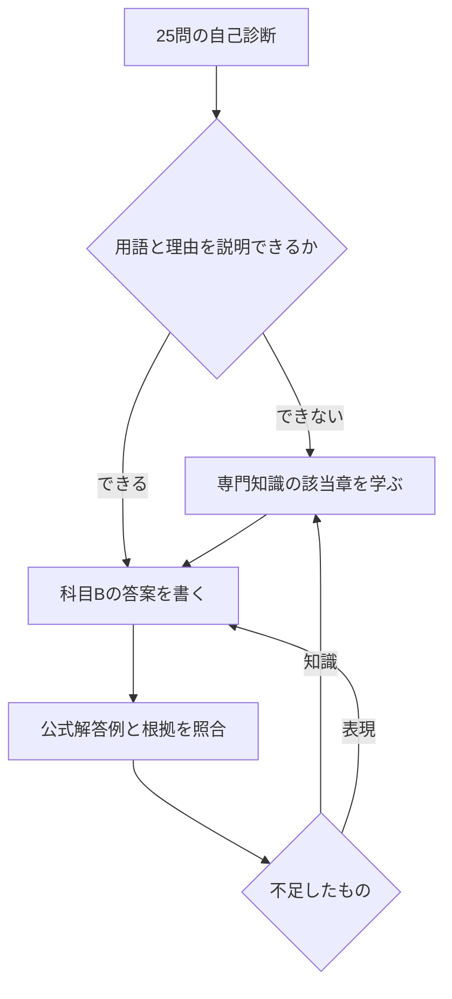

情報処理安全確保支援士（SC）の合格ロードマップは、実務で説明できる分野と、答案にできない分野を分けるところから始まる。

だからこそ、<strong>IT知識とスキルが十分に備わっていることが前提</strong>になる。

多くの人は、ゼロから学ぶためではなく、すでに持っているスキルを証明するためにSCに挑む。

実務でセキュリティ業務相当をこなしている人なら、出題範囲の大半はすでに「知っている」内容のはずだ。

ただし、誰にでも当てはまる最短ルートは決められない。

必要な学習は、実務経験の深さと、どの分野が抜けているかで人それぞれ変わるからだ。

このガイドでは、25問の自己診断で自分の弱点を特定し、苦手な章を1つずつ埋めていくロードマップを整理する。

この記事の知識861語・技能31項目は、2027年度向けシラバス案Ver.0.1を当サイトが整理した数だ。現行試験の公式な暗記語数ではない。案は2026年8月31日掲載で、変更の可能性がある。[IPA「新試験制度のシラバス案」](https://www.ipa.go.jp/shiken/syllabus/henkou/2026/20260630.html)

筆者はSC未受験だ。以下は公式資料と当サイトのコース構成に基づく学習の提案だ。

## 合格までの勉強時間

以下は計画用の目安で、IPAが定めた標準学習時間ではない。診断後は実際に要した時間を記録し、配分を見直す。

SCの学習時間は、実務経験の深さによって大きく変わる。

| 実務経験 | 目安時間 |
| --- | :---: |
| セキュリティ実務経験なし・IT実務経験のみ | 150〜250時間 |
| セキュリティ関連業務に一部携わっている | 60〜120時間（苦手分野の補強が中心） |
| セキュリティ業務相当を日常的にこなしている | 20〜60時間（弱点の棚卸しと記述式対策が中心） |

<strong>SCは実務経験者の「仕上げ」に最も向いた試験</strong>だ。知識861語をゼロから覚えるのではなく、実務で自然に身についた知識と、シラバスが要求する言葉遣い・切り口のギャップを埋める作業になる。

### AI活用で専任講師を月額20ドルで雇う感覚

SCの学習で詰まりやすいのは、次のような場面だ。

- 実務では「なんとなく」対応している判断が、シラバス上の正式名称（例: 「リスク対応の選択肢（回避・低減・移転・保有）」）と結びつかない
- 科目B（記述式）で、頭では分かっているのに<strong>「指導・助言する立場」としての文章</strong>に変換できない
- 2027年度向けシラバス案で新しく設けられる予定の「セキュリティ実装技術・評価」（ゼロトラスト・生成AIセキュリティ・脆弱性管理）は、実務経験があっても体系的に触れたことがない

生成AIを使えば、<strong>月額20ドル程度で何度でも質問できる専任講師を雇う</strong>のと同じ感覚でこのギャップを埋められる。「この実務対応は、シラバス上の何という用語に対応しますか」とAIに聞くだけで、知識の棚卸しが一気に進む。

## SCとはどんな試験か

SCは、経済産業省が認定する国家資格で、情報処理技術者試験の中でも最難関区分の1つとされる。企業のDX推進・サイバーセキュリティ経営が求められる中、資格保有者への需要はIT部門にとどまらず経営層への助言役としても広がっている。

2026年度の試験形式は次の通り（2026年11月時点）。[IPA試験要綱Ver.5.6](https://www.ipa.go.jp/shiken/syllabus/rcu1hd00000141gq-att/youkou_ver5_6.pdf)

| 科目 | 形式 | 問題数 | 試験時間 |
| --- | --- | :---: | :---: |
| 科目A-1 | 多肢選択式（一般知識寄り） | 30問 | 50分 |
| 科目A-2 | 多肢選択式（専門知識） | 25問 | 40分 |
| 科目B | 記述式（4問中2問選択） | 4問中2問 | 150分 |

科目A-1（一般知識寄り）はガバナンス・監査、サービスマネジメント、データベース、システム開発・運用といった「その他知識」に、科目A-2（専門知識）は脅威・マネジメント・対策・実装評価・ネットワークといった「専門知識」にそれぞれ対応する。科目Bは自由記述のため自動採点はできず、<strong>「〜について、必要な指導・助言を行い、支援する」</strong>という技能31項目の文体どおり、組織を指導・助言する立場としての文章力が問われる。

## 世間の需要

SCは<strong>「名称独占資格」</strong>で、登録していなければ「情報処理安全確保支援士」と名乗ることはできない。ただし試験に合格した事実自体は、登録の有無にかかわらず履歴書に「情報処理安全確保支援士試験 合格」と書くことができる。

登録維持には講習の受講が必要だ。費用は選ぶ講習と制度の適用条件で変わるため、「一律3年で約15万円以上」とは見積もれない。2026年11月時点の条件は[IPA「講習の目的と概要」](https://www.ipa.go.jp/jinzai/riss/forriss/koushu/overview.html)で確認してほしい。

登録するかは、応募先の募集要項・契約で登録が必要か、会社の費用補助があるかで判断する。試験合格が、そのまま担当業務全般の実績の証明になるわけではない。

企業のセキュリティ対策の重要性が増す中で、実務でセキュリティ業務相当をこなしていても資格そのものは取れていないという方が、管理職登用やキャリアアップの場面で「有資格者であること」を証明したいというケースは増えている。

SCを持っている時点で、<strong>サーバーやシステムの管理者として申し分ない知識</strong>を備えていることの証明になる。

それだけで、キャリアの強みとして十分に通用する。

2026年秋ごろには情報漏えいの事例が相次ぎ、セキュリティ対策への投資を強める企業が増えている。

その流れの中で、SCの知識を持つ人材は、いま企業がもっとも必要としている人材の1つになりえる。

## まず力試し：25問の自己診断



診断は当サイトの学習用で、合否予測ではない。既知の用語でも説明できなければ復習し、知識があっても記述できなければ答案練習へ進む。

いきなり参考書を1周する前に、まず[SC 20時間コース](/course/sc/)の冒頭にある25問の診断テストを受けてみよう。12章のうちどこが苦手かが、その場で分かる。

診断を受けたら、正解数の目安に応じて次のように進め方を変えるのがおすすめだ。

| 正解数の目安（25問中） | 診断結果の意味 | 次にやること |
| --- | --- | --- |
| 18問以上（7割程度） | 基礎はできている、苦手箇所だけが残っている | 診断結果に表示される苦手章だけを[20時間コース](/course/sc/)で集中して学び、総復習で仕上げる |
| 10〜17問程度（4〜6割） | 基礎理解の土台がまだ定まっていない | [記述式対策のAI対話プロンプト](/method/ap-pm-descriptive-ai-prompts/)で、自分が本当に学ぶべき方向性を言語化してから着手する |
| 9問以下（4割未満） | 実務経験の幅とシラバスの範囲にまだギャップがある | 第1〜9章（専門知識）を順番に一周してから、第12章（技能・ケーススタディ）に進む。受験日までの残り日数を12章で割り、1章あたりにかけられる時間を先に把握しておくと計画が崩れにくい |

診断結果は12章それぞれの正誤に基づく「苦手章」として表示される。上の表の正解数はあくまで全体の目安であり、苦手章が1〜2章に集中している場合は正解数が低くても集中して学ぶことで間に合うケースもある。

## 20時間学習コースの使い方

[SC 20時間コース](/course/sc/)は、知識861語・技能31項目を12章に整理した無料の学習コースだ。他資格のような「20時間で全体像をつかむ」訴求はしない。<strong>SCは最難関試験であり、フラットな総時間訴求は実態とかけ離れる</strong>ためだ。

代わりに、20時間を「1つの章にかける時間の上限」として再定義している。診断テストが教えてくれた苦手章だけに、最大20時間をかけて仕上げる。特に第8章「セキュリティ実装技術・評価」は、2027年度向けシラバス案で新しく設けられる予定の中分類26に対応する。実務経験があっても未確認の項目がないか、診断後に一度は目を通しておこう。[SCシラバス案Ver.0.1](https://www.ipa.go.jp/shiken/syllabus/minaoshi/rcu1hd000001g5rk-att/syllabus_sc_ver0_1.pdf)

コースは全12章で、第1〜9章が専門知識（脅威・マネジメント・対策・実装評価・ネットワーク）、第10〜11章がその他知識（ガバナンス・監査・サービスマネジメント・データベース・システム開発運用）、第12章が技能（実務ケーススタディ）という構成になっている。

## 記述式（科目B）対策

SCの最大の壁は、科目Bの記述式だ。自動採点できる選択式と違い、<strong>「組織を指導・助言する立場」としての文章</strong>を自分の言葉で書く必要がある。

[午後記述プロンプト集のSC編（S.E.L.Fループ）](/method/ap-pm-descriptive-ai-prompts/)では、AIとの対話を通じて自分の再現答案を添削してもらうループと、学習の方向性に迷っている人向けの自己診断プロンプトをセットで紹介している。診断テストで中間スコアだった人は、まずこちらから着手するのがおすすめだ。

## AIを専任講師にする学習プラン

この記事は実務経験者を主な読者としているため、ゼロからのロードマップ作成プロンプトよりも、<strong>自分の実務知識を試験の言葉に翻訳・添削させるプロンプト</strong>の方が効果が高い。

### 実務知識を棚卸しするプロンプト

```
あなたは情報処理安全確保支援士（SC）試験の講師です。

私はセキュリティ関連の実務を担当していますが、それがSCのシラバス上どの用語・分類に対応するのか整理できていません。

以下の順で対話を進めてください。

1. 私が日常業務で担当しているセキュリティ関連のタスクを1つずつ聞き出してください（一度に1つの質問だけ）
2. それぞれのタスクが、SCシラバスのどの中分類（脅威／マネジメント／対策／実装評価／ネットワーク／ガバナンス・監査／サービスマネジメント／データベース／システム開発運用）に対応するかを教えてください
3. 対応する中分類の中で、私が「知っているつもりで実は正式な用語を知らない」可能性が高い箇所を指摘してください
4. 最後に、優先して復習すべき中分類を3つ、理由付きで提示してください

参照するシラバスは〇〇（版・該当箇所を貼り付け）です。
対応箇所が見つからなければ「確認できない」と答えてください。
実在の会社名、顧客情報、機器の設定値は聞かないでください。
準備ができたら、まず最初の質問をしてください。
```

### 診断結果を深掘りするプロンプト

```
情報処理安全確保支援士（SC）の自己診断テストで、以下の章が苦手と判定されました。

【苦手と判定された章】（ここに苦手章のタイトルを貼り付ける）

この章について、次の形式で整理してください。

1. この章で問われる中心的な考え方を3行で要約
2. 実務経験があれば聞いたことがあるはずの用語と、シラバスで新しく追加された用語を分けてリストアップ
3. 独学で誤解しやすいポイント
4. この章を20時間以内で仕上げるための優先順位（用語暗記より理解を優先すべき箇所はどこか）
```

## キャリア戦略

SCは、試験合格と登録を分けて考える。登録が必要な仕事を目指すなら、勤務先の補助と講習の受講条件を確認する。合格を知識の証明に使うなら、担当できる業務と経験も併せて説明する。

登録の維持条件は前掲のIPA資料で確認し、転職時の伝え方は[情報処理安全確保支援士は転職で隠すと損？](/career/sc-unregistered-benefit-hack/)へ進んでほしい。

## 実務で触れない分野はAIで体験して覚える

SCの学習は、基本的には知識を「覚える」作業だ。

ただ、出題範囲には、実務ではなかなか経験できない分野も含まれている。

たとえば、マルウェア感染やサイバー攻撃を受けたときのインシデント対応は、現場で何度も経験するものではない。

こうした分野は、用語だけを覚えても、実際にどう運用するのかがイメージしにくい。

そこで、<strong>AIにインシデントのシミュレーションを作ってもらい、対応する側として体験する</strong>学び方が役に立つ。

知識を「使って運用する」目的を体験したほうが理解しやすい人には、特に向いている。

```
あなたは情報処理安全確保支援士（SC）の学習を支援するトレーナーです。

架空の中堅企業で起きたセキュリティインシデントを、時系列で1ステップずつ提示してください。

- 私はこの会社のセキュリティ担当者として、各ステップで取るべき対応を答えます
- 私が答えたら、その対応がSCのシラバス上どの用語・考え方に当たるかを示し、不足している観点を指摘してください
- 次のステップは、私の対応の結果として起こる状況にしてください

最初のステップを提示してください。
```

チャット形式で足りなければ、同じ流れを簡単なWebアプリにしてもらうこともできる。

<strong>受け身で読むより、自分で判断する場面を作ったほうが知識は身につく。</strong>

## 関連記事インデックス

| 記事 | カテゴリ | 内容 |
| --- | --- | --- |
| [SC 20時間コース](/course/sc/) | course | 知識861語・技能31項目を12章に整理、診断テスト・章末チェック付きの無料学習コース |
| [応用情報・高度試験の午後記述をAIで対策するプロンプト集](/method/ap-pm-descriptive-ai-prompts/) | method | SCの長文インシデントのタイムライン表・構成図、科目BのS.E.L.Fループによる再現答案の添削、学習の方向性の自己診断 |
| [情報処理安全確保支援士は転職で隠すと損？](/career/sc-unregistered-benefit-hack/) | career | 知名度の低さを補う伝え方と、責任を背負いすぎない役割の選び方 |
| [SC（情報処理安全確保支援士）専門用語特訓](/app/sc-specialist-quiz/) | app | フラッシュカード形式の用語暗記アプリ |
| [IPA資格の高難易度対策｜応用情報・高度試験と2027年の新試験の選び方](/method/advanced-ipa-hub/) | method | SC以外の高度試験（NW・PM・DB・ST・SA）も含めた分野選択の全体マップ |

---

## まとめ

SCは、最短で合格しようと考えるより、<strong>知識の地盤が固まってから挑む</strong>のがいちばんいい。

そのうえで、合格に向けた考え方は3つだ。

<strong>知識861語を全部覚えようとしない</strong>——実務経験者ならその大半は「知っている」内容であり、必要なのはゼロからの学び直しではなく弱点の特定だ。

<strong>20時間は「章単位の配分」として使う</strong>——診断テストが教えてくれた苦手章だけに、最大20時間をかけて集中的に仕上げる。

<strong>科目Bは「指導・助言する立場」への翻訳作業</strong>——実務知識を丸暗記の模範解答ではなく、自分の言葉で組織を指導・助言する文章に変換する練習を積む。

まずは[25問の自己診断](/course/sc/)から始めて、自分の本当の弱点を可視化することから始めよう。
