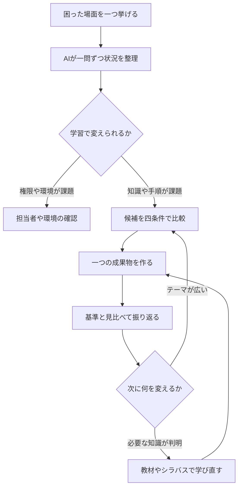

<!-- TARGET_KW: 何を学ぶべきか 分からない 社会人 AI -->
<!-- READER: S4-不安-検討前 / 検索 ｜ 学び直したいが教材を選べない社会人 -->
<!-- ANSWER: 最近困った場面から、学習で変えられる部分を見つけ、小さく試すテーマを一つ選ぶ -->
<!-- TAKEAWAY: 学習課題の切分け、候補比較、実践後の見直し条件 -->

「何か学ばなければ」と思いながら、教材や資格の一覧を見て終わってしまう。そんなときは、流行の分野を探す前に、最近困った場面を一つ取り出してみましょう。

学ぶテーマの分かれ目は、不安の大きさよりも「学んだ後に、どの行動を変えたいか」です。この記事では、AIとの対話で候補を整理し、一週間で試すテーマを一つ選ぶ方法を示します。

## 困りごとが、学習で変えられるものかを見分ける

たとえば「会議後の作業が進まない」という困りごとでも、原因は一つではありません。議事録の書き方を知らないのか、担当が決まっていないのかで、次の行動が変わります。

| 困っている条件 | 最初にすること | 学習テーマにするなら |
| --- | --- | --- |
| 言葉や仕組みを説明できない | 必要な概念を絞る | 会議の目的・決定事項・ToDoの違いを学ぶ |
| 分かっているが手順にできない | 小さな成果物を一つ作る | 短い会議メモから担当と期限を整理する |
| 権限や社内の決定が足りない | 担当者と条件を確認する | 個人の勉強だけで解消しようとしない |
| 具体的な困りごとがまだない | 興味のある作業を小さく試す | 用語の学習より先に、試したい題材を決める |

AIは状況を整理する対話相手として使います。返答だけで、自分の適性や将来の職業が確定すると考える必要はありません。

まずは、事実と推測を分けて質問してもらいます。

## AIに一度に一つずつ質問してもらう

入力するのは、社外に出してよい範囲の状況です。顧客名や勤務先の機密は、架空の名前や一般的な説明へ置き換えてください。

次のプロンプトは、キャリア全体の結論を出すためでなく、最初に試す学習テーマを決めるためのものです。

```text
学び直しのテーマを一つ選ぶため、状況整理を手伝ってください。
今の困りごと：[最近困った場面を一つ記入。なければ興味のある作業]
一週間に試せる時間：[記入]
使える環境：[自分のPC、公開資料のみ、など]

進め方：
- 質問は一度に一つ。私の返答を待って次へ進む。
- 「起きた事実」「私の推測」「まだ不明な点」を分ける。
- 何をして、どこで止まったか、できたら何が変わるかを具体化する。
- 知識不足・手順の不足・権限や環境の制約を混同しない。
- 能力や職業適性を断定しない。情報が足りなければ聞く。
最後に、学習で変えられる部分と、それ以外に確認すべき部分を整理し、
学習テーマの候補を最大三つ挙げてください。
まず最初の質問をしてください。
```

質問に答えづらければ、「例を二つ示して」と返してかまいません。ただし、AIの例に自分を無理に当てはめず、実際に起きたことへ戻ります。

<!-- AI_EXAMPLE: 使うAI=Claude / プロンプト=本文「AIに一度に一つずつ質問してもらう」 / 見せたいこと=架空の会議メモの困りごとから、一問ずつ質問し、学習課題と業務上の確認事項を分ける過程。対話は筆者が実行して用意 -->

<!-- LEARNER_NOTE: 候補=実際にこの対話を使って、漠然とした困りごとが具体化したか / 種類=think / 筆者の実体験で記入 -->

候補が出たら、全部を学ぶ計画にせず、試せる順に並べます。

## 三つの候補から、一週間で試す一つを選ぶ

この記事での一週間は、効果が保証された期間ではなく、試行を区切る目安です。確保できる時間に合わせて短くしてもかまいません。

各候補を、次の四条件で比べます。

| 判断する条件 | 選びやすい候補 | いったん保留する候補 |
| --- | --- | --- |
| 実際に使う場面があるか | 次の会議や自分の作業で使える | 使う場面をまだ説明できない |
| 一つの成果を確かめられるか | 一枚のメモなど、確認対象が明確 | 「DXに強くなる」など広いまま |
| 用意できる時間で試せるか | 作成と振り返りまで含められる | 環境準備だけで時間を使い切る |
| 入力資料と正しさを確認できるか | 公開資料や架空の素材で比較できる | 入力できない社内資料が前提 |

たとえば「生成AIを使えるようになる」なら、最初の成果を「架空の会議メモから、決定事項・担当・期限を分けた表を作る」と置き換えます。これは説明用の題材であり、AIが実行した結果ではありません。

続けて、次のように依頼します。

```text
候補を、使う場面・一つの成果物・試す時間・検証用の資料の四条件で比較してください。
私が伝えていない時間や条件は推測せず「未確認」としてください。
一つ選ぶために足りない情報があれば質問し、最終的な選択は私に確認してください。
選んだテーマについて、次の三つだけ整理してください。
1. 必要な概念を最大三つと、それぞれ必要な理由
2. 一回の試行で作る成果物と、できたかを確認する基準
3. 用意する資料。資料名やURLは推測せず、未確認ならそう示す
```

AIが挙げた教材やシラバスは、実際に存在するか、対象年度と内容が合っているかを確かめます。資格を先に選ぶより、必要な知識がどの範囲に含まれるかを後から照合する順番です。

手順を一枚にすると、次のようになります。



## 学んだ時間より、何を試せたかで振り返る

読むだけで終わりそうなら、実践の時間を先に予定へ入れます。最初の試行では、完成度を上げるよりも「どこで止まったか」を記録することが次の判断材料になります。

| 試した後の状態 | 次に変えること |
| --- | --- |
| 用語が分からず作業に入れない | 必要な概念へ戻る |
| 手順は分かるが成果物が広すぎる | 一枚・一機能などへ範囲を狭める |
| 成果は出たが自分で説明できない | 資料を見直して自分の言葉で説明する |
| 目的と成果が合わなかった | 最初の困りごととテーマを選び直す |

振り返りでは、実際に試した内容だけをAIへ渡します。

```text
今回の目的：[記入]
作った成果物：[貼り付け]
確認基準：[記入]
できたことと止まったこと：[事実だけ記入]
私が理解している仕組み：[自分の言葉で説明]

目的と成果のずれ、説明で根拠が足りない点を指摘してください。
実行していないことを成功扱いせず、次に変える点を一つ提案してください。
判断できない点は、追加で何を確かめるか示してください。
```

独学の範囲が広がったら、体系的な教材を探します。ITの基礎が必要と分かった場合は、[ITパスポートの合格ロードマップ](/method/itp-hub/)で範囲を見て、[ITパスポート20時間コース](/course/ip/)の必要な章を選べます。

---

## まとめ

何を学ぶべきか迷ったら、最近困った場面から、学習で変えられる部分を選びます。使う場面・成果物・時間・確認資料の四条件をそろえ、一つ試してから続けるかを判断しましょう。

生成AIの業務練習を題材にする場合は、[生成AI実務練習コース](/course/ai-work/)から、今の困りごとに合う章を一つ選んでください。
