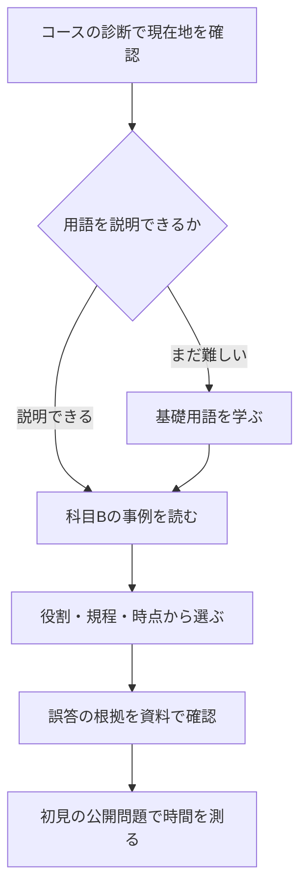

情報セキュリティマネジメント試験（SG）の合格ロードマップは、用語の基礎から始めるか、事例の判断から始めるかを決める地図です。

情報セキュリティマネジメント試験（SG）は、<strong>組織のセキュリティを「管理・運用する人材」を認定する試験</strong>です。プログラミング中心の試験ではありませんが、ネットワークや認証などの基礎知識は必要です。[IPA「SGの対象者像・技術水準」](https://www.ipa.go.jp/shiken/kubun/sg.html)

「ITパスポートの次に何を取るか」という問いに対して、利用部門で情報管理を担うなら、SGで学ぶ管理・運用の知識を仕事に結びつけやすくなります。

<strong>まず全体像を20時間でつかみたい方は、無料の <a href="/course/sg/">情報セキュリティマネジメント20時間コース</a> から始めるのがおすすめです。</strong>模擬試験で今の実力を確認してから、8章の要点とケーススタディを効率よく学べます。

---

## 情報セキュリティマネジメント試験とは

SGはIPAが実施する国家試験で、<strong>組織の情報セキュリティを推進・管理するための実践知識を証明する資格</strong>です。

CBT方式で随時実施されています。2026年11月時点の予約可能日や休止期間は、[IPAの受験申込案内](https://www.ipa.go.jp/shiken/mousikomi/cbt_sg_fe.html)で確認してください。

| 科目 | 出題形式 | 内容 |
|---|---|---|
| 科目A | 多肢選択（4択）48問 | 情報セキュリティ・ネットワーク・法務・マネジメント |
| 科目B | 多肢選択式12問 | 実務シナリオ形式の事例問題 |

科目A・Bをまとめて120分で解き、総合評価点600点以上／1,000点が合格基準です（2026年11月時点）。科目ごとの合格基準ではありません。[IPA「SG試験の案内」](https://www.ipa.go.jp/shiken/about/gmcbt8000000cy3n-att/pamphlet_IP-SG.pdf)

## なぜ今、SGを取るべきか

2027年度にはSGは変更を伴って継続し、応用情報はPD（仮称）へまとめ直される予定です。受験区分を選ぶときは、[2027年度の新試験と教材の一覧](/method/ipa-2027-new-exam-hub/)で現行制度と予定を分けて確認してください。

### 利用部門の管理・運用から学ぶセキュリティ系国家資格

SC（情報処理安全確保支援士）と違い、SGは<strong>技術者ではなく管理者・利用者側の視点で出題される</strong>ため、プログラミングやネットワーク設計の知識がなくても対応できます。

「情報漏洩が起きたとき誰がどう動くか」「社員にどんなルールを守らせるか」「委託先とどんな契約を結ぶか」——これらの問いに論理的に答える能力が問われます。

### バックオフィス職の希少スキルになる

情報セキュリティ担当者が不足している中小企業・地方企業では、<strong>SGを持つバックオフィス職員はIT部門との橋渡し役として即戦力になります</strong>。

マイナンバー管理・個人情報保護法対応・テレワーク時のBYODルール整備——これらの実務にSGの知識が直接使えます。

### APへの足固めとして機能する

SGで学ぶ情報セキュリティの概念（リスク管理・インシデント対応・セキュリティポリシー）は、応用情報技術者試験（AP）の情報セキュリティ分野（午後必須）と直結します。

<strong>SGを先に取得することで、APの最難関分野を事前に固められます</strong>。上位試験を考える場合も、SGで身につけた判断の根拠は学習の土台になります。

### 「セキュマネは意味がない」と言われたら

「ITパスポートの延長でしょ」「取っても実務では役に立たない」と言われることがあります。たしかに、合格しただけで、翌日から組織のセキュリティが守られるわけではありません。資格を「持っている」だけでは、意味は生まれにくいでしょう。価値が出るのは、試験で学んだ知識を、自分の職場の課題に当てはめて使ったときです。

その入口が、情報セキュリティの三要素です。丸暗記の対象ではなく、職場のどの業務を守る考え方なのかに結びつけると、実務に近づきます。

| 要素 | 意味 | 試験での問われ方 | 職場での例 |
| --- | --- | --- | --- |
| 機密性 | 許可された人だけが情報にアクセスできる | アクセス制御、暗号化 | 顧客情報や社内資料の閲覧権限 |
| 完全性 | 情報が正確で、改ざんされていない | ハッシュ値、デジタル署名 | 契約書や財務データの正確さ |
| 可用性 | 必要なときに情報やシステムを使える | 冗長化、バックアップ、災害対策 | 業務システムが止まらないこと |

シラバスの用語の多くは、実際のインシデントから得られた教訓が整理されたものです。用語の定義だけでなく、「自分の会社のどの業務に関わるか」を考えると、理解が定着します。

学んだ知識を使う練習として、AIに、自社の課題に合わせた規定のたたき台を作ってもらう方法があります。

```text
# 指示
私は情報セキュリティマネジメント試験（SG）を勉強しています。学んだ知識を、自社のセキュリティの向上に活かしたいと考えています。

# 入力情報
- 自社の業種：（例）ITサービス業、社員50名程度
- 課題：（例）テレワークでの私物デバイス（BYOD）の利用ルールが曖昧

# 出力してほしいこと
1. SGのシラバス（リスクマネジメント、資産管理、ISMSなど）に基づいた、会社が最低限守るべき「BYOD利用規定」のたたき台
2. 従業員に納得してもらうための、「なぜこのルールが必要か」の説明文（具体例つき）
3. ルールが形骸化しないための、継続的な見直しの案を3つ
```

AIが作るのは、たたき台です。実際の規定は、会社の実情、法令、上長や情報システム部門の確認を踏まえて決めてください。シラバスの知識をもとに、社内の懸念事項を一つずつ整理して、提案できる人になることが、SGの価値を実務で示す方法です。

## 科目別学習アプローチ

### 科目A: 用語のなぜから理解する

科目Aはセキュリティ用語の定義・法律・マネジメント手法が中心です。

<strong>語句を単純に暗記するより、「なぜこの概念が生まれたか」を理解する方が定着率が高く、応用問題にも対応できます</strong>。

```text
あなたは情報セキュリティの専門家です。
「[用語: 例 ゼロトラストネットワーク / ISMS / インシデント対応]」について、
1. この概念が生まれた背景（どんな問題を解決するための概念か）
2. 試験で問われやすい定義の核心
3. 混同しやすい類似概念との違い
を教えてください。
```

### 科目B: 実務シナリオの解答パターンを型化する

科目Bは長文シナリオを読んで、登場人物の行動の適切/不適切を判断する問題形式です。

<strong>正答の型は「セキュリティポリシー・ルールへの準拠」を根拠にした判断</strong>です。

```text
以下の情報セキュリティマネジメント試験の科目B事例について、
各選択肢が「適切」または「不適切」な理由を
「組織のセキュリティポリシーに照らして」説明してください。

不適切な選択肢については「どんな脅威・リスクにつながるか」も示してください。

【事例】: 〇〇（公開問題の該当箇所）
【公式解答と自分の理由】: 〇〇
事例にない規程は作らず、根拠の文を示してください。
推測が必要な場合は「資料から確認できない」としてください。
```

科目Bで詰まる場合のほとんどは「答えは分かっているが理由の言語化ができない」パターンです。AIに解説させることで、採点者が求める論理の型が身につきます。

## 推奨学習フロー



用語で止まるなら基礎へ戻り、用語は分かるのに選べないなら事例の条件を整理します。以下の月数は配分の例です。20時間コースの修了や演習の正答率だけで、本番の合格を予測するものではありません。

> [!think]
> 非エンジニアだからこそ、SGは取得しておきたい資格です。一般教養レベルになってきたので、日頃のセキュリティ意識が高いほど、学ぶ項目は減るはずです。今までの体験から学んだことを正解とせず、知識として受け入れることも大切です。

| 期間 | 科目A | 科目B |
|---|---|---|
| 1ヶ月目 | セキュリティ基礎用語のAI対話理解 | 科目B形式の問題を1日1問・AIで解説 |
| 2ヶ月目 | 法律・マネジメント系用語の整理 | シナリオ読解の時間短縮（10分以内を目標）|
| 3ヶ月目 | 科目A模擬試験で弱点確認 | 誤答の根本原因分析・パターン完成 |

---

## 学習メソッド

- [情報セキュリティマネジメント20時間コース](/course/sg/) — 診断テスト・8章の要点・ケーススタディ付きの無料学習コース
- [情報セキュリティマネジメント試験は未経験だと難しい？](/method/sg-beginner-roadmap/) — ゼロから3ヶ月で合格する学習計画
- [公的機関のレポートで事故対応をシミュレーションする勉強法](/method/sg-news-study-hack/) — ニュースだけでは分からない事故の流れを、レポートとAIで疑似体験読む手順

## 試験情報・トレンド

- [今さら聞けない情報漏えい対策](/trend/security-incident-prevention-basics/) — 個人と職場の対策、経営層・管理職がSGを活用する方法
- [SGシラバスの変更点](/trend/sg-syllabus-latest-change-guide/) — 現行Ver.4.1と新シラバス案、生成AIのセキュリティをニュースから学ぶ方法

## キャリア戦略

- [バックオフィス職がSGで年収を上げる道筋｜社内のセキュリティ教育から副業講師まで](/career/backoffice-sg-career-hack/) — 社内で教える側に回り、評価と副業につなげる方法

## 練習アプリ

- [情報セキュリティマネジメント科目B対策](/app/sg-subject-b-quiz/) — インシデント対応3事例を、初期対応から再発防止まで12問で演習

---

## まとめ

情報セキュリティマネジメント試験は、<strong>バックオフィス・文系・非エンジニアが「セキュリティ」という専門領域に踏み込む最初の国家資格</strong>です。

技術の基礎と管理の知識を結びつけて、「組織を守るための論理的な判断力」を学べます。ITパスポートの次の一手として、利用部門の情報管理を担いたい人に向く選択肢です。

今日、生成AIに次のプロンプトを投げてください。

```text
情報セキュリティマネジメント試験（SG）の科目Aで頻出の用語を15個選んでください。
各用語について「なぜセキュリティ管理で必要か」という背景から教えてください。
定義の暗記より先に、存在意義を理解したいです。
```

> この記事は [IPA資格の高難易度対策｜応用情報・高度試験と2027年の新試験の選び方](/method/advanced-ipa-hub/) とあわせて読むと、上位区分への学習のつながりを整理できます。
