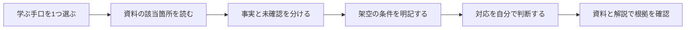

情報セキュリティマネジメントのニュース学習は、記事に書かれた事実と、判断の練習用の仮定を分けることから始めます。

ニュースでは「情報が漏えいした」「システムが停止した」と報じられても、<strong>なぜ起きたのか、どう対応したのか</strong>までは書かれていないことがほとんどです。事故の詳細は、被害を受けた組織が自分から細かく公開することが少ないからです。

そこで題材にしたいのが、NICT・IPAなどの公的機関や、JPCERT/CCが出している<strong>専門機関のレポート</strong>です。

この記事では、そのレポートから事故の状況を読み取り、AIを使って自分が担当者になったつもりで対応をシミュレーションする方法を紹介します。読み終えたときに、科目Bで問われる「状況から判断する力」を鍛える練習の進め方を、自分で組み立てられるようにします。

## ニュースだけでは、教材にならない理由

ニュースの記事は、事故を知らせるのが目的です。試験で問われる次のような点は、書かれていないことが多いです。

| 試験で問われること | ニュースに書かれているか |
| --- | --- |
| 何が脆弱性だったのか | 多くの場合、書かれていない |
| どの管理策が不足していたのか | 書かれていない |
| 最初にどう対応したのか | 一部しか書かれていない |
| 再発防止に何をしたのか | 公表されるまで時間がかかる |

そのため、ニュースを読んで「これはSGでいう〇〇だ」と考えるには、情報が足りないのです。足りない部分は未確認のまま区別し、情報が出ている別の資料を使います。練習のために仮定を置くときも、実際の事故原因には結びつけません。

## 公的機関のレポートを、題材にする

次のような公的機関の資料は、攻撃の傾向や、実際の被害の状況が整理されています。

- <strong>NICT（情報通信研究機構）</strong>：インターネット上の攻撃の観測結果をまとめた[「NICTER観測レポート」](https://csl.nict.go.jp/nicter-report.html)を公開している
- <strong>JPCERT/CC</strong>：対応状況や観測の情報を[「四半期レポート」](https://www.jpcert.or.jp/qr/)として公開している。旧インシデント報告対応レポートなどは統合済み
- <strong>IPA（情報処理推進機構）</strong>：[「情報セキュリティ10大脅威」](https://www.ipa.go.jp/security/10threats/10threats2026.html)や、注意喚起、サイバー攻撃の情報共有に関する資料を公開している
- <strong>警察庁</strong>：サイバー空間をめぐる脅威の情勢についての資料で、ランサムウェアなどの被害の状況を[公表している](https://www.npa.go.jp/publications/statistics/cybersecurity/index.html)
- <strong>個人情報保護委員会</strong>：[漏えい等の対応資料](https://www.ppc.go.jp/personalinfo/legal/leakAction/)を公開している

これらは、特定の組織の事故の全容を示すものではありません。ただ、<strong>どんな手口が多いか、どんな被害が出ているか、どの対策が有効とされているか</strong>が書かれています。事故の疑似体験をするための土台になります。

資料の名前や公開の場所は変わることがあります。検索して、各機関の公式サイトで最新のものを確かめてください。

## レポートから、事故のシミュレーションを作る

観測された攻撃の傾向ならNICTER、国内の対応状況ならJPCERT/CC、対策の全体像ならIPAを選びます。特定企業の原因を知りたい場合は、その企業の公表と続報を使います。

手順は、4つです。



1. レポートの中から、気になる手口や被害のパートを1つ選ぶ
2. 書かれている事実だけを、AIに抜き出させる
3. 自分が担当者の立場だったら、という架空の状況を作らせる
4. 事故の発生から再発防止までの流れを、順番に判断する

### ステップ1と2：事実だけを抜き出す

まず、選んだパートの文章をAIに渡して、<strong>書かれていること</strong>と<strong>書かれていないこと</strong>を分けさせます。

```text
次の文章は、セキュリティに関する公的機関のレポートの一部です。
情報セキュリティマネジメント試験（SG）の学習のために読みます。

1. 書かれている事実だけを、箇条書きで抜き出してください
2. 原因や対応について、書かれていない点を挙げてください
3. 書かれていない点を、あなたの推測で埋めないでください
4. 各事実に、資料名・公表日と該当する見出しまたは頁を添えてください

[ここにレポートの文章を貼り付け]
```

最後の指示が大切です。AIは、書かれていない点を自然な文章で埋めてしまうことがあります。事実と推測が混ざると、学習の根拠がぐらつきます。

### ステップ3と4：架空の組織で、対応を判断する

事実が整理できたら、次は架空の状況を作って、自分で判断します。

```text
先ほどの事実をもとに、次の条件でインシデント対応のシミュレーションをしてください。

- 舞台は、従業員200名の架空の会社です
- 私は、情報システム部のセキュリティ担当です
- 事故の発生から、次の4つの段階で、1段階ずつ状況を出してください
  初期対応 → 現場の指揮 → 専門的な調査・判断 → 再発防止
- 各段階で、状況の説明のあとに、私に「あなたならどうするか」を質問してください
- 私が答えたら、その判断の良い点と不足している点を指摘してください
- 事実と推測は、区別して書いてください。推測は「推測」と明記してください
```

<!-- LEARNER_NOTE: 候補=学習を始める前に、事実と仮定を分ける読み方をどの資料で試す予定か / 種類=think / 未受験・学習開始前の見立てだけを筆者が記入 -->

AIが出す状況は創作です。実際の事故の記録ではないことを意識して、<strong>判断の練習として使う</strong>ようにします。

## 試験のどこにつながるか

用語や管理策の分類で止まるなら、先に[SGの20時間コース](/course/sg/)の該当分野を確認します。資料を増やすより、1つの判断の根拠を説明できる状態を目指しましょう。

このシミュレーションで練習するのは、科目Bで問われる次の力です。

- <strong>管理策を4つに分けて考える</strong>：技術的、組織的、人的、物理的のどれで防ぐのかを見分ける。たとえば、ファイアウォールは技術的、セキュリティポリシーは組織的、従業員教育は人的、入退室管理は物理的な管理策にあたる
- <strong>立場に応じた判断をする</strong>：最初に気づいた人、現場の責任者、専門家で、取るべき行動が変わる
- <strong>時間の流れで考える</strong>：封じ込め・証拠保全・報告を初動として考え、調査と再発防止へつなぐ。実際には規程に沿って並行して進める

この流れを、問題形式で練習したいときは、[情報セキュリティマネジメント科目B対策](/app/sg-subject-b-quiz/)が使えます。クラウドの誤公開、ランサムウェア、PC紛失の3つの事例を、発生直後から再発防止まで追えます。

## 最初の入口としてのニュース

公的機関のレポートは、更新のタイミングが決まっていて、毎日は読めません。日々の入口には、ニュースも役立ちます。

ニュースで気になる事故を見つけたら、その手口の名前（たとえば「ランサムウェア」「標的型攻撃メール」）を控えておきます。あとで公的機関のレポートで、その手口の傾向を調べると、ニュースの背景が見えてきます。

ニュースは入口、レポートは土台、シミュレーションは練習、と役割を分けてください。

## まとめ

セキュリティ事故のニュースは、詳細が公開されないことが多く、そのままでは教材として足りません。

公的機関のレポートで事実を押さえ、AIで架空の組織の事故に置き換えて、初期対応から再発防止まで順に判断する。これで、<strong>状況から判断する力</strong>を鍛えられます。

これで、レポートの一部を題材にして、自分なりの事故対応の練習を組み立てられます。まず、IPAの「情報セキュリティ10大脅威」から気になる脅威を1つ選び、上のプロンプトで事実を抜き出してみてください。

用語の確認には、[重要用語フラッシュカード](/app/flashcard-app/)も使えます。

---

> この記事は [情報セキュリティマネジメント試験（SG） 合格ロードマップ](/method/sg-hub/) の一部です。
