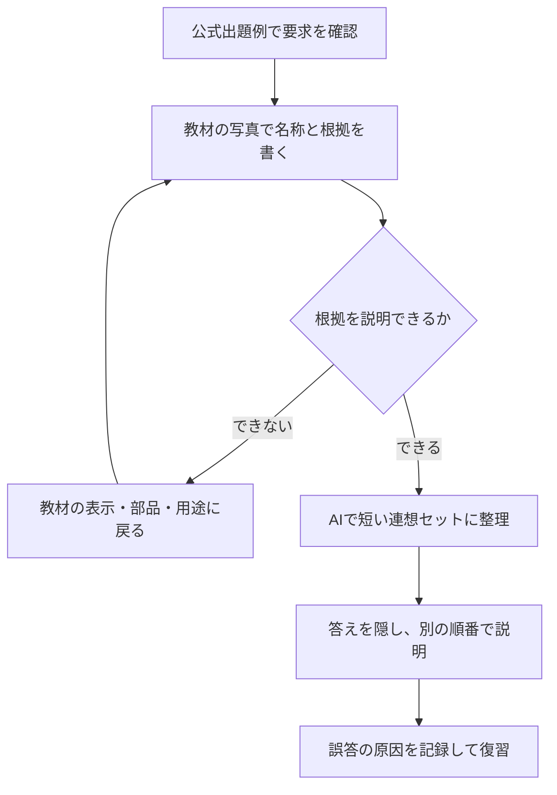

消防設備士の鑑別で、写真を見れば分かるのに、名称を書こうとすると手が止まる。似た機器を並べられると、自信がなくなる。

復習の分かれ目は、名称を忘れたのか、写真から判断できる情報が足りないのかです。見た目だけで決められないものを、色や形の語呂合わせだけで覚えると混同が残ります。

この記事では乙6・乙4の学習を想定し、公式の出題例と手元の教材から「根拠・名称・用途」をつなげる手順を紹介します。読み終えたら、次の復習で写真と説明のどちらを見直すかを決められます。

筆者は消防設備士を未受験です。以下は公式資料から整理した方法で、受験・合格の体験ではありません。

## 鑑別で何を答えるかを公式の問題で確認する

乙種の実技は「鑑別等5問」で、乙6・乙4もこの区分です。甲種1〜5類には製図もあるため、この記事の方法だけで甲種の実技全体を対策することはできません。出典: [試験科目及び問題数｜消防試験研究センター](https://www.shoubo-shiken.or.jp/shoubou/annai/subject.html)。

実技には筆記と別の合格基準があり、成績60%以上が必要です。「5問だから3問正解なら合格」とは換算せず、通知される得点率と模試の配点で確認します。出典: [合格基準のFAQ](https://www.shoubo-shiken.or.jp/faq/index_shoubou.html)。

まず[公式の過去に出題された問題](https://www.shoubo-shiken.or.jp/shoubou/exercise.html)から受ける類を確認し、設問の動詞を拾います。「名称を答える」「用途を書く」など、要求された内容を区別してください。

名称を問う設問に、用途まで長く書けば加点されるとは限りません。公開されていない採点基準をAIに推定させるより、設問が要求したことと教材の解答を照合します。

## 覚えられない原因を3つに分ける

写真だけを眺める前に、解答を隠して「何を根拠にその名前だと思ったか」を一言書きます。この一言を残すと、復習する対象が分かれます。

| 自分の状態 | 戻る場所 | 次にすること |
| --- | --- | --- |
| 特徴は言えるが名称が出ない | 名称と特徴の対応 | 教材の正しい名称で短いカードを作る |
| 名称は出るが用途を説明できない | 仕組み・機能 | 何を検出・消火する機器かを説明し直す |
| 色や形だけで決め、別写真で間違う | 判断の根拠 | 表示・部品・設問条件のどれが決め手か確認 |
| 写真が不鮮明で判断材料が見えない | 画像の品質 | 判定を保留し、教材の鮮明な画像で確認 |

同じ赤い容器というだけで消火器の種類を断定するような覚え方は避けます。メーカーや型式で外観が違う場合もあるため、教材で示された表示や特徴と、単なる共通点を分けてください。

この分類ができたら、根拠のある情報だけをAIに整理させます。

## AIに連想セットを作らせるときは根拠を先に渡す

AIに写真だけを見せて名称を当てさせると、何を根拠に判断したのかを確かめにくくなります。先に教材で正解を確認し、学習用に自分で要約した説明を渡します。

```text
消防設備士乙6の鑑別を学習しています。
以下は、教材で正しい名称と用途を確認した学習メモです。
【対象の名称】（正しい名称）
【教材で確認できた特徴】（表示・部品等を自分の言葉で要約）
【用途】（教材で確認した内容）
【混同した機器】（名称）

このメモだけを根拠に、特徴→名称→用途の短い連想セットを作ってください。
- 外観だけで区別できると断定しない
- メモにない識別点・規格値・採点基準は作らない
- 混同を避けるために、追加で教材を確認すべき点を1つ挙げる
最後に私が用途を説明するので、メモとの食い違いだけを指摘してください。
```

### Claudeで試した結果：根拠を渡さずに頼むとどうなるか

「根拠を先に渡す」理由を確かめるために、学習メモを渡さない聞き方をClaude（Sonnet 5.5、有料プラン）で試しました（2026年10月）。

```text
消防設備士の実技（鑑別）対策をします。
消火器の種類（粉末・強化液・二酸化炭素・機械泡など）について、
**外観の特徴 → 名称 → 適応火災 → 使用上の注意** の順で、
写真を見たときに見分けられる連想セットを作ってください。
1種類ずつ提示し、私が自分の言葉で説明し返すので、曖昧な点を指摘してください。
```

1種類目は粉末（ABC）消火器でした。要点は次のとおりです。

> - 外観：赤い円筒形で、加圧式と蓄圧式がある。蓄圧式は上部に指示圧力計（緑の範囲を指す）が付く。<strong>加圧式は本体の外側に小型の加圧用ガス容器が付く</strong>。本体に「ABC」と、白・黄・青の円（普通・油・電気）の絵表示
> - 適応火災：普通火災・油火災・電気火災のすべて
> - 使用上の注意：粉末で視界が悪くなる。精密機器を汚す。<strong>窓のない狭い場所や地下街では、呼吸や視界に支障が出るおそれがある</strong>。蓄圧式は圧力計の指針が緑の範囲にあるか確認する

指示圧力計、絵表示の色、適応火災は、教材の内容と合っています。

一方で、太字の2点は教材と照らす必要があります。

- 住宅や事務所でよく見る小型の加圧式粉末消火器は、加圧用ガス容器が<strong>本体の内部</strong>にあります。外側にガス容器が付くのは大型のものなどで、「加圧式＝外にガス容器」と覚えると写真で迷います
- 地下街や換気の悪い狭い場所での設置が制限されているのは、<strong>二酸化炭素消火器</strong>です。粉末消火器の注意に混ざっていると、鑑別で問われる「機器ごとの注意」がずれます

回答の最後には「教本の記述と食い違う点があれば、教本を優先してください」と添えられていました。根拠を渡さずに頼むと、もっともらしい識別点が混ざり、その確認は自分でするしかありません。上のプロンプトで、教材で確認した内容だけを根拠にさせているのはこのためです。

> [!exp]
> 消防設備士の知識がClaudeに備わっているかも大事ですが、シラバスを渡している前提で言えば、教本以外の話題はすべて推測で話していると判断していいと思います。シラバス（教材）にあることがすべてで、それを守る前提にしないと例題でハルシネーションが起きやすく、テキストを一括で出させると販売されているテキストに負ける可能性があります。

返答を採用する条件は、各識別点を教材に戻って確認できることです。根拠が見つからない説明はカードに入れず、未確認として残します。

AIは何度も説明を頼める学習相手ですが、実技試験官ではありません。正しい解答を確定する役割まで任せず、説明を短く整える用途に絞ります。

## 写真・名称・用途を一組ずつ確認する流れ



カードには「写真」「正しい名称」「決め手」「用途」「混同した理由」を一組で残します。色だけ、語呂だけで覚えていたなら、決め手の欄を書き直します。

確認は、掲載順を変えて行います。教材が許す範囲で別の写真でも説明し、画像が変わると答えられない場合は、機器の機能と識別点に戻ってください。

写真をAIへ送る場合は、利用許諾のある画像や自分で用意したものを使います。画像から読めない表示をAIが推測したら採用せず、該当部分を文字で補います。

## 直前の復習は、間違えた理由から選ぶ

名称の抜けが多いならカードの答えを隠して再確認します。用途の説明が弱いなら、名称の暗記回数を増やすより、「何をする機器か」を短く説明する練習を増やします。

模試の得点を使う場合は、その模試の配点で集計してください。AIの独自採点を本試験の点数として扱わず、実技だけでなく筆記の科目別基準も別に確認します。

---

## まとめ

消防設備士の鑑別が覚えられないときは、名称・用途・判断材料のどこで止まっているかを分けると、次の復習が決まります。

まず公式の出題例を1つ確認し、教材の写真を1枚選んで「正しい名称と、その根拠」を書いてください。AIには確認済みの根拠を渡し、短く整理する役割を任せます。

筆記との配分や受ける類の選択は、[消防設備士の合格ロードマップ](/method/shobo-setsubi-hub/)で確認できます。
