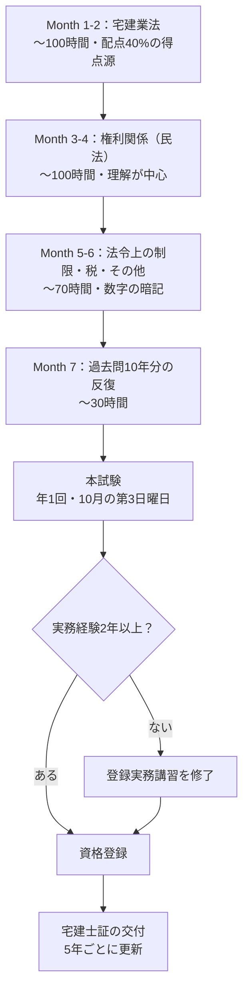

宅建を独学で目指すときは、試験の難しさだけでなく、何から学び、合格後に何が必要かも気になります。

分かれ目は、法律の学習経験と、過去問で説明できない分野です。このガイドでは、300時間・7ヶ月の配分例を土台に、初学者と実務経験者が学習順を調整する方法を整理します。

タイトルの「合格率18%」は難易度を示す概数です。2025年度は受験者245,462人、合格率18.7%でした。2026年度の結果は2026年10月31日時点では未発表です。[2025年度結果](https://goukaku.retio.or.jp/exam/pdf_2025_1_UWbaZCx6hm/2025result.pdf)・[RETIOの試験案内](https://www.retio.or.jp/exam/)

## 合格までの勉強時間

下表は公式の標準時間ではなく、学習枠を確保するための配分例です。合格に必要な時間を保証するものではなく、最初の過去問で説明できなかった論点に合わせて増減します。

| 学習経験 | 計画を作る際の仮置き | 最初に確認すること |
|---|---|---|
| 完全未経験 | 350〜400時間を確保する案 | 宅建業法の用語と民法の登場人物を整理できるか |
| 法律・不動産の基礎知識あり | 300時間の案から不足分を調整 | 未学習の法令上の制限や税を見落としていないか |
| 宅建業務経験者 | 300時間の案を診断後に再配分 | 自社の運用と条文上の原則・例外を区別できるか |

経験があるだけで短時間の計画にしないことが要点です。週10時間を30週確保すれば300時間、週5時間なら同じ期間で150時間です。確保できる枠が半分なら、期間か学習範囲の見積もりを再検討します。

### AI活用で専任講師を月額20ドルで雇う感覚

テキスト学習の壁は「わからないことが出たとき、その場で解決できない」ことだ。

分からない用語が続く場合は、どの概念で止まったかを一つずつ整理します。

生成AIには、民法の仕組みを自分の言葉で説明し、その論理を点検してもらう使い方があります。

この見出しは個別に質問できる相手の比喩です。有料契約を学習の前提にはせず、AIの回答は教材で確認します。

- 「連帯保証の意味がわからない」→ その場で図解つきで説明してもらえる
- ぶしつけな質問をしても怒られない
- 深夜2時でも、何度同じ質問をしても問題ない
- 相手のスケジュールに合わせる必要がない

宅建の権利関係（民法）は「なぜそのルールなのか」という背景が掴めないと暗記だけでは崩れやすい。

AIに「なぜ？」を何度でも聞ける環境は、この科目で特に効く。

## 宅建とは何か

宅地建物取引士資格試験は宅建業法に基づく試験です。[RETIO：試験の概要](https://www.retio.or.jp/exam/exam_detail/)

試験合格と資格登録、宅建士証の交付は別の段階です。登録には原則として2年以上の実務経験、またはそれに代わる実務講習の修了などが必要です。[静岡県：資格登録](https://www.pref.shizuoka.jp/kurashikankyo/kenchiku/takuchitatemono/1015876.html)

業務独占資格のため、以下の行為は宅地建物取引士しか行えない。

- 重要事項の説明（物件の内容や契約条件の説明）
- 重要事項説明書への記名
- 契約書（37条書面）への記名

重要事項説明や書面への記名は、宅建業法第35条・第37条の規定に基づく業務です。宅建業者が関与しない取引まで、すべて同じ条件と考えないでください。[宅地建物取引業法](https://laws.e-gov.go.jp/law/327AC1000000176)

## 需要と実態

### 不動産業界での設置義務

宅地建物取引業者（不動産会社）は、事務所ごとに<strong>宅建業務に従事する者5人に1人以上の割合で、成年者である専任の宅建士を配置</strong>しなければならない（[宅地建物取引業法 第31条の3｜e-Gov法令検索](https://laws.e-gov.go.jp/law/327AC1000000176)）。

人数の数え方や専任性も含め、[神奈川県：新規免許の審査基準](https://www.pref.kanagawa.jp/docs/u2h/cnt/f531874/p15655.html)で確認できます。合格者なら誰でも専任として数えられるわけではありません。

### 資格手当の実態

手当の有無・金額は勤務先の規程で確認します。合格時の一時金、資格登録、宅建士証の保有、専任への就任のどれが支給条件かを分けてください。

| 勤務先の条件 | 確認してから決めること |
|---|---|
| 合格のみで一時金 | 申請期限と対象年度 |
| 有効な宅建士証が必要 | 登録・交付・更新費用の負担者 |
| 専任への就任が必要 | 担当業務と専任性を満たせるか |
| 手当の記載がない | 手当収入を前提に費用回収を計算しない |

更新費用は講習料と交付手数料に分かれます。[宅建士証の更新費用](/theory/takken-koushin-hiyou/)で、自治体・実施団体ごとの確認方法を整理しています。

### 不動産以外での活用

宅建の知識は不動産業界以外で、不動産取引の知識を学ぶ目的も考えられます。以下は知識と業務を結びつける例で、資格の必須要件や採用効果を示すものではありません。

- <strong>金融機関</strong>：住宅ローン担当として不動産担保の査定に使う
- <strong>ゼネコン・ハウスメーカー</strong>：土地仕入れ・用地取得部門
- <strong>一般企業の総務</strong>：社宅・オフィス賃貸の契約業務

## 試験の全体像

### 試験日程と形式

- 実施：年1回（10月の第3日曜日）
- 形式：四肢択一、50問、2時間
- 合格基準点：年度ごとに発表。2025年度の一般受験者は50問中33問以上

試験形式・日程は2026年10月確認。[RETIO：試験概要](https://www.retio.or.jp/exam/exam_detail/)・[2025年度結果](https://goukaku.retio.or.jp/exam/pdf_2025_1_UWbaZCx6hm/2025result.pdf)。登録講習修了者の一部免除は別条件です。

### 出題科目と配点

下表は過去問を学習分野に整理した区分です。公式の将来配点の保証ではありません。実際の設問と法令の基準日は[RETIO：過去の試験問題](https://www.retio.or.jp/exam/past_ques_ans/other/)から確認してください。

| 科目 | 出題数 | 内容 |
|-----|:-----:|-----|
| 宅建業法 | 20問 | 宅建業者・宅建士の義務・規制 |
| 権利関係（民法・借地借家法等） | 14問 | 不動産に関する民事法 |
| 法令上の制限 | 8問 | 都市計画法・建築基準法・農地法等 |
| 税・その他（統計・価格） | 8問 | 不動産取得税・固定資産税・地価公示等 |

<strong>宅建業法は配点が最も大きく（40%）、かつ対策しやすい科目</strong>だ。ここを先に固めるのが合格に向けた王道ルートだ。

### 難易度と合格率

2025年度は受験者245,462人、合格者45,821人、合格率18.7%、一般受験者の合格基準は33問以上でした。[RETIO：2025年度結果](https://goukaku.retio.or.jp/exam/pdf_2025_1_UWbaZCx6hm/2025result.pdf)

他資格との合格率だけの比較では、自分にとっての難易度は決まりません。法律の初学者はまず宅建業法と民法の少量の過去問を解き、知らない語と、理由を説明できない誤答を分けてください。

## 合格ロードマップ（300時間・7ヶ月プラン）

次は300時間を約7ヶ月に配る案です。各月の時間は合格実績ではありません。図の登録段階では実務経験以外の登録要件も確認します。



### Month 1-2（〜100時間）：宅建業法を完全制覇

初学者は、業者・宅建士の義務を区別するところから始める案があります。実務経験者は、業法の誤答が少なければ権利関係に時間を回します。

宅建業法は暗記系が多く、初期に得点源を作れると心理的に楽になる。

テキストと対応する過去問を行き来し、正誤だけでなく、義務を負う主体と例外を説明できるか確かめます。

### Month 3-4（〜100時間）：権利関係（民法）の基礎を固める

民法は範囲が広く、理解を伴う学習が必要だ。AIを活用する場面はここが最大だ。

条文の暗記ではなく「なぜそのルールがあるのか」を理解することで応用問題に対応できるようになる。

### Month 5-6（〜70時間）：法令上の制限・税・その他

都市計画法・建築基準法は細かい数字の暗記が多い。

ゴロ合わせ・AIによる図解化が有効だ。

### Month 7（〜30時間）：過去問10年分の反復

10年分をこの月に初めて解く計画にはせず、前月までに扱った誤答の再確認を中心にします。法改正で答えが変わる旧問は、現行教材の解説で確認してください。

直前期は新しいインプットより「弱点の洗い出しと反復」に集中する。

## AI活用法

### 民法・借地借家法の理解を加速する

権利関係は法律の読解力が問われる。以下のプロンプトが有効だ。

```
宅建試験の権利関係（民法）で「連帯保証」の問題が苦手です。
以下について、試験に出やすいパターンを中心に説明してください。

1. 連帯保証と通常保証の違い
2. 主債務者が支払えなくなった時に連帯保証人はどうなるか
3. 試験でよく問われる「催告の抗弁権」「検索の抗弁権」の有無について
4. 過去問に出やすい引っかけパターン
```

<!-- AI_EXAMPLE: 使うAI=Gemini / プロンプト=本文「連帯保証」 / 見せたいこと=通常保証と連帯保証の違いを教材と照合できるか -->

連帯保証や危険負担のようなひっかけ論点をまとめて反復演習したい場合は、[宅建 権利関係 一問一答](/app/takken-kenri-quiz/)で○×形式のドリルを解きながらAI解説を確認できる。

### 民法を「登場人物の関係図」にして理解する

権利関係でA・B・Cの関係を追えない場合は、「誰が誰に何を主張するか」を分けて書きます。事例問題の記号を売主・買主などの立場に置き換えると、条文のどの条件を確認するかを整理できます。

条文を読んで混乱したら、先に、AIに登場人物の関係を整理してもらいます。

```text
宅建の民法の学習中です。以下の事例を、登場人物の関係が一目で分かる形に整理してください。

【事例】Aは自分の土地をBに売却したが、登記を移転しないうちに、同じ土地をCにも売却し、Cが先に登記を済ませた。

整理してほしい内容：
1. 登場人物ごとの立場（誰が売主か、誰が買主か）の一覧
2. 時系列（何がいつ起きたか）を矢印で整理
3. この事例で問われる法律上の論点（二重譲渡と対抗要件）を一言で
4. 「Bが保護されないのはなぜか」を初心者向けに説明
```

#### Geminiで実行した結果

このプロンプトを、Gemini（無料プラン）で実行しました（2026年10月）。

回答は、指定した4項目の順にまとまっていました。登場人物の一覧は次のとおりです。

| 登場人物 | 立場 | 説明 |
| --- | --- | --- |
| A | 売主（二重譲渡人） | 1つの土地をBとCの両方に売った |
| B | 第一の買主 | 先に買ったが、登記は移していない |
| C | 第二の買主 | 後から買ったが、先に登記を済ませた |

時系列は「AがBに売る → AがCに売る → Cが先に登記 → BとCがどちらの土地かで争う」と矢印でつながれていました。

論点は「売買の前後ではなく、先に登記を備えた者が第三者に対抗できる（民法177条・対抗要件）」の一文です。

「Bが保護されないのはなぜか」は、登記を看板にたとえた説明でした（要約）。

> - 不動産は、外から見て誰のものか分からないと安全に取引できない。登記は「この土地は私のもの」と世の中に示す看板にあたる
> - Bは先に契約したが、看板を立てずにいた。Cは後から契約したが、すぐに看板を立てた。民法は取引の安全のため、先に看板を立てたCを保護する
> - Bは、Aに契約違反の責任（損害賠償など）を問えるが、Cに「土地を渡せ」とは言えない

結論は、宅建の過去問の正解と一致しています。

ただし、回答には出てこない例外があります。Cが、Bを困らせる目的で買ったような<strong>背信的悪意者</strong>なら、登記があってもBに対抗できません。試験ではこの例外もよく問われるので、関係図ができたら「Cがどんな人なら結論が変わるか」と続けて聞くと、論点が一段深まります。

先に登記した買主が常に保護される、と覚えるのは避けます。第三者の範囲など、結論に影響する条件は教材の解説で確認してください。対抗要件の条文は[民法第177条](https://laws.e-gov.go.jp/law/129AC0000000089)です。

<!-- LEARNER_NOTE: 候補=Geminiで関係を整理した実際の回答を見て、例外の質問が必要だった箇所 / 種類=think / 筆者がAI使用の実体験で記入。宅建の受験体験は書かない -->

### 都市計画法の数字を整理する

法令上の制限では、開発許可の面積要件など、区域や行為によって条件が変わる数字を整理します。建築確認と開発許可は別の制度なので、一つの条件表に混ぜないでください。

```
都市計画法の開発許可について、以下の表を作ってください。
【区域別の開発許可が必要な面積の下限】
- 市街化区域
- 市街化調整区域
- 非線引き区域
- 準都市計画区域
- 上記以外

それぞれ「面積」と「例外（許可不要のケース）」を含めた一覧表を作成してください。
```

<!-- AI_EXAMPLE: 使うAI=Gemini / プロンプト=本文「都市計画法の開発許可」 / 見せたいこと=区域別の原則と例外を分け、条例等の確認が必要な点を示せるか -->

AIの数字は暗記前に現行教材・法令で照合します。敷地や開発行為の条件を省いた一覧だけで実務判断はしません。

---

## まとめ

宅建攻略の3原則：

<strong>1. 宅建業法から始める</strong>

配点40%・暗記系が多い宅建業法を先に固めることで、早期に得点源を作れる。

<strong>2. 権利関係はAIで理解を深める</strong>

民法の暗記ではなく「なぜそのルールか」の理解がAI対話で速くなる。

<strong>3. 過去問10年分を繰り返す</strong>

過去問で誤った理由を確認し、現行法との違いにも注意して復習します。

300時間は配分の出発点です。初学者は用語と主体の整理、実務経験者は条文と日常業務の差を起点に調整します。筆者は宅建未受験であり、合格体験に基づく計画ではありません。

権利関係が頭に入らず止まっている場合は、前述の「民法を『登場人物の関係図』にして理解する」を参照してほしい。
