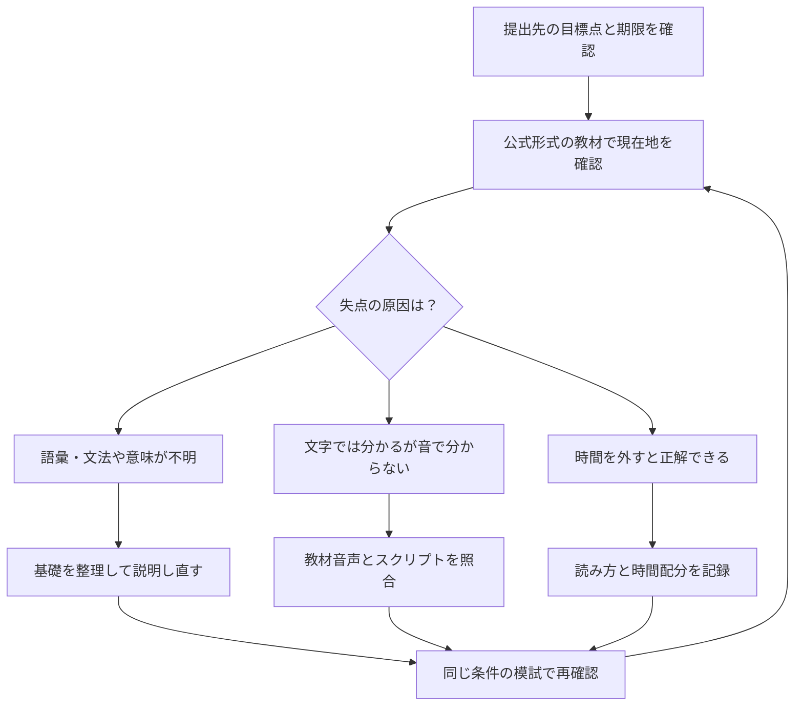

単語帳と問題集を繰り返しても、TOEICのどの力を伸ばすべきか判断できないことがあります。

見直す手がかりは、目標点との差だけでなく、時間を外せば解けるか、スクリプトを読めば意味が分かるかです。このページでは公式の試験形式を確認し、失点原因から学習順を決めるロードマップを整理します。

筆者はTOEIC未受験です。以下の時間配分は受験体験や到達実績ではなく、計画を立てるための例です。

## 合格までの勉強時間

TOEIC L&Rの結果は合否ではなくスコアです。[IIBC：TOEIC L&Rとは](https://www.iibc-global.org/toeic/test/lr/about.html)

下表は公式の標準学習時間や到達予測ではなく、学習枠を見積もるための仮置きです。同じ現在点でも失点原因が異なるため、数週間の記録で調整してください。

| 現在の状況 | 目標スコア | 最初に確保する時間枠の例 |
|-----------|:---:|:---:|
| 英語知識がほぼ白紙（中学英語も曖昧） | 600点 | 300〜400時間 |
| 大学受験レベルの基礎はある | 730点 | 200〜300時間（600点付近からの計画例） |
| 730点前後で頭打ち・仕事で英語を多少使う | 800点 | 150〜250時間（730点付近からの計画例） |
| 800点前後・900点の壁で伸び悩み中 | 900点 | 150〜300時間（800点付近からの計画例） |



### AI活用で専任講師を月額20ドルで雇う感覚

学習内容を選ぶときは、次の3つの状態を区別します。

- <strong>リスニングで音が聞き取れない理由が分からない</strong>：単語は知っているのに、ネイティブの発音では別の単語に聞こえる（音の連結・脱落・弱化）
- <strong>Part 5の文法問題で「なぜその形になるのか」が説明できない</strong>：正解は選べても、理由を人に説明できないため応用が利かない
- <strong>Part 7の長文で時間切れになる理由が分からない</strong>：読むスピードの問題なのか、設問の解き方の問題なのか自己診断できない

従来の独学では、これらの「なぜ」を聞ける相手がいない。参考書の解説を読んでも納得できなければ、そこで止まってしまう。

生成AIを使えば、聞き取れなかった一文を貼り付けて「なぜこの音がこう聞こえるのか、音声変化のルールを教えて」と聞くだけで、専任講師に個別解説してもらう感覚が手に入る。この見出しは個別に質問する相手の比喩で、有料プランを必須にはしません。利用範囲内で、同じ概念を別の例に言い換えてもらう使い方ができます。

AIの説明は仮説です。<strong>説明で分かったことを教材で確認する</strong>工程まで含めて学習時間を確保します。

## TOEIC L&Rとは何か

TOEIC L&R（Listening & Reading）は、国際ビジネスコミュニケーション協会（IIBC）が主催する、ビジネス英語のコミュニケーション能力を測る試験だ。

- リスニング100問・リーディング100問の合計200問、マークシート方式
- スコアは10〜990点（5点刻み）で、合否ではなくスコアで評価される
- 試験時間は約2時間、リスニング約45分・リーディング75分
- スコアの有効期限について、ETSは2年と設定。提出先にも独自の条件があるため、募集要項を別途確認する。[IIBC公式FAQ](https://faq.iibc-global.org/faq/show/1010?site_domain=default)

形式・スコアは2026年10月確認。[IIBC：テスト概要](https://www.iibc-global.org/toeic/test/lr/about.html)。本記事は公開テスト等のマークシート方式を扱い、時間・問題数が異なるIPオンライン方式とは区別します。

TOEIC L&Rは点数を目標にする試験です。目標点は応募・昇進などの提出先の条件から決め、現在地は模試や受験結果で確認します。

## パート構成と配点感

問題数は[IIBC：形式と構成](https://www.iibc-global.org/english/toeic/test/lr/about/format.html)で確認しています（2026年10月）。右欄は学習時に点検する観点です。

| Part | 内容 | 問題数 | 詰まりやすいポイント |
|------|------|:---:|------|
| Part 1 | 写真描写問題（リスニング） | 6問 | 語彙より「音」の聞き取り精度が問われる |
| Part 2 | 応答問題（リスニング） | 25問 | 疑問文以外の応答パターン（依頼・提案）に弱い人が多い |
| Part 3 | 会話問題（リスニング） | 39問 | 設問を先読みできないと聞きながら解答欄を探して失点する |
| Part 4 | 説明文問題（リスニング） | 30問 | 話者交代がなく情報密度が高いため集中力が切れやすい |
| Part 5 | 短文穴埋め問題（リーディング・文法） | 30問 | 文法ルールを暗記していても、初見の文型で判断できない |
| Part 6 | 長文穴埋め問題（リーディング） | 16問 | 文脈依存の設問（前後の文とのつながり）を見落としやすい |
| Part 7 | 読解問題（リーディング） | 54問 | 時間切れが最大の敵。複数文書問題（トリプルパッセージ）で崩れる人が多い |

Part 5〜7の100問を75分で割ると平均45秒ですが、長文を読む時間も必要で、すべての設問を45秒で解く配分にはなりません。<strong>時間配分の設計そのものが得点源になる</strong>のがTOEIC攻略の特徴だ。

## AIを専任講師にする学習プラン

### これから勉強する人向け（600点を目指す）

まず模試を解き、時間を外しても解けない箇所と、時間切れの箇所を分けます。以下は入力形式を示す架空の条件です。実際のスコアや学習成果ではありません。

```
TOEICのリスニングとリーディングの模試を1回分解きました。
以下が結果です。

- リスニング: スクリプトを読めば分かるが、音だけでは聞き逃す
- リーディング: 時間を外してもPart5の品詞問題で迷う
- 目標: 600点。模試の換算点は使わず、誤答の特徴を記録した
- 現在の英語学習歴: 高校卒業後は英語学習をしていない

この結果から、私が優先的に強化すべき分野を3つに絞って、理由と一緒に教えてください。
問題を出すのではなく、まず「なぜその分野が弱いのか」の仮説を聞きたいです。
```

<!-- AI_EXAMPLE: 使うAI=ChatGPT / プロンプト=本文の第1プロンプト / 見せたいこと=初学者の誤りから優先学習の理由を説明できるか -->

AIが立てた仮説を土台に、実際の教材（公式問題集など）で該当分野を集中的に解き、自分の誤答の理由をAIに伝えて「なぜ聞き取れなかったか」「なぜこの文法になるのか」を1問ずつ深掘りする。自分で書いた英文や誤りの要約を使い、教材の解説と照合して理解を点検します。

### 現場経験者向け（800点から900点の壁を越える）

800点前後でも、語彙・文法不足、聞き逃し、時間切れのどれが中心かは人によって異なります。以下も読者が自分の記録に差し替えるためのプロンプトです。

```
TOEICで800点前後を維持していますが、900点の壁を3回連続で超えられていません。
直近の模試の誤りを、自分の言葉で要約します。
【自分の誤りの記録を入力】

私の間違え方に共通するパターンがあれば指摘してください。
単純な語彙不足なのか、時間切れによる焦りなのか、設問タイプへの読み方の相性なのか、
原因のレイヤーを分けて分析してください。
```

<!-- AI_EXAMPLE: 使うAI=ChatGPT / プロンプト=本文の第2プロンプト / 見せたいこと=800点帯の誤りを原因別に分けられるか -->

すでに知識があるからこそ、AIには「教えてもらう」のではなく「自分のミスの構造を添削してもらう」使い方が最も効く。時間切れが原因なら設問を先読みする順番を、ケアレスミスが原因なら選択肢の読み方の癖を、それぞれAIと一緒に特定して修正していく。

## リスニングを伸ばす — 音声変化をAIに解説させる

スクリプトなら理解できるのに音では聞き取れない場合は、音の変化を点検します。語彙や文法が不明な場合は、先に意味を整理してください。ネイティブスピーカーの発音では、単語同士が連結・脱落・弱化して、辞書通りの発音とは違って聞こえる。

教材のスクリプトは手元で確認し、AIには同じ仕組みを知りたい自作の英文を使います。

```
以下は練習用英文です。音の変化が起きうる箇所を知りたいです。実際の試験音声の引用ではありません。

"Could you let me know if there's any update on the shipment?"

なぜ聞き取りにくいのか、音の連結・脱落のルールを使って説明してください。
同じルールが使われる別の例文も3つ挙げてください。
```

<!-- AI_EXAMPLE: 使うAI=ChatGPT / プロンプト=本文の第3プロンプト / 見せたいこと=自作英文の音変化の仮説を教材音声で照合できるか -->

「なぜ聞き取れないのか」のルールが分かると、同じパターンの別の文でも聞き取れるようになる。AIの説明だけで実音の変化を断定せず、同じ箇所を教材音声で聞き直します。

### 聞き取れない理由を言語化するシャドーイング

音声変化を点検する際は、たとえば次の3つを区別します。

- <strong>連結（リンキング）</strong>："turn off" が「ターン・オフ」ではなく「ターノフ」のように聞こえる
- <strong>脱落</strong>：語末の子音（特にt、d）が聞き取りにくくなることがある。"next month" のtが聞こえなくなる
- <strong>弱化</strong>：前置詞、冠詞、助動詞などの機能語が短く発音される

音の説明を読んだ後も、元音声に戻って聞き分けを練習します。説明の理解と、実際の音を聞けることは別々に確認してください。

シャドーイング（音声を追いかけて発音する練習）は、独学だと、聞き取れなかった理由を自分で分析しにくく、ネイティブとの違いも客観的に判断しにくい、という壁があります。そこで、AIに聞きます。

1. <strong>聞き取れなかった一文を特定する</strong>：手元の教材で聞き取れなかった一文を特定し、スクリプトを手元で確認する。AIには自作の例文や誤りの要約を使う
2. <strong>音声変化のルールを解説してもらう</strong>：連結、脱落、弱化のどれが起きているかを、音の変化を一つずつ指摘してもらう
3. <strong>同じルールの例文を作ってもらう</strong>：TOEICのビジネスの場面の例文を5つ作ってもらい、音声変化が起きる部分に印をつけてもらう。声に出して読む、スマートフォンの読み上げ機能で聞くなど、実際に音を確かめる工程を必ず入れる
4. <strong>自分の発音との違いを聞く</strong>：音声を扱える環境なら録音を確認する。文字起こしだけでは発音の正確さやリズムは判定できないため、元音声との比較を続ける

```text
次は学習用の自作例文です。音声変化が起きうる箇所を知りたいです。
連結・脱落・弱化の候補を挙げ、発音する人によって変わりうる点も説明してください。
そのうえで、同じルールが使われるTOEICのビジネスの場面の例文を5つ作り、音声変化が起きる部分に印（**）をつけてください。

"I was wondering if you could send me the updated invoice by the end of the day."
```

<!-- AI_EXAMPLE: 使うAI=ChatGPT / プロンプト=本文の第4プロンプト / 見せたいこと=音変化の候補と自作例文を示し、実音で再確認できるか -->

## キャリア戦略 — TOEICスコアをどう使うか

TOEICスコアの価値は「持っていること」自体ではなく、<strong>スコアが必要な場面で基準を超えていること</strong>にある。

| 提出する目的 | 先に確認する条件 | 学習計画への反映 |
|---|---|---|
| 就職・転職 | 必要スコア、受験方式、対象となる受験日 | 提出期限までに結果が出る回を選ぶ |
| 昇進・昇格 | 社内規程の基準と申請期限 | 基準点と受験機会から逆算する |
| 実務での英語使用 | 読む・聞く・話す・書くのどれが必要か | L&R以外の練習も必要か考える |

ITの基礎も必要なら[ITパスポートの学習ガイド](/method/itp-hub/)を参照できます。資格を組み合わせる前に、応募先で必要な知識を確かめてください。

スコアだけを追い求めるのではなく、「どの場面で・何点が・いつまでに必要か」を先に決めてから学習時間を配分すると、遠回りが少なくなる。

## 受験前チェックリスト

- 申込方式（公開テスト・IPテスト）と会場を確認する。公開テストは申込〆切が早いため注意
- 本人確認書類・写真の要件を事前に確認しておく
- 当日の音量確認などは監督者の案内に従い、受験上の配慮が必要なら事前に公式案内を確認する
- リーディングは大問ごとの時間配分（Part5→Part6→Part7の順）を事前に決めておく

---

## まとめ

目標スコアまでの学習は、語彙・文法、音の聞き取り、時間配分のどこが不足するかで変わります。時間を外せば解けるか、文字で読めば分かるかを記録して優先順位を決めます。

AIには原因の仮説や自分の説明の点検を任せ、正しさと到達度は教材・模試で再確認します。まず提出先の必要点・期限・対象となる試験方式を確認してください。
