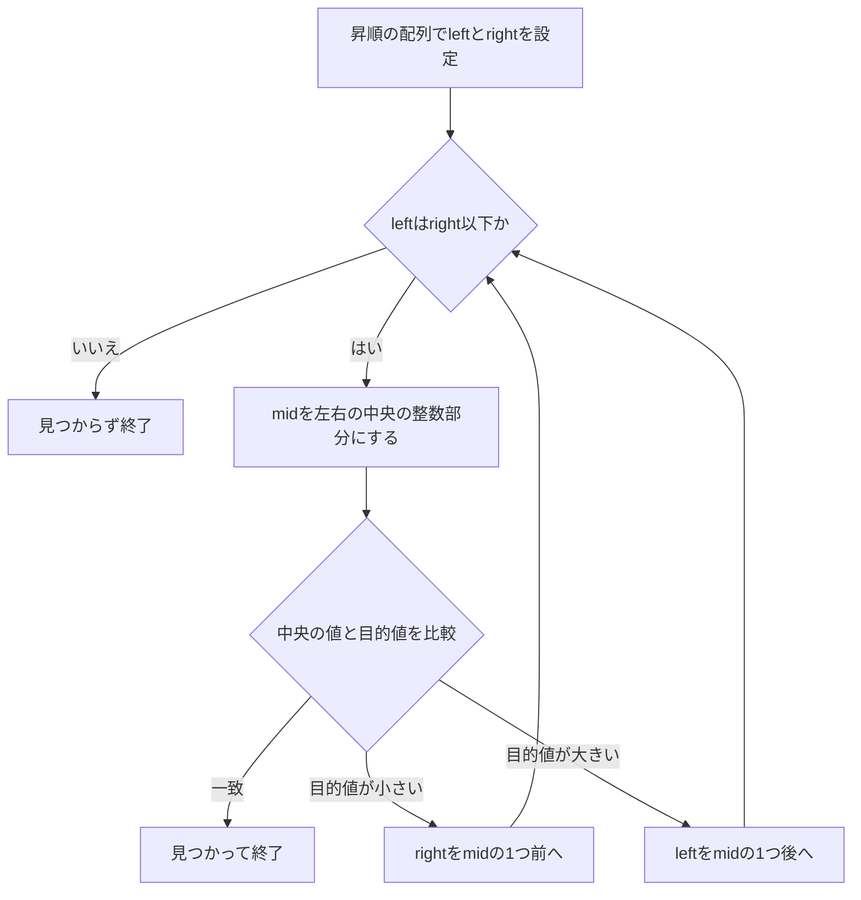

アルゴリズムとは「問題を解く手順の定義」だ。

同じ問題を解くにも「速いやり方」と「遅いやり方」があり、その差を測る物差しが<strong>計算量（O記法）</strong>だ。

基本情報技術者試験では、アルゴリズムの知識は科目A（選択問題）と科目B（擬似言語トレース）の両方に登場する。

「どんな手順で動くか」を自分の頭でトレースできるレベルまで理解しておくことが合格の条件だ。

アルゴリズムは、データをどう並べて持つか（データ構造）と切り離せない。この記事では、探索・整列の手順と、スタック・キュー・連結リスト・木を、1ページに並べて整理する。

---

## 探索アルゴリズム — データを見つける手順

### 線形探索

配列の先頭から順番に目的の値を探す、最もシンプルな探索アルゴリズムだ。

```
手順:
1. 先頭の要素から比較を始める
2. 目的の値と一致したら終了（見つかった）
3. 末尾まで到達しても見つからなければ「存在しない」
```

<strong>特徴</strong>
- 配列がソートされていなくても使える
- 最悪の場合、全要素を調べる必要がある
- 計算量：<strong>O(n)</strong>（nはデータ件数）

「10,000件のデータから1件を探す場合、最悪で10,000回比較が必要」ということだ。

試験では「以下の配列から値42を線形探索で見つけるとき、何回目の比較で見つかるか」という問題が出る。単純に先頭から数えるだけだが、<strong>インデックスが1始まりであること</strong>を忘れずに。

### 二分探索

<strong>ソート済みの配列</strong>に対して使える、高速な探索アルゴリズムだ。

配列の真ん中の要素と比較し、目的の値が大きければ右半分、小さければ左半分だけに絞り込む。

```
手順（配列が昇順ソート済みとして）:
1. left=1, right=配列の末尾 とする
2. mid = (left + right) ÷ 2（整数部分）を求める
3. array[mid] と目的値を比較する
   - 一致 → 見つかった、終了
   - 目的値 < array[mid] → right = mid - 1（左半分を探索）
   - 目的値 > array[mid] → left = mid + 1（右半分を探索）
4. left > right になったら「存在しない」
```

<strong>特徴</strong>
- ソート済みデータが前提（事前にソートが必要）
- 探索のたびに対象範囲が半分になる
- 計算量：<strong>O(log n)</strong>

「10,000件のデータなら最大14回の比較で見つかる」（log₂10000 ≈ 13.3）。

線形探索の最悪10,000回とは、比較回数に大きな差がある。

二分探索は、次の順で探索範囲を縮める。昇順・添字1始まりの手順で、範囲がなくなったら終了する。



未整列の配列で一度だけ探すなら線形探索、整列済みで何度も探すなら二分探索が候補になる。二分探索自体が速くても、未整列なら先に並べ替える処理が要る。[Python公式：二分探索と性能上の注意](https://docs.python.org/3/library/bisect.html)

left・right・mid の3つの変数を紙に書きながら追う練習をしておくこと。

## 整列アルゴリズム — データを並べ替える手順

### バブルソート

隣り合う2つの要素を比較して、大小が逆なら交換する。

これを配列全体に対して繰り返すと、最大値が泡（バブル）のように末尾へ浮かび上がっていく。

```
手順（昇順ソートの場合）:
1. i=1 から n-1 まで繰り返す
   2. j=1 から n-i まで繰り返す
      3. array[j] > array[j+1] なら swap（入れ替え）
```

<strong>特徴</strong>
- 実装がシンプルで理解しやすい
- 比較回数が多く処理が遅い
- 計算量：<strong>O(n²)</strong>

試験でのトレースポイントは「何回目のパスで配列がどう変化するか」だ。

1パス（外側ループ1回）ごとに末尾から1つずつ最大値が確定するイメージを持つと追いやすい。

スワップ処理の擬似言語はほぼ必ず以下の形で出る。

```
tmp ← array[j]
array[j] ← array[j+1]
array[j+1] ← tmp
```

tmpなしで直接入れ替えると値が失われる。このパターンを体に染み込ませておくこと。

### 選択ソート

未整列部分の中から最小値（または最大値）を探し、先頭要素と交換する。

これを繰り返して整列する。

```
手順（昇順ソートの場合）:
1. i=1 から n-1 まで繰り返す
   2. minIndex = i とする
   3. j=i+1 から n まで繰り返す
      4. array[j] < array[minIndex] なら minIndex = j
   5. array[i] と array[minIndex] を swap
```

<strong>特徴</strong>
- 比較回数はバブルソートと同じだが交換回数が少ない
- 計算量：<strong>O(n²)</strong>
- 「交換が少ない」という点でバブルソートと区別できることが重要

試験では「バブルソートと選択ソートの違い」を問う選択問題が出る。

「バブルソートは隣接要素を繰り返し交換、選択ソートは最小値を選んで一度だけ交換」という差を押さえておくこと。

## 計算量O記法の基本

アルゴリズムの「速さ」を比較するための表記法だ。データ件数 n が増えたとき、処理時間がどう増えるかを表す。

| O記法 | 意味 | 代表的なアルゴリズム |
|------|------|-------------------|
| O(1) | データ数に無関係で一定 | 配列への直接アクセス |
| O(log n) | 対数的に増加（非常に速い） | 二分探索 |
| O(n) | データ数に比例して増加 | 線形探索 |
| O(n log n) | 件数とその対数の積に応じて増加 | マージソート、クイックソートの平均的な場合 |
| O(n²) | データ数の2乗で増加（遅い） | バブルソート・選択ソート |

試験では「以下のアルゴリズムの計算量はどれか」という選択問題で使う。

O(n²) と O(n log n) の差が大きいことを数値イメージで持っておくと選択問題が速くなる。

n=1000なら、n²は100万、n log₂ nは約10,000だ。ただしO記法は増え方の上限を表すもので、この数字が実際の処理回数や実行時間そのものになるわけではない。クイックソートも平均と最悪の場合を区別する。

## データ構造 — データの並べ方のルール

プログラムは「データをどこに、どう並べるか」で処理速度が大きく変わる。その並べ方のルールがデータ構造だ。科目Aの知識問題と、科目Bの擬似言語問題の両方に出る。

| データ構造 | 原則 | 代表的な用途 | 試験ポイント |
|----------|------|-----------|-----------|
| スタック | LIFO（後入れ先出し） | 元に戻す機能、ブラウザの「戻る」、関数の呼び出し履歴 | プッシュ／ポップのトレース |
| キュー | FIFO（先入れ先出し） | 印刷の待ち行列、パケットの送信待ち、タスクのスケジューリング | エンキュー／デキューの順序 |
| 連結リスト | ポインタで次のデータにつなぐ | 動的なデータ管理 | ポインタの付け替え手順 |
| 二分探索木 | 左の子 < 親 < 右の子 | 高速な検索 | 前順／中順／後順の走査 |

### スタックとキュー

<strong>スタック</strong>は、後から入れたものを先に取り出す（LIFO）。本を積んだ山の、一番上から取るイメージだ。データを入れる操作を<strong>プッシュ</strong>、取り出す操作を<strong>ポップ</strong>という。

<strong>キュー</strong>は、最初に入れたものを先に取り出す（FIFO）。コンビニのレジ待ちの行列と同じだ。末尾に追加する操作を<strong>エンキュー</strong>、先頭から取り出す操作を<strong>デキュー</strong>という。

```
スタック（LIFO）:  追加→[3][2][1]  取り出し順: 3→2→1
キュー（FIFO）:    追加→[1][2][3]  取り出し順: 1→2→3
```

科目Bでは、「プッシュとポップを繰り返したあと、先頭にある値は何か」をトレースする形が多い。途中でプッシュとポップが混ざるので、状態を書き出しながら追う練習が必要だ。

### 連結リスト

<strong>連結リスト</strong>は、各データが「次のデータへのポインタ（アドレス）」を持つ構造だ。配列と違い、メモリ上で連続して並んでいる必要がない。

| 操作 | 配列 | 連結リスト |
|------|:---:|:--------:|
| 末尾への追加 | 容量に空きがあれば末尾へ格納。拡張が必要ならコピーを伴う場合がある | 末尾への参照を持てば速い。なければ末尾までたどる |
| 先頭への挿入 | 遅い（全シフト） | 速い |
| ランダムアクセス | 速い（添字で直アクセス） | 遅い（先頭から辿る） |

前後両方向へのポインタを持つ<strong>双方向リスト</strong>は、前のノードにも辿れて柔軟だが、メモリの使用量が増える。試験では、挿入・削除のときのポインタの付け替え手順をトレースする問題が出やすい。

### 木（ツリー）構造

<strong>木構造</strong>は、親ノードから子ノードへ枝分かれする階層型のデータ構造だ。ファイルシステムのフォルダ階層や、組織図がイメージしやすい。

- <strong>根（ルートノード）</strong>：最上位のノード。親を持たない
- <strong>葉（リーフノード）</strong>：子を持たない末端のノード
- <strong>深さ</strong>：根からそのノードまでの辺の数。高さはそのノードから最も遠い葉までの辺の数

<strong>二分木</strong>は、各ノードの子が最大2つの木だ。<strong>二分探索木</strong>は、さらに「左の子 < 親 < 右の子」という順序の制約を加えた二分木で、探索が速い。探したい値を根と比べ、小さければ左、大きければ右へ進む。バランスが取れていれば、探索の計算量は O(log n) になる。

試験で頻出なのが、木を巡る順番（走査）だ。

| 走査 | 順番 |
|------|------|
| 前順 | 自分 → 左の子 → 右の子 |
| 中順 | 左の子 → 自分 → 右の子 |
| 後順 | 左の子 → 右の子 → 自分 |

二分探索木を<strong>中順</strong>で走査すると、要素が昇順に並ぶ。この性質は覚えておくと役に立つ。

## AIで練習する方法

まず自分で途中状態を書き、どの代入・比較で迷ったかをAIに説明する。問題を増やす前に、値が変わった理由を確かめるためのプロンプトとして使う。

```
基本情報技術者試験の科目B形式で、以下の問題を作ってください。

対象アルゴリズム: バブルソート
配列: [8, 3, 6, 1, 5]
問題形式: 1パス目が終了した時点での配列の状態を答えよ
擬似言語の添字は1始まりで記述すること
```

<!-- AI_EXAMPLE: 使うAI=普段使う生成AI / プロンプト=配列8・3・6・1・5のバブルソート1パス目 / 見せたいこと=筆者の手書きトレースとAIの回答を比べ、各交換の理由を確認できるか -->

```
スタックに [5, 3, 8, 1] の順でプッシュした後、
ポップを2回行った状態を教えてください。
さらに 9 をプッシュして、残っているデータを答えてください。
```

```
以下の二分探索木に対して、前順・中順・後順で走査した結果をそれぞれ答えてください。
根=4、4の左の子=2、右の子=6。
2の左の子=1、右の子=3。6の左の子=5、右の子=7。
```

AIには「自分の途中状態と比較し、最初に食い違う代入を一つ示して」と続ける。最終結果だけが一致しても、途中の説明が正しいとは限らない。添字・繰り返し条件は[IPAの試験要綱・シラバス](https://www.ipa.go.jp/shiken/syllabus/gaiyou.html)にある擬似言語の資料で確認する。

---

## まとめ

| アルゴリズム | 種別 | 前提条件 | 計算量 | 試験ポイント |
|------------|------|---------|:-----:|-----------|
| 線形探索 | 探索 | なし | O(n) | 先頭から何番目で見つかるか |
| 二分探索 | 探索 | ソート済み | O(log n) | left/mid/rightの変化を追う |
| バブルソート | 整列 | なし | O(n²) | 隣接swap・1パス後の状態 |
| 選択ソート | 整列 | なし | O(n²) | 最小値選択・交換回数の少なさ |

学習の全体の進め方は[基本情報技術者試験の合格ロードマップ](/method/fe-hub/)で確認できる。

探索・整列の4つのアルゴリズムと、スタック・キュー・連結リスト・二分探索木の4つのデータ構造は、仕組みを理解してしまえば、擬似言語に書き換えられても動きを追える。用語の暗記より「手を動かしてトレース」を優先してほしい。
