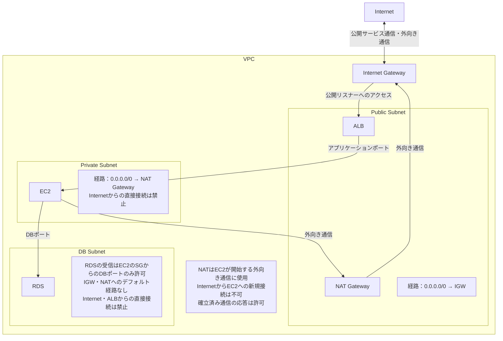
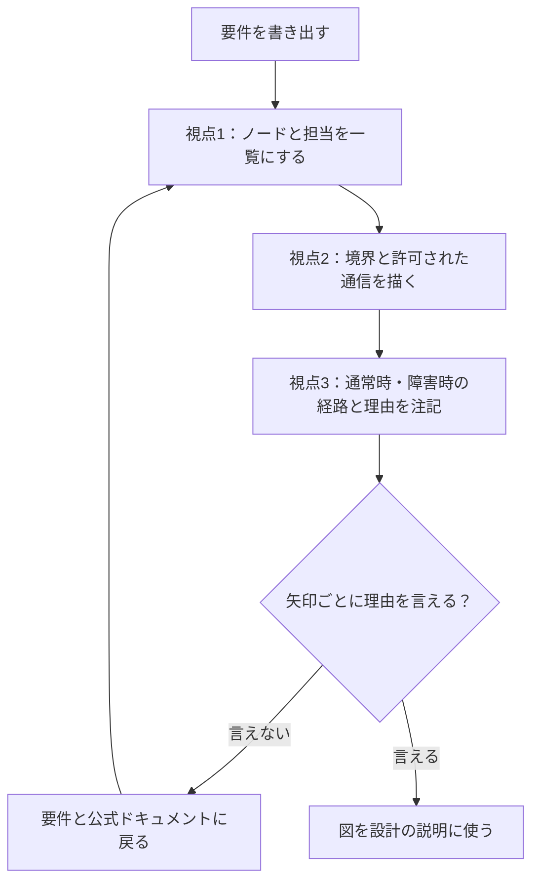

AWSの構成図をMermaidで描いてみたものの、レビューで「なぜこの構成なのか」と聞かれると答えに詰まる。SAAの学習でも、サービス名を並べた図は描けるのに、選択肢の違いを説明できないことがあります。

分かれ目は、図を描く前と描いた後に、何を確かめるかです。この記事では、要件の分解・境界と経路・設計理由の3つの視点で、AWSのMermaid構成図を作る手順を整理します。

読み終えたら、AIに構成図のコードを出させたときに、どこを点検すれば設計の説明に使える図になるかを判断できます。

筆者はAWS認定を未受験です。以下はAWSの公式ドキュメントで確認した仕様をもとにした学習方法の整理で、受験や実務の体験談ではありません。

---

## Mermaid構成図を3つの視点で作る理由

Mermaidは、テキストで図を書ける記法です。コードを書けば、ノード（箱）と線で関係を表した図として表示されます。構文は[Mermaid公式のフローチャート文法](https://mermaid.js.org/syntax/flowchart.html)で確認できます。

テキストなので、AIにコードを出してもらい、そのまま表示できます。ただし、AIは要件にない接続を足したり、サービスの置き場所を間違えたりすることがあります。図ができたことと、図が正しいことは別です。

そこで、1枚の図を次の3つの視点で順に確かめます。

| 視点 | 図で確かめること | 迷ったときの判断 |
| --- | --- | --- |
| 要件の分解 | どのサービスが何を担当するか | サービス名だけでなく、担当する役割を1行で書けるか |
| 境界と経路 | どこからどこへ通信できるか | 許可された通信だけが実線になっているか |
| 設計理由 | なぜその配置にしたか | 障害時にどう切り替わるかを説明できるか |

SAAの問題も、可用性・セキュリティ・コストなどの観点から構成を選ばせる形が中心です。出題分野は[AWSのSAA試験案内](https://aws.amazon.com/certification/certified-solutions-architect-associate/)で確認できます（2026年10月31日確認）。3つの視点は、この「選んだ理由を説明する」練習にそのまま使えます。

## 視点1: 要件をノードへ分解する（題目: IAM・VPC・EC2の責務関係）

最初の視点は、文章の要件をそのまま図にしないことです。先に、登場するサービスと、それぞれの担当を一覧にします。

```text
次の題目を、Mermaid図にする前処理として分解してください。
題目: IAM・VPC・EC2の責務関係

要件:
- IAMはアクセス制御ポリシーを管理
- VPCはネットワーク分離境界を提供
- EC2はワークロード実行基盤

出力形式:
1) ノード一覧（責務つき）
2) エッジ一覧（依存関係つき）
3) graph TD向け草案
```

<!-- AI_EXAMPLE: 使うAI=筆者が選ぶチャットAI / プロンプト=本文「視点1: 要件をノードへ分解する」 / 見せたいこと=IAMをVPCの中に置かないか、ノードに責務が付くか、要件にない依存関係を足さないか -->

ラベルは「IAM（アクセス制御）」のように、サービス名と役割を並べて書くと、図を見た人が担当を取り違えにくくなります。

この題目で一番間違えやすいのは、<strong>IAMの置き場所</strong>です。IAMは、AWSのリソースへのアクセスを誰に許可するかを管理するサービスで、VPCの中に置くネットワークの部品ではありません。[AWSのIAMの説明](https://docs.aws.amazon.com/IAM/latest/UserGuide/introduction.html)

AIの草案で、IAMがVPCのサブグラフの中に入っていたら、外に出します。VPCの中にあるのはEC2で、IAMは「EC2にどの権限を与えるか（IAMロール）」という線でつながります。

| ノード | 担当 | 図での置き場所 |
| --- | --- | --- |
| IAM | 誰が・何に・何をしてよいかの管理 | VPCの外 |
| VPC | 他のネットワークから分けた仮想ネットワーク | 境界（サブグラフ） |
| EC2 | アプリケーションを動かす仮想サーバー | VPCのサブネットの中 |

## 視点2: 通信経路と境界を明示する（題目: Public/Private Subnetの経路設計）

2つ目の視点は、どこからどこへ通信できるかを、図を見ただけで判断できるようにすることです。境界（VPC・サブネット）をサブグラフで囲み、許可された通信だけを実線にします。

```text
以下の要件をMermaidのgraph TDで図示してください。
題目: Public/Private Subnetの経路設計

要件:
- Public Subnet: ALB配置、Internet Gatewayに接続
- Private Subnet: EC2配置、NAT Gateway経由で外向き通信のみ許可
- DB Subnet: RDS配置、EC2からのみ到達可

制約:
- 境界(Subnet/VPC)をサブグラフで表現
- 許可通信のみ実線、禁止・非直結は注記
```

### ChatGPTで実行した結果

このプロンプトを、ChatGPT（有料プラン）で実行しました（2026年10月）。

返ってきたコードを、そのまま表示したのが次の図です（先頭のタイトル行だけ、図の下のキャプションに移しています）。



実線の矢印は、許可された通信だけです。「InternetからEC2」「ALBからRDS」のような禁止された通信は線を引かず、注記のボックスに書かれています。プロンプトの制約どおりです。

プロンプトに書いていない点まで、注記に入っていました。

- 各サブネットのルートテーブルの行き先（Publicは `0.0.0.0/0 → IGW`、Privateは `0.0.0.0/0 → NAT Gateway`）
- RDSへの受信を、EC2の<strong>セキュリティグループ（SG）</strong>からのDBポートに絞ること
- NAT Gatewayは、EC2から始めた通信の応答は通すが、外からの新規接続は通さないこと

どれもSAAで問われる設定です。ただし、ポート番号やSGのルールは図に書かれていないので、実際の値は自分で決めて書き足します。

この図を自分で点検するときは、境界ごとに「何が通信を制御しているか」を分けて確かめます。

| 確かめる点 | 制御する仕組み | 単位 |
| --- | --- | --- |
| サブネットから外へ出る経路 | ルートテーブル | サブネット |
| リソースへの受信・送信 | セキュリティグループ | EC2などのリソース |
| サブネットへの出入り | ネットワークACL | サブネット |

セキュリティグループはリソース単位、ネットワークACLはサブネット単位で通信を許可・拒否します。[AWSのVPCのセキュリティ](https://docs.aws.amazon.com/vpc/latest/userguide/VPC_Security.html)

図の矢印1本ごとに、「この通信を通しているのは、どの仕組みか」を言えるようにします。言えない矢印は、要件にない接続をAIが足した可能性があるので、要件に戻って確かめます。

## 視点3: 設計判断の理由を図に埋め込む（題目: マルチAZ高可用構成）

3つ目の視点は、構成図を「見た目」ではなく、設計の判断を記録した資料にすることです。マルチAZの構成なら、通常時の経路と、障害時に切り替わる経路の両方を図に残します。

```text
題目: マルチAZ高可用構成
Mermaid graph TDで、次の方針を満たす図を作成してください。

- AZ-A / AZ-C にそれぞれEC2とRDS(standby)を配置
- ALBは両AZへ分散
- 単一障害点を避けるため、各コンポーネントの冗長化理由を注記

要件:
1) 通常時の通信経路
2) 障害時のフェイルオーバー経路
3) なぜこの構成なのかの補足コメント
```

<!-- AI_EXAMPLE: 使うAI=筆者が選ぶチャットAI / プロンプト=本文「視点3: 設計判断の理由を図に埋め込む」 / 見せたいこと=スタンバイを読み取りに使う線を引かないか、通常時と障害時の経路を分けて描けるか -->

AIの図で特に確かめたいのは、<strong>RDSのスタンバイの扱い</strong>です。Multi-AZ（スタンバイ1台）の構成では、スタンバイは障害時に切り替わるための待機用で、読み取りの通信には使えません。読み取りを分散したいときは、リードレプリカという別の仕組みを使います。[AWSのRDS Multi-AZの説明](https://docs.aws.amazon.com/AmazonRDS/latest/UserGuide/Concepts.MultiAZSingleStandby.html)

図に「EC2 → スタンバイ」の読み取りの線があったら、それは誤りです。注記には、目的ごとに理由を分けて書きます。

| 構成 | 注記に書く理由 |
| --- | --- |
| EC2を2つのAZに置く | 片方のAZで障害が起きても、もう片方で処理を続けるため |
| ALBで両AZに分散する | 正常なEC2にだけ通信を振り分けるため |
| RDSのMulti-AZ | 障害時にスタンバイへ切り替えて、データベースを使い続けるため |
| リードレプリカ（使う場合） | 読み取りの負荷を分けるため。障害対策とは目的が違う |

理由を1行ずつ書き分けると、SAAで「可用性を上げたい」のか「読み取り性能を上げたい」のかを問う選択肢の違いも見分けやすくなります。

## 3つの視点を1つのプロンプトの流れにする

毎回同じ順で回すと、確かめる点の抜けが減ります。



AIに頼むときは、次の順で区切って送ります。1回で全部を頼むより、段階ごとに出力を確かめられます。

```text
手順1: 要件分解（視点1）
手順2: 境界と経路の描画（視点2）
手順3: 設計理由と障害時挙動を注記（視点3）
手順4: graph TDを出力し、レビュー観点で自己採点
```

手順4の自己採点では、「単一障害点はないか」「権限は必要な分だけか」「要件にない接続が増えていないか」を確かめます。AIの自己採点をそのまま信じず、最後は自分で矢印を1本ずつ読みます。

---

## まとめ

AWSのMermaid構成図は、要件をノードに分解し、境界と許可された通信を描き、設計の理由を注記する、の3つの視点で作ると、設計を説明する資料になります。

AIに出させた図は、IAMの置き場所、矢印ごとの制御の仕組み、スタンバイの使い方を点検してから使ってください。まずは視点2の題目で、ChatGPTの図の矢印を1本ずつ説明できるか試すのがおすすめです。

SAA・CCNA・LPICの取る順番は[AWS・CCNA・LPICの取る順番](/method/aws-hub/)に、ネットワークスペシャリスト試験向けのMermaid活用法は[ネットワーク図の書き方](/method/nw-mermaid-hack/)にまとめています。
