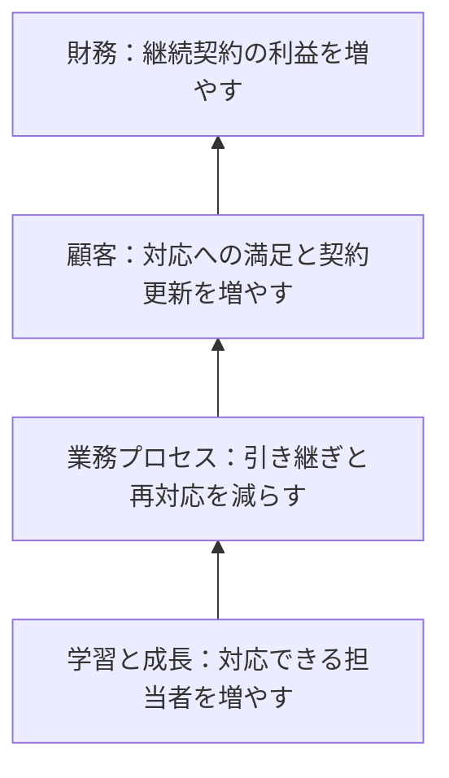

BSCの「財務・顧客・業務プロセス・学習と成長」は覚えたのに、回答時間や研修費用をどこに入れるか迷う。そんなときは、指標の名前より、何の成果を測っているかを見ます。

この記事では一つの保守サービスを例に、4つの視点を分類する条件と、指標同士のつながりを説明します。用語を覚えるだけでなく、似た指標の違いを理由つきで判断できるようにします。

## BSCとは、戦略を4つの視点から測る枠組み

売上が増えていても、対応できる人が少なく、顧客からの苦情が増えていたら、将来も同じ成果を維持できるかは分かりません。

<strong>BSC（バランススコアカード）</strong>は、財務だけでなく、顧客、内部の業務プロセス、学習と成長から業績を捉える枠組みです。提唱者Robert S. Kaplan本人によるHBSの解説でも、この4つを組み合わせて説明しています。[Kaplan：Partnering and the Balanced Scorecard](https://www.library.hbs.edu/working-knowledge/partnering-and-the-balanced-scorecard)

4視点は「指標を同じ数だけ並べる」という意味ではありません。会社が何を実現したいかを決め、それを支える目標と指標を選びます。次の表では、その見分け方を整理します。

## BSCの4つの視点は、何を測るかで見分ける

以下は架空の「問い合わせ対応を強みにする保守サービス」の例です。実在企業や筆者の実績ではありません。

| 視点 | 分類する条件 | このサービスでの目標 | 測る指標の例 |
|---|---|---|---|
| 財務 | 収益性や資金など、金銭的な成果を測る | 継続契約から得られる利益を増やす | 保守事業の営業利益率 |
| 顧客 | 顧客がどう評価し、選んだかを測る | 安心して更新してもらう | 更新率、対応に対する満足度 |
| 業務プロセス | 価値を届ける内部の仕事の出来を測る | 適切な担当者へ早く引き継ぐ | 引き継ぎ時間、再対応率 |
| 学習と成長 | 人材・情報・組織の能力の土台を測る | 対応できる人を増やす | 対象業務の技能を確認できた担当者の割合 |

名称だけでは決まらない指標もあります。たとえば「回答時間」は、内部の処理時間を測るなら業務プロセスの指標として読めます。一方、「顧客が待ち時間をどう評価したか」なら、顧客の視点から測るものです。

問題文で「顧客満足」「内部処理」「人材育成」のどこに目的を置いているかを確認してから分類してください。次は、その指標をなぜ一緒に使うかを見ます。

## 戦略マップは、成果に至る仮説をつなぐ

戦略マップは目標同士の関係を表します。次の矢印は、必ず成果が出る法則ではなく、経営側が検証する仮説です。

たとえば研修を増やしても再対応率が下がらなければ、研修が現場の誤りと合っていないかもしれません。再対応率が下がっても更新率が上がらなければ、価格や契約条件など別の理由を調べる必要があります。

<strong>途中の指標が良くなったのに、次の成果につながらない所を探せる</strong>ことが、財務指標だけを見る場合との違いです。BSCを戦略の実行につなぐ考え方は、[HBS Onlineの解説](https://online.hbs.edu/blog/post/balanced-scorecard)でも示されています。

## KGI・KPI・目標値を混同しない

KGIは最終的な目標の達成度、KPIはそこへ向かう業績や進捗を見る指標として整理すると読み分けやすくなります。指標の名前と、目標とする数値も分けて読みます。

| 書かれている内容 | 読み分け | 理由 |
|---|---|---|
| 営業利益率 | 指標 | 何を測るかを表す |
| 営業利益率を来期に8%へ | 指標に目標値と期限を設定したもの | どの状態をいつまでに目指すかがある |
| 引き継ぎ時間の短縮 | 中間の改善目標の候補 | それが顧客や利益にどうつながるかの確認が必要 |
| 研修を開催する | 施策 | 実行した回数だけでは技能の獲得まで分からない |

8%は説明用の仮定値です。また、財務の指標をすべてKGI、学習の指標をすべてKPIと固定しないでください。部署や対象の目標によって、どこを最終成果とするかが変わります。

## 指標を選ぶときの判断基準

試験やケースの読み取りでは、次の順で点検します。

- 目的が財務成果なら → 利益や収益性を測る指標かを確認する
- 目的が顧客から選ばれることなら → 顧客の評価・行動を測っているかを確認する
- 目的が仕事の改善なら → 処理時間や品質を測っているかを確認する
- 目的が能力の基盤づくりなら → 人が何をできるようになったかまで見られるかを確認する
- 施策の回数だけがあるなら → その先の成果を測る指標がないかを確認する

4視点のどれかに機械的に振り分ける前に、問題文の戦略と目的を読むのが先です。関連する学習の全体像は[ITパスポートの学習ガイド](/method/itp-hub/)、基礎から学ぶ場合は[ITパスポート20時間コース](/course/ip/)へ進めます。

筆者は応用情報技術者試験は未受験です。本記事は受験体験やBSCの導入実績ではなく、公開資料と学習用の架空例で整理しています。

---

## まとめ

BSCの4つの視点は、何を測る指標かで分類します。そのうえで、能力づくりから仕事の改善、顧客の評価、財務成果へつながる仮説を読みます。

次にBSCの問題を解くときは、選んだ視点の理由を一言で説明してください。「研修だから学習」だけで終えず、技能を測るのか、実行回数だけなのかまで区別できれば、指標の意味も読み取れます。
