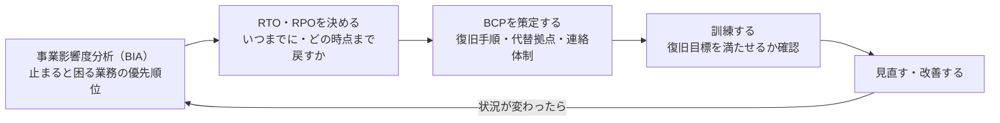

BCP担当になって計画書のひな形を探しても、「何をどこまで決めればよいか」が分からず手が止まることがあります。

BCPとBCMの違いを理解すると、計画書を作る仕事と、それを使える状態に保つ仕事を分けられます。この記事では、重要業務の選定から訓練・改善までの流れを示し、自社の状態に応じて最初に着手することを整理します。

## BCPとBCMの違いを一言で

BCP（Business Continuity Plan）は、中断時にも重要業務を継続し、または早期に再開するための方針・体制・手順等を定める計画です。BCM（Business Continuity Management）は、その策定や対策、教育・訓練、点検・改善を含む管理活動です。[内閣府：事業継続ガイドライン（2023年3月）](https://www.bousai.go.jp/kyoiku/kigyou/pdf/guideline202303.pdf)

「必ず事業を止めない」という保証ではなく、どの業務をどの水準で続けるかを決めるための区別です。

| 観点 | BCP（事業継続計画） | BCM（事業継続管理） |
|---|---|---|
| 正体 | 具体的な「計画書」 | 計画を回し続ける「マネジメント活動」 |
| タイミング | 策定時に作る<strong>成果物</strong> | 策定前の方針決定から継続する<strong>プロセス</strong> |
| 中身 | 復旧手順、代替拠点、連絡体制など | BCPの策定・訓練・見直し・改善（PDCA） |
| 例えるなら | 重要業務の継続・再開の「手順書」 | 計画を整え、使えるかを確かめ続ける活動全体 |

つまり<strong>BCPはBCMというマネジメントサイクルの中で作られる一部品</strong>という関係です。BCPだけ作って放置すると状況の変化に対応できなくなるため、BCMとして継続的に維持・改善する必要があります。

## BCP担当者が最初にやるべき3ステップ

「BCP担当」を任されて最初に迷うのは、用語の意味より「何から手をつけるか」です。ここでは、経営者が方針と責任者を決めたうえで、次の順に具体化する案を示します。担当者だけで全社の優先順位や予算を決めず、関係部門と合意してください。

1. <strong>事業影響度分析（BIA）を行う</strong>：まず、どの業務が止まると会社に最も深刻な影響が出るかを洗い出します。売上損失・顧客への影響・法的責任・ブランドイメージの毀損などを軸に、<strong>復旧すべき業務の優先順位</strong>を決めるのが最初の一歩です。全部を同時に守ろうとすると計画が破綻するため、この優先順位付けを飛ばしてはいけません。
2. <strong>優先業務ごとにRTO・RPOを決める</strong>：BIAで洗い出した重要業務について、「いつまでに復旧させるか（<strong>RTO：目標復旧時間</strong>）」「どの時点のデータまで戻せればよいか（<strong>RPO：目標復旧時点</strong>）」を具体的な数値で決めます。この数値が、バックアップの頻度や冗長化のレベルなど、以降の技術的な対策の設計図になります。
3. <strong>BCPを策定し、BCMとして回し始める</strong>：復旧手順・代替拠点・連絡体制を計画書（BCP）にまとめたら、自社で定めた周期と変更時に訓練し、見直す（BCM）サイクルに乗せます。策定して終わりにせず、この運用フェーズこそが本番です。

この3ステップの土台がないまま「バックアップを増やす」「代替拠点を契約する」といった対策から入ると、優先順位を誤ったまま予算を使ってしまうリスクがあります。

3ステップと、その後に回し続けるBCMの関係を図にすると、次のようになります。BCPは図の中の1つの箱で、BCMは矢印でつながった輪全体です。



内閣府の「事業継続ガイドライン」も、BCPを計画書だけでなく経営の取り組みとしてとらえ、マネジメントの面を強調するときにBCM（Business Continuity Management）と呼ぶ場合がある、と説明しています。

出典: [事業継続ガイドライン（2023年3月）｜内閣府 防災情報のページ](https://www.bousai.go.jp/kyoiku/kigyou/pdf/guideline202303.pdf)

### RTOとRPOを混同しないための仮定例

仮に、受注システムは停止から4時間以内に必要最低限の受注を再開し、データは停止の1時間前までの状態に戻せることを目標にするとします。

この場合、RTOは4時間、RPOは1時間前です。どちらも説明用の仮定値で、全社に勧める基準ではありません。RPOはシステム停止後に何時間で復旧するかを表すものではありません。

バックアップがあっても、復元に8時間かかるなら、このRTOは満たしません。バックアップの取得だけでなく、復元と業務再開までを訓練して測る必要があります。[内閣府ガイドライン：目標復旧時間・目標復旧時点](https://www.bousai.go.jp/kyoiku/kigyou/pdf/guideline202303.pdf)

ここまでで目標が決まったら、不足している対策を選べます。

## 企業が取るべきBCP対策の具体例

対策の種類は、止まる原因だけでなく、重要業務が依存する人・拠点・データ・取引先から選びます。次はガイドラインの考え方をもとにした確認表です。[内閣府：事業継続ガイドライン](https://www.bousai.go.jp/kyoiku/kigyou/pdf/guideline202303.pdf)

| 今の状態 | 先にすること | 確認する成果 |
|---|---|---|
| 計画がない | 優先業務と停止による影響を確認する | 誰が何を優先すると合意したか |
| 計画はあるが訓練していない | 連絡・代替手段・復元を試す | 目標時間・復旧水準を満たせるか |
| 組織・システム・委託先が変わった | 依存先と連絡先を見直す | 古い前提が計画に残っていないか |
| 訓練で目標に届かなかった | 原因・改善担当・期限を決める | 次回の確認で解消したか |

そのうえで、次の対策を組み合わせます。

*   <strong>データのバックアップ・分散管理</strong>: 重要データをクラウドや遠隔地のデータセンターに複製し、単一拠点の被災でもデータを失わないようにする
*   <strong>代替拠点の確保</strong>: 本社やオフィスが使用できない場合に業務を継続できる拠点（他拠点、レンタルオフィス、リモートワーク環境）をあらかじめ用意する
*   <strong>通信手段の複線化</strong>: 固定回線が使えない事態に備え、衛星電話や複数キャリアの回線など連絡手段を多重化する
*   <strong>サプライチェーンの複線化</strong>: 特定の仕入先・協力会社に依存せず、代替調達ルートを確保する
*   <strong>定期的な訓練と見直し</strong>: 策定したBCPを年1回以上のペースで訓練し、実際に機能するかを検証・改善する（この訓練・改善のサイクルこそがBCM）

## BCPコンサルティングとは？依頼を検討すべきケース

自社にBIA（事業影響度分析）やBCP策定のノウハウがない場合、外部の<strong>BCPコンサルティング</strong>会社に策定支援を依頼するケースがあります。相談する場合は、ひな形の納品だけか、業務分析・訓練・改善の支援まで含むかを見積もりで確認します。

自社対応かコンサル活用かの判断基準は、<strong>BIAを実施できる人材が社内にいるか</strong>と<strong>初回策定にかけられる工数</strong>です。業務間の依存が分からない、部門調整を進められない場合は分析や合意形成の支援を検討します。社内に責任者・関係部門・訓練を実施する時間がそろう場合は、既存計画の点検から自社で進める案もあります。外部へ依頼しても、重要業務や許容できる中断の判断は社内に残ります。

なお本記事はIT試験対策の観点からBCP/BCMを整理するものです。自社導入を検討している場合は、上記を判断軸として専門家への相談を検討してください。

## 試験での出題ポイント

試験学習では、BCP／BCMをITシステムの復旧だけに狭めないことが要点です。ITシステムの復旧技術だけでなく、緊急時の要員確保・代替拠点の選定・協力会社との連携・顧客への情報提供など「事業全体」の視点から問われる点に注意してください。

理解を点検する観点は次の3つです。

1. <strong>BIAの目的</strong>：「なぜ最初にBIAを行うのか」が問われます。答えは、限られたリソースを最も重要な業務から優先的に復旧させるための根拠を作るためです。
2. <strong>RTO・RPOの定義と使い分け</strong>：「いつまでに復旧させるか」がRTO、「どの時点のデータまで戻せればよいか」がRPOです。具体的なシナリオを与えられて、どちらの指標の話かを判断させる場面を読み分けます。
3. <strong>BCPとBCMのプロセスの違い</strong>：BCPは「策定した計画書（成果物）」、BCMは「策定・訓練・見直しを回し続けるマネジメントサイクル（プロセス）」という違いを問う問題です。

## 【AIハック】生成AIで覚える
BCPを自分ごとに置き換えてAIに問いかけると、重要性がよく理解できます。単に用語を覚えるだけでなく、具体的な状況を想定することで、知識がより深く定着します。

### プロンプト例

```text
架空のEC事業でBCPとBCMの違いを理解したいです。
倉庫と受注システムのどちらも停止しうると仮定します。
私が重要業務と依存する資源を挙げるので、抜けている前提を質問してください。
その後、計画に書く内容と、平常時の訓練・改善で行うことを分けて説明してください。
RTOやRPOの数値は勝手に決めず、業務側に確認すべき条件を示してください。
```

<!-- AI_EXAMPLE: 使うAI=生成AI（筆者の利用環境で指定） / プロンプト=本文「架空のEC事業」 / 見せたいこと=BCPの計画とBCMの活動を分け、復旧目標を決める前提を質問できるか -->

AIが挙げた案は学習の材料です。実際の業務計画は、社内の責任者と関係部門で前提を確認し、実行できるかを訓練で確かめます。

---

## まとめ：事業を止めない準備

BCPは重要業務を継続・再開するための計画、BCMはその策定から訓練・改善までの管理です。BCPはBCMの一部であり、作成して終わりにはできません。

計画がなければ重要業務の選定から、計画があるなら復旧目標を満たせるかの確認から始めます。担当者が今日確認するのは、計画の有無、責任者、直近の訓練記録の3点です。

基礎の学習は[ITパスポートの学習ガイド](/method/itp-hub/)、体系的に進めるなら[ITパスポート20時間コース](/course/ip/)へ進めます。筆者は応用情報技術者試験は未受験です。本記事はBCP導入実績や受験体験を根拠にしていません。
