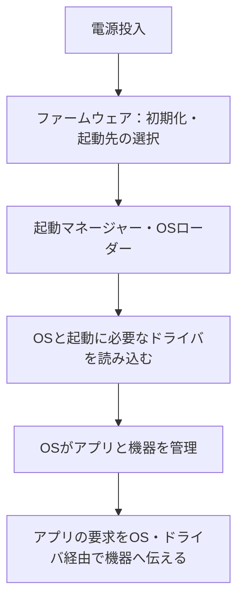

BIOSもデバイスドライバも「ハードウェアを制御するソフト」と説明されると、どちらの役割か見分けにくくなります。

区別の手がかりは、OSを起動する準備なのか、OSから機器を利用するための仲介なのかです。この記事ではUEFIとOSローダーも含めて流れを図にし、用語の意味と、機器が動かないときの確認対象を整理します。

## BIOS・UEFIとデバイスドライバの違い

PCには、電源投入後に動くファームウェアと、OSが機器を使うためのソフトウェアがあります。ファームウェアは、機器に組み込まれた基本的な制御用ソフトウェアを指します。

| 用語 | 主な役割 | 混同しないこと |
|---|---|---|
| BIOS | PCの初期化やOS起動につなぐ処理を担う従来の仕組み | OSそのものではない |
| UEFI | ファームウェアとOSなどの間のインタフェースを定める規格 | 特定のメーカーの設定画面の名称ではない |
| OSローダー | OSの起動に必要な内容を読み込み、制御を渡す | BIOS・UEFIがOS全体を単独で起動するわけではない |
| デバイスドライバ | OSと機器の通信などを仲介するソフトウェア | 利用者が毎回手動で導入するとは限らない |

UEFIは規格の名前で、その規格に対応するファームウェアがPCに実装されます。従来のBIOSとUEFIを区別する考え方は、[UEFI ForumのFAQ](https://uefi.org/faq)で確認できます。

ここではOS用のデバイスドライバを中心に説明します。UEFI側にもドライバがあるため、あらゆるドライバを「OSの起動後だけに動くもの」と定義しないでください。

## BIOS・UEFIからOSへ、起動の流れを図で見る

電源を入れると、ファームウェアがハードウェアを初期化し、設定された起動先からOSの起動処理につなぎます。OS側の起動処理では、必要なドライバも読み込まれます。

これは学習用の概略です。<strong>ドライバはOSが完全に起動してから初めて必要になる、とは限りません</strong>。起動ディスクを利用するためなど、Windowsの起動に必要なブートスタートドライバもあります。[Microsoft：起動用ドライバ](https://learn.microsoft.com/en-us/windows-hardware/drivers/install/installing-a-boot-start-driver)

「OSより前」と「OSより後」の二択だけで暗記せず、ファームウェア・OSローダー・OS用ドライバの担当を分けて考えると、例外にも対応できます。

## デバイスドライバは、OSと機器の間を仲介する

たとえばアプリから印刷を指示すると、その要求はOSの仕組みやドライバを通じてプリンターに伝わります。ドライバが機器ごとの違いを扱うことで、アプリがすべての機器の制御方法を直接持つ必要を減らせます。[Microsoft：ドライバとは](https://learn.microsoft.com/en-us/windows-hardware/drivers/gettingstarted/what-is-a-driver-)

新しい機器がすぐ使えても、「ドライバが不要」という意味ではありません。OSに適合するドライバが含まれていたり、自動的に選択・導入されたりする場合があります。

プラグアンドプレイは、機器の検出や構成を支える仕組みです。「どんな機器でも、接続すれば必ず使える」という保証とは分けて理解します。[Microsoft：プラグアンドプレイ](https://learn.microsoft.com/en-us/windows-hardware/drivers/kernel/introduction-to-plug-and-play)

では、設定画面でよく見る「UEFIなら高機能」という説明は、どこまで一般化できるのでしょうか。

## UEFIなら必ずGUI・高速起動になるわけではない

UEFIは、画面の見た目そのものを決める名称ではありません。マウス操作やGUIの有無、起動にかかる時間は、そのPCの実装や設定にもよります。

UEFIの機能として押さえたいのは、起動するソフトウェアの署名などを検証するSecure Bootです。これは起動時の信頼を支える仕組みで、すべてのマルウェア感染を防ぐという意味ではありません。[Microsoft：Secure Boot](https://learn.microsoft.com/en-us/windows-hardware/drivers/bringup/secure-boot)

機能と見た目を分けると、「きれいな設定画面ならUEFI」「UEFIなら必ず速い」といった誤った判断を避けられます。

## 周辺機器が動かないときは、症状から確認対象を絞る

次は学習用の切り分けです。症状だけで故障箇所を断定するものではありません。型番と表示されたエラーを記録してから、そのPCや機器の公式サポートを確認します。

| 症状・条件 | 最初に確認する対象 | その理由 |
|---|---|---|
| 電源を入れても画面に何も出ない | 電源・画面接続・メーカーの診断案内 | OS用ドライバの問題と決める段階ではない |
| ファームウェアの設定画面は出るがOSへ進まない | 起動先・ストレージの認識・エラー表示 | 起動経路のどこで止まるかを絞る |
| OSは起動するが特定の機器だけ使えない | 接続・給電・OSの認識・対応ドライバ | ほかの機器まで含めた故障とは限らない |
| OSから機器は見えるが特定のアプリだけ使えない | アプリの設定や権限、対応条件 | 機器全体よりアプリ側の条件も候補になる |

ドライバを入れる場合は、機器とOSの型番・版を照合します。起動できているPCで、原因を確認せずBIOS設定や起動方式を変更することを、最初の対処にはしません。

筆者は基本情報技術者試験は未受験です。本記事は受験体験としてではなく、規格団体と開発元の資料をもとに用語を整理しています。

---

## まとめ

BIOS・UEFIはOS起動につなぐ土台、OSローダーはOSを読み込む担当、デバイスドライバはOSと機器などの仲介役です。起動時に必要なドライバもあるため、時刻だけでなく役割で区別します。

次は「電源投入時の初期化」「OSの読み込み」「プリンターへの要求の仲介」のそれぞれを、どの担当か説明してみてください。全体の学習は[ITパスポートの学習ガイド](/method/itp-hub/)、基礎から進めるなら[ITパスポート20時間コース](/course/ip/)につなげられます。
