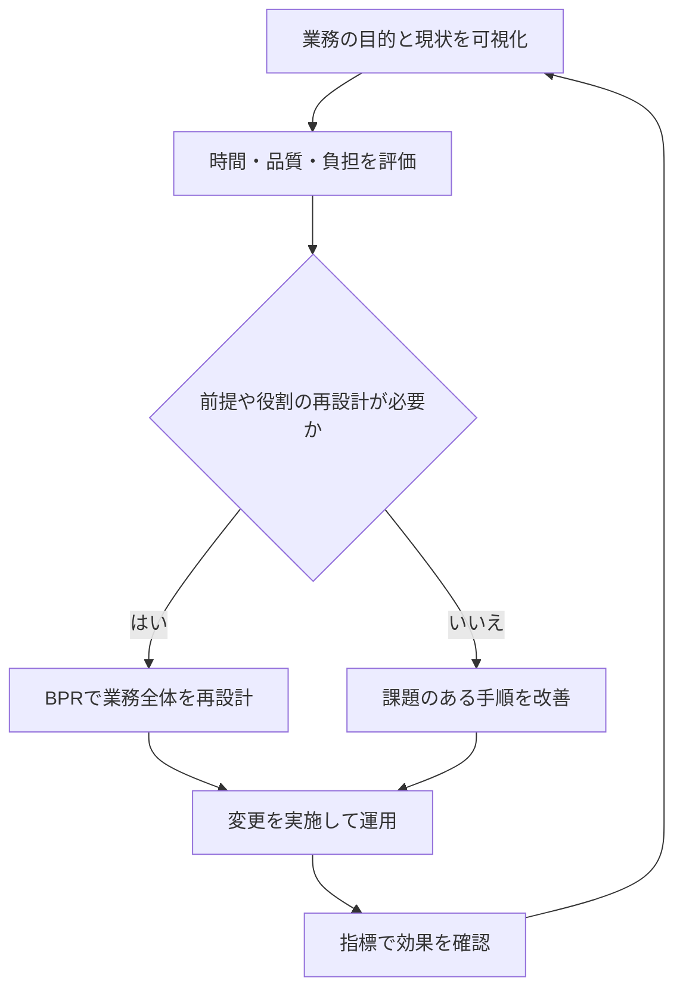

BPRもBPMも業務をよくする話なのに、設問ではどちらを選べばよいのか。「大改革と小改善」「一回と毎日」だけで覚えると、改革後の管理や継続的な再設計の説明で迷います。

違いを見る軸は、何を作り直すのか、何を管理し続けるのかです。同じ経費精算を例に、用語の意味と、問題文のどこから判断するかを整理します。

## BPRは、業務の前提から再設計する

経費精算が遅いとき、「入力を速くする」以外に、「なぜ全件で五段階の承認が必要なのか」と問う方法があります。部門間の役割・承認権限・情報の流れまで見直すのが、BPRの発想です。

BPRはBusiness Process Reengineeringの略で、業務プロセスを根本から見直して再設計し、大きな改善を目指す考え方です。[IBM「Business process reengineering」](https://www.ibm.com/think/topics/business-process-reengineering)

たとえば、金額とリスクに応じた承認へ切り替え、同じ情報の再入力をなくす案を考えます。これは説明のための仮想例で、実際に承認を減らしてよいかは社内規程や統制の要件を別に確認します。

BPRかどうかを決めるのはツールの新しさではありません。電子化しても、不要な確認や重複作業がそのままなら、前提からの再設計とは限らないのです。

では、その業務を作ったあと、誰が成果を見て直し続けるのでしょうか。

## BPMは、業務プロセスを継続して管理する

経費精算の流れを図にし、申請から振込までの時間や差し戻しの割合を計測し、課題を見つけて直す。このようにプロセス全体を管理するのがBPMです。

BPMはBusiness Process Managementの略です。業務プロセスの可視化とPDCAによる、継続的な改革・改善のための管理手法として説明されています。[一般社団法人BPMコンソーシアム「BPMとは」](https://bpm-consortium.or.jp/bpm/)

<strong>BPRとBPMは、互いに排他的な二択ではありません</strong>。BPMで大きな問題を発見し、BPRで再設計したあと、その成果をBPMで追い続ける関係もあります。

「BPRは一回だけ、BPMは小さな変更だけ」と固定せず、設問が焦点を当てている行動を見ます。次の表で、同じ業務でも答えが変わる条件を確認します。

## 同じ経費精算でも、何を変えるかで見分ける

| 問題文の条件・行動 | 中心になる考え方 | 判断した理由 |
| --- | --- | --- |
| 承認の必要性や部門の役割から問い直し、流れ全体を再構築する | BPR | 既存の前提から業務を再設計している |
| 処理日数を定期測定し、滞留箇所を見直し続ける | BPM | 可視化・評価・改善の継続管理をしている |
| 経費精算の処理を外部の事業者へ委ねる | BPO | 業務を誰が担うかを変えている |
| 決まった画面操作や転記をソフトウェアで自動化する | RPA | 作業の実行手段を変えている |

BPO（Business Process Outsourcing）は業務の外部委託、RPA（Robotic Process Automation）は定型的な操作などの自動化です。BPRやBPMの活動の中で採用される手段になり得ます。

たとえば「ソフトを入れたからBPR」「RPAを使ったからBPM」とは決まりません。設問で、権限や流れの抜本的な再設計を問うのか、継続的な管理を問うのかを優先して読みます。

## 改革したあとも、評価と改善は続く

次の図は、BPMの継続管理の中で、必要に応じてBPRを行う関係を整理した学習用の図です。すべての組織がこの順番で進めるという規則ではありません。



経費精算なら、日数を短くしても誤支払いや差し戻しが増えていれば、目標を達成したとはいえません。「速さ・品質・負担」のうち、何を改善したいかと、悪化させてはいけない条件を先に決めます。

目標達成のために仕組みを作り直す行動と、成果を測り続ける管理を分けると、BPRとBPMを対立させずに説明できます。

## AIには分類の答えより、判断した条件を聞く

次の仮想例で、自分が考えた理由を先に書き、AIに論理の抜けを確認してもらいます。実際の社内情報や個人の申請内容を入れる必要はありません。

```text
BPRとBPMの違いを理解したいです。
仮想例：経費精算に五段階の承認があり、完了まで一週間かかります。

案A：承認の必要性と権限を見直し、金額・リスク別の流れに再設計する。
案B：現行の流れを可視化し、処理日数と差し戻し率を毎月測り改善する。
私の説明：（案A・案Bをどう分類したか、その理由を記入）

私の説明に抜けや混同があれば指摘してください。
分類の根拠を「変える対象」と「管理を続ける活動」に分け、
BPRのあとにBPMが必要になる理由を質問形式で一つ確認してください。
実在の企業で成功した事例や効果の数値は作らないでください。
```

<!-- AI_EXAMPLE: 使うAI=Gemini / プロンプト=本文の経費精算の仮想例 / 見せたいこと=BPRとBPMが排他的な分類ではないことを、変更対象と継続管理で説明した回答 -->

## まとめ

BPRは業務の前提からの再設計、BPMは業務プロセスを可視化し、評価と改善を続ける管理です。実施回数やツール名だけで判断せず、問題文の「何を変えるか」「何を続けるか」に印を付けてみてください。

周辺用語とのつながりは[ITパスポートのコース](/course/ip/)、学習全体の進め方は[ITパスポートの学習ハブ](/method/itp-hub/)で確認できます。
