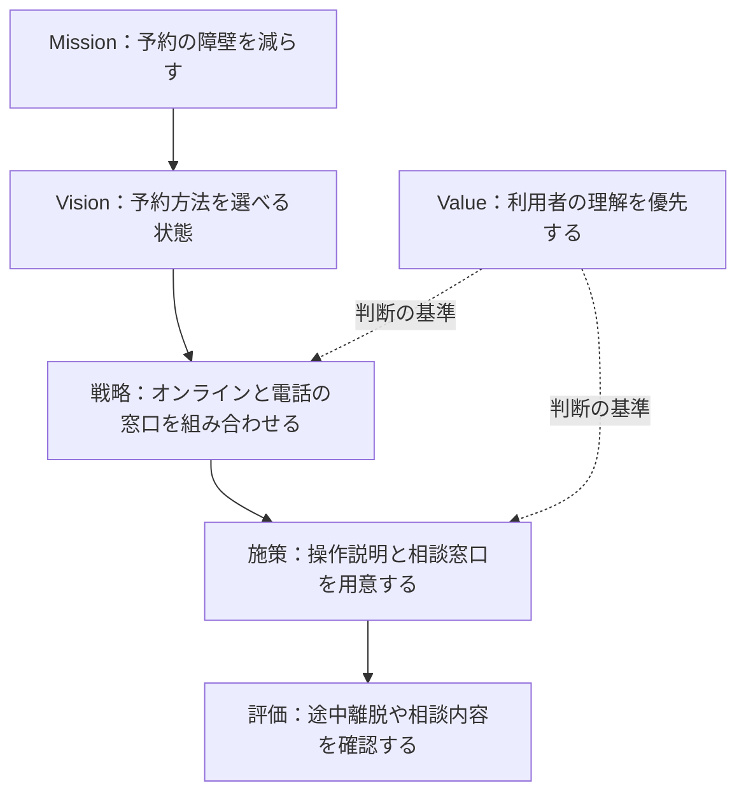

<!-- TARGET_KW: 経営理念 MVV 違い -->
<!-- READER: S3-知的好奇心-学習中 / 検索｜経営理念とMVVの説明を読むと同じに見える社会人 -->
<!-- ANSWER: 存在理由・目指す状態・判断基準のどれを述べているかで分類し、企業独自の呼び方は公式定義を優先する。 -->
<!-- TAKEAWAY: MVVと戦略・目標の違い、文章の分類手順 -->

「会社の存在意義」と「目指す姿」は、どちらも理念のように見えます。経営理念とMVVを整理するには、その文章が答えている問いに注目すると区別しやすくなります。

この記事では、同じ架空サービスの例を使い、使命・将来像・行動指針を見分けて、戦略や数値目標との違いまで説明できるようにします。

## 経営理念とMVVの違いは、文章が答える問いで整理する

経営理念は、企業が活動する際の根本の考え方です。MVVは、その考え方をMission・Vision・Valueという三つの観点で言葉にする整理の枠組みとして使われます。

| 観点 | 答える問い | 架空の予約サービスの例 |
| --- | --- | --- |
| Mission（ミッション） | 何のために存在するか | 予約の手間で、必要なサービスを諦める人を減らす |
| Vision（ビジョン） | どんな将来の状態を目指すか | 誰もが、自分に合う予約方法を選べる社会 |
| Value（バリュー） | 判断や行動で何を大切にするか | 利用者の理解を優先し、使いにくさを放置しない |

この例は用語の違いを示すための架空設定です。Missionを「今日やる作業」、Visionを「販売する製品名」と覚えると、使命と手段を取り違えます。

企業の呼び方は一律ではありません。例えばソニーグループは公式にPurpose（存在意義）とValues（価値観）を掲げています。すべての企業を無理にMVVという見出しに当てはめず、公式の説明を先に読みます。[出典：ソニーグループ「ソニーグループについて」](https://www.sony.com/ja/SonyInfo/CorporateInfo/)

## 理念から行動へ落とす流れ

次の図は、学習用の架空サービスで理念を意思決定につなげる流れです。MVVを必ずこの順で策定するという規則ではありません。



「電話窓口をやめればコストが下がる」という案があっても、予約できなくなる人が増えるなら、MissionやValueとの整合を検討します。理念は飾る言葉にとどめず、施策を選ぶときの基準にできます。

## 戦略・目標と迷ったときの判断基準

用語の雰囲気ではなく、文の役割を確かめます。

- 存在理由や果たす役割を述べている → Missionの説明として読む。
- 実現したい未来の状態を述べている → Visionの説明として読む。
- 迷ったときに選ぶ行動や重視する姿勢を述べている → Valueの説明として読む。
- 顧客層や提供方法を選んでいる → 使命を実現する戦略として読む。
- 期限や達成水準を測れる形で示している → 目標・指標として読む。

例えば「来年度までに予約完了率を上げる」は目標です。「誰もが予約方法を選べる」は将来像で、数字がないから不十分な目標というわけではありません。

一つの文章が使命と将来像を兼ねる場合もあります。学習問題では説明文の焦点を見つけ、実在企業を読むときは企業自身の定義を優先しましょう。

## 生成AIとの対話で、分類の理由を確かめる

分類だけをAIに任せると、もっともらしい説明で曖昧さが隠れることがあります。先に自分の理由を書き、どこが混ざっているかを対話で確かめます。

```text
経営理念とMVVを勉強しています。
架空の会社について、私は次のように分類しました。
Mission：予約の手間で必要なサービスを諦める人を減らす
Vision：誰もが予約方法を選べる社会
Value：利用者の理解を優先する
戦略：オンラインと電話の窓口を組み合わせる
この分類の理由を私に一つずつ説明させてください。
使命と手段を混同した場合は、答えを示す前に問い返してください。
実在企業の理念や、実際の導入成果は作らないでください。
```

<!-- AI_EXAMPLE: 使うAI=ChatGPT / プロンプト=本文「分類の理由を確かめる」 / 見せたいこと=使命と戦略を混同した説明への問い返し。実行結果は筆者が用意 -->

---

## まとめ：何を決める言葉かで見分ける

経営理念とMVVは、存在理由・将来像・行動の基準という問いで整理できます。戦略はそれを実現する選択、目標は進み具合を測る基準です。

ITパスポートの企業活動を続けて学ぶ場合は、[20時間コース](/course/ip/)で前後のテーマを確認できます。試験全体の位置づけは[ITパスポートの合格ロードマップ](/method/itp-hub/)にまとめています。

本記事は受験体験ではなく、概念の整理と公式情報をもとに構成しています。
