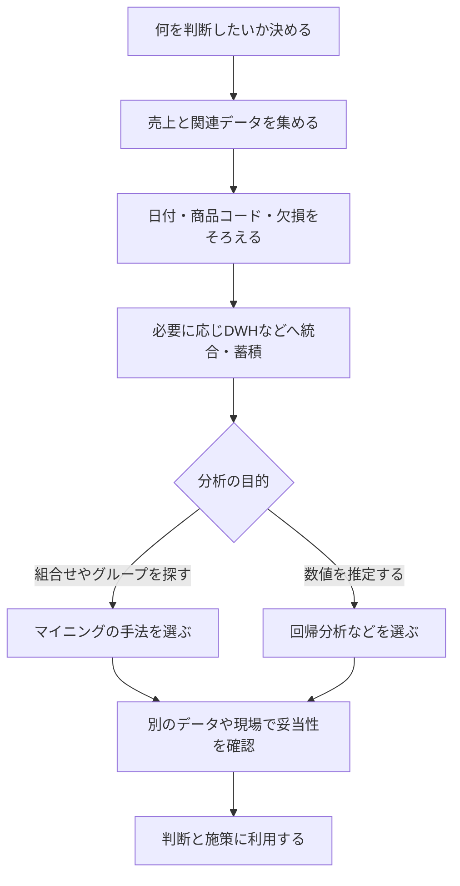

売上の分析で「DWHにためて、マイニングして、回帰分析する」と聞くと、3つを必ずこの順番で使うように見えます。

区別の軸は作業順ではなく、「データをそろえるのか」「パターンを探すのか」「数値を推定するのか」です。架空の店舗データを例に、目的から用語を選べるように整理します。

## まず、データをそろえる仕事と分析する仕事を分ける

別々の店舗から売上を集めたところ、店名や商品コード、日付の書式が違っていたとします。そのまま合計すると、同じ商品を別物として集計するおそれがあります。

<strong>DWH（データウェアハウス）</strong>は、複数の情報源のデータを分析に使える形へ統合し、蓄積する仕組みです。日々の注文を登録する取引処理と、大量の過去データを横断して分析する処理では目的が異なります。[AWSのDWH解説](https://aws.amazon.com/what-is/data-warehouse/)

DWHは「ためれば自動的に答えが出る箱」ではありません。コードの対応づけや欠損の確認など、比較できる状態に整える作業が必要です。

全社の情報を扱うDWHに対し、営業部の売上分析など、特定の用途向けに整えたデータのまとまりをデータマートと呼びます。まず「何を比較するための蓄積か」を押さえ、その先の分析と分けます。

## データマイニングと回帰分析は排他的な分類ではない

<strong>データマイニング</strong>は、データから役立つパターンや関係を探す取り組みです。一緒に買われやすい商品の組合せを見つけたり、似た購買行動の顧客をまとめたりします。[AWSのデータマイニング解説](https://aws.amazon.com/what-is/data-mining/)

たとえば、パンを買った人のうち何割が牛乳も買ったかを調べるなら、商品の組合せの分析です。ただし「一緒に買われる」ことは、「パンの陳列を変えれば牛乳の売上が増える」という証明にはなりません。

一方、回帰分析は、説明に使う変数と推定したい数値の関係を式で表す手法です。売上金額や注文数など、数値の推定に用います。

回帰分析はマイニングの中で使われることもあります。「マイニングを終えてから、必ず回帰分析へ進む」という別々の工程ではありません。小さなデータを直接分析する場合には、DWHを用意しないこともあります。

## 売上の分析を目的ごとに分岐させる

以下は、各用語の役割を理解するための流れ図です。実際の分析ではデータの不備が見つかれば、整える段階へ戻ります。



図の分岐は整理のためのものです。マイニングにも数値予測は含まれ、手法の名前と分析全体の目的は重なることがあります。

## 回帰式の予測値を、原因と取り違えない

学習用の架空の式として、「売上予測値（万円）＝20＋広告費（万円）×3」が得られたとします。広告費が10万円なら、式に代入した予測値は50万円です。

広告費だけを説明に使えば単回帰、広告費に気温なども加えれば重回帰になります。「説明変数」は説明・推定に使う変数であり、名称だけで因果関係が確定するわけではありません。

この式から「広告を1万円増やせば必ず売上が3万円増える」とは言えません。繁忙期には広告費と売上の両方が増えるなど、別の条件が関わる可能性があります。

実測値と予測値の差を残差といいます。式を作ったデータでよく合っていても、別期間の売上でも同様に当てはまるとは限りません。決定係数は当てはまりの指標で、将来の精度や因果の証明ではありません。[総務省統計局・相関と回帰](https://www.stat.go.jp/dstart/point/seminar/02/3-3-2.html)

<!-- LEARNER_NOTE: 候補=回帰式に代入できることと原因を説明できることの違い / 種類=think / 筆者の実体験で記入 -->

では、設問でどの用語を選べばよいか、条件を短く整理します。

## 条件から選ぶ判断表

| 困っていること・設問の条件 | 選ぶ考え方 | その答えだけでは分からないこと |
|---|---|---|
| 部署や店舗の過去データを横断して集計したい | DWHなどへの統合・蓄積 | どんな施策が有効か |
| 同時購入や似た顧客の集まりを探したい | データマイニング | 見つけた関係の因果 |
| 気温などから売上の数値を推定したい | 回帰分析 | 学習にない条件でも当たるか |
| 広告が売上を増やした効果を知りたい | 比較条件や交絡を考えた効果検証 | 相関や回帰式だけでは結論を出せない |

自由記述の口コミを扱うなら、文章を対象にパターンを調べるテキストマイニングという呼び方もあります。頻出語の図だけで満足度や原因を断定せず、否定表現や文脈を読む必要があります。

## AIには、分析の目的の混同を指摘してもらう

自分の説明を添削してもらう用途なら、次のように使えます。架空の説明を材料にして、実データや機密情報は入力しません。

```text
ITパスポートの学習として、次の説明の論理の穴を指摘してください。
「DWHに売上を集め、マイニングで広告費との関連を見つけた。
回帰式の当てはまりがよいので、広告費が売上の原因だと証明できた」
データの統合、パターンの探索、数値の推定、因果の検証を区別し、
どの段階に追加の情報が必要かを説明してください。
最後に、私が自分の言葉で説明し直すための問いを一つ出してください。
```

<!-- AI_EXAMPLE: 使うAI=Gemini / プロンプト=本文の分析目的の混同を指摘するプロンプト / 見せたいこと=DWHと手法の役割を分け、回帰と因果の飛躍を指摘する回答 -->

回答が「予測が当たれば因果がある」と説明していないかを確認します。数値の散らばりが分からなければ、[平均・分散・標本抽出の基礎](/theory/statistics-mean-variance-probability-sampling/)も参照できます。

## まとめ

DWHは分析用のデータをそろえて蓄積する仕組み、データマイニングはパターンを探す取り組み、回帰分析は数値の関係を式で扱う手法です。3つを必須の直列工程として覚える必要はありません。

次は[ITパスポート学習コース](/course/ip/)で具体的な設問に当てはめてください。試験全体の位置づけは[ITパスポート合格ロードマップ](/method/itp-hub/)で確認できます。
