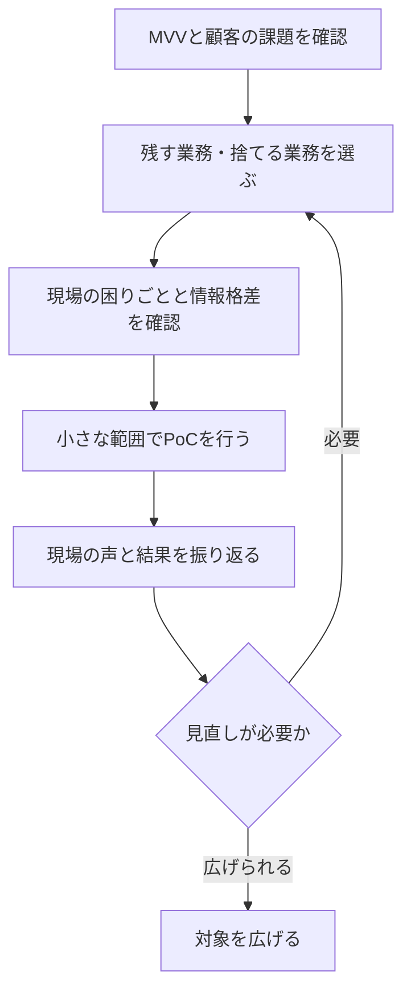

<!-- TARGET_KW: DX IT化 違い -->
<!-- READER: S3-義務-学習中 / 検索 -->
<!-- ANSWER: 道具の導入ではなく価値と業務の変革を見る -->
<!-- TAKEAWAY: MVV・取捨選択・現場支援からPoCへ進む順序 -->

DXとは、データとデジタル技術で製品・サービスや業務・組織を変革し、競争上の優位性につなげることです。IT化との違いを考えるときは、導入した道具より、顧客への価値や仕事の進め方がどう変わるかを見ます。

DX推進を任された人に向けて、目的・業務の取捨選択・現場の参加という3つの判断軸と、小さく試す順序を整理します。

## DXとは｜IT化との違い

<strong>DX（デジタルトランスフォーメーション）</strong>は、データとデジタル技術を活用して、製品やサービス、ビジネスモデル、組織、企業文化を変革し、競争上の優位性を確立することです。定義とIT化との関係は[IPAのDX推進指標の解説](https://www.ipa.go.jp/digital/dx-suishin/dx-promotion-lp/)でも確認できます（2026年11月時点）。

用語があるだけで正解とはせず、具体的な変革の内容まで読み取ります。

IT化（デジタル化）との違いは、<strong>手段か、目的に近いか</strong>です。

| 区分 | 内容 | 例 |
| --- | --- | --- |
| IT化（デジタル化） | 既存の業務を効率化するために、情報技術を導入する。手段 | 紙の帳票を電子化する。手作業のデータ入力をシステムに置き換える |
| DX | データとデジタル技術で、顧客の体験やビジネスモデル、組織文化を根本から変え、新しい価値を作る | 購入データを分析して、品ぞろえや生産量を自動で調整し、新しい顧客層に向けたサービスを作る |

紙の伝票をPDFにするだけでは、DXではなく、IT化止まりです。PDFにしたデータをリアルタイムで分析して、経営状況を見える化し、迅速な判断や新しいサービスにつなげてはじめて、DXと言えます。

老舗のパン屋で言えば、POSレジを入れて会計を早くしたのはIT化、購入データをAIで分析して、曜日や天気に合わせて焼くパンの種類と数を調整し、食品ロスを減らしたのがDXです。

試験では、次のキーワードがセットで出ます。

| キーワード | 内容 |
| --- | --- |
| データとデジタル技術の活用 | AI、IoT、クラウドで集めたデータを、需要予測やレコメンドに使う |
| 顧客・社会のニーズ | 顧客体験（CX）の向上、新しい価値の提供、社会課題への対応 |
| ビジネスモデル・組織・文化の変革 | 部門横断のチーム、リスキリング（学び直し）、失敗を恐れず挑戦できる文化 |
| 競争上の優位性の確立 | 新規事業、差別化、市場シェアの拡大が最終的なゴール |

では、実際にDXを任されたとき、何から手をつけるのか。ここからは、推進担当者の視点に切り替えて、必要なスキルを見ていきます。

## なぜDX推進は「システム導入」ではなく「取捨選択」なのか

新しいクラウドツールを導入しても、現場のベテラン層が使ってくれない——DXでよく起きる失敗です。原因は、ツールという「手段」から入り、「何のために、何を変えるのか」という<strong>取捨選択の軸</strong>を後回しにしてしまうことにあります。

DXを進める担当者に必要なのは、道具の知識より先に、次の3つのスキルです。

1. <strong>目的からブレない軸を持つ力</strong>
2. <strong>何を残し、何を捨てるか判断する力</strong>
3. <strong>現場を置き去りにしない力</strong>

取りかかる場所は、次の条件で選べます。

- 目的を説明できないなら、ツール選定より先にMVVと顧客の課題を確認する
- 不要な作業が残っているなら、そのまま電子化せずBPRの観点で見直す
- 使えない人がいるなら、操作支援と現場の声の収集を先に設計する

次の図は、これらの判断を小さな試行につなげる順序です。



## スキル1：目的からブレない軸を持つ力

「このクラウドツールは便利ですよ」という説明だけでは、人は動きません。まず立ち返るべきは、自社の<strong>経営理念（MVV：ミッション・ビジョン・バリュー）</strong>です。

「私たちのサービスで、お客様をどう幸せにしたいか。そのために、このツールがどう役立つか」を語れて初めて、DXは目的の達成（Purpose）のための手段になります。

MVVそのものの定義や作り方は[経営理念とMVVとは？](/theory/corporate-mission-mvv/)で詳しく解説しています。

## スキル2：何を残し、何を捨てるか判断する力

既存の業務フローをすべてデジタル化しようとすると、予算も時間も足りません。DX推進担当者に求められるのは、<strong>「この作業は本当に必要か」を一度疑い、不要なものは削除する</strong>という判断です。

単なるIT化（紙をPDFにするだけ）と、業務プロセスそのものを作り直すBPR（業務プロセス再設計）の違いも、この取捨選択の視点を持っているかどうかで分かれます。既存業務の改善・再設計の考え方は[BPR・BPMとは？改革と改善の違い](/theory/bpr-bpm-business-process-improvement-basics/)を参照してください。

## スキル3：現場を置き去りにしない力

ツールを導入した結果、ITに強い若手と苦手な年配層の間に<strong>デジタルディバイド（情報格差）</strong>が生まれることがあります。「使い方が分からないから紙に戻ってしまう」「IT化は若手の仕事だと関心を持たない」という分断を放置すると、組織のコミュニケーション不全を引き起こします。

デジタルディバイドそのものの定義は[デジタルディバイドとは？](/theory/digital-divide-basics/)で解説しています。

現場に置き去りにされた不満は、<strong>シャドーIT</strong>（部門ごとに独自運用されるExcelや個人SaaS）という形で表面化しがちです。これは単なるルール違反ではなく、「公式システムが現場の業務実態に追いついていない」というシグナルとして受け止める必要があります。

また、ベテラン層が持つ業務ノウハウが口伝えのまま残る<strong>暗黙知の属人化</strong>も、DXの遅延要因になりやすい論点です。手順化・テンプレート化・用語統一まで設計して初めて、IT導入は業務変革になります。

## 小さく試して学ぶ姿勢

取捨選択の判断を一度に完璧に下すことはできません。ここで役立つのが、2027年度向けのITパスポート試験シラバス<strong>案</strong>にある「ビジネス変革の方法論」「マインド・スタンス」の考え方です。

2026年11月時点の案であり、変更される可能性があります。[IPAのシラバス案掲載ページ](https://www.ipa.go.jp/shiken/syllabus/henkou/2026/20260630.html)

最小限の製品で仮説検証を繰り返す<strong>リーンスタートアップ</strong>、試作品で実現可能性を検証する<strong>PoC（概念実証）</strong>という手法を使えば、「全社導入して失敗する」リスクを避け、小さな範囲で試してから広げられます。反復的に試して学ぶアジャイルマインド、短い期間で区切って進めるスプリント、その振り返りであるふりかえり（KPT：Keep・Problem・Try）も、DX推進を一歩ずつ前進させるための実務的な型です。

## 現場の声を拾う設計思考

「何を残すか」を決めるには、現場が本当に困っていることを正しく把握する必要があります。利用者を起点にプロダクトやプロセスを設計する<strong>人間中心設計</strong>、課題発見から解決までを共感→問題定義→アイデア創出→試作→検証という流れで進める<strong>デザイン思考</strong>、利用者の行動を時系列で可視化するカスタマージャーニーマップは、DX推進担当者が現場の声を拾い上げるための具体的な道具です。

「使いにくい」という現場の声はUX（ユーザー体験）の改善点、「怖い」という声はセキュリティ管理の不安の裏返しだと捉え、丁寧に拾い上げましょう。

## Syllabus Hack Points：AIに反対派を説得するプランを作らせる

「何度説明しても、新しいやり方を拒否する人がいる」というときは、AIにチェンジマネジメント（変革管理）のアドバイスを求めましょう。

```text
ITパスポートの「DX」について学びたいです。
ある老舗のパン屋が「IT化止まりで失敗した例」と「DXに成功した例」を対比させて、物語風に説明してください。
```

```text
SaaSによる営業支援システムの導入を進めていますが、ベテラン社員から「これまでのやり方が一番早い」と反対されています。MVV（自社の目的）とデジタルディバイド解消の観点から、この反対派の社員に寄り添いつつ前向きに参加してもらうための3つのコミュニケーションプランを、ITパスポートの用語を使って提案してください。あわせて、いきなり全社導入するのではなく、PoCやリーンスタートアップの考え方でどう小さく始めるべきかも教えてください。
```

AIの回答をそのまま使うのではなく、<strong>「自社なら何を残し、何を捨てるか」</strong>を自分の言葉で言い換えてみましょう。取捨選択の軸を自分で説明できるようになれば、DX推進担当者としての実務にも試験対策にも直結します。

## まとめ

DX推進で最初に選ぶ作業は、目的が曖昧ならMVVの確認、無駄があるなら業務の見直し、参加できない人がいるなら操作支援です。

1. <strong>MVVで目的の軸を示し</strong>（[経営理念とMVVとは？](/theory/corporate-mission-mvv/)）
2. <strong>BPRの視点で何を残し何を捨てるか判断し</strong>（[BPR・BPMとは？](/theory/bpr-bpm-business-process-improvement-basics/)）
3. <strong>デジタルディバイドを埋めて全員で進み</strong>（[デジタルディバイドとは？](/theory/digital-divide-basics/)）
4. <strong>PoCやデザイン思考で小さく試しながら学ぶ</strong>

基礎から学ぶなら[ITパスポートの20時間コース](/course/ip/)と[合格ロードマップ](/method/itp-hub/)へ進めます。2027年度の案と教材の対応は[IPA新試験の対策一覧](/method/ipa-2027-new-exam-hub/)で確認できます。
