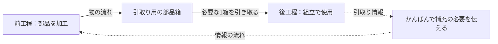

<!-- TARGET_KW: ジャストインタイム かんばん方式 違い -->
<!-- READER: S3-知的好奇心-学習中 / 検索｜JITと手段のかんばんを混同する社会人 -->
<!-- ANSWER: JITは必要なものを必要な時に必要な量だけ用意する考え方、かんばんは後工程の引取りと補充を伝える手段。 -->
<!-- TAKEAWAY: 目的と手段、物と情報の逆向きの流れ、在庫削減の前提 -->

ジャストインタイム（JIT）とかんばん方式は、同じ説明の中によく出てきます。ただし、一方は目指す生産の考え方、もう一方はそれを支える情報の仕組みです。

この記事では、架空の部品箱を使って後工程引取りをたどります。「必要な分だけ作る」がどう成立するのか、在庫を減らす前に何を整えるかまで整理できます。

## ジャストインタイムは考え方、かんばん方式は手段

<strong>ジャストインタイム</strong>は、必要なものを必要な時に必要な量だけ生産・供給する考え方です。トヨタの公式解説でも、工程を連携させ、必要な部品を必要な数だけ届ける仕組みとして説明されています。[出典：トヨタ自動車「よく分かるトヨタ生産方式」](https://global.toyota/jp/company/plant-tours/production-system/)

<strong>かんばん方式</strong>は、その実現を支える手段です。後工程が引き取るものや数量などを、かんばんの情報で前工程に伝えます。トヨタの歴史資料でも、JITを実施する道具としてかんばんが位置づけられています。[出典：トヨタ自動車75年史「ジャスト・イン・タイムの起源」](https://www.toyota.co.jp/jpn/company/history/75years/text/taking_on_the_automotive_business/chapter2/section4/item5.html)

つまり「JITを実現するため、かんばんで引取り・生産の情報を伝える」という関係です。かんばんを置くだけで、生産全体が自動的に最適化されるわけではありません。

## 後工程引取りの流れを部品箱で考える

説明用に、前工程で部品を加工し、後工程で組み立てる工場を仮定します。部品は1箱10個入り、かんばんは箱と補充の情報を結びつけるものとします。

後工程が1箱分を引き取ったら、その情報を前工程に戻し、引き取られた分の補充につなげます。数値は理解のための架空設定です。



図は原理を示した簡略図です。実際のかんばんの種類や運用手順をすべて示すものではありません。

注目するのは、物は前工程から後工程へ、必要量の情報は後工程から前工程へ伝わる点です。前工程の都合で作れるだけ作って押し出す仕組みとは、補充のきっかけが違います。

## プル方式とプッシュ方式を見分ける

| 条件 | 判断 | 確認する理由 |
| --- | --- | --- |
| 後工程の引取り・使用量を受けて補充する | プル型の説明 | 後工程からの要求が作業のきっかけになる |
| 需要予測や生産計画に従って前工程から送り出す | プッシュ型の説明 | 前もって決めた計画が作業のきっかけになる |
| 在庫が多いので、補充条件を変えず保管場所だけ減らす | JITを実現したとは判断できない | 量・タイミングを制御する仕組みが確認できない |

プル型でも、生産計画や需要予測が不要になるわけではありません。試験学習では「計画があるか」より、目の前の補充を何が引き起こしたかを見ると区別しやすくなります。

## 在庫を減らす前に、補充と品質の条件を整える

在庫が少ないほど、補充の遅れや不良の影響が次の工程に伝わりやすくなります。「在庫ゼロ」という言葉だけを目標にせず、次の条件を確かめます。

- 補充に時間がかかるなら、引取りから次の補充までに必要な量を確保できるかを先に調べる。
- 不良や設備停止が多いなら、品質や復旧の課題を先に把握する。
- 日ごとの負荷が大きく違うなら、作業量のならし方や補充能力を検討する。

これは導入の成否を断定する基準ではなく、「減らしても次工程が動くか」を考えるための確認観点です。

ソフトウェア開発のタスクボードも、作業の状態を見えるようにするために使われます。ただし「未着手・作業中・完了」の列を作ることだけでは、生産かんばんの引取り・補充の仕組みを説明したことにはなりません。

## 生成AIに、在庫が減る理由を問い返してもらう

```text
JITとかんばん方式の関係を理解したいです。
架空の工場で、後工程が10個入りの部品箱を1箱引き取り、
前工程がその情報を受けて10個補充するとします。
私に「なぜ前工程が好きなだけ作らないのか」を説明させてください。
その後、補充に時間がかかる条件を加え、
在庫を減らすだけでは困る理由を問い返してください。
実在工場の成果や最適な在庫量は推測しないでください。
```

<!-- AI_EXAMPLE: 使うAI=ChatGPT / プロンプト=本文「在庫が減る理由」 / 見せたいこと=後工程引取りと補充時間の関係を説明する対話。実行結果は筆者が用意 -->

---

## まとめ：補充のきっかけを見る

JITは必要量を必要なタイミングで供給する考え方、かんばんは引取り・補充の情報を伝える手段です。事例では「誰の要求で、いつ、何を補充するか」を確かめましょう。

生産管理を企業活動の中で学び直すなら[ITパスポート20時間コース](/course/ip/)、学習範囲全体は[合格ロードマップ](/method/itp-hub/)が入口になります。

本記事は受験体験ではなく、公式の生産方式解説と学習用の架空例をもとにしています。
